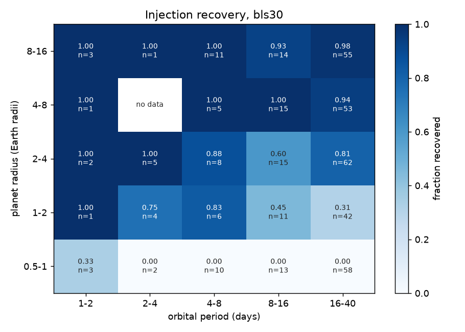
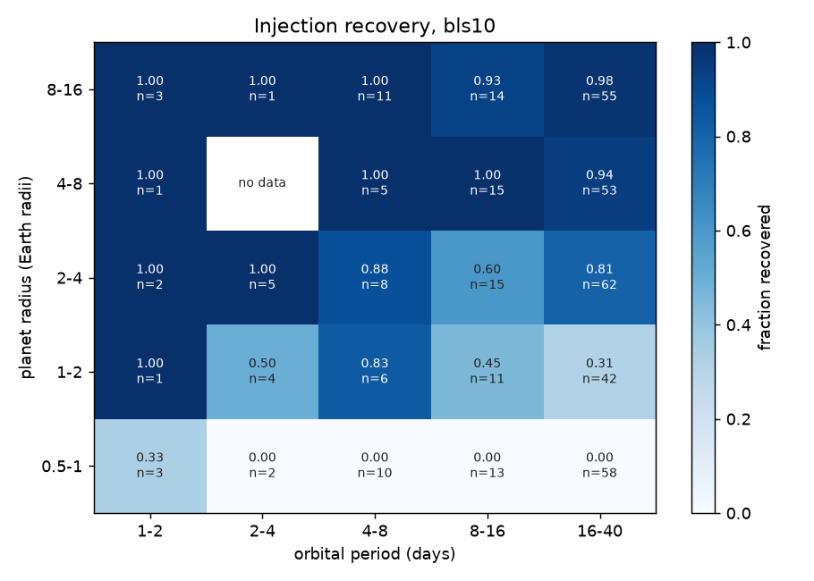

# Injection recovery (20261009T181208Z-benchmark-inject-0801864-5082)

| engine | injections | recovered | alias | median_runtime_s |
|---|---|---|---|---|
| bls10 | 400 | 0.632 | 0 | 265 |
| bls30 | 400 | 0.635 | 0 | 120 |

## By expected SNR

| engine | bin | count | fraction |
|---|---|---|---|
| bls10 | [0.0, 5.0) | 95 | 0 |
| bls10 | [5.0, 7.0) | 14 | 0 |
| bls10 | [7.0, 10.0) | 19 | 0.105 |
| bls10 | [10.0, 15.0) | 22 | 0.636 |
| bls10 | [15.0, 20.0) | 15 | 0.8 |
| bls10 | [20.0, 50.0) | 52 | 0.904 |
| bls10 | [50.0, inf) | 183 | 0.973 |
| bls30 | [0.0, 5.0) | 95 | 0 |
| bls30 | [5.0, 7.0) | 14 | 0 |
| bls30 | [7.0, 10.0) | 19 | 0.105 |
| bls30 | [10.0, 15.0) | 22 | 0.682 |
| bls30 | [15.0, 20.0) | 15 | 0.8 |
| bls30 | [20.0, 50.0) | 52 | 0.904 |
| bls30 | [50.0, inf) | 183 | 0.973 |

