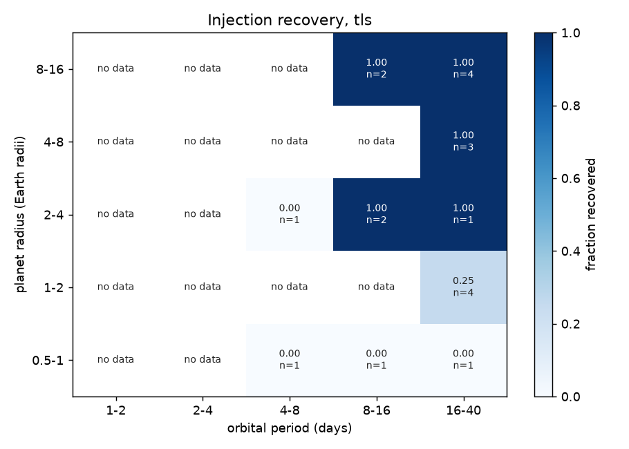

# Injection recovery (20261009T202102Z-benchmark-inject-c7a2625-6dae)

| engine | injections | recovered | alias | median_runtime_s |
|---|---|---|---|---|
| tls | 20 | 0.65 | 0 | 642 |

## By expected SNR

| engine | bin | count | fraction |
|---|---|---|---|
| tls | [0.0, 5.0) | 3 | 0 |
| tls | [5.0, 7.0) | 2 | 0 |
| tls | [7.0, 10.0) | 0 | nan |
| tls | [10.0, 15.0) | 2 | 0.5 |
| tls | [15.0, 20.0) | 3 | 0.667 |
| tls | [20.0, 50.0) | 2 | 1 |
| tls | [50.0, inf) | 8 | 1 |

