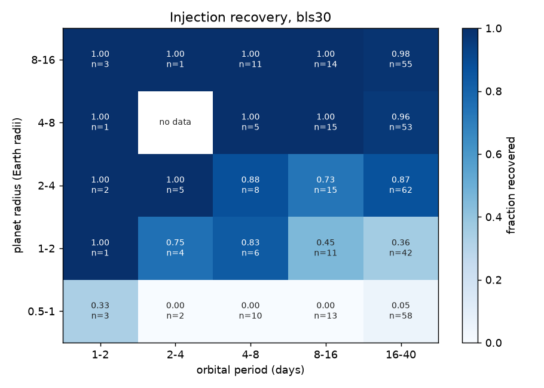

# Injection recovery (20261013T012920Z-benchmark-inject-b62e857-d86f)

Replay of an earlier run's `injections.csv` (sha256 in provenance.json): 400 of its 400 `bls30` injections with status ok. `--per-star` and `--seed` are ignored.

| engine | injections | recovered | alias | median_runtime_s |
|---|---|---|---|---|
| bls30 | 400 | 0.667 | 0 | 118 |

## By expected SNR

| engine | bin | count | fraction |
|---|---|---|---|
| bls30 | [0.0, 5.0) | 95 | 0.0105 |
| bls30 | [5.0, 7.0) | 14 | 0 |
| bls30 | [7.0, 10.0) | 19 | 0.316 |
| bls30 | [10.0, 15.0) | 22 | 0.727 |
| bls30 | [15.0, 20.0) | 15 | 0.867 |
| bls30 | [20.0, 50.0) | 52 | 0.962 |
| bls30 | [50.0, inf) | 183 | 0.989 |

