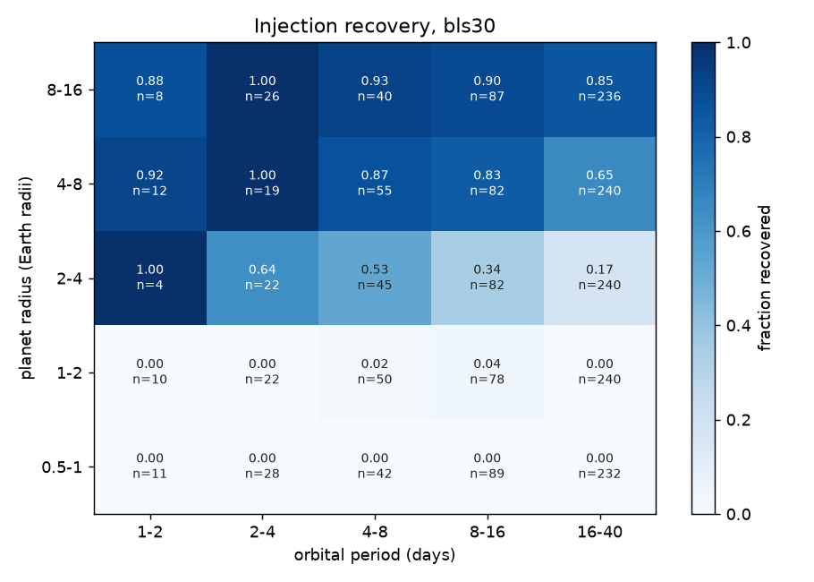

# Injection recovery (20261015T131443Z-benchmark-inject-fe29585-8496)

Recovered: a signal at the injected ephemeris with SDE 20.2449 or above (the threshold in `threshold.json`).

| engine | injections | recovered | alias | median_runtime_s |
|---|---|---|---|---|
| bls30 | 2000 | 0.385 | 0.0055 | 38 |

## By expected SNR

| engine | bin | count | fraction |
|---|---|---|---|
| bls30 | [0.0, 5.0) | 755 | 0 |
| bls30 | [5.0, 7.0) | 89 | 0 |
| bls30 | [7.0, 10.0) | 105 | 0 |
| bls30 | [10.0, 15.0) | 111 | 0.0541 |
| bls30 | [15.0, 20.0) | 79 | 0.43 |
| bls30 | [20.0, 50.0) | 290 | 0.686 |
| bls30 | [50.0, inf) | 571 | 0.928 |

