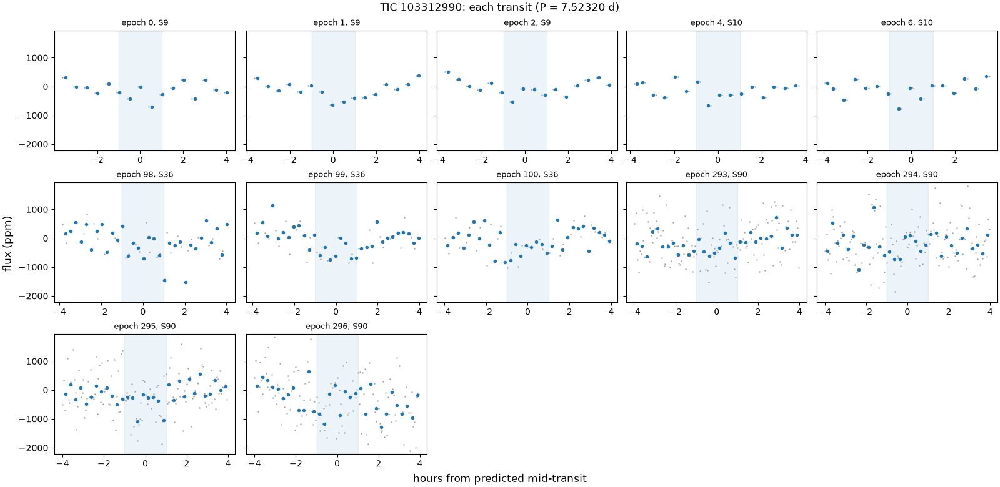
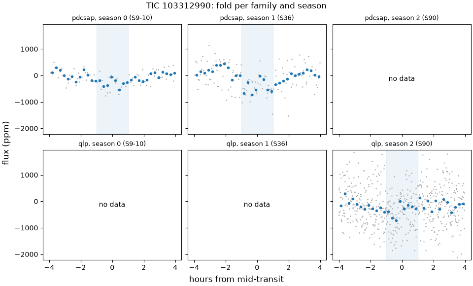
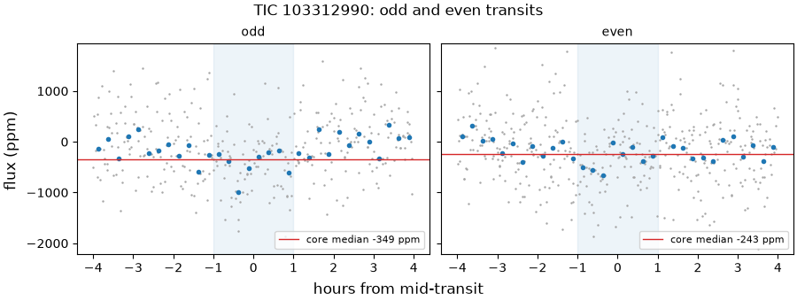
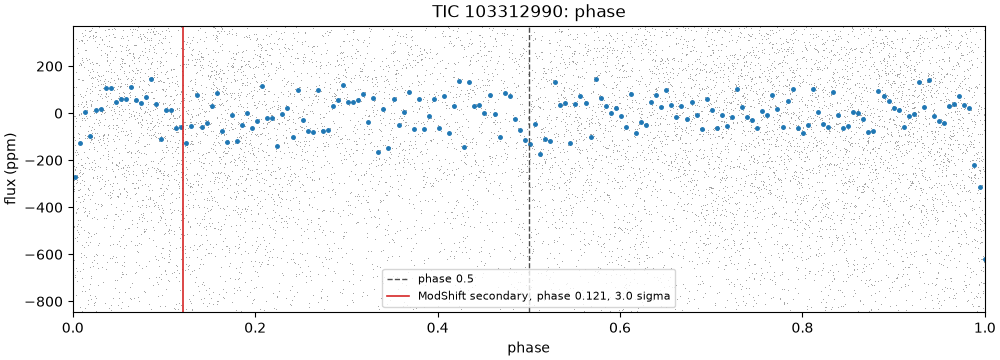
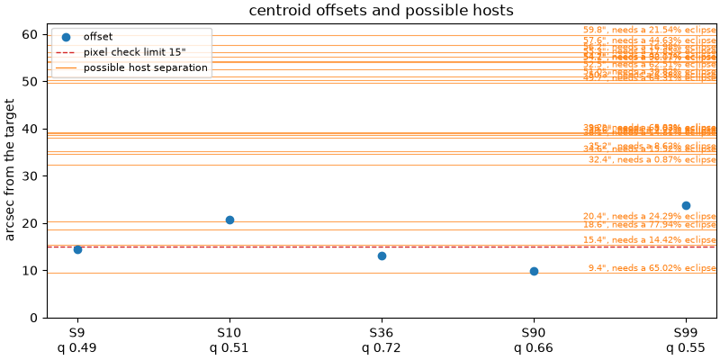

# 103312990-1: TIC 103312990

Call: **held** on 2026-10-22. Rendered from the files in this directory ([decision 0028](../../../docs/decisions/0028-outcomes-and-calls.md)); the review and the call are quoted, not rendered ([decision 0037](../../../docs/decisions/0037-quoted-text-in-the-dossier.md)).

## Signal and star

|  |  |
|---|---|
| Signal | 103312990-1, a shortlisted candidate |
| Names | TIC 103312990, Gaia DR3 5365550158677776896, HD 297321, TYC 8188-2433-1, 2MASS J10271901-4731132 |
| Ephemeris (the search's box) | period 7.523205 d, epoch BTJD 1545.9350, duration 0.0833 d (2.00 h), depth 364 ppm |
| Star (TIC) | Teff 5624 K, radius 1.19 solar radii, Tmag 9.57 |
| RUWE (Gaia DR3) | 6.21 |
| CROWDSAP | S9 0.941; S10 0.944; S36 0.937; none published for S90 (QLP), S99 (QLP) |
| Sectors vetted | PDCSAP family: 9, 10 and 36; QLP family: 90; left out as timing-suspect: 99 |
| Criteria | search-v2, vet-v3 |
| Runs | vetting 20261020T174317Z-vetting-run-61b5944-2d70 (commit 61b5944, production); TRICERATOPS 20261021T194348Z-vetting-triceratops-cd4e7a2-7821 (commit cd4e7a2, production); literature 20261021T001540Z-vetting-literature-61b5944-07de (commit 61b5944, production); evidence-only vetting 20261020T175536Z-vetting-run-61b5944-7f4e (commit 61b5944, production); titles 20261026T155726Z-vetting-titles-0b1deac-1d19 (commit 0b1deac, production) |

## Checks

vet-v3's checks first, then the neighbour table (evidence, never a fail), triage's pixel check, TRICERATOPS and the literature search.

| Check | Outcome | Reason |
|---|---|---|
| novelty | pass | no known object matches |
| odd_even | pass | pdcsap: odd and even depths agree within 1.2 sigma; qlp: odd and even depths agree within 0.6 sigma |
| secondary | pass | no dip at phase 0.5 (2.5 sigma) |
| sector_depth | pass | pdcsap: depths agree across 2 sectors (p = 0.88) |
| holdout | inconclusive | 1 season(s) could be tested; need 2 |
| signal_present | pass | combined depth is 7.1 sigma |
| shape | pass | U-shaped: grazing in 0% of samples |
| density | pass | transit and TIC densities agree (0.2 sigma) |
| radius | pass | 2.3 Earth radii |
| neighbours | pass | 21 of 55 neighbours could host the signal |
| pixels | pass | centroid offset 13.1" within 15" |
| triceratops | inconclusive | RUWE 6.21 > 1.4: an unresolved companion the priors don't condition on |
| literature | pass | complete: 7 hits to screen |

## On the star?

Centroids, from triage's pixel check (pass, centroid offset 13.1" within 15"): the difference-image centroid's offset from the target in each sector. Triage's pass rests on the best-quality sector's offset, S36's.

| Sector | Offset (arcsec) | Quality | Note |
|---|---|---|---|
| 9 | 14.4 | 0.49 |  |
| 10 | 20.7 | 0.51 |  |
| 36 | 13.1 | 0.72 | the offset triage judged |
| 90 | 9.8 | 0.66 |  |
| 99 | 23.8 | 0.55 | timing-suspect: vet-v3 leaves it out |

Neighbours (pass): 21 of 55 neighbours could host the signal. Each Gaia DR3 star that could make the dip, with its separation from the target (Gaia DR3 5365550158677776896, J2016.0) and the eclipse depth it would need, scaled from the depth in the signals file (364 ppm) as if all its light fell in the aperture, and the TRICERATOPS star matched to it with the distance between them at the TIC's epoch:

| Star | Separation (arcsec) | Eclipse needed | TRICERATOPS's star (distance) | Its depth |
|---|---|---|---|---|
| Gaia DR3 5365550188738551040 | 9.4 | 65% | TIC 103312987 (0.1") | 68.6% |
| Gaia DR3 5365550193037516288 | 15.4 | 14.4% | TIC 864915227 (0.0") | 16.1% |
| Gaia DR3 5365553109321276160 | 18.6 | 77.9% | TIC 864916052 (0.0") | 82.5% |
| Gaia DR3 5365550193037515520 | 20.4 | 24.3% | TIC 103312995 (0.0") | 29.7% |
| Gaia DR3 5365550193037516032 | 32.4 | 0.873% | TIC 103312997 (0.0") | 1.53% |
| Gaia DR3 5365550158677773568 | 34.6 | 15.5% | TIC 103313005 (0.0") | 22.8% |
| Gaia DR3 5365550158677773312 | 35.2 | 8.62% | TIC 103313002 (0.0") | 11.8% |
| Gaia DR3 5365550193037517312 | 38.1 | 14.8% | TIC 103312980 (0.0") | 29.1% |
| Gaia DR3 5365553113615275264 | 38.6 | 7.72% | TIC 103312983 (0.0") | 10.1% |
| Gaia DR3 5365553113615274752 | 39.0 | 8.03% | TIC 103312986 (0.0") | 11.3% |
| Gaia DR3 5365553143673489152 | 39.2 | 65.8% | TIC 864916063 (0.0") | 70.3% |
| Gaia DR3 5365553109313739776 | 49.7 | 64.3% | TIC 864916051 (0.0") | 0% |
| Gaia DR3 5365550193037518720 | 50.3 | 6.38% | TIC 103312961 (0.0") | 11.3% |
| Gaia DR3 5365550124318040960 | 51.0 | 39.8% | TIC 103312985 (0.0") | 0% |
| Gaia DR3 5365553006234492288 | 52.5 | 62.5% | TIC 103313007 (0.0") | 0% |
| Gaia DR3 5365553143673496576 | 54.1 | 98.1% | TIC 103312962 (0.0") | 0% |
| Gaia DR3 5365553109313748736 | 54.2 | 32.1% | TIC 103312972 (0.0") | 60.1% |
| Gaia DR3 5365550497973622784 | 55.3 | 17.9% | TIC 103312981 (0.0") | 0% |
| Gaia DR3 5365553113615275136 | 56.2 | 17% | TIC 103312976 (0.0") | 41.6% |
| Gaia DR3 5365550566693107584 | 57.6 | 44.6% | TIC 103312973 (0.0") | 0% |
| Gaia DR3 5365550055598557056 | 59.8 | 21.5% | TIC 103313020 (0.0") | 0% |

TRICERATOPS (inconclusive) took sectors 36 at 600 s and folded them on the density-prior fit's ephemeris. It gave a mean NFPP 0.0198 (sd 0.00023) over 10 run(s) of 1000000 draws. Possible hosts it did not weigh: none. It gave zero depth to Gaia DR3 5365553109313739776 (TIC 864916051), Gaia DR3 5365550124318040960 (TIC 103312985), Gaia DR3 5365553006234492288 (TIC 103313007), Gaia DR3 5365553143673496576 (TIC 103312962), Gaia DR3 5365550497973622784 (TIC 103312981), Gaia DR3 5365550566693107584 (TIC 103312973), Gaia DR3 5365550055598557056 (TIC 103313020): its apertures take too little of each one's light to make the dip. Evidence for the review, not a blocker ([decision 0026](../../../docs/decisions/0026-triceratops.md)).

RUWE 6.21 (Gaia DR3). A high RUWE points to an unresolved companion, which TRICERATOPS's priors don't condition on; above vet-v3's limit, or without a RUWE, TRICERATOPS is inconclusive.

## A planet rather than a binary?

- Odd and even transits: pass, pdcsap: odd and even depths agree within 1.2 sigma; qlp: odd and even depths agree within 0.6 sigma.
- Secondary at phase 0.5: pass, no dip at phase 0.5 (2.5 sigma).
- Secondary at any phase (LEO-Vetter's ModShift, from triage): the strongest secondary is 3.01 sigma at phase 0.121, depth 118 ppm; primary 10.1 sigma, tertiary 2.58 sigma at phase 0.379, positive 2.43 sigma at phase 0.424; Fred 1.09.
- The search's other signals on the star: rank 2 at 33.2130 d (period ratio 4.41, SDE 9.6).
- Shape (flat-prior fit): pass, U-shaped: grazing in 0% of samples; median b 0.53.
- Density (flat-prior fit): pass, transit and TIC densities agree (0.2 sigma).
- Radius: pass, 2.3 Earth radii. Rp is 2.31 Earth radii from the flat-prior fit and 2.20 (16th to 84th percentile 1.97 to 2.53) from the density-prior fit; the radius check reads the flat-prior fit.
- Density-prior fit (the TIC density as a prior), whose parameters M4 uses: Rp 2.20 Earth radii (16th to 84th percentile 1.97 to 2.53), b 0.57 (-0.25, +0.18), a/R* 13.77 (-0.93, +1.00), period 7.523159 d (sd 0.00013), t0 BTJD 1545.9487 (sd 0.0098 d).
- TRICERATOPS (inconclusive): mean FPP 0.0587 (sd 0.0011) over 10 run(s) of 1000000 draws.

## Real and new?

- Signal present: pass, combined depth is 7.1 sigma.
- Held-out seasons: inconclusive, 1 season(s) could be tested; need 2.
- Sector depths: pass, pdcsap: depths agree across 2 sectors (p = 0.88).
- Novelty, against the catalog snapshot: pass, no known object matches.
- Literature by name (TIC 103312990, Gaia DR3 5365550158677776896, HD 297321, TYC 8188-2433-1, 2MASS J10271901-4731132) and NASA ADS: pass, complete: 7 hits to screen. The hits are listed below.

ExoFOP, read live: TOIs none; CTOIs none; confirmed planets none.

## Next TESS looks

tess-point places the star in sectors 110, 111, 112 and 113.

Each transit predicted in those sectors, from the density-prior fit's posterior (epochs count periods from its t0); duration 0.1466 d from the density-prior fit. Mid (UTC) is when the transit is seen from Earth: the barycentric time less the light's travel time toward the star:

| Sector | Epoch | Mid (BTJD) | Mid (UTC) | sd (min) | 1 sigma half-width (min) | 3 sigma half-width (min) |
|---|---|---|---|---|---|---|
| 110 | 372 | 4344.563 | 2026-10-31 01:33 | 62.3 | 62.3 | 186.8 |
| 110 | 373 | 4352.086 | 2026-11-07 14:06 | 62.5 | 62.5 | 187.4 |
| 110 | 374 | 4359.609 | 2026-11-15 02:39 | 62.7 | 62.7 | 188.0 |
| 110 | 375 | 4367.132 | 2026-11-22 15:12 | 62.8 | 62.8 | 188.5 |
| 111 | 376 | 4374.656 | 2026-11-30 03:45 | 63.0 | 63.0 | 189.1 |
| 111 | 377 | 4382.179 | 2026-12-07 16:17 | 63.2 | 63.2 | 189.6 |
| 111 | 378 | 4389.702 | 2026-12-15 04:50 | 63.4 | 63.4 | 190.2 |
| 112 | 379 | 4397.225 | 2026-12-22 17:23 | 63.6 | 63.6 | 190.8 |
| 112 | 380 | 4404.748 | 2026-12-30 05:55 | 63.8 | 63.8 | 191.3 |
| 112 | 381 | 4412.271 | 2027-01-06 18:28 | 64.0 | 64.0 | 191.9 |
| 112 | 382 | 4419.795 | 2027-01-14 07:01 | 64.2 | 64.2 | 192.5 |
| 113 | 383 | 4427.318 | 2027-01-21 19:34 | 64.3 | 64.3 | 193.0 |
| 113 | 384 | 4434.841 | 2027-01-29 08:06 | 64.5 | 64.5 | 193.6 |
| 113 | 385 | 4442.364 | 2027-02-05 20:39 | 64.7 | 64.7 | 194.2 |

2-min data and the DDT ask ([decision 0026](../../../docs/decisions/0026-triceratops.md)): which stars get 2-min data in a sector is decided per cycle, so tess-point can't say whether these sectors will have it. In the sectors fetched, the star never had SPOC 2-min data (QLP at 600 and 200 s; TESS-SPOC at 1800 and 600 s). Held: the DDT ask applies only on the maintainer's call and only when the deciding evidence is the transit's shape; a hold on blending does not go, since 2-min data come from the same pixels. Deciding evidence: Seeing-limited ground-based photometry on a predicted transit that resolves the neighbours (F1); high-resolution imaging that finds or bounds the companion (F2); the sector 110 to 113 light curves or a QLP redelivery of sector 99 for a second held-out season (F3). Under vet-v3 TRICERATOPS stays inconclusive on the high RUWE whatever the imaging shows, so a pass also needs a recorded decision on how imaging clears that blocker.

## Plots

Each transit, against hours from its predicted mid-time:

The fold in each season and each product family:

Odd and even transits side by side:

The whole orbit, with phase 0.5 and LEO-Vetter's ModShift secondary marked:

Triage's centroid offset per sector, with the neighbours that could host the signal:

## Catalogued rows on the star

No catalogued row on this star.

## Literature hits

7 paper(s) from the searches that answered, one row per paper. Titles come only from open sources: the search's own arXiv, OpenAlex and Zenodo hits, else OpenAlex's record for the paper's DOI; a paper none of them titles has a blank title ([decision 0038](../../../docs/decisions/0038-literature-trim-and-username-scrub.md)).

| Title | Id | Found by |
|---|---|---|
| A catalogue of stellar diameters and fluxes for mid-infrared interferometry★ | doi 10.1093/mnras/stz2803, arXiv 1910.00542 | ads TIC 103312990 |
|  | 1995A&AS..110..367N | ads TIC 103312990 |
|  | 2014ASPC..485..223B | ads TIC 103312990 |
| Comoving Stars in Gaia DR1: An Abundance of Very Wide Separation Comoving Pairs | doi 10.3847/1538-3881/aa6ffd, arXiv 1612.02440 | ads TIC 103312990 |
| Empirical photometric calibration of the Gaia red clump: Colours, effective temperature, and absolute magnitude | doi 10.1051/0004-6361/201731572, arXiv 1710.05803 | ads TIC 103312990 |
| Fundamental Properties of Co-moving Stars Observed by Gaia | doi 10.3847/1538-3881/aaaebe, arXiv 1801.00537 | ads TIC 103312990 |
|  | 1939cfsc.book.....S | ads TIC 103312990 |

## With the timing-suspect sectors (evidence only)

The same vet with the timing-suspect sectors kept in ([decision 0022](../../../docs/decisions/0022-vet-without-timing-suspect-sectors.md)). It is shown for comparison and never used for the call. Sectors it adds: 99.

| Check | Without them | With them | Reason with them |
|---|---|---|---|
| novelty | pass | pass | no known object matches |
| odd_even | pass | pass | pdcsap: odd and even depths agree within 1.2 sigma; qlp: odd and even depths agree within 0.4 sigma |
| secondary | pass | pass | no dip at phase 0.5 (2.3 sigma) |
| sector_depth | pass | pass | pdcsap: depths agree across 2 sectors (p = 0.88); qlp: depths agree across 2 sectors (p = 0.87) |
| holdout | inconclusive | pass | 2 held-out seasons predicted |
| signal_present | pass | pass | combined depth is 7.7 sigma |
| shape | pass | pass | U-shaped: grazing in 0% of samples |
| density | pass | pass | transit and TIC densities agree (0.2 sigma) |
| radius | pass | pass | 2.3 Earth radii |

## Review

Quoted from `review.json`, as the reviewer and the refuters wrote it: its numbers, paths and run names are theirs, not rendered from the runs ([decision 0037](../../../docs/decisions/0037-quoted-text-in-the-dossier.md)). [The vetting README](../README.md) says what its paths and run names stand for.

Reviewer claude-opus-5-5, 2026-10-20, updated 2026-10-21 and 2026-10-22. Tested all three lenses on 103312990-1 (HD 297321; 2.2 Earth radii at 7.52 d, 7.1 sigma), refitting triage's difference images and reading Gaia, SIMBAD and ExoFOP. Nothing kills it: the dip is in every sector at a steady depth, shows no binary signature on the target, and is not known. It is held on three counts: a nearby binary within 1' that the pixels and TRICERATOPS can't exclude (ground-based photometry decides), Gaia's unresolved companion at RUWE 6.21 (high-resolution imaging decides), and a held-out check with one testable season (a QLP S99 redelivery or S110 to S113 decide). Updated 2026-10-21 for the 0034/0035 rerun. Updated 2026-10-22 for the 0036 TRICERATOPS rerun.

A finding rated kill or hold is confirmed when no refuter refuted it; a note gets no refuters.

### F1 (on the star, hold): confirmed

Claim: A nearby eclipsing binary 15" to 60" from the target can't be excluded: the pixel check passes near its 15" limit with its fits leaning east toward possible hosts, and TRICERATOPS's NFPP of 0.0198 sits between its bars, near the two real nearby-binary controls, so only ground-based photometry that resolves the neighbours decides.

Evidence: Pixel check ($TESS_HUNT_DATA/drafts/m3-r2/103312990-1/checks.json, pixels): offsets S9 14.4", S10 20.7", S36 13.1" (quality 0.72, the sector triage judged; TESS-SPOC 600 s, not timing-suspect), S90 9.8", S99 23.8" (timing-suspect). Refit of triage's saved difference images ($TESS_HUNT_DATA/tdi/20261015T155441Z-triage-7b12e25-3f57/103312990-1/) with the pixel diagnosis's scripts, copied to /tmp/t13/103312990-1 (MSYS_NO_PATHCONV=1 wsl.exe -d Ubuntu-26.04 --cd /tmp/t13/103312990-1 -- bash -l -s, then P=~/code/tess-hunt/.venv/bin/python; /tmp/t13/heavy.sh $P sector_detail.py detail.json jobs.json; $P summary.py detail.json candidate): fits east, north of the target S99 +22.9", +6.6"; S90 +9.8, +1.1; S36 +12.3, -4.7; S10 +16.7, +12.2; S9 -12.1, +7.8 (position angles 74, 84, 111, 54, 303 deg); quality-weighted mean +10.4, +3.8 (11.1"), sky scatter 13.3" against detector scatter 15.5", so the sky-versus-detector test can't separate a source from noise. Mean offset in standard errors ($P stderr_cmp.py /tmp/pixel-diag/detail.json detail.json): 1.87, above every unsaturated known planet (1.42 at most; saturated TOI-144.01 4.02), below 295140687-1 (2.97, 'off-target source supported, weakly') and the three controls (7.83 to 26.61). No null image reaches any sector's quality (0 of 16 each; null median quality 0.12 to 0.30), so the images hold a real loss; box z at the target 3.9, 3.5, 3.9, 0.4, 2.6 against 5.1, 4.4, 3.3, 0.9, 2.6 expected for a transit on the target (S99, S90, S36, S10, S9): S10's image holds almost no transit, so its 20.7" says nothing. Fixed two-PRF fits (/tmp/t13/heavy.sh $P two_star.py two_star.json jobs_pairs.json pairs.json; two_star.txt) with TIC 864915227, 103312987, 103312995, 103312997 or 864916052 as the neighbour: no neighbour reaches z 3 (1.7 at most), the target -0.2 to 2.8; the diagnosis's rate for a neighbour at z 3 or more above the target is 1 of 75 unsaturated known-planet sectors and 10 of 15 control sectors. A single-PRF target-versus-star comparison calibrated on null images (/tmp/t13/heavy.sh $P which_star_cal.py; which_star_cal.txt) prefers TIC 864915227 to the target at z -3.1 in S90 (camera 2.1) and S99 (camera 3.2), but gives z -3 or lower in 18 of 75 known-planet sectors (4 of 15 planets in two or more) and in only 1 of 5 sectors of TOI-1058.01's real 20.9" binary, so it decides nothing. Possible hosts, separations from the target's own DR3 position ($P sep_dr3.py), TESS mag, eclipse needed, TRICERATOPS tdepth ($TESS_HUNT_DATA/drafts/m3-r2/103312990-1/triceratops.json hosts): TIC 103312987 9.41" (T 17.70, 65.0%, 68.6%), TIC 864915227 15.37" (16.06, 14.4%, 16.1%), TIC 864916052 18.63" (17.90, 77.9%, 82.5%), TIC 103312995 20.38" (16.63, 24.3%, 29.7%), TIC 103312997 32.37" (13.02, 0.87%, 1.53%), and 16 more 34.6" to 59.8" out needing 6.4% to 98.1% (dossier's neighbour table); the one host inside 15" needs a 65% eclipse. TRICERATOPS ($TESS_HUNT_DATA/drafts/m3-r2/103312990-1/triceratops.json): mean NFPP 0.0198 (sd 0.00023) over 10 runs, between nfpp_pass 0.001 and nfpp_fail 0.1 (criteria/vet-v3.toml), so inconclusive even without the RUWE blocker; decision 0032's real binaries at 20.9" and 23.5" read 0.027 and 0.0341. Largest NFPP terms ($TESS_HUNT_DATA/drafts/m3-r2/103312990-1/probs.csv, last run): NTP on TIC 103312997 0.0048, NEB on TIC 864915227 0.0028. The seven hosts it gave zero depth sit 49.7" to 59.8" out, beyond every pixel fit (23.8" at most). Its NFPP comes from one ephemeris (density-prior fit) and can move with it (0032). Deciding evidence: ground-based seeing-limited photometry at a predicted transit (dossier windows in S110 to S113), which resolves every possible host (all 9.4" or more out). 2-min data would not decide it: same pixels (0028). Updated 2026-10-21 for the 0034/0035 rerun: decision 0034 adds Gaia DR3 5365550055598557056 (TIC 103313020) as a possible host at 59.83" needing 21.5% (TRICERATOPS depth 0), so the claim's outer bound 57" to 60"; the hosts past the fifth, 15 at about 35" to 57" to 16 at 34.6" to 59.8" (the table now measures from the target's DR3 position, as sep_dr3.py did); TRICERATOPS's zero-depth hosts, six at 50.1" to 56.5" (the old table's TIC-epoch separations) to seven at 49.7" to 59.8", the new star among them; mean NFPP 0.0197995 to 0.0198004 (sd 0.000224 both) and the probs.csv terms quoted read the same at the digits given; the cited run files move from drafts/m3 to drafts/m3-r2. Updated 2026-10-22 for the 0036 TRICERATOPS rerun: the triceratops.json and probs.csv cited (same drafts/m3-r2 paths) are now TRICERATOPS run 20261021T194348Z-vetting-triceratops-cd4e7a2-7821's, not 20261020T181658Z-vetting-triceratops-61b5944-1bbf's; NFPP sd 0.00022 to 0.00023 (0.000224 to 0.000225) and mean 0.0198004 to 0.0198006, within 0036 item 5's run-to-run noise; dropped_stars lists TIC 103312957 (ARTIFACT) and TIC 864915594 (a DUPLICATE of TIC 103313054), 118" and 139" out (0036 item 3) and neither a host; the 21 hosts, their tdepths and the seven zero-depth hosts are unchanged, and the last run's NTP on TIC 103312997 (0.004828 to 0.004829) and NEB on TIC 864915227 (0.002753 both) read the same at the digits given.

- Refuter 1: did not refute. Every number F1 rests on reproduces, from the new run files or by rerunning its commands. My scratch is in /tmp/t13/103312990-1/addendum-0036/refute-F1-reproduce/.

TRICERATOPS:
- The drafts/m3-r2 triceratops.json and probs.csv have the same sha256 as TRIC3B_RUN's signals/103312990-1 copies (d9e41b0b..., 8cb751f1...).
- tric_check.py gives mean NFPP 0.0198006 and sd 0.000225 (stdev of the 10 runs, recomputed the same) against 0.0198004 and 0.000224 in pre-0036/1bbf. The 1.2e-5 relative move is inside 0036 item 5's 2.9e-3. ephemeris_from is fit_prior and the RUWE 6.21 blocker is unchanged.
- 21 hosts, unchanged. The five nearest have required depth and tdepth 0.6502/0.6856, 0.1442/0.1609, 0.7794/0.8254, 0.2429/0.2972 and 0.0087/0.0153.
- Seven zero-depth hosts at 49.65" to 59.83", the same as before. The largest nonzero-depth host is at 56.2".
- probs.csv, last run: NTP on TIC 103312997 is 0.004829 (was 0.004828) and NEB on TIC 864915227 is 0.002753 (both). These are the two largest N-scenario terms.
- dropped_stars lists 103312957 (ARTIFACT) and 864915594 (DUPLICATE of 103313054). dropped.py, run on pre-0036's star list, puts them 117.9" and 139.1" from the target. Neither is a host, and 0036 line 81 says "118" and 139"".

Neighbours:
- nb.py on neighbours.csv finds 21 possible hosts. The five nearest are at 9.41, 15.37, 18.63, 20.38 and 32.36" (32.37" recomputed from the DR3 position), with T 17.70, 16.06, 17.90, 16.63 and 13.02. The other 16 lie 34.63" to 59.83" out and need 6.38% to 98.07%.
- Gaia DR3 5365550055598557056 is at 59.83", needs 0.2154 and gets tdepth 0.

Thresholds and decisions:
- vet-v3.toml lines 92 and 93 set nfpp_pass 0.001 and nfpp_fail 0.1.
- 0032 gives 0.027 and 0.0341 for the binaries at 20.90" and 23.53".
- 0028 line 144: a hold on blending gets no DDT ask, since 2-min data come from the same pixels.
- The dossier's Next TESS looks section gives transit windows in S110 to S113 (upcoming_sectors [110, 111, 112, 113]).

Pixel check:
- checks.json has the same sha256 as VET2_RUN's (a513d03f...), and that is the input TRIC3B's provenance records.
- Offsets: S9 14.35", S10 20.68", S36 13.13" (quality 0.717), S90 9.81", S99 23.85". Max offset 15; the pass reason is S36's 13.1".
- S36 is TESS-SPOC at 600 s and not timing-suspect. dropped_suspect is [99].
- The triage pickles' sha256 match checks.json's file list.

Pixel refits, each run through /tmp/t13/heavy.sh with the venv python, exit 0:
- sector_detail.py writes a detail.json byte-identical to the reviewer's.
- summary.py gives fits S99 +22.9/+6.6, S90 +9.8/+1.1, S36 +12.3/-4.7, S10 +16.7/+12.2, S9 -12.1/+7.8. Mean +10.4/+3.8 (11.1"); sky scatter 13.3" against detector scatter 15.5". 0 of 16 nulls reach any sector's quality; null median quality 0.12 to 0.30. Box z at the target 3.9/3.5/3.9/0.4/2.6 against 5.1/4.4/3.3/0.9/2.6 expected.
- stderr_cmp.py gives 1.87 with PAs 74, 84, 111, 54 and 303. TOI-4307.01 is the highest unsaturated known planet at 1.42 (the diagnosis counts it as unsaturated); TOI-144.01 4.02, 295140687-1 2.97, controls 7.83 to 26.61.
- two_star.py gives a two_star.json identical to the reviewer's. No neighbour reaches z 3 (1.7 at most); the target runs -0.2 to 2.8.
- /tmp/pixel-diag/fixed_fit_rates.py gives 1 of 75 unsaturated known-planet sectors and 10 of 15 control sectors.
- which_star_cal.py, with its output path moved to my folder, gives a JSON identical to the reviewer's. wsc_count.py counts 18 of 75 known-planet sectors at z -3 or lower, 4 of 15 planets in two or more, and 1 of 5 sectors for TOI-1058.01. For the candidate, TIC 864915227 reads -3.07 in S99 (camera 3.2) and -3.08 in S90 (camera 2.1).

One omission, which doesn't refute F1: in S9 the same test also prefers TIC 864915216 (21.8", min z -3.67) and TIC 103312995 (-3.08). That only adds to the finding's point that the test decides nothing.
- Refuter 2: did not refute. I checked the finding against the rules and found no misread rule, no overstated evidence and no wrong rating.

1. **The pixel check.** docs/design.md (triage, "Pixels") says the pixel check fails a signal when the best-quality sector's offset is over 15". checks.json pixels has S36, quality 0.717, at 13.13" ("centroid offset 13.1\" within 15\""). S36 is TESS-SPOC 600 s. Under 0022, only S99 to S104 are timing-suspect. design.md's "known miss" note says a nearby binary (TOI-1399.01) passed the 15" rule at 11.63". So "passes near its 15" limit" does not exclude a nearby binary, and the finding does not claim the pixel check failed.

2. **TRICERATOPS.** criteria/vet-v3.toml sets nfpp_pass 0.001 and nfpp_fail 0.1. Design 4.5 calls anything between them inconclusive. triceratops.json gives nfpp_mean 0.0198006 with the RUWE 6.21 blocker, so "inconclusive even without the RUWE blocker" is right. The 0032 numbers (0.027 and 0.0341) and its line that "NFPP can move with the ephemeris" are quoted correctly. The comparison to the binaries is not overstated: in controls.csv of 20261020T082333Z-benchmark-controls-16418d2-f45a, every known planet has NFPP 0.00808 or less. The finding only says NFPP doesn't exclude a binary, not that it shows one.

3. **Zero-depth hosts (0026 Ruling M).** Ruling M says hosts TRICERATOPS gave zero depth are evidence for the on-star lens and the per-sector centroids. The finding does that: seven hosts at 49.7" to 59.8", against pixel fits of 23.8" at most. missing_hosts is [], so design 4.4's "missing host" blocker doesn't apply.

4. **The rating.** The brief's Ratings section, design 4.9 and 0028 define a hold as data that can't decide plus named deciding evidence, with ground-based photometry on the list. The finding names seeing-limited ground photometry. Its line that 2-min data would not decide it matches 0028's DDT note and design 4.5 ("held on blending ... 2-min data come from the same pixels"). No check failed, so a kill would overstate.

5. **The 0036 update.**
   - The drafts' triceratops.json and probs.csv have the same sha256 as TRIC3B_RUN's (d9e41b0b... and 8cb751f1...).
   - 0036 item 3 gives the two dropped rows at 118" and 139". The hosts are within 60", so neither is a host.
   - My refuter-F1-rules/sd_moves.py compared 1bbf with 7821: the same 21 hosts, the same 7 zero-depth hosts, and tdepth changes of 2.5e-16 relative at most.
   - In probs.csv, the two largest non-target terms are NTP on TIC 103312997 (0.004829) and NEB on TIC 864915227 (0.002753), as quoted.
   - The NFPP mean moved by 1.2e-5 relative, inside item 5's 3e-3. The sd moved by 6.0e-3 relative. Item 5 only gives numbers for means, but in the identical-input rerun item 5 cites (e092 to 1bbf), NFPP sds moved up to 2.0e-2 relative (296819076-1) and FPP sds up to 34%. So calling the sd move run-to-run noise holds.
   - The "2026-10-22" update date matches UTC (date -u gives Thu Oct 22 01:53 UTC).

6. **Not grounds to refute.** The claim's range starts at 15", but the evidence counts TIC 103312987 at 9.41" (needs a 65% eclipse, under design 4.4's 100% limit) as a possible host. The deciding evidence covers it ("all 9.4\" or more out"). That narrows the claim rather than overstating it, and changes neither the rating nor what would decide it.

### F2 (on the star, hold): confirmed

Claim: Gaia DR3 sees an unresolved companion (RUWE 6.21) that no public data identify, so whether the dip is on HD 297321 or on the companion, and how much the companion dilutes the depth and the radius, stays open until high-resolution imaging finds or bounds it.

Evidence: Gaia archive TAP (MSYS_NO_PATHCONV=1 wsl.exe -d Ubuntu-26.04 --cd /tmp/t13/103312990-1 -- bash -l -s, then P=~/code/tess-hunt/.venv/bin/python; $P -I gaia_q.py): source 5365550158677776896, RUWE 6.208, astrometric_excess_noise 0.73 mas at significance 891, ipd_frac_multi_peak 0 and ipd_gof_harmonic_amplitude 0.0073 (no resolved second peak), non_single_star 0 with no rows in nss_two_body_orbit, nss_acceleration_astro, nss_non_linear_spectro or nss_vim_fl; RVS over 29 transits rv_chisq_pvalue 0.077, rv_renormalised_gof 0.79, rv_amplitude_robust 3.93 km/s (not RV-variable by DR3's criteria); no vari_* rows. $P -I gaia_dr12.py: RV DR2 33.61 +- 0.44 and DR3 33.51 +- 0.24 km/s; proper motion TGAS (-48.46 +- 1.18, -55.83 +- 0.69), DR2 (-47.89 +- 0.10, -56.68 +- 0.12), DR3 (-47.85 +- 0.07, -56.53 +- 0.07) mas/yr, the same within about 1 sigma, so no long-term acceleration; DR2 excess noise 0.30 mas (sig 40); parallax DR2 7.753 +- 0.070, DR3 7.922 +- 0.069. SIMBAD (sim-id HD 297321): type PM*, no WDS name; ExoFOP live (target.php?id=103312990&json): no stellar companions, imaging or spectroscopy. So the companion is faint, very close or on a near face-on orbit, and Gaia can't say which. Depth and radius if the dip is on the target: with the companion's TESS flux fraction f the true depth is the measured one over (1 - f) and Rp grows by 1/sqrt(1 - f), 5% at f = 0.1; the TIC radius 1.19 (M_G 4.54 = 10.047 + 5 log10(0.007922) + 5, read as one star) shrinks for a bright companion, which partly cancels. Rp now: 2.20 (1.97 to 2.53) Earth radii, density-prior fit ($TESS_HUNT_DATA/drafts/m3/103312990-1/checks.json fit_prior). Host: on the companion the eclipse is the measured depth over f (3.6% at f = 0.01); TRICERATOPS's STP 0.0355, PTP 0.176 and SEB 7.1e-5 ($TESS_HUNT_DATA/drafts/m3-r2/103312990-1/probs.csv, last run) use priors that don't know a companion is there (decision 0026's blocker). The shape limits a dense host: in the flat-prior fit (/tmp/t13/heavy.sh $P -I rho_post.py, on the vetting run's fit_samples.npz) 5.4% of the density posterior lies above an M0V's (0.57 Msun, 0.58 Rsun) and 0.01% above an M3V's (0.35, 0.36), circular orbits, so an M-dwarf host needs an eccentric orbit while a G or K companion host stays open. Deciding evidence: high-resolution imaging (speckle or AO) for a companion and its contrast, which TRICERATOPS can then take as a contrast curve (0026); Gaia DR4's epoch astrometry and RVs, when released, for its orbit. Updated 2026-10-22 for the 0036 TRICERATOPS rerun: the probs.csv cited for STP, PTP and SEB moves from drafts/m3 (the first TRICERATOPS run, 20261020T013408Z-vetting-triceratops-62882b5-e092) to drafts/m3-r2 (20261021T194348Z-vetting-triceratops-cd4e7a2-7821); the last run's STP 0.03554 to 0.03554, PTP 0.17615 to 0.17616, SEB 7.148e-5 to 7.149e-5, the same at the digits given.

- Refuter 1: did not refute. Every number F2 rests on reproduces. Scratch and outputs are in /tmp/t13/103312990-1/addendum-0036/refute-F2-reproduce/.

1) Gaia DR3 and DR2. I reran `$P -I gaia_q.py` (live Gaia TAP; output in gaia_q.out). It gives source 5365550158677776896 with RUWE 6.2079, astrometric_excess_noise 0.732 mas at significance 890.7, ipd_frac_multi_peak 0, ipd_gof_harmonic_amplitude 0.00729 and non_single_star 0. nss_two_body_orbit, nss_acceleration_astro, nss_non_linear_spectro and nss_vim_fl return headers only, as do vari_summary, vari_eclipsing_binary and vari_classifier_result. RVS: rv_nb_transits 29, rv_chisq_pvalue 0.0774, rv_renormalised_gof 0.790, rv_amplitude_robust 3.93 km/s. That is p > 0.01 and gof < 4, so not RV-variable.

`$P -I gaia_dr12.py` (gaia_dr12.out) gives:
- RV: DR2 33.61 +- 0.44, DR3 33.51 +- 0.24 km/s.
- Proper motion: TGAS (-48.46 +- 1.18, -55.83 +- 0.69), DR2 (-47.89 +- 0.10, -56.68 +- 0.12), DR3 (-47.85 +- 0.065, -56.53 +- 0.074) mas/yr. The largest gaps are 1.03 sigma (DR2 vs DR3 pmdec) and 1.00 sigma (TGAS vs DR3 pmdec), so "within about 1 sigma" holds.
- DR2 excess noise 0.299 mas at significance 40.2.
- Parallax: DR2 7.753 +- 0.070, DR3 7.922 +- 0.069.

2) SIMBAD. A sim-id query for HD 297321 (simbad.txt) returns type PM* with no WDS identifier. Its ids include Gaia DR1 5365550154375279232 = TYC 8188-2433-1, which matches the TGAS row queried.

3) ExoFOP could not be read live: target.php?id=103312990&json returned HTTP 503 ("temporary maintenance") on two tries. The records on hand agree with the claim:
- LIT3_RUN signals/103312990-1/literature.json (byte-identical to drafts/m3-r2) has search.exofop status ok with imaging, tois, ctois and files all empty. It does not keep stellar_companions or spectroscopy (literature.py _exofop).
- The 2026-10-20 fetch at /tmp/t13/103312990-1/refute-F2-reproduce/exofop.json shows stellar_companions, imaging and spectroscopy all empty.

4) TRICERATOPS. drafts/m3-r2 probs.csv has the same sha256 (8cb751f1...) as TRIC3B_RUN's signals/103312990-1/probs.csv, and drafts/m3 probs.csv matches e092's (bfdc02cd...). For TIC 103312990 (probs.py, probs.out):
- STP 0.0355414 to 0.0355446
- PTP 0.1761470 to 0.1761628
- SEB 7.14792e-5 to 7.14855e-5

At the stated digits these read 0.03554 to 0.03554, 0.17615 to 0.17616 and 7.148e-5 to 7.149e-5, as the finding says. They round to 0.0355, 0.176 and 7.1e-5. The new triceratops.json has outcome inconclusive with blocker "RUWE 6.21 > 1.4: an unresolved companion the priors don't condition on" (decision 0026 lines 104-107) and an empty contrast list. m3-contrast.csv has no row for 103312990.

5) Radius and depth. VET2_RUN checks.json has the same sha256 as drafts/m3-r2 (a513d03f...). Its fit_prior rp_rearth is median 2.204, p16 1.968, p84 2.525, identical to drafts/m3 checks.json, so 2.20 (1.97 to 2.53) holds. The star radius is 1.19019 and the ephemeris depth is 3.6396e-4, so the depth over 0.01 is 3.64% (3.6%). M_G = 10.04665 + 5 log10(0.0079223) + 5 = 4.541, and 1/sqrt(0.9) = 1.054 (5%).

6) Density. fit_samples.npz has the same sha256 (42156675...) in the first vetting run (c3ee, which rho_post.py points at), VET2_RUN and VET2_SUSPECT_RUN. I reran it from VET2_RUN through /tmp/t13/heavy.sh (rho_post_vet2.py, exit 0). It puts 0.0542 of the posterior above M0V (log rho 0.61 g/cc) and 0.0001 above M3V (1.02), matching 5.4% and 0.01%. Columns follow fit.NAMES (log_rho is index 4, in g/cc per transit.a_rs_from_density).

None of these numbers moves beyond 0036 item 5's 3e-3 relative. The evidence shows what the claim says: an unresolved companion that no public data identify, which TRICERATOPS's priors do not condition on.
- Refuter 2: did not refute. I tested F2 against the rules and it reads them correctly. The hold fits.

1. Rating. Brief "Ratings", M3 design 4.9 and decision 0028 define a hold as "the public data can't decide" and list high-resolution imaging as deciding evidence. F2 names speckle or AO imaging first, then Gaia DR4. Decision 0025 (Limitations) says a companion too close for Gaia DR3 is the case "RUWE (TRICERATOPS's blocker) and high-resolution imaging speak to". It names no 2-min data, as M3 design 4.5 requires for a blending hold. The lens is on_star, which design 4.8 covers.

2. The RUWE reading matches the rules. 0026 ("Inconclusive whatever the numbers") and criteria/vet-v3.toml `max_ruwe = 1.4` ("an unresolved companion the priors don't condition on") are the basis for "priors that don't know a companion is there (decision 0026's blocker)". drafts/m3-r2 triceratops.json reads "inconclusive | RUWE 6.21 > 1.4: an unresolved companion the priors don't condition on", with an empty contrast list (my chk.py). "TRICERATOPS can then take as a contrast curve (0026)" matches Ruling K. F2 does not claim a curve would lift the RUWE blocker, which 0026 keeps whatever the numbers.

3. The fits are used as the design intends. M3 design 4.2 says shape and density stay on the flat-prior fit because the density-prior fit "would assume the signal is on the target". F2 bounds a denser host with the flat-prior posterior, and quotes the density-prior Rp only in its "if the dip is on the target" branch.

4. Decision 0036 item 5. sha256 shows drafts/m3-r2 probs.csv (8cb751f1...) is TRIC3B_RUN's. Its target rows read PTP 0.17616, STP 0.035545 and SEB 7.1486e-5. The moves from 1bbf are about 6e-6 to 1.4e-4 relative, inside the 3e-3 noise, and F2 reads nothing into them.

5. Citations from the first runs. The brief says not to quote first-run files as the record, and F2 still cites drafts/m3 checks.json for Rp. rho_post.py reads VET_RUN's (c3ee) fit_samples.npz. Both carry the record's numbers:
   - fit_samples.npz has the same sha256 (4215667...) in c3ee and in VET2_RUN 2d70;
   - fit_prior rp_rearth (2.2044, 1.9682, 2.5251) is the same in drafts/m3 and drafts/m3-r2 checks.json;
   - the ephemeris depth of 3.64e-4 backs "3.6% at f = 0.01".

   This is a citation to fix, not a misread or an overstatement. The controller could repoint it to drafts/m3-r2 and VET2_RUN.

Scratch scripts are in /tmp/t13/103312990-1/addendum-0036/refute-F2-rules/.

### F3 (real and new, hold): confirmed

Claim: The dip is in every season at a steady depth, but vet-v3's held-out check can test only S9-10, so it stays inconclusive until a QLP redelivery of S99 or the S110 to S113 light curves give it a second testable season.

Evidence: $TESS_HUNT_DATA/drafts/m3/103312990-1/checks.json holdout: season 0 (S9-10) predicted, 5.79 sigma, tension 0.33; season 1 (S36) underpowered, expected SNR 3.32 under min_expected_snr 4.0; season 2 (S90, QLP) untestable, no QLP training cadences (decision 0023). $TESS_HUNT_DATA/drafts/m3/103312990-1/checks-with-suspect.json (evidence only): with S99 the QLP family has training cadences, S99 is predicted at 3.38 sigma (expected SNR 4.28, tension 0.69) and holdout passes on two seasons; S90 stays underpowered (3.50). Sector depths (both files): S9 343 +- 97, S36 322 +- 94, S90 333 +- 94, S99 309 +- 111 ppm. Per transit (MSYS_NO_PATHCONV=1 wsl.exe -d Ubuntu-26.04 --cd /tmp/t13/103312990-1 -- bash -l -s, then P=~/code/tess-hunt/.venv/bin/python; /tmp/t13/heavy.sh $P -I per_transit.py on $TESS_HUNT_DATA/lc/103312990.npz, local linear baseline, density-prior ephemeris, core half): all 15 measured transits positive, 14 between 234 and 612 ppm, none above 5.1 sigma; LEO-Vetter (triage evidence 103312990-1.json) MES 10.0 over 14 transits, max SES 4.45. Nothing failed, so 0031's causes (TTVs, a partly covered transit) don't arise; vet-v3 leaves S99 out for QLP's S99 to S104 timing (0022). Deciding evidence: a QLP redelivery of S99 with corrected timestamps, or new TESS sectors (tess-point gives S110 to S113).

- Refuter 1: did not refute. Every number F3 rests on reproduces.

1. Holdout and sector depths, read from $TESS_HUNT_DATA/drafts/m3/103312990-1/checks.json with the venv python -I and json.load:
   - The holdout outcome is inconclusive, "1 season(s) could be tested; need 2".
   - Season 0 (1544.97 to 1595.14, which is S9-10) is predicted at sigma 5.795 with tension 0.328.
   - Season 1 (S36) is underpowered at expected_snr 3.320. criteria/vet-v3.toml [holdout] has min_expected_snr = 4.0.
   - Season 2 (S90) is untestable: "no training cadences in the held-out season's qlp family". docs/decisions/0023 lines 32-33 give that rule.
   - dropped_suspect is [99], and families are pdcsap [9, 10, 36] and qlp [90].
   - upcoming_sectors is [110, 111, 112, 113].
   - No check failed. Novelty, odd_even, secondary, sector_depth, signal_present, shape, density and radius pass, and holdout is inconclusive.

2. The evidence-only run, checks-with-suspect.json:
   - Holdout passes, "2 held-out seasons predicted".
   - Season 3 (S99, QLP) is predicted at sigma 3.377, expected_snr 4.281, tension 0.689, with 10283 training cadences.
   - Season 2 (S90) is underpowered at expected_snr 3.496.

3. Sector depths:
   - S9 is 342.6 +- 96.6 ppm, S36 321.8 +- 94.3 and S90 333.2 +- 94.5. These appear in both files.
   - S99 is 309.3 +- 110.6, in checks-with-suspect.json only. The finding's "(both files)" is loose for S99, but the value is right.

4. Decision 0022 line 8 says QLP's timestamps are wrong in S99 to S104. sources.99 in checks.json has timing_suspect true.

5. Per transit: I copied per_transit.py into /tmp/t13/103312990-1/refute-F3-reproduce/ and ran `/tmp/t13/heavy.sh ~/code/tess-hunt/.venv/bin/python -I per_transit.py`. It exited 0 and wrote per_transit.out.
   - The script's P=7.523158501215208 and T0=1545.9487439220118 match fit_prior.ephemeris. Its D=0.14660 matches window_duration (from fit_prior).
   - 15 transits are measured. All 15 are positive, and 14 fall between 234 and 612 ppm. The other one is 53 ppm at epoch 101, 0.20 d from the S36 edge.
   - The largest SNR is 5.10, at epoch 295 in S90.

6. LEO-Vetter, read from $TESS_HUNT_DATA/runs/20261015T155441Z-triage-7b12e25-3f57/evidence/103312990-1.json: MES 10.033, N_transit 14, max_SES 4.453.

S90 starts at 3747.9 and S99 at 4046.9, so they are separate seasons under season_gap_days 60. That fits the claim that a corrected S99 would give a second testable QLP season.
- Refuter 2: did not refute. Not refuted. F3 reads the rules correctly, and the hold rating fits the brief.

1. **The check result is as stated.** In checks.json the holdout seasons read:
   - season 0 (S9-10): predicted, 5.79 sigma, tension 0.33;
   - season 1 (S36): underpowered, expected SNR 3.32, under [holdout] min_expected_snr = 4.0 in criteria/vet-v3.toml;
   - season 2 (S90, QLP): untestable, "no training cadences in the held-out season's qlp family". That is family_expected_depth in src/tess_hunt/checks/holdout.py applying decision 0023, and 0023's Limitations name this exact case: "a held-out season holding a family its training seasons lack is untestable".

   holdout() counts only predicted or missed seasons as tested and returns inconclusive below 2 (holdout.py lines 185-189). So "can test only S9-10, stays inconclusive" is right.

2. **S99 is handled as the rules say.** S99 is QLP and is flagged by search-v2.toml [[fetch.timing_suspect]] (QLP, sectors 99 to 104, v01). vet-v3 [timing] exclude_timing_suspect = true leaves it out (decision 0022). The finding uses checks-with-suspect.json only as evidence, which 0022 allows ("shown beside the vet and never used for the call"). Its numbers match that file:
   - S99 predicted at 3.38 sigma, expected SNR 4.28, tension 0.69;
   - S90 underpowered at 3.50;
   - outcome "2 held-out seasons predicted".

   Under 0010 and 0022, a redelivered sector "arrives under a new key and fetch takes it without the flag", so a QLP redelivery of S99 is a real route to a second testable season.

3. **S110 to S113 would form a new testable season.** checks.json upcoming_sectors is [110, 111, 112, 113]. benchmarks/tess_sectors.csv puts them contiguous from 2026-10-31 to 2027-02-13: one season, more than 60 days ([holdout] season_gap_days) after S99. Its training would span the 3 good-timestamp seasons, above min_training_seasons = 2.

4. **The 0031 reading is right.** 0031 points the review to TTVs or a partly covered transit only for a holdout or sector_depth fail. Nothing failed here: sector_depth passes, p = 0.88 in the PDCSAP family. The low-SNR side (S36 underpowered) is stated plainly, not hidden.

5. **The rating fits.** The M3 design 4.9 and decision 0028 define held as "not passed and not killed, because the public data can't decide", naming the deciding evidence, and list "a QLP redelivery" among the examples. Bar 1 in 0028 needs every vet-v3 check passed, so an inconclusive holdout already blocks a pass while killing nothing (0028, 0031: "an inconclusive is a lack of evidence and kills nothing"). The finding claims no kill and names what decides it.

6. **The evidence is not overstated.**
   - Sector depths match both files: S9 343 +- 97, S36 322 +- 94, S90 333 +- 94, S99 309 +- 111 ppm. S99 appears only in checks-with-suspect.json, not in both files as the finding says, but that is minor.
   - "Steady depth" holds within each family: PDCSAP p = 0.88, QLP p = 0.87 (evidence only). Cross-family dilution is small, with CROWDSAP 0.937 to 0.944 in checks.json sources.
   - The LEO-Vetter numbers reproduce from $TRIAGE_RUN/evidence/103312990-1.json: MES 10.03, N_transit 14, max_SES 4.45. Command: `wsl.exe -d Ubuntu-26.04 -- bash -l -s`, sourcing m3-vars.sh, then python3 reading leo_flux.evidence.metrics.

7. **One soft spot, not grounds to refute.** S99's expected SNR of 4.28 sits close to the 4.0 guard, so a redelivery making S99 testable is likely but not certain. The finding names S110 to S113 as the alternative route.

### F4 (a planet, note)

Claim: A 2.5-sigma dip at phase 0.5 (100 +- 40 ppm) is under the 3-sigma line, but if real it would be 28% of the primary, far past any occultation of a 2.2 Earth-radius planet, so it would mean an eclipsing binary; it looks like noise now and is worth watching in S110 to S113.

Evidence: $TESS_HUNT_DATA/drafts/m3/103312990-1/checks.json secondary: depth 1.004e-4, err 3.95e-5, 2.54 sigma, 116 cadences; $TESS_HUNT_DATA/drafts/m3/103312990-1/checks-with-suspect.json: 78 +- 34 ppm, 2.33 sigma. Decision 0031 bounds the shortlist's own occultations at 15.2 ppm (albedo 1.0). LEO-Vetter's ModShift (triage evidence 103312990-1.json): strongest secondary at phase 0.121, 118 ppm, 3.01 sigma, under FA1 5.01 (implied albedo 55 +- 25); tertiary 2.58 sigma at phase 0.379 and the strongest positive feature 2.43 sigma at 0.424, Fred 1.09, so features this size sit at several phases.

### F5 (a planet, note)

Claim: At 7 sigma the transit's shape and odd and even depths can't tell a diluted eclipsing binary at 7.52 or 15.05 days from a planet, so they add nothing against F1 and F2; nothing on the target itself looks like a binary.

Evidence: Flat-prior fit ($TESS_HUNT_DATA/drafts/m3/103312990-1/checks.json fit; rho_post.py): b 0.53, 16th to 84th percentile 0.16 to 0.87, grazing probability 0.0017; LEO-Vetter's fit (triage evidence) b 0.86 +- 0.20, trapezoid ingress fraction 0.15 +- 0.07. Odd and even (checks.json): pdcsap 478 +- 117 vs 321 +- 67 ppm (1.17 sigma), qlp 384 +- 131 vs 278 +- 137 (0.56), odd deeper in both; the inverse-variance mean of the two differences is 140 +- 110 ppm, so eclipses differing by under about 330 ppm (3 sigma) pass. LEO-Vetter over all 14 transits: odd 388 +- 58, even 395 +- 55 ppm. Density: flat-prior log rho 0.053 (+0.39, -0.65) against the TIC's -0.078 +- 0.094 (0.2 sigma). The search's other signal on the star, 33.213 d (ratio 4.41, SDE 9.6; checks.json other_signals), sits at no binary or novelty harmonic (1, 1/2, 2, 1/3, 3).

### F6 (on the star, note)

Claim: On the first runs (vetting 20261020T010149Z-vetting-run-62882b5-c3ee) this finding reported that neighbours.csv's separations ran from the target's J2000 TIC position, off by up to 1.2" for a target moving 74 mas/yr, so the 15.37" possible host read 14.5" and the centroid plot drew it inside the 15" line, with no outcome changed; decision 0034 fixed it, and the rerun's table and plot measure from the target's Gaia DR3 position at J2016.0.

Evidence: Original claim: "neighbours.csv's separations run from the target's J2000 TIC position, and the target moves 74 mas/yr, so each is off by up to 1.2"; from the target's DR3 position the 14.5" possible host is 15.37" out, just past the pixel rule, and no outcome changes." Decision 0034 (docs/decisions/0034-neighbour-table-epochs.md) centres the cone on the target's own Gaia DR3 row, so every separation runs from DR3 at J2016.0. Rerun vetting 20261020T174317Z-vetting-run-61b5944-2d70 ($TESS_HUNT_DATA/drafts/m3-r2/103312990-1/checks.json neighbours): centre "Gaia DR3 5365550158677776896, J2016.0"; the five nearest possible hosts read 9.41", 15.37", 18.63", 20.38" and 32.36" (neighbours.csv sep_arcsec), within 0.01" of the DR3 values F6 gave (9.41", 15.37", 18.63", 20.38", 32.37") where the first table read 8.23", 14.47", 19.29", 20.07" and 31.98"; plots/centroids.png draws Gaia DR3 5365550193037516288 (TIC 864915227) at 15.4", above the 15" line. No outcome changed: neighbours passes at 21 of 55 (was 20 of 54), Gaia DR3 5365550055598557056 (TIC 103313020) entering at 59.83" needing 21.5%, which TRICERATOPS gives zero depth; TRICERATOPS stays inconclusive on RUWE 6.21.

### F7 (real and new, note)

Claim: Two literature hits list HD 297321 in a Gaia comoving pair, whose partner is degrees away and plays no part in the light curve; no hit or ExoFOP row names it a planet host, binary or variable or reports a signal near 7.52 d.

Evidence: $TESS_HUNT_DATA/drafts/m3/103312990-1/literature.json (7 hits, ADS by SIMBAD id). Oh et al. 2017 (2017AJ....153..257O) catalogue comoving TGAS pairs out to 10 pc (arXiv 1612.02440 abstract), and Bochanski et al. 2018 (2018AJ....155..149B) fit MIST isochrones to that catalogue's stars (arXiv 1801.00537 abstract); SIMBAD's TAP mesFe_H gives Bochanski's [Fe/H] 0.08 for this star. Flagged as membership of a multiple system. Gaia DR3 (MSYS_NO_PATHCONV=1 wsl.exe -d Ubuntu-26.04 --cd /tmp/t13/103312990-1 -- bash -l -s, then P=~/code/tess-hunt/.venv/bin/python; $P -I gaia_comove_2deg.py): no other star within 2 deg with parallax 6.4 to 9.4 mas and proper motion within 10 mas/yr of the target's; $P -I gaia_comove.py (6 deg, within 12 mas/yr, G under 13) finds two, 4.1 deg and 5.9 deg away. Ruiz-Dern et al. 2018 (2018A&A...609A.116R) calibrate the red clump and selected low-reddening red giants (arXiv 1710.05803 abstract), yet this star is a dwarf (M_G 4.54 from the DR3 parallax, TIC logg 4.29, FLAME logg 4.28, and the transit density in F5); its catalogue row couldn't be read because VizieR answered 'The database is not currently reachable' on 2026-10-20, so how it entered that list is unconfirmed. Dismissed. The other four are star catalogues (HDE charts, spectral type K0; JSDC v2; mid-infrared diameters; Cape astrographic zone). ExoFOP live (target.php?id=103312990&json, 2026-10-20): no TOIs, CTOIs, planet parameters, imaging, spectroscopy or stellar companions; SIMBAD lists no WDS or variable name.

### F8 (real and new, note)

Claim: No artefact explains the dip: no transit sits near a gap or sector edge except S36's epoch 101, 0.20 d before the sector ends and the one transit without a dip, only S90's epoch 296 lost more than one in-transit cadence (7 of 63), and no sector dominates the fold.

Evidence: /tmp/t13/heavy.sh $P -I per_transit.py (MSYS_NO_PATHCONV=1 wsl.exe -d Ubuntu-26.04 --cd /tmp/t13/103312990-1 -- bash -l -s, then P=~/code/tess-hunt/.venv/bin/python): in-transit cadences present as expected in 13 of 15 transits (epoch 296 56 of 63, epoch 101 20 of 21; the vet's light curve keeps only good-quality cadences, n_good in checks.json sources); nearest gap or sector edge 0.97 d or more for every transit but epoch 101 (0.20 d, 53 +- 127 ppm) and epoch 3 (S9's end, 1 of 7 cadences, unmeasured). Sector depths 343, 322, 333 and 309 ppm (F3); the largest single transit is epoch 295 (S90), 612 +- 120 ppm. Red-noise beta is 1.0 for S9 and S10 by default (2 cadences per bin, need 3; $TESS_HUNT_DATA/drafts/m3/103312990-1/checks.json red_noise), so their errors were not tested for red noise.

Literature hits flagged for the maintainer to read: doi 10.3847/1538-3881/aa6ffd, arXiv 1612.02440, doi 10.3847/1538-3881/aaaebe, arXiv 1801.00537.

## Call

Quoted from `call.toml`, the maintainer's words, not rendered from the runs ([decision 0037](../../../docs/decisions/0037-quoted-text-in-the-dossier.md)).

Outcome: **held**, 2026-10-22.

Reasons: Nothing kills it: the dip is in every season at a steady depth, shows no binary signature on the target, and is not known. It can't pass because the public data can't place it on HD 297321: a nearby eclipsing binary within an arcminute is not excluded, Gaia sees an unresolved companion that no public data identify, and only one season can test the held-out check.

Rests on: F1 (finding), F2 (finding), F3 (finding), holdout, triceratops.

Criteria: vet-v3.

Deciding evidence: Seeing-limited ground-based photometry on a predicted transit that resolves the neighbours (F1); high-resolution imaging that finds or bounds the companion (F2); the sector 110 to 113 light curves or a QLP redelivery of sector 99 for a second held-out season (F3). Under vet-v3 TRICERATOPS stays inconclusive on the high RUWE whatever the imaging shows, so a pass also needs a recorded decision on how imaging clears that blocker.
