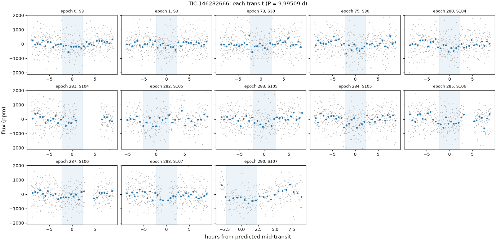
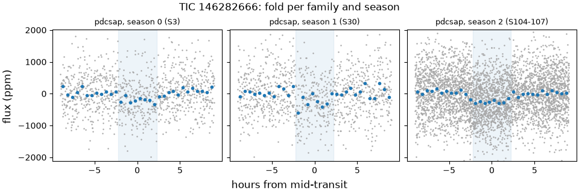
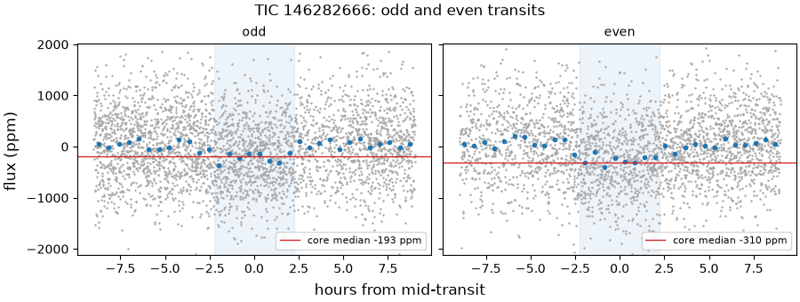
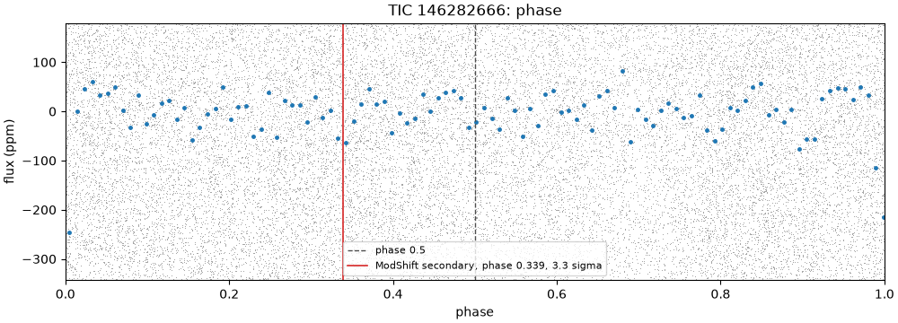
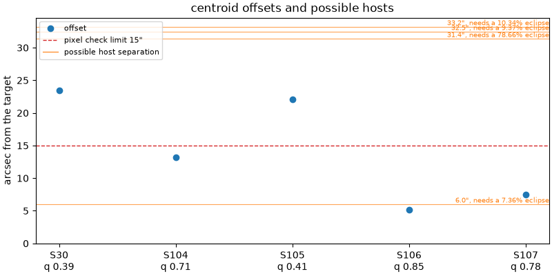

# 146282666-1: TIC 146282666

Call: **held** on 2026-10-22. Rendered from the files in this directory ([decision 0028](../../../docs/decisions/0028-outcomes-and-calls.md)); the review and the call are quoted, not rendered ([decision 0037](../../../docs/decisions/0037-quoted-text-in-the-dossier.md)).

## Signal and star

|  |  |
|---|---|
| Signal | 146282666-1, a shortlisted candidate |
| Names | TIC 146282666, Gaia DR3 4967249906845494144, 2MASS J02235715-3406338, HD 14989, TYC 7009-282-1, TOI-4298 |
| Ephemeris (the search's box) | period 9.995091 d, epoch BTJD 1389.3226, duration 0.1875 d (4.50 h), depth 233 ppm |
| Star (TIC) | Teff 6090 K, radius 1.22 solar radii, Tmag 9.13 |
| RUWE (Gaia DR3) | 1.04 |
| CROWDSAP | S3 0.974; S30 0.976; S104 0.983; S105 0.984; S106 0.977; S107 0.980 |
| Sectors vetted | PDCSAP family: 3, 30, 104, 105, 106 and 107; left out as timing-suspect: none |
| Criteria | search-v2, vet-v3 |
| Runs | vetting 20261020T174317Z-vetting-run-61b5944-2d70 (commit 61b5944, production); TRICERATOPS 20261020T181658Z-vetting-triceratops-61b5944-1bbf (commit 61b5944, production); literature 20261021T001540Z-vetting-literature-61b5944-07de (commit 61b5944, production); evidence-only vetting 20261020T175536Z-vetting-run-61b5944-7f4e (commit 61b5944, production); titles 20261026T155726Z-vetting-titles-0b1deac-1d19 (commit 0b1deac, production) |

## Checks

vet-v3's checks first, then the neighbour table (evidence, never a fail), triage's pixel check, TRICERATOPS and the literature search.

| Check | Outcome | Reason |
|---|---|---|
| novelty | pass | no known object matches |
| odd_even | pass | pdcsap: odd and even depths agree within 2.4 sigma |
| secondary | pass | no dip at phase 0.5 (1.5 sigma) |
| sector_depth | pass | pdcsap: depths agree across 6 sectors (p = 0.53) |
| holdout | inconclusive | 1 season(s) could be tested; need 2 |
| signal_present | pass | combined depth is 9.6 sigma |
| shape | pass | U-shaped: grazing in 0% of samples |
| density | pass | transit and TIC densities agree (1.3 sigma) |
| radius | pass | 2.0 Earth radii |
| neighbours | pass | 4 of 7 neighbours could host the signal |
| pixels | pass | centroid offset 5.2" within 15" |
| triceratops | inconclusive | mean FPP 0.0293, mean NFPP 0.00153 over 10 run(s): neither likely a planet nor likely a nearby false positive |
| literature | pass | complete: 13 hits to screen |

## On the star?

Centroids, from triage's pixel check (pass, centroid offset 5.2" within 15"): the difference-image centroid's offset from the target in each sector. Triage's pass rests on the best-quality sector's offset, S106's.

| Sector | Offset (arcsec) | Quality | Note |
|---|---|---|---|
| 30 | 23.4 | 0.39 |  |
| 104 | 13.2 | 0.71 |  |
| 105 | 22.0 | 0.41 |  |
| 106 | 5.2 | 0.85 | the offset triage judged |
| 107 | 7.4 | 0.78 |  |

Neighbours (pass): 4 of 7 neighbours could host the signal. Each Gaia DR3 star that could make the dip, with its separation from the target (Gaia DR3 4967249906845494144, J2016.0) and the eclipse depth it would need, scaled from the depth in the signals file (233 ppm) as if all its light fell in the aperture, and the TRICERATOPS star matched to it with the distance between them at the TIC's epoch:

| Star | Separation (arcsec) | Eclipse needed | TRICERATOPS's star (distance) | Its depth |
|---|---|---|---|---|
| Gaia DR3 4967249906843757568 | 6.0 | 7.36% | TIC 632015734 (0.0") | 7.34% |
| Gaia DR3 4967296803591446400 | 31.4 | 78.7% | TIC 632016189 (0.0") | 98.3% |
| Gaia DR3 4967249872486553600 | 32.5 | 9.37% | TIC 146282669 (0.3") | 9.63% |
| Gaia DR3 4967249872484022400 | 33.2 | 10.3% | TIC 632015732 (0.0") | 11.7% |

TRICERATOPS (inconclusive) took sectors 3, 30, 104, 105, 106 and 107 at 120 s and folded them on the density-prior fit's ephemeris. It gave a mean NFPP 0.00153 (sd 0.0001) over 10 run(s) of 1000000 draws. Possible hosts it did not weigh: none.

RUWE 1.04 (Gaia DR3). A high RUWE points to an unresolved companion, which TRICERATOPS's priors don't condition on; above vet-v3's limit, or without a RUWE, TRICERATOPS is inconclusive.

## A planet rather than a binary?

- Odd and even transits: pass, pdcsap: odd and even depths agree within 2.4 sigma.
- Secondary at phase 0.5: pass, no dip at phase 0.5 (1.5 sigma).
- Secondary at any phase (LEO-Vetter's ModShift, from triage): the strongest secondary is 3.27 sigma at phase 0.339, depth 62 ppm; primary 15.9 sigma, tertiary 3 sigma at phase 0.895, positive 2.52 sigma at phase 0.663; Fred 1.26.
- The search's other signals on the star: rank 2 at 28.8998 d (period ratio 2.89, SDE 19.1).
- Shape (flat-prior fit): pass, U-shaped: grazing in 0% of samples; median b 0.45.
- Density (flat-prior fit): pass, transit and TIC densities agree (1.3 sigma).
- Radius: pass, 2.0 Earth radii. Rp is 1.99 Earth radii from the flat-prior fit and 1.96 (16th to 84th percentile 1.87 to 2.04) from the density-prior fit; the radius check reads the flat-prior fit.
- Density-prior fit (the TIC density as a prior), whose parameters M4 uses: Rp 1.96 Earth radii (16th to 84th percentile 1.87 to 2.04), b 0.18 (-0.13, +0.15), a/R* 15.69 (-0.76, +0.72), period 9.995026 d (sd 2.5e-05), t0 BTJD 1389.3286 (sd 0.0061 d).
- TRICERATOPS (inconclusive): mean FPP 0.0293 (sd 0.0032) over 10 run(s) of 1000000 draws.

## Real and new?

- Signal present: pass, combined depth is 9.6 sigma.
- Held-out seasons: inconclusive, 1 season(s) could be tested; need 2.
- Sector depths: pass, pdcsap: depths agree across 6 sectors (p = 0.53).
- Novelty, against the catalog snapshot: pass, no known object matches.
- Literature by name (TIC 146282666, Gaia DR3 4967249906845494144, 2MASS J02235715-3406338, HD 14989, TYC 7009-282-1, TOI-4298) and NASA ADS: pass, complete: 13 hits to screen. The hits are listed below.

ExoFOP, read live: TOIs TOI 4298.01 (PC); CTOIs none; confirmed planets none.

Planet parameters on ExoFOP:

- TOI 4298.01 (TIC 146282666.01), TOIs (TESS Project): 722.262 d, 72.3 times ours

## Next TESS looks

tess-point places the star in no upcoming sector.

2-min data and the DDT ask ([decision 0026](../../../docs/decisions/0026-triceratops.md)): which stars get 2-min data in a sector is decided per cycle, so tess-point can't say whether these sectors will have it. In the sectors fetched, the star had SPOC 2-min data in sectors 3, 30, 104, 105, 106 and 107. With no upcoming TESS look there is no DDT ask; M4 decides this signal's route.

## Plots

Each transit, against hours from its predicted mid-time:

The fold in each season and each product family:

Odd and even transits side by side:

The whole orbit, with phase 0.5 and LEO-Vetter's ModShift secondary marked:

Triage's centroid offset per sector, with the neighbours that could host the signal:

## Catalogued rows on the star

Every catalogued row on the star in the snapshot. vet-v3 masks only the kinds the search masks ([decision 0021](../../../docs/decisions/0021-vet-masks-search-kinds.md)); the rest stay unmasked. A row overlaps a transit of ours, numbered by epoch from the signal's t0, when its mask window (2 of its durations, or of 0.25 d where the catalog gives none) meets it. 13 transits of ours have data.

| Source | Kind | Name | Period (d) | Masked | Transits of ours it overlaps |
|---|---|---|---|---|---|
| TOI | candidate | TOI-4298.01 | 722.26198 | yes | 0 of 13 |
| SPOC-TCE | tce | TCE s0001-s0036 00146282666-01 | 722.26200 | no | 0 of 13 |
| SPOC-TCE | tce | TCE s0003-s0003 00146282666-01 | 9.07720 | no | 2 of 13: 0, 287 |
| SPOC-TCE | tce | TCE s0030-s0030 00146282666-01 | 18.34250 | no | 1 of 13: 75 |
| SPOC-TCE | tce | TCE s0104-s0104 00146282666-01 | 13.37180 | no | 3 of 13: 280, 284, 288 |
| SPOC-TCE | tce | TCE s0106-s0106 00146282666-01 | 22.12850 | no | 0 of 13 |
| ExoMiner-v1 | tce | ExoMiner 146282666-1-S1-36 | 722.26200 | no | 0 of 13 |
| ExoMiner-v1 | tce | ExoMiner 146282666-1-S30 | 18.34300 | no | 1 of 13: 75 |
| ExoMiner-v2 | tce | ExoMiner vetting_catalog_2-min 146282666-1-S3 | 9.08087 | no | 2 of 13: 0, 288 |
| ExoMiner-v2 | tce | ExoMiner vetting_catalog_2-min 146282666-1-S30 | 18.34254 | no | 1 of 13: 75 |
| ExoMiner-v2 | tce | ExoMiner vetting_catalog_2-min 146282666-1-S1-36 | 722.26198 | no | 0 of 13 |
| eumemic-tce | tce | eumemic-tce f1d17f0 146282666 | 22.15689 | no | 0 of 13 |
| eumemic-tce | tce | eumemic-tce f1d17f0 146282666 | 9.12108 | no | 0 of 13 |
| eumemic-tce | tce | eumemic-tce f1d17f0 146282666 | 13.31313 | no | 3 of 13: 280, 284, 288 |
| eumemic-tce | tce | eumemic-tce f1d17f0 146282666 | 18.25386 | no | 1 of 13: 290 |

## Literature hits

13 paper(s) from the searches that answered, one row per paper. Titles come only from open sources: the search's own arXiv, OpenAlex and Zenodo hits, else OpenAlex's record for the paper's DOI; a paper none of them titles has a blank title ([decision 0038](../../../docs/decisions/0038-literature-trim-and-username-scrub.md)).

| Title | Id | Found by |
|---|---|---|
|  | 1982mcts.book.....H | ads TIC 146282666 |
| A catalogue of stellar diameters and fluxes for mid-infrared interferometry★ | doi 10.1093/mnras/stz2803, arXiv 1910.00542 | ads TIC 146282666 |
|  | 1993yCat.3135....0C | ads TIC 146282666 |
| THE RADIAL VELOCITY EXPERIMENT (RAVE): FIFTH DATA RELEASE | doi 10.3847/1538-3881/153/2/75, arXiv 1609.03210 | ads TIC 146282666 |
| THE RADIAL VELOCITY EXPERIMENT (RAVE): FOURTH DATA RELEASE | doi 10.1088/0004-6256/146/5/134, arXiv 1309.4284 | ads TIC 146282666 |
| The Sixth Data Release of the Radial Velocity Experiment (Rave). II. Stellar Atmospheric Parameters, Chemical Abundances, and Distances | doi 10.3847/1538-3881/ab9ab8, arXiv 2002.04512 | ads TIC 146282666 |
|  | 2014ASPC..485..223B | ads TIC 146282666 |
| THE RADIAL VELOCITY EXPERIMENT (RAVE): SECOND DATA RELEASE | doi 10.1088/0004-6256/136/1/421, arXiv 0806.0546 | ads TIC 146282666 |
| Empirical photometric calibration of the Gaia red clump: Colours, effective temperature, and absolute magnitude | doi 10.1051/0004-6361/201731572, arXiv 1710.05803 | ads TIC 146282666 |
| THE RADIAL VELOCITY EXPERIMENT (RAVE): THIRD DATA RELEASE | doi 10.1088/0004-6256/141/6/187, arXiv 1104.3576 | ads TIC 146282666 |
| The flaring TESS Objects of Interest: flare rates for all two-minute cadence TESS planet candidates | doi 10.1093/mnrasl/slac024, arXiv 2203.01954 | ads TIC 146282666 |
|  | 1979A&AS...37..367O | ads TIC 146282666 |
| Calibration of RAVE distances to a large sample of Hipparcos stars | doi 10.1093/mnras/stt1651, arXiv 1309.1154 | ads TIC 146282666 |

## With the timing-suspect sectors (evidence only)

The same vet with the timing-suspect sectors kept in ([decision 0022](../../../docs/decisions/0022-vet-without-timing-suspect-sectors.md)). It is shown for comparison and never used for the call. Sectors it adds: none.

| Check | Without them | With them | Reason with them |
|---|---|---|---|
| novelty | pass | pass | no known object matches |
| odd_even | pass | pass | pdcsap: odd and even depths agree within 2.4 sigma |
| secondary | pass | pass | no dip at phase 0.5 (1.5 sigma) |
| sector_depth | pass | pass | pdcsap: depths agree across 6 sectors (p = 0.53) |
| holdout | inconclusive | inconclusive | 1 season(s) could be tested; need 2 |
| signal_present | pass | pass | combined depth is 9.6 sigma |
| shape | pass | pass | U-shaped: grazing in 0% of samples |
| density | pass | pass | transit and TIC densities agree (1.3 sigma) |
| radius | pass | pass | 2.0 Earth radii |

## Review

Quoted from `review.json`, as the reviewer and the refuters wrote it: its numbers, paths and run names are theirs, not rendered from the runs ([decision 0037](../../../docs/decisions/0037-quoted-text-in-the-dossier.md)). [The vetting README](../README.md) says what its paths and run names stand for.

Reviewer claude-opus-5-5, 2026-10-21. Full brief. I refitted triage's difference images, read TRICERATOPS's scenarios and star list against the TIC and Gaia DR3, re-measured the transits on vet-v3's light curve and the SPOC files, and screened ExoFOP and the 13 hits. Nothing kills it: the 9.995-d dip is periodic, steady over 13 transits and eight years, U-shaped and new, but it holds on blending, since a background star 6" out can make it with a 7.4% eclipse that TESS can't separate, while two thirds of the NFPP over the bar comes from a 69" star the pixels exclude (no TIC duplicate is involved). TOI-4298.01 turns out to repeat every 28.896 d, not 722 d, and one of its transits sits unmasked on our epoch 290; masked properly, the depth checks still pass.

A finding rated kill or hold is confirmed when no refuter refuted it; a note gets no refuters.

### F1 (on the star, hold): confirmed

Claim: A background star 6.0" from the target (Gaia DR3 4967249906843757568, G 15.73) could make the dip with a 7.4% eclipse, TESS's pixels can't separate it from the target and their centroids lean its way within the noise, and TRICERATOPS is inconclusive, so the public data can't place the dip on the target.

Evidence: ~/.cache/tess-hunt/drafts/m3-r2/146282666-1/neighbours.csv: Gaia DR3 4967249906843757568 at 6.016" (J2016.0, from the target's DR3 position), G 15.73, required_depth 0.0736; triceratops.json hosts[0]: TIC 632015734 at 0.0004", tdepth 0.0734. Gaia DR3 (/tmp/t13/146282666-1/gaia.py, output gaia.txt, 2026-10-21): that star has parallax 0.285 +- 0.040 mas and pm (13.50, -6.55) mas/yr against the target's 8.029 mas and (-7.36, -115.00): a background star at about 3.5 kpc, not bound; RUWE 1.18. ~/.cache/tess-hunt/drafts/m3-r2/146282666-1/probs.csv (last run; /tmp/t13/146282666-1/nfpp_share.py, output nfpp_share.txt): its NEB scenario (R_EB 0.40 on R 1.51, b 0.10) is 0.000474, 31.1% of that run's NFPP 0.00152924. Pixels: triage's pickles (~/.cache/tess-hunt/tdi/20261015T155441Z-triage-7b12e25-3f57/146282666-1/tic146282666/) refitted with /tmp/t13/146282666-1/sector_detail.py (copied from /tmp/t13/399023421-1) on /tmp/t13/146282666-1/jobs.json, output detail.json, summarised by /tmp/t13/146282666-1/summ.py into summ.txt; every refit reproduces the saved image. Fit east, north in arcsec: S30 (-23.4, 1.3) q 0.395, S104 (6.0, 11.7) q 0.713, S105 (-14.4, -16.7) q 0.413, S106 (-5.2, -0.1) q 0.853, S107 (-6.1, -4.3) q 0.785. The neighbour sits at (-5.0, 4.1) in S106's catalogue. S106, the sector triage judged (SPOC, not timing-suspect; the images are TESScut cutouts), lands 5.2" from the target and 4.2" from the neighbour. Quality-weighted mean (-6.4, -0.5): 6.4" from the target, 4.8" from the neighbour, sky scatter 12.3", 1.16 standard errors from the target. The difference images are weak: target 3x3 box z over the sd of 16 null images 1.14, 1.51, 4.01, 4.38, 3.00 in S30, S104 to S107. Fixed-position fits of the target and the neighbour (/tmp/t13/146282666-1/two_star.py on jobs_two.json and pairs.json, output two_star.json and two_star.txt) are degenerate at 0.3 pixel: the neighbour's fitted out-of-transit flux comes out 546 to 5577 e/s or negative where a T 15.36 star gives about 110. The hosts at 32.5" and 33.2" show no loss at their positions: TIC 146282669 amplitude z 0.31, -0.46, 0.94, -0.10, -0.50 against the target's 0.33, 1.88, 0.13, 3.03, 2.10 (TIC 632015732, 1.1" from it, the same), and probs.csv gives the pair 1.4e-6; the one at 31.4" (TIC 632016189, needs 78.7%) gets z 0.78, 1.87, 1.01, 0.40, -1.09 against the target's 0.31, 1.62, 0.20, 2.36, 2.01, and probs.csv gives it 7e-17. Deciding evidence: seeing-limited ground-based photometry on a predicted transit that resolves 6" and shows whether the G 15.7 star dims by about 7.4% (density-prior ephemeris P 9.995026 +- 2.5e-5 d, t0 BTJD 1389.3286 +- 0.0061, so about 14 min or less at a transit in early 2027). The SOAR speckle image (F9) and 2-min TESS data would not decide it. Clearing this star leaves TRICERATOPS over its bar on TIC 146282663 alone (F2).

- Refuter 1: did not refute. Reproduced. Every number F1 rests on came out the same, apart from three rounding slips that change nothing. Scratch is in /tmp/t13/146282666-1/refute-F1-reproduce/.

Run files, read directly:
- neighbours.csv: Gaia DR3 4967249906843757568 at sep 6.0156", G 15.7286, required_depth 0.07355.
- triceratops.json evidence.hosts[0]: TIC 632015734, distance_arcsec 0.00039, tdepth 0.07341.
- triceratops.json: outcome inconclusive, NFPP of the last run 0.00152924.
- probs.csv: 632015734 NEB prob 0.000474216, R_EB 0.400, R_s 1.511, b 0.097.
- probs.csv: the 146282669 pair sums to 9.01e-7 + 4.58e-7 = 1.36e-6. 632016189 sums to 6.85e-17.
- criteria/vet-v3.toml [triceratops] nfpp_pass = 0.001. Without 632015734 the NFPP is 0.001053, from TIC 146282663 alone, which is still over the bar (F2).

Commands I reran, all from ~/code/tess-hunt:
- `uv run python /tmp/t13/146282666-1/nfpp_share.py`: output identical to nfpp_share.txt (diff clean). It gives 632015734 at 31.1% of the NFPP.
- `uv run python /tmp/t13/146282666-1/gaia.py`: a live Gaia query. It returns parallax 0.2854 +- 0.0401, pm (13.4956, -6.5518) and RUWE 1.1796 for the neighbour, and 8.0288, (-7.3641, -115.0029) for the target. 1/parallax is 3.50 kpc.
- `/tmp/t13/heavy.sh uv run --project ... python sector_detail.py refute-F1-reproduce/detail.json jobs.json`: exit 0, and `cmp` shows detail.json byte-identical to the reviewer's.
- The same with two_star.py on jobs_two.json and pairs.json: exit 0, two_star.json byte-identical.
- summ.py on my detail.json: diff with summ.txt is clean.

The pixel numbers that confirms:
- Fits: S30 (-23.4, 1.3) q 0.395, S104 (6.0, 11.7) q 0.713, S105 (-14.4, -16.7) q 0.413, S106 (-5.2, -0.1) q 0.853, S107 (-6.1, -4.3) q 0.785. Every refit reproduces the saved image.
- The neighbour sits at (-5.0, 4.1) in S106's catalogue. S106's fit is 4.17" from it.
- Quality-weighted mean (-6.4, -0.5), 6.37" from the target, sky scatter 12.3", 1.16 standard errors.
- Box z over the null sd: 1.14, 1.51, 4.01, 4.38, 3.00.
- The neighbour's fitted out-of-transit flux: 5577, 1673, -5511, 546, 1206 e/s. A T 15.36 star should give 103 to 127 e/s, scaled from the target's fitted flux.
- 146282669's z: 0.31, -0.46, 0.94, -0.10, -0.50, against the target's 0.33, 1.88, 0.13, 3.03, 2.10. 632015732's are nearly the same.
- 632016189's z: 0.78, 1.87, 1.01, 0.40, -1.09, against the target's 0.31, 1.62, 0.20, 2.36, 2.01.
- The 632015732 to 146282669 separation in TRICERATOPS's star list is 1.08".

Triage: $TRIAGE_RUN/evidence/146282666-1.json gives offset_qual_arcsec 5.195, which is S106's. The dossier lists no timing-suspect sectors, and src/tess_hunt/pixels.py:22 confirms the images are TESScut cutouts.

Ephemeris: using the dossier's P 9.995026 +- 2.5e-5 d and t0 1389.3286 +- 0.0061 d, the predicted-transit uncertainty is 13.98 min on 2027-01-01 and 14.23 min on 2027-04-01.

The three rounding slips:
- The mean fit is 4.74" from the neighbour, not 4.8". The 4.8" came from rounded inputs.
- The NEB scenario alone is 31.0% of the NFPP. The 31.1% is the star's total, including NEBx2P.
- The early-2027 uncertainty runs 14.0 to 14.2 min, so "14 min or less" should read "about 14 min".

None of the three moves the claim.
- Refuter 2: did not refute. I checked the finding against the rules and found no misread rule and no claim beyond its evidence. A hold fits the brief's definition.

What I checked:
1. TRICERATOPS really is inconclusive, with no blocker. In triceratops.json the outcome is "inconclusive" because the mean NFPP is 0.00153 (sd 0.0001). That sits between nfpp_pass 0.001 and nfpp_fail 0.1 in criteria/vet-v3.toml [triceratops], with FPP 0.0293 and blockers []. 0026's Outcomes give exactly this verdict for those numbers.
2. TRICERATOPS weighed the star, so section 4.4 does not apply. hosts[0] is Gaia DR3 4967249906843757568, matched to TIC 632015734 at 0.0004" at J2000. That is the match distance, not the star's distance from the target. Its tdepth is 0.0734 against a required_depth of 0.0736 in neighbours.csv, at 6.016" and G 15.73. M3 design 4.4 says a weighed host is "accounted for", but that means it counts in the NFPP, not that it is cleared.
3. The pixels can't decide a star inside 15". Decision 0032 says the pixel check can miss inside 15" and TRICERATOPS is the catch there. Decision 0033 (lines 99 to 101) says the pixel check "says nothing about stars within 15"" and calls the possible hosts there "TRICERATOPS's question". TRICERATOPS's answer here is inconclusive, so "the public data can't decide" holds under the rules.
4. The deciding evidence is valid and the exclusions are right. Ground-based photometry is on the brief's list of what decides a hold (M3 design 4.9 held; 0028 Three outcomes). Saying 2-min data would not decide it matches M3 design 4.5, the DDT ask paragraph in 0026, and 0028's DDT note ("a hold on blending does not go: 2-min data come from the same pixels").
5. The finding is candid about the star's share. I recomputed it from probs.csv with a short uv run python sum over the NTP, NEB and NEBx2P rows:
   - TIC 632015734 gives 0.000475 (31.1%) of the last run's NFPP of 0.00152924.
   - Its NEB row is 0.00047421578 with R_EB 0.40 on a 1.51 star at b 0.097.
   - TIC 146282663 gives 0.001053 (68.8%).

   So F1's own line "clearing this star leaves TRICERATOPS over its bar on TIC 146282663 alone" is right, and the finding does not pin TRICERATOPS's verdict on this star.

The strongest case for refuting: this star's share alone (0.000475) is under nfpp_pass, so TRICERATOPS would pass with the star still in if 146282663 were removed. No rule allows that today. 0026's outcome uses only the mean NFPP over all stars, has no per-star clearance, and lets no star leave the NFPP. Removing 146282663 would need a new decision record. Under the rules as written, the star is not cleared.

When the maintainer answers this hold (bar 4 of 0028), he may cite that 0.000475 share. That makes the answer easy, but it does not make the finding wrong.

### F2 (on the star, note)

Claim: Two thirds of the NFPP that keeps TRICERATOPS over its pass bar comes from TIC 146282663, a T 11.6 star 69" away whose position the difference images rule out as the source; without it the NFPP is 0.00048, under the 0.001 bar. The star list holds no TIC duplicate, so 399023421-1's duplicate defect does not touch this NFPP.

Evidence: /tmp/t13/146282666-1/nfpp_share.txt from ~/.cache/tess-hunt/drafts/m3-r2/146282666-1/probs.csv (last run, NFPP 0.00152924 as recorded): TIC 146282663 0.001053 (68.8%: NTP 0.000705 with R_p 19.8 Earth radii, NEB 0.000347), TIC 632015734 0.000475 (31.1%), the rest 1.4e-6; without 146282663 0.000476, and the 10-run mean 0.00152612 scaled the same way 0.000475; criteria/vet-v3.toml nfpp_pass 0.001. triceratops.json stars: 146282663 tdepth 0.0237. It is 68.6" from the target, outside the neighbour table's 1' radius, so the dossier never lists it. Fixed-position fits (/tmp/t13/146282666-1/two_star.json): its fractional loss -0.0006, 0.0003, -0.0001, 0.0002, 0.00004 in S30, S104 to S107, null sd 0.0002 to 0.0005, against the 0.0237 it would need: 50 to 110 null sds per sector. Gaia DR3 4967296807888366720 (its TIC GAIA id; gaia.txt): RUWE 1.90, astrometric_excess_noise_sig 94.6, rv_chisq_pvalue 0.0, rv_amplitude_robust 22.5 km/s over 54 transits: likely a binary itself, but not at our ephemeris. Duplicates: MAST TIC for all 38 TRICERATOPS stars (/tmp/t13/146282666-1/tic_disp.py, output tic_disp.txt, astroquery Catalogs.query_criteria, 2026-10-21): disposition and duplicate_id empty for every one, and no two share a position (the nearest pair, TIC 146282669 and 632015732, are distinct Gaia sources 1.1" apart). vet-v3 has no step that lets a star the pixels exclude leave the NFPP (decision 0026), so whether one may is a decision for a record, not a rerun. The margin is also smaller than the check's movement with its inputs (0032): Task 0's probe on this star gave NFPP 0.0139 to 0.0183 with TIC 146283232 about 55% of it (.superpowers/sdd/tess-hunt-m3-plan/progress.md, P2 entry), where production gives 146283232 about 5e-46 (probs.csv); and the fold TRICERATOPS ran on includes epoch 290 with TOI-4298.01's transit on it (F3).

### F3 (real and new, note)

Claim: TOI-4298.01 is not a 722-d pair of single transits: the star dips every 28.896 d (close to 722.26/25 = 28.890) in all six windows with data, and one of those transits falls on our epoch 290, which vet-v3 leaves unmasked because it masks the TOI at the catalog's 722-d ephemeris (empty in S107) and cuts that epoch's baseline instead; with the TOI masked at 28.896 d the depth checks still pass, at 8.5 sigma.

Evidence: /tmp/t13/146282666-1/lc_toi.py on vet-v3's light curve detrended by search-v2's biweight with every window held out (output lc_toi.txt, lc_toi.png): best 7.7-h box 473 +- 40 ppm at BTJD 1398.36 (S3), 542 +- 45 at 2120.66 (S30), 382 +- 44 at 4201.24 (S104), 333 +- 43 at 4230.15 (S105, a time predicted from the other four before it was measured), 289 +- 42 at 4259.04 (S106), 546 +- 45 at 4287.94 (S107). /tmp/t13/146282666-1/toi_period.py: linear ephemeris P 28.89622 d, T0 1398.3116, residuals +1.1, -1.4, -0.1, +0.2, +0.1, +0.2 h. The 722-d prediction in S107, 4287.443, shows -192 +- 62 ppm (/tmp/t13/146282666-1/lc_146.py, output lc_146.txt). The P/2 alias's five half-way epochs give 10 +- 19 ppm (/tmp/t13/146282666-1/lc_toi2.py, output lc_toi2.txt). ExoFOP (/tmp/t13/146282666-1/exofop.json, read 2026-10-21): P 722.2620 +- 0.0073 d, epoch 2458398.3956, 481 ppm, 7.71 h, sectors 3 and 30. The search's rank-2 signal on this star (checks.json other_signals: 28.89977 d, t0 1398.004, SDE 19.1) is this TOI. SPOC's one-sector TCEs each pair two of these dips: S3 9.0772 d = our epoch 0 and the TOI at 1398.40; S30 18.3425 d = the TOI at 2120.66 and our epoch 75; S104 13.3718 d = our epoch 280 and the TOI at 4201.30; S106 22.1285 d = an unexplained 369 +- 42 ppm dip at 4236.91 and the TOI at 4259.04. In S107 the vet's mask spans 4287.122 to 4287.765 and leaves epoch 290 29 cadences before ingress within three durations (93 to 338 at the other epochs; first cadence -3.21 h), while the TOI's transit, about 4287.78 to 4288.10, covers epoch 290 (4287.81 to 4287.99): 290 is 393 +- 83 ppm in the vet (+1.85 sigma, the deepest) and 654 +- 59 ppm with the windows held out. The dossier's 'overlaps 0 of 13' is true of the catalog row, not of the TOI. lc_toi2.txt, with the vet run's red-noise betas: vet-v3's masks give 245.3 +- 25.6 ppm (z 9.59, as checks.json), odd/even 2.44 sigma, sector chi2 p 0.529, S107 327 +- 70; masked at 28.896 d instead, 229.8 +- 26.9 (z 8.54 > 7), odd/even 1.89 sigma (< 3), p 0.724 (> 0.001), S107 160 +- 131 (epoch 288 only). Not recomputed: the two fits, shape, density and holdout season 2, which all include epoch 290; Rp and the ephemeris M4 uses come from that fit. The ratio 28.896 / 9.995 = 2.891 is no novelty harmonic. The check's input, not its code, is wrong (0021 masks catalog ephemerides), which belongs in a decision record; a CTOI should give the TOI's period.

### F4 (a planet, note)

Claim: LEO-Vetter's ModShift secondary (3.27 sigma at phase 0.339) and tertiary (phase 0.895) are single dips, TOI-4298.01's S104 transit and the unexplained S106 dip, not a repeating eclipse; without them both phases are flat.

Evidence: checks.json modshift: sig_sec 3.27 at 0.3388 (62 ppm), sig_ter 3.00 at 0.8952, Fred 1.26. /tmp/t13/146282666-1/lc_146.txt (vet-v3's light curve, our duration, white errors): phase 0.339 60.2 +- 23.3 ppm, its strongest epoch BTJD 4201.33 at 355 +- 81 (the TOI's S104 transit, F3), without it 33.4 +- 24.3 (1.37 sigma); phase 0.895 49.0 +- 24.7, strongest 4236.88 at 246 +- 77 (the S106 single dip), without it 26.4 +- 26.1 (1.01 sigma). Phase 0.5: 1.5 sigma (the secondary check). So no eccentric secondary, and 0031's own-occultation case does not arise.

### F5 (a planet, note)

Claim: Nothing points to an eclipsing binary on the target: the transit is U-shaped, the density agrees, Gaia's 40 RV epochs rule out a stellar companion on a 10-d orbit, and odd and even differ by 2.4 sigma (1.9 with the TOI's transit masked); a user-uploaded CHIRON fit's logg 3.24 is ruled out by the parallax.

Evidence: checks.json: shape grazing 0%, b 0.45 (flat-prior fit), 0.18 (density-prior); density tension 1.3 sigma (transit 0.514 g/cm3 against TIC 0.883; Gaia FLAME's mass 1.09 and radius 1.28 give 0.74); Rp 1.99 Earth radii. Gaia DR3 (/tmp/t13/146282666-1/gaia.txt): RV -13.10 +- 0.17 km/s over 40 transits, rv_amplitude_robust 3.19 km/s, rv_chisq_pvalue 0.071, non_single_star 0. At P 9.995 d and 1.14 solar masses K is about 86 m/s per Jupiter mass, so an 80-Jupiter-mass companion gives about 6.6 km/s (with the total mass), 13 km/s peak to peak. RAVE DR6 (2003-11-11): -11.79 +- 3.03 km/s (/tmp/t13/146282666-1/viz.txt). Odd 187 and even 312 ppm, 2.44 sigma (checks.json, limit 3); with the TOI's transit masked 188 and 291, 1.89 sigma (lc_toi2.txt). probs.csv: EB 5e-43, EBx2P 1e-24, PEBx2P 1e-19. The search's other signal (28.90 d) is TOI-4298.01 (F3), whose 7.7-h dips are longer than our 4.5-h ones, not an eclipse pair of ours. ExoFOP stellar parameters (exofop.json, CHIRON, uploaded 2023-12-14): Teff 5390 K, logg 3.24, [M/H] -0.56, vsini 4.7 km/s. With the TIC's luminosity 1.85 solar from the parallax, logg 3.24 needs R about 4.2 and L about 13 solar; Teff 5390 K alone gives R 1.56 and Rp about 2.5 Earth radii, still small. Gaia GSP-Phot: Teff 6000 K, logg 4.13, [M/H] -0.68: a metal-poor F dwarf.

### F6 (real and new, note)

Claim: The dip is real and periodic: 13 transits over eight years agree in depth, no single transit carries it, it stands 9 null sds above folds shifted in phase on the same light curve, and no transit sits on a momentum dump, a sector edge or a timing-suspect sector.

Evidence: /tmp/t13/146282666-1/lc_146.py on ~/.cache/tess-hunt/drafts/m3-r2/146282666-1/checks.json and ~/.cache/tess-hunt/lc/146282666.npz with the six SPOC files (/tmp/t13/146282666-1/fits/, each sha256 equal to checks.json sources), run through /tmp/t13/heavy.sh from the repo root; output lc_146.txt. Per-epoch core depths 118 to 393 ppm, chi2 16.0 on 12 dof (p 0.19); leave-one-epoch-out combined z 9.7 to 10.6 (white errors); 198 folds with t0 shifted by quarter durations, our transits masked: z mean -0.05, sd 1.18, max 3.22, against 10.63. Momentum dumps (QUALITY bit 32): nearest to any transit +6.2 h after epoch 281's mid, outside it. /tmp/t13/146282666-1/quality.py (output quality.txt): manual-exclude (bit 128) cadences cut epoch 288 to 94 of 135 in-transit cadences (core n 26, depth 160 +- 132) and touch no other transit by more than 2 cadences (epoch 290). Every transit is at least 2.5 d from its sector's first or last cadence. All six sectors are SPOC 2-min; dropped_suspect is empty and the evidence-only vet is identical. The star has other single dips (F3), but none repeats at our period.

### F7 (real and new, note)

Claim: Holdout is inconclusive for lack of power, not of transits: the 2018 and 2020 seasons hold two transits each, below the 4-sigma expectation, while the 2026 season is found at 8.0 sigma where they put it; no TESS sector is coming, so the check blocks a pass under 0028's bar 1 until new photometry exists.

Evidence: checks.json holdout: season 0 (S3) expected_snr 3.87 and season 1 (S30) 3.48, both underpowered against criteria/vet-v3.toml min_expected_snr 4.0; season 2 (S104 to S107) predicted from seasons 0 and 1 (training_seasons_with_transits 2) at period 9.994936, found at 8.04 sigma, depth 252 +- 31 ppm against 194 +- 45 from training, tension 1.06. The refit starts from the search's period (refit_resolutions 5), so the prediction is not blind, and season 2 includes epoch 290 (F3). checks.json upcoming_sectors is empty (tess-point). What would make it testable: transits observed at about 240 ppm, from CHEOPS or a large ground-based telescope; a TESS season only if one is scheduled.

### F8 (real and new, note)

Claim: No catalog row, ExoFOP entry or paper reports a signal at 9.995 d or a harmonic; SPOC caught three of our transits singly and paired each with an unrelated dip, and the 13 hits are catalogues and one flare survey that lists the star as TOI-4298's host, so the signal is new, in a known-TOI system.

Evidence: checks.json novelty pass, tce_matches and tce_period_matches empty. The catalogued rows' periods (722.26, 9.0772, 18.3425, 13.3718, 22.1285, ExoMiner 9.0809 and 18.343, eumemic 22.157, 9.121, 13.313, 18.254 d) match none of 9.995, 4.998, 19.990, 3.332 and 29.985 d; the SPOC pairs are in F3. ExoFOP (exofop.json): TOI 4298.01 only, no CTOI, no time series, no notes. Literature (~/.cache/tess-hunt/drafts/m3-r2/146282666-1/literature.json; VizieR rows in /tmp/t13/146282666-1/viz.py, output viz.txt): Howard et al. 2022 (flaring TOIs) lists TOI-4298.01 at 722.26 d with 0 flares, Binarity 0, Contam 0 (J/MNRAS/512/L60): flagged as naming the star a planet-candidate host. Dismissed: Houk 1982, F7 V with no remark (III/80); Cruzalebes et al. 2019 (MDFC), F7V, CalFlag 0, IRflag 1, which is a possible 22-micron excess (K - W4 0.39 +- 0.16 mag), not multiplicity (II/361 ReadMe); the HD catalogue; RAVE DR2 to DR6 (one 2003 spectrum, its RV in F5); JSDC v2; Ruiz-Dern et al. 2018 (a row in its low-extinction photometric sample, J/A+A/609/A116); Francis 2013 (RAVE distances). Olsen 1979 ('interesting Stromgren indices'): its groups are Ap, Am, metal-poor and composite stars; I read its tables 1, 3, 4, 6 to 8, 10 to 14 and 16 in the ADS scan (/tmp/t13/146282666-1/olsen1979.pdf, rendered pages in olsen/) and did not find HD 14989, so why SIMBAD links it is not established; the star's [M/H] of -0.56 to -0.68 would make it an intermediate population II F dwarf, the paper's main subject.

### F9 (on the star, note)

Claim: No visual double or bound companion shows: SOAR speckle reaches 7.5 mag at 1" with none noted, Gaia's RUWE is 1.04 with no multi-peak images and no co-moving star within 10', and crowding is 1.6% to 2.6% in each sector; the one oddity is Gaia's duplicated_source flag on the target.

Evidence: exofop.json imaging: SOAR HRCam, I band, 2021-10-01, 'delta 7.5 mag @ 1"', notes empty; stellar_companions empty. gaia.txt: RUWE 1.039, ipd_frac_multi_peak 0, ipd_gof_harmonic_amplitude 0.027, astrometric_excess_noise_sig 18.3, non_single_star 0, duplicated_source true (also true in DR2 and EDR3 by RAVE's cross-match, viz.txt). /tmp/t13/146282666-1/gaia_cpm.py (output gaia_cpm.txt): no other DR3 source within 10' with parallax 6.5 to 9.5 mas. WDS and VSX: nothing within 30" (viz.txt). checks.json: CROWDSAP 0.974 to 0.984, TIC contratio 0.011; no QLP sector, so no QLP dilution. TRICERATOPS ran without a contrast curve (triceratops.json contrast []), because ExoFOP's SOAR curve is a PDF (pins.md, P4); its FPP of 0.0293 already passes its own bar without one.

Literature hits flagged for the maintainer to read: doi 10.1093/mnrasl/slac024, arXiv 2203.01954.

## Call

Quoted from `call.toml`, the maintainer's words, not rendered from the runs ([decision 0037](../../../docs/decisions/0037-quoted-text-in-the-dossier.md)).

Outcome: **held**, 2026-10-22.

Reasons: Nothing kills it: the dip is periodic, steady across eight years of transits, U-shaped and new, in a system that already holds TOI-4298.01. It can't pass because the public data can't place it on the target: a background star a few arcseconds away could make it, TESS's pixels can't separate the two, and TRICERATOPS sits just over its pass bar. The held-out check is also inconclusive, for lack of power rather than of transits.

Rests on: F1 (finding), triceratops, holdout.

Criteria: vet-v3.

Deciding evidence: Seeing-limited ground-based photometry on a predicted transit that resolves the background star a few arcseconds away and shows whether it dims (F1); transits measured by CHEOPS or a large ground-based telescope for a second testable held-out season, since no TESS sector is scheduled (F7). Most of TRICERATOPS's excess over its bar comes from a star the difference images exclude, and vet-v3 has no rule that lets such a star leave the NFPP, so a pass also needs a recorded decision on that (F2).
