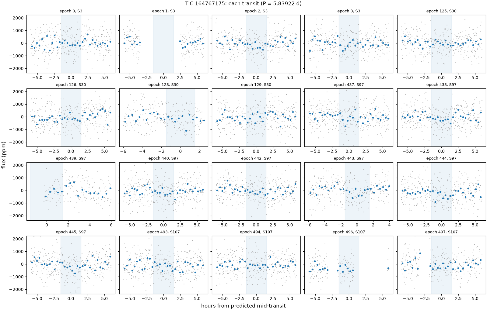
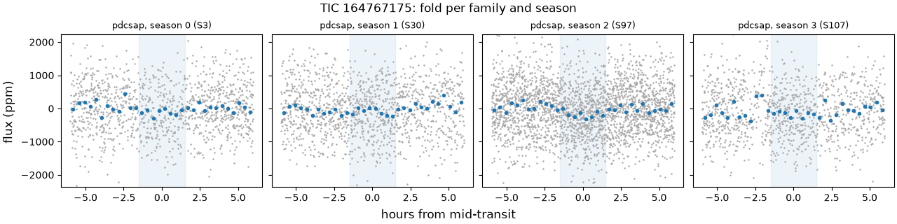
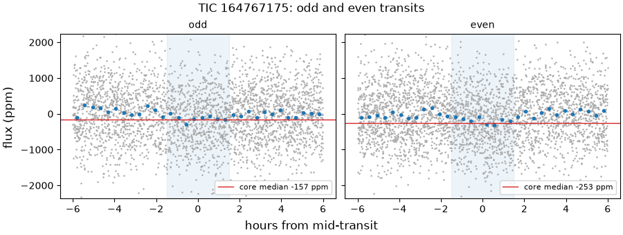
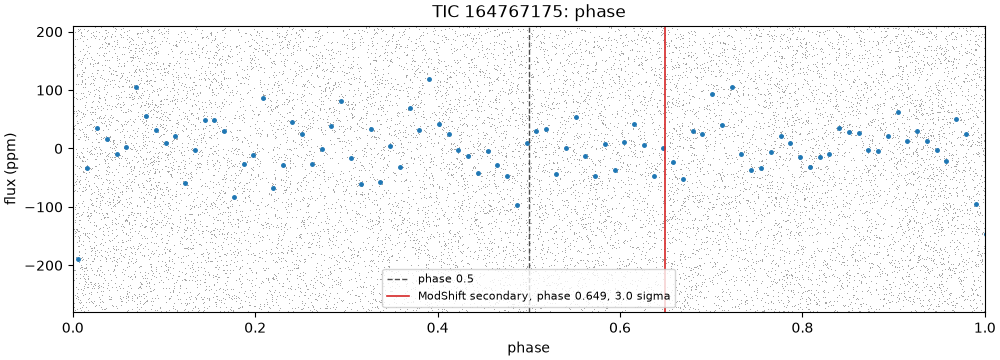
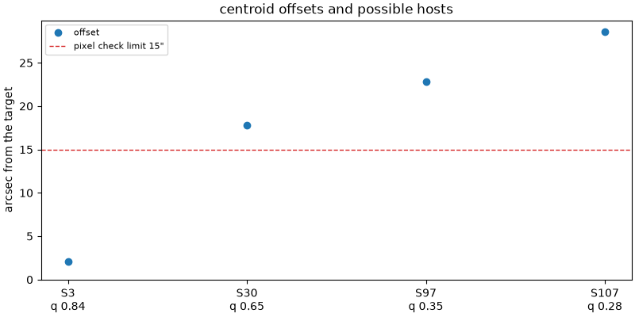

# 164767175-1: TIC 164767175

Call: **held** on 2026-10-22. Rendered from the files in this directory (decision 0028).

## Signal and star

|  |  |
|---|---|
| Signal | 164767175-1, a shortlisted candidate |
| Names | TIC 164767175, Gaia DR3 5140454049422547200, HIP 8152, 2MASS J01445032-1824032, TOI-266, TYC 5855-2286-1 |
| Ephemeris (the search's box) | period 5.839222 d, epoch BTJD 1387.2646, duration 0.1250 d (3.00 h), depth 180 ppm |
| Star (TIC) | Teff 5784 K, radius 0.92 solar radii, Tmag 9.46 |
| RUWE (Gaia DR3) | 0.83 |
| CROWDSAP | S3 0.999; S30 0.999; S97 1.000; S107 0.999 |
| Sectors vetted | PDCSAP family: 3, 30, 97 and 107; left out as timing-suspect: none |
| Criteria | search-v2, vet-v3 |
| Runs | vetting 20261020T174317Z-vetting-run-61b5944-2d70 (commit 61b5944, production); TRICERATOPS 20261020T181658Z-vetting-triceratops-61b5944-1bbf (commit 61b5944, production); literature 20261021T001540Z-vetting-literature-61b5944-07de (commit 61b5944, production); evidence-only vetting 20261020T175536Z-vetting-run-61b5944-7f4e (commit 61b5944, production) |

## Checks

vet-v3's checks first, then the neighbour table (evidence, never a fail), triage's pixel check, TRICERATOPS and the literature search.

| Check | Outcome | Reason |
|---|---|---|
| novelty | pass | no known object matches |
| odd_even | pass | pdcsap: odd and even depths agree within 1.1 sigma |
| secondary | pass | no dip at phase 0.5 (-0.7 sigma) |
| sector_depth | pass | pdcsap: depths agree across 4 sectors (p = 0.26) |
| holdout | inconclusive | 0 season(s) could be tested; need 2 |
| signal_present | pass | combined depth is 7.5 sigma |
| shape | pass | U-shaped: grazing in 0% of samples |
| density | pass | transit and TIC densities agree (1.4 sigma) |
| radius | pass | 1.3 Earth radii |
| neighbours | pass | 0 of 0 neighbours could host the signal |
| pixels | pass | centroid offset 2.1" within 15" |
| triceratops | pass | mean FPP 0.022 < 0.5 and mean NFPP 0 < 0.001 over 10 run(s): likely a planet |
| literature | pass | complete: 40 hits to screen |

## On the star?

Centroids, from triage's pixel check (pass, centroid offset 2.1" within 15"): the difference-image centroid's offset from the target in each sector. Triage's pass rests on the best-quality sector's offset, S3's.

| Sector | Offset (arcsec) | Quality | Note |
|---|---|---|---|
| 3 | 2.1 | 0.84 | the offset triage judged |
| 30 | 17.8 | 0.65 |  |
| 97 | 22.9 | 0.35 |  |
| 107 | 28.6 | 0.28 |  |

Neighbours (pass): 0 of 0 neighbours could host the signal.

TRICERATOPS (pass) took sectors 3, 30, 97 and 107 at 120 s and folded them on the density-prior fit's ephemeris. It gave a mean NFPP 0 (sd 0) over 10 run(s) of 1000000 draws. The neighbour table lists no possible host for it to weigh.

RUWE 0.83 (Gaia DR3). A high RUWE points to an unresolved companion, which TRICERATOPS's priors don't condition on; above vet-v3's limit, or without a RUWE, TRICERATOPS is inconclusive.

## A planet rather than a binary?

- Odd and even transits: pass, pdcsap: odd and even depths agree within 1.1 sigma.
- Secondary at phase 0.5: pass, no dip at phase 0.5 (-0.7 sigma).
- Secondary at any phase (LEO-Vetter's ModShift, from triage): the strongest secondary is 2.98 sigma at phase 0.649, depth 65 ppm; primary 10 sigma, tertiary 2.92 sigma at phase 0.31, positive 3.73 sigma at phase 0.389; Fred 1.42.
- The search's other signals on the star: rank 2 at 1.3890 d (period ratio 0.238, SDE 9.2).
- Shape (flat-prior fit): pass, U-shaped: grazing in 0% of samples; median b 0.48.
- Density (flat-prior fit): pass, transit and TIC densities agree (1.4 sigma).
- Radius: pass, 1.3 Earth radii. Rp is 1.29 Earth radii from the flat-prior fit and 1.26 (16th to 84th percentile 1.18 to 1.35) from the density-prior fit; the radius check reads the flat-prior fit.
- Density-prior fit (the TIC density as a prior), whose parameters M4 uses: Rp 1.26 Earth radii (16th to 84th percentile 1.18 to 1.35), b 0.21 (-0.15, +0.19), a/R* 14.51 (-0.86, +0.89), period 5.839259 d (sd 2.5e-05), t0 BTJD 1387.2597 (sd 0.0081 d).
- TRICERATOPS (pass): mean FPP 0.022 (sd 0.00095) over 10 run(s) of 1000000 draws.

## Real and new?

- Signal present: pass, combined depth is 7.5 sigma.
- Held-out seasons: inconclusive, 0 season(s) could be tested; need 2.
- Sector depths: pass, pdcsap: depths agree across 4 sectors (p = 0.26).
- Novelty, against the catalog snapshot: pass, no known object matches.
- Literature by name (TIC 164767175, HIP 8152, Gaia DR3 5140454049422547200, 2MASS J01445032-1824032, TOI-266, TYC 5855-2286-1) and NASA ADS: pass, complete: 40 hits to screen. The hits are listed below.

ExoFOP, read live: TOIs TOI 266.01 (CP), TOI 266.02 (CP); CTOIs none; confirmed planets HIP 8152 b, HIP 8152 c.

Planet parameters on ExoFOP:

- HIP 8152 b, Confirmed Planets (Exoplanet Archive): 10.751 d, 1.84 times ours
- HIP 8152 c, Confirmed Planets (Exoplanet Archive): 19.6056 d, 3.36 times ours
- TOI 266.01 (TIC 164767175.01), TOIs (TESS Project): 10.7511 d, 1.84 times ours
- TOI 266.02 (TIC 164767175.02), TOIs (TESS Project): 19.6051 d, 3.36 times ours
- TOI 266.02 (TIC 164767175.02), Planet Parameters (User uploaded): 6.54 d, 1.12 times ours
- TOI 266.02 (TIC 164767175.02), Planet Parameters (User uploaded): 6.548 d, 1.12 times ours
- TOI 266.01 (TIC 164767175.01), Planet Parameters (User uploaded): 10.7491 d, 1.84 times ours
- TOI 266.01 (TIC 164767175.01), Planet Parameters (User uploaded): 10.7494 d, 1.84 times ours
- TOI 266.01 (TIC 164767175.01), Planet Parameters (User uploaded): 10.751 d, 1.84 times ours

## Next TESS looks

tess-point places the star in no upcoming sector.

2-min data and the DDT ask (M3 design, section 4.5): which stars get 2-min data in a sector is decided per cycle, so tess-point can't say whether these sectors will have it. In the sectors fetched, the star had SPOC 2-min data in sectors 3, 30, 97 and 107. With no upcoming TESS look there is no DDT ask; M4 decides this signal's route.

## Plots

Each transit, against hours from its predicted mid-time:

The fold in each season and each product family:

Odd and even transits side by side:

The whole orbit, with phase 0.5 and LEO-Vetter's ModShift secondary marked:

Triage's centroid offset per sector, with the neighbours that could host the signal:

## Catalogued rows on the star

Every catalogued row on the star in the snapshot. vet-v3 masks only the kinds the search masks (decision 0021); the rest stay unmasked. A row overlaps a transit of ours, numbered by epoch from the signal's t0, when its mask window (2 of its durations, or of 0.25 d where the catalog gives none) meets it. 20 transits of ours have data.

| Source | Kind | Name | Period (d) | Masked | Transits of ours it overlaps |
|---|---|---|---|---|---|
| TOI | candidate | TOI-266.01 | 10.75112 | yes | 1 of 20: 1 |
| TOI | candidate | TOI-266.02 | 19.60510 | yes | 0 of 20 |
| archive | planet | HIP 8152 c | 19.60562 | yes | 0 of 20 |
| archive | planet | HIP 8152 b | 10.75101 | yes | 1 of 20: 1 |
| archive_ps | planet | HIP 8152 b | 10.75101 | no | 1 of 20: 1 |
| archive_ps | planet | HIP 8152 c | 19.60530 | no | 0 of 20 |
| archive_ps | planet | HIP 8152 b | 10.75101 | no | 1 of 20: 1 |
| archive_ps | planet | HIP 8152 b | 10.75112 | no | 1 of 20: 1 |
| archive_ps | planet | HIP 8152 c | 19.60562 | no | 0 of 20 |
| archive_ps | planet | HIP 8152 c | 19.60510 | no | 0 of 20 |
| SPOC-TCE | tce | TCE s0001-s0036 00164767175-02 | 10.99110 | no | 2 of 20: 0, 128 |
| SPOC-TCE | tce | TCE s0001-s0036 00164767175-01 | 10.75100 | no | 1 of 20: 1 |
| SPOC-TCE | tce | TCE s0003-s0003 00164767175-01 | 10.74850 | no | 2 of 20: 1, 128 |
| SPOC-TCE | tce | TCE s0030-s0030 00164767175-01 | 11.22610 | no | 0 of 20 |
| SPOC-TCE | tce | TCE s0097-s0097 00164767175-01 | 10.75420 | no | 0 of 20 |
| SPOC-TCE | tce | TCE s0097-s0097 00164767175-02 | 19.61340 | no | 1 of 20: 126 |
| ExoMiner-v1 | tce | ExoMiner 164767175-1-S1-36 | 10.75100 | no | 1 of 20: 1 |
| ExoMiner-v1 | tce | ExoMiner 164767175-1-S3 | 10.76800 | no | 1 of 20: 1 |
| ExoMiner-v1 | tce | ExoMiner 164767175-1-S30 | 11.22600 | no | 0 of 20 |
| ExoMiner-v2 | tce | ExoMiner vetting_catalog_2-min 164767175-1-S1-36 | 10.75101 | no | 1 of 20: 1 |
| ExoMiner-v2 | tce | ExoMiner vetting_catalog_2-min 164767175-2-S1-36 | 10.99105 | no | 2 of 20: 0, 128 |
| ExoMiner-v2 | tce | ExoMiner vetting_catalog_2-min 164767175-1-S30 | 11.22610 | no | 0 of 20 |
| ExoMiner-v2 | tce | ExoMiner vetting_catalog_2-min 164767175-1-S3 | 10.76781 | no | 1 of 20: 1 |
| eumemic-tce | tce | eumemic-tce f1d17f0 164767175 | 11.26577 | no | 0 of 20 |
| eumemic-tce | tce | eumemic-tce f1d17f0 164767175 | 10.98922 | no | 0 of 20 |
| RAVEN | candidate | RAVEN 164767175 | 10.75065 | no | 1 of 20: 1 |

## Literature hits

40 paper(s) from the searches that answered, one row per paper.

| Title | Id | Found by |
|---|---|---|
| The Impact of Observing Cadence and Undetected Companions on the Accuracy of Planet Mass Measurements from Radial Velocity Monitoring | doi 10.3847/1538-3881/ad8f9a, arXiv 2411.02521 | ads TIC 164767175, openalex HIP 8152, openalex TOI-266 |
| An Ultra-Short Period Super-Earth and Sub-Neptune Spanning the Radius Valley Orbiting the Kinematic Thick Disk Star TOI-2345 | doi 10.48550/arxiv.2510.12783, arXiv 2510.12783 | ads TIC 164767175, openalex HIP 8152 |
| Cold Jupiters and small planets: Friends, foes, or indifferent? | doi 10.1051/0004-6361/202452523 | openalex HIP 8152, openalex TOI-266 |
| Hidden Worlds: Dynamical Architecture Predictions of Undetected Planets in Multi-planet Systems and Applications to TESS Systems | doi 10.3847/1538-3881/aba61d | openalex TOI-266 |
| The small transiting planet population revealed by ESPRESSO with extreme precision radial velocities | doi 10.1051/0004-6361/202659915/pdf, arXiv 2605.27002 | ads TIC 164767175, openalex TOI-266 |
| Searching for Additional Planets in TESS Multiplanet Systems: Testing Empirical Models Based on Kepler Data | doi 10.3847/1538-3881/adcd71, arXiv 2409.03852 | ads TIC 164767175, openalex TOI-266 |
| No statistically significant evidence for a correlation between stellar and planetary composition | doi 10.1093/mnras/stag1756 | openalex TOI-266 |
| The TESS-Keck Survey. XX. 15 New TESS Planets and a Uniform RV Analysis of All Survey Targets | doi 10.3847/1538-4365/ad4484, arXiv 2405.14786 | ads TIC 164767175, openalex TOI-266 |
| La pensée maternaliste à l'oeuvre : une lecture des aventures de Perrine et de Charlot de Marie-Claire Daveluy | https://openalex.org/W1530622523 | openalex TOI-266 |
| Validation of the new Hipparcos reduction | doi 10.1051/0004-6361:20078357, arXiv 0708.1752 | ads TIC 164767175 |
|  | 1997A&A...323L..49P | ads TIC 164767175 |
| Stellar and substellar companions of nearby stars from Gaia DR2 | doi 10.1051/0004-6361/201834371, arXiv 1811.08902 | ads TIC 164767175 |
| The Hipparcos–Gaia Catalog of Accelerations: Gaia EDR3 Edition | doi 10.3847/1538-4365/abf93c, arXiv 2105.11662 | ads TIC 164767175 |
| Vetting of 384 TESS Objects of Interest with TRICERATOPS and Statistical Validation of 12 Planet Candidates | doi 10.3847/1538-3881/abc6af, arXiv 2002.00691 | ads TIC 164767175 |
| A catalogue of stellar diameters and fluxes for mid-infrared interferometry★ | doi 10.1093/mnras/stz2803, arXiv 1910.00542 | ads TIC 164767175 |
| Fundamental parameters and infrared excesses ofHipparcosstars | doi 10.1111/j.1365-2966.2012.21873.x, arXiv 1208.2037 | ads TIC 164767175 |
| The PASTEL catalogue: 2016 version | doi 10.1051/0004-6361/201628497, arXiv 1605.07384 | ads TIC 164767175 |
| THE RADIAL VELOCITY EXPERIMENT (RAVE): FIFTH DATA RELEASE | doi 10.3847/1538-3881/153/2/75, arXiv 1609.03210 | ads TIC 164767175 |
| THE RADIAL VELOCITY EXPERIMENT (RAVE): FOURTH DATA RELEASE | doi 10.1088/0004-6256/146/5/134, arXiv 1309.4284 | ads TIC 164767175 |
| The Sixth Data Release of the Radial Velocity Experiment (Rave). II. Stellar Atmospheric Parameters, Chemical Abundances, and Distances | doi 10.3847/1538-3881/ab9ab8, arXiv 2002.04512 | ads TIC 164767175 |
| The TESS-Keck Survey. XV. Precise Properties of 108 TESS Planets and Their Host Stars | doi 10.3847/1538-3881/acd557, arXiv 2306.00251 | ads TIC 164767175 |
| The PASTEL catalogue of stellar parameters | doi 10.1051/0004-6361/201014247, arXiv 1004.1069 | ads TIC 164767175 |
| The Gaia spectroscopic catalogue of exoplanets and host stars | doi 10.1051/0004-6361/202554739, arXiv 2505.22205 | ads TIC 164767175 |
|  | 2014ASPC..485..223B | ads TIC 164767175 |
| A new catalogue of Strömgren-Crawforduvbyβphotometry | doi 10.1051/0004-6361/201526413, arXiv 1506.04568 | ads TIC 164767175 |
| Radial Velocity Photon Limits for the Dwarf Stars of Spectral Classes F–M | doi 10.3847/1538-4365/ab609f, arXiv 1912.04120 | ads TIC 164767175 |
| A Search for Multiplanet Systems with TESS Using a Bayesian N-body Retrieval and Machine Learning | doi 10.3847/1538-3881/ab4e1c, arXiv 1907.03377 | ads TIC 164767175 |
| Effective temperature scale and bolometric corrections from 2MASS photometry | doi 10.1051/0004-6361:20054021, arXiv astro-ph/0601049 | ads TIC 164767175 |
| Radial velocities for the HIPPARCOS-GaiaHundred-Thousand-Proper-Motion project | doi 10.1051/0004-6361/201219219, arXiv 1208.3048 | ads TIC 164767175 |
| Bayesian inference of stellar parameters and interstellar extinction using parallaxes and multiband photometry | doi 10.1111/j.1365-2966.2010.17699.x, arXiv 1009.2766 | ads TIC 164767175 |
| SWEET-Cat: A view on the planetary mass-radius relation | doi 10.1051/0004-6361/202451704, arXiv 2409.11965 | ads TIC 164767175 |
| The TESS-Keck Survey. XVI. Mass Measurements for 12 Planets in Eight Systems | doi 10.3847/1538-3881/ace2ca, arXiv 2306.16587 | ads TIC 164767175 |
| Empirical photometric calibration of the Gaia red clump: Colours, effective temperature, and absolute magnitude | doi 10.1051/0004-6361/201731572, arXiv 1710.05803 | ads TIC 164767175 |
| Speckle Observations of TESS Exoplanet Host Stars. II. Stellar Companions at 1–1000 au and Implications for Small Planet Detection | doi 10.3847/1538-3881/ac0d06, arXiv 2106.13354 | ads TIC 164767175 |
| Dynamical Architectures of S-type Transiting Planets in Binaries. I. Target Selection Using Hipparcos and Gaia Proper Motion Anomalies* | doi 10.3847/1538-3881/ad1189, arXiv 2310.03299 | ads TIC 164767175 |
| The TESS-Keck Survey: * Science Goals and Target Selection | doi 10.3847/1538-3881/ac6266, arXiv 2106.06156 | ads TIC 164767175 |
| Speckle Observations of TESS Exoplanet Host Stars: Understanding the Binary Exoplanet Host Star Orbital Period Distribution | doi 10.3847/1538-3881/abdec6, arXiv 2101.08671 | ads TIC 164767175 |
| The flaring TESS Objects of Interest: flare rates for all two-minute cadence TESS planet candidates | doi 10.1093/mnrasl/slac024, arXiv 2203.01954 | ads TIC 164767175 |
| The TESS Triple-9 Catalog: 999 uniformly vetted exoplanet candidates | doi 10.1093/mnras/stac652, arXiv 2203.15826 | ads TIC 164767175 |
|  | 1987A&AS...69..505M | ads TIC 164767175 |

## With the timing-suspect sectors (evidence only)

The same vet with the timing-suspect sectors kept in (decision 0022). It is shown for comparison and never used for the call. Sectors it adds: none.

| Check | Without them | With them | Reason with them |
|---|---|---|---|
| novelty | pass | pass | no known object matches |
| odd_even | pass | pass | pdcsap: odd and even depths agree within 1.1 sigma |
| secondary | pass | pass | no dip at phase 0.5 (-0.7 sigma) |
| sector_depth | pass | pass | pdcsap: depths agree across 4 sectors (p = 0.26) |
| holdout | inconclusive | inconclusive | 0 season(s) could be tested; need 2 |
| signal_present | pass | pass | combined depth is 7.5 sigma |
| shape | pass | pass | U-shaped: grazing in 0% of samples |
| density | pass | pass | transit and TIC densities agree (1.4 sigma) |
| radius | pass | pass | 1.3 Earth radii |

## Review

Reviewer claude-opus-5-5, 2026-10-21. I tested the 5.839 d, 180 ppm signal on TOI-266 (HIP 8152) against the two known planets (10.751 d, 19.606 d), every literature hit, ExoFOP, the blend space, the centroids, TRICERATOPS's contrast-curve clamp and star list, and the light curve's artefacts. It is no harmonic or beat alias of b or c. No paper, ExoFOP row or catalogue reports anything at this period. The old TOI-266.02 periods (6.19 d, 6.54 d) are superseded aliases of planet c and share no transit with it. On the star the blend space looks closed, the centroid offsets over 15 arcsec are noise, and TRICERATOPS's pass leans neither on the clamp nor on a duplicate. The dip shows in SAP and PDCSAP in all four sectors and not in the background. But no season can be held out, and the search found it just 3% above the null threshold, so the TESS data can't replicate it. I rate that a hold.

A finding rated kill or hold is confirmed when no refuter refuted it; a note gets no refuters.

### F1 (real and new, hold): confirmed

Claim: The public TESS data can't replicate the transit independently of the period search: every held-out season is underpowered and the search found it just above the null threshold, so its reality rests on the full four-sector fold alone.

Evidence: checks.json (drafts/m3-r2/164767175-1) holdout: all four seasons 'underpowered', expected_snr 3.32, 3.08, 3.82 and 2.98 against [holdout] min_expected_snr 4.0 (criteria/vet-v3.toml), outcome inconclusive. The held-out depths 134 +- 56, 126 +- 72, 228 +- 43 and 221 +- 67 ppm (tensions 0.85, 1.19, 1.11, 0.29) agree but are not a test. Search: SDE 20.887 ($SEARCH_RUN/signals.parquet, tic 164767175, rank 1) against the threshold 20.245 ($THRESHOLD_RUN/threshold.json, expected_false_alarms 1.03 over n_sample 30195). Of the 19 vetted signals it has the second-lowest SDE and the lowest depth_snr (9.60). Per sector (checks.json sector_depth, beta-scaled): S3 163 +- 64, S30 145 +- 62, S97 273 +- 43, S107 178 +- 62 ppm; without S97 the weighted mean is 162 +- 36 ppm (4.5 sigma). For reality, short of replication: signal_present is 7.51 sigma. The vet's own statistic at 82 independent phase offsets of the same period has sd 1.15 and max 2.24, so the real value is 6.65 sd. The best phase at each of 300 random periods from 3 to 9 d reaches at most 4.26 (/tmp/t13/164767175-1/sp_scramble.py, output sp_scramble.out; run as /tmp/t13/heavy.sh uv run python /tmp/t13/164767175-1/sp_scramble.py from ~/code/tess-hunt). On a local-baseline statistic it is 4.9 sd of its phase nulls (pertransit.py, pertransit.out). Akana Murphy et al. 2023 (arXiv 2306.16587, section 6.1.2) ran BLS on S3 and S30 after masking b and c and found no further transit-like event, which fits S3 and S30 holding about 3 sigma of it. tess-point gives no upcoming sector (checks.json upcoming_sectors []). What would decide: photometry at the predicted times precise to about 50 ppm per 3-hour transit, either CHEOPS (new visits, or the 2022 archival HIP 8152 visits that confirmed planet c if one covers a predicted transit) or a future TESS 2-min sector. Ground photometry can't reach 180 ppm. A fit of the public HIRES (94) and ESPRESSO (26) RVs at P 5.83926 d and the transit phase would add a mass limit but would not decide alone: K is about 1.2 m/s for a 3 Earth-mass planet (K = 28.4 m/s x Mp/MJ x (P/1 yr)^(-1/3) x (M*/Msun)^(-2/3), M* 0.84).

- Refuter 1: did not refute. Every number F1 rests on reproduces. Scratch is in /tmp/t13/164767175-1/refute-F1-reproduce/.

1) Holdout. The draft checks.json is byte-identical to $VET2_RUN/signals/164767175-1/checks.json (cmp). Its holdout check reports all four seasons as "underpowered", with expected_snr 3.32, 3.08, 3.82 and 2.98. Depths are 134 +- 56, 126 +- 72, 228 +- 43 and 221 +- 67 ppm, tensions 0.85, 1.19, 1.11 and 0.29. Outcome is inconclusive ("0 season(s) could be tested; need 2"). criteria/vet-v3.toml [holdout] sets min_expected_snr = 4.0. upcoming_sectors is [].

2) Search vs threshold. In $SEARCH_RUN/signals.parquet, tic 164767175 rank 1 has sde 20.8865 and depth_snr 9.603. $THRESHOLD_RUN/threshold.json has threshold 20.2449, expected_false_alarms 1.029 and n_sample 30195. My script (refute-F1-reproduce/sde.py) ranked the 19 names under $VET2_RUN/signals. This signal has the second-lowest SDE (only 296819076-1 is lower, at 20.72) and the lowest depth_snr (next is 103312990-1 at 11.97).

3) Sector depths. checks.json sector_depth gives S3 163 +- 64, S30 145 +- 62, S97 273 +- 43 and S107 178 +- 62 ppm. The inverse-variance mean without S97 is 162.1 +- 36.2 ppm (4.48 sigma). All four combine to 208.1 +- 27.7, the same as signal_present's err of 27.7 ppm, so the errors are the beta-scaled ones. signal_present snr is 7.509.

4) Phase and period nulls. Rerun: `/tmp/t13/heavy.sh uv run python /tmp/t13/164767175-1/sp_scramble.py` from ~/code/tess-hunt, exit 0. It reproduced the original output exactly: snr 7.51 with n 830; 82 phase offsets with sd 1.15 and max 2.24; real value 6.65 sd; 300 random periods with max 4.26 at P = 7.8132. The pertransit.py rerun through heavy.sh produced output identical to pertransit.out (diff empty): 204.3 ppm = 4.89 sd of the 2000-offset phase scramble.

5) Literature. Akana Murphy et al. 2023 (papers/2306.16587.pdf.txt), section 6.1.2, says they masked b and c, ran another BLS and "found no additional transit-like events". Line 339 lists HIP 8152 sectors 3 and 30. Table 4 lists 94 Keck-HIRES RVs. Section 10.1 says CHEOPS observed a transit of c in 2022-Aug. papers/2605.27002v1.html.txt lists 26 ESPRESSO RVs for TOI-266 (TIC 164767175) and M* 0.838.

6) K. The finding's formula with Mp = 3 Earth masses, P = 5.83926 d and M* = 0.84 gives K = 1.195 m/s.

One discrepancy, too small to refute: 2605.27002 says Akana Murphy used "95 RVs" from HIRES, while Akana Murphy's own Table 4 says 94. The finding's 94 matches the primary source.
- Refuter 2: did not refute. Not refuted. The finding reads the rules correctly, and a hold fits the brief. One part of its "what would decide" needs correcting.

1. Holdout is read correctly. In src/tess_hunt/checks/holdout.py, line 186 marks a season "underpowered" when expected/err < [holdout] min_expected_snr (4.0 in criteria/vet-v3.toml). Only "predicted" or "missed" seasons count as tested, and fewer than 2 tested seasons makes the check inconclusive. Running python3 over drafts/m3-r2/164767175-1/checks.json gives all four seasons underpowered, at expected_snr 3.32, 3.08, 3.82 and 2.98, each with training_seasons_with_transits 3 (so decision 0035 is not the cause). The outcome is "inconclusive: 0 season(s) could be tested; need 2". No sector is timing-suspect (dropped_suspect is [], all four sectors are SPOC 120 s) and there is one family (pdcsap), so decisions 0022 and 0023 change nothing. checks-with-suspect.json gives the same outcome. "Agree but are not a test" matches the code comment at line 187 ("absence proves nothing") and decision 0004.

2. "Its reality rests on the full fold alone" matches decision 0017. signal_present on the full fold is the only check that asks whether a dip exists (7.51 sigma >= min_snr 7.0). 0017 says odd/even, secondary and sector depth pass pure noise. Their passes therefore add no evidence for reality.

3. The threshold is read correctly. Decision 0019 defines the threshold as the highest null SDE that survives the false-alarm tests, and expected_false_alarms as n_sample over the null's size. threshold.json gives threshold 20.245, expected_false_alarms 1.029, n_sample 30195, n_null_stars 29343. signals.parquet in $SEARCH_RUN has tic 164767175, rank 1, SDE 20.887 and depth_snr 9.60. Of the 19 signals in $VET2_RUN/signals it is the second-lowest SDE (after 296819076-1 at 20.72) and the lowest depth_snr.

4. A hold fits the rules. Bar 1 of design section 4.9 and decision 0028 require every vet-v3 check to pass, so an inconclusive holdout already blocks a pass. Decisions 0028 and 0031 say an inconclusive at low SNR kills nothing. With no kill, the signal can only be held, and the finding supplies the deciding evidence a held call needs. In calls.py, lines 171 and 172 require deciding_evidence to be non-empty text only, so naming CHEOPS, which is not on the brief's list of examples, is allowed. The lens is right: design sections 4.7 and 4.8 put held-out seasons under real and new. upcoming_sectors [] matches decision 0024 and design 4.1 ("none through S134").

5. The caveats do not change the verdict, but they should go to the maintainer:
   - "A future TESS 2-min sector" does not meet the finding's own bar of about 50 ppm per 3-hour transit. Sector depth errors in checks.json are 43 to 64 ppm per sector, which is about 110 to 125 ppm per transit's core at 45 core cadences per transit. Under the [holdout] rule, a new single-sector season would itself be underpowered: S3, S30 and S107 alone give expected_snr 3.3, 3.1 and 3.0. CHEOPS stays as a valid decider, so the hold still names one.
   - The finding misses S108. tess-point (tess_stars2px_function_entry at the star's checks.json position) places the star in S107 and S108. S108 is already observed but not yet public: a listing of stpubdata/tess/public/tid/s0108/ returns KeyCount 0 for this star and for every star. It is the nearest new TESS data. Folded into season 3, it would raise that season to an expected SNR of about 4.2, which by itself still leaves fewer than two seasons tested.

### F2 (real and new, note)

Claim: No artefact found: the dip is in SAP and PDCSAP in every sector, it is not in the background, no single transit carries it, and no momentum dump falls inside a transit that carries depth.

Evidence: The four SPOC 2-min files fetched from stpubdata (sha256 equal to checks.json sources) are in /tmp/t13/164767175-1/fits. bkg.py (output bkg.out) folds the core minus the local baseline on quality-0 cadences, with b and c masked, against 60 phase offsets, giving PDCSAP / SAP / SAP_BKG in ppm of the star: S3 -112 / -46 / -33 (z -1.34 / -0.49 / -0.20); S30 -154 / -256 / -41 (z -1.67 / -1.86 / -0.34); S97 -231 / -247 / -282 (z -4.11 / -2.12 / -0.75); S107 -198 / -160 / -422 (z -2.55 / -2.03 / -0.66). The background's null sd is 1026 to 3145 ppm, so it shows no feature at the transit. quality.py (quality.out) gives momentum dumps (bit 32): only S3 epoch 3 has one inside the transit window, 1.6 h before mid-transit, and that transit shows -18.5 ppm (no dip). S107 epoch 496's dump is 5.3 h after mid-transit. pertransit.py (pertransit.out) gives a leave-one-transit-out SNR of 7.14 to 7.90 over 19 transits; S97 holds 8 of them. No timing-suspect or QLP sector: families pdcsap only, dropped_suspect []; CROWDSAP 0.999 to 1.000.

### F3 (real and new, note)

Claim: Nothing published or catalogued sits at or near 5.839 d: the period is no harmonic or beat alias of HIP 8152 b or c, and the 6.54, 6.548 and 6.19 d rows for TOI-266.02 are superseded aliases of planet c that share no transit with this signal.

Evidence: b/P = 1.8412 and c/P = 3.3576, far from novelty's harmonics (1, 0.5, 2, 1/3, 3). The nearest i/b + j/c with |i|, |j| <= 4 is 4/b - 4/c = 5.951 d, 1.9% off. ExoFOP live JSON (/tmp/t13/164767175-1/exofop.json): the 6.54 d and 6.548 d user rows were uploaded by 'eastman' on 2019-05-10 and 2019-05-31 at epoch 2458398.288, planet c's S3 transit (BTJD 1398.29). c/3 is 6.535 d, and the ratio to ours is 1.120. SPOC's original TOI-266.02 period was 6.19 d, Tc 1392.10 (Akana Murphy et al. 2023, arXiv 2306.16587 section 6.1.2: 'spuriously reported'). The Triple-9 catalogue lists it at 6.191320 d, epoch 2458392.105, 345 ppm, PC (VizieR J/MNRAS/513/102). Its ratio to ours is 1.060. Its S3 events nearest ours are 1404.488 against our 1404.777 (6.9 h apart), and c's 1398.287 against our 1398.938 (15.6 h). SPOC TCE s0001-s0036-02 (10.9911 d, t0 1387.3) runs through c's two transits (1398.29, 2123.70) and our epochs 0 and 128 (checks.json catalogued overlaps [0, 128]). Its ratio is 1.882, not a match: it is SPOC's alias fit of c. Dynamite predictions for TOI-266 are 4.93 d and 19.8 d (Dietrich and Apai 2020), and 3.55, 21.2, 18.5 and 20.3 d (Turtelboom et al. 2025, arXiv 2409.03852, Tables 1 to 4). None is near 5.84 d, and the 2025 paper lists no new TOI on the star since 2020. Hobson et al. 2026 (arXiv 2605.27002, section 3.3.3) prefer two circular planets on S3, S30, ESPRESSO and HIRES. ExoFOP has no CTOI. The star is a known planet host, so the papers in hits_flagged all name it as one; none reports a third signal.

### F4 (on the star, note)

Claim: The centroid offsets beyond 15 arcsec in S30, S97 and S107 are noise around the target, not an off-target source; triage's pass on S3 agrees with the other sectors' pixels.

Evidence: I refitted triage's saved difference images ($TRIAGE_RUN tdi pickles) with the pixel diagnosis's /tmp/pixel-diag/sector_detail.py on /tmp/t13/164767175-1/jobs_pix.json. Output is in pix_detail.json, summarized by pix_summary.py in pix_summary.out. Every rebuilt image reproduces the saved one. Fits: S3 2.1 arcsec (E +1.3, N -1.6), quality 0.84; S30 17.8 (E +12.5, N +12.6), q 0.65; S97 22.9 (E +1.7, N -22.8), q 0.35; S107 28.6 (E +20.8, N +19.6), q 0.28. In S97 and S107, 10 and 11 of 16 null images reach the fit's quality. The quality-weighted mean fit sits 7.7 arcsec from the target, with a sky scatter of 18.2 arcsec, which is 0.84 standard errors. The pixel diagnosis (results/benchmarks/pixel-check-diagnosis-2026-10-20.md) gives 7.8 to 26.6 for real off-target sources and at most 1.4 for unsaturated known planets. The target's 3 x 3 box shows the loss against its nulls at z 4.79 (S3), 3.41 (S97), 1.42 (S30) and 0.16 (S107). No catalogued star but the target lies within 42 arcsec of any fit. S3 is not timing-suspect.

### F5 (on the star, note)

Claim: The blend space looks closed: no Gaia source within 67 arcsec, no companion in speckle or AO imaging, no astrometric or WDS sign of one, and TRICERATOPS gave every other star zero depth.

Evidence: A Gaia DR3 TAP cone of 120 arcsec around the target (gea.esac.esa.int tap-server sync, gaiadr3.gaia_source CONTAINS CIRCLE(26.20925, -18.40138, 0.0333)) finds the nearest other source at 67.6 arcsec (G 19.63, BP-RP 2.56), then 81.8 (G 17.80) and 90.4 (G 15.39). That fits the empty neighbours.csv (1 arcmin cone). The 67.6 arcsec star is probably TRICERATOPS's TIC 164767177 (T 18.68, 69.7 arcsec at J2000), given tdepth 0. TRICERATOPS lists 29 stars, all but the target at tdepth 0, with NFPP 0 in all 10 runs and hosts []. Target RUWE 0.83; Gaia DR3 non_single_star 0. Kervella et al. 2019 (VizieR J/A+A/623/A72, HIP 8152): BinH 0, BinG2 0, PMaG2 S/N 1.48. Zhang et al. 2024 (arXiv 2310.03299, Table 5): SNR_G 0.23. WDS (VizieR B/wds/wds) has nothing within 120 arcsec. ExoFOP imaging (literature.json): 'Alopeke 4.49 and 6.47 mag at 0.5 arcsec, HRCam 7.4 mag at 1 arcsec, PHARO Br-gamma 6.169 mag at 0.5 arcsec; Akana Murphy et al. 2023 section 3.2.1 reports no stellar companions; ExoFOP stellar_companions is empty. Howard et al. 2022 (VizieR J/MNRAS/512/L60): 0 flares in 39.6 d, Binarity 0. Decision 0032's binary 20 to 25 arcsec out can't arise, with nothing within 67 arcsec.

### F6 (on the star, note)

Claim: TRICERATOPS's pass leans on neither the contrast-curve clamp nor a TIC duplicate: NFPP does not use the curves, and the clamp reaches only companions too faint to host the dip.

Evidence: probs.csv: TP 0.9146, PTP 0.0641, DTP 0.00013. STP 0.0211 is 96% of the mean FPP 0.022. SEB 1.8e-6, SEBx2P 1.7e-6, BEB 2.5e-5, BEBx2P 1.7e-5, every other scenario below 1e-11. The margin to the 0.5 bar is 0.478. NFPP comes from TIC stars that calc_depths gave tdepth 0, so contrast curves don't enter it. In triceratops funcs.py:533, np.interp gives a dmag beyond a curve's deepest point that curve's widest separation, and limiting_separation (funcs.py:577) takes the minimum over curves. The converted curves ($TRIC2_RUN/contrast) reach PHARO K 8.53 mag by 1.19 arcsec and 9.27 at 9.857, and 832 nm 8.21 at 1.175. The 562 nm and NESSI curves stop at 4.75, 6.27 and 4.83 mag by 1.2. So the clamp can tighten an exclusion beyond what was measured only for companions fainter than K 8.53, outside 1.19 arcsec. A companion that could host the dip needs TESS dmag <= 9.36 (depth <= 1), and a redder bound star has a smaller K contrast than TESS contrast, so PHARO's measured part decides for every possible host. At TESS dmag 8.21 a host already needs a 35% eclipse. No validated label (FPP 0.022 > 0.015). The star list (MAST TIC query, /tmp/t13/164767175-1/tic_all.json) holds no DUPLICATE disposition. TIC 508568626 (T 16.40) carries duplicate_id 164767179 (SPLIT, T 13.40); both are about 172 arcsec out with tdepth 0. TIC 10000443581 and 10000443584 are 2MASS extended sources (objType EXTENDED) counted as stars, also at tdepth 0. NFPP is 0 either way, and 0032's ephemeris sensitivity can't move an NFPP made of zero-depth stars.

### F7 (a planet, note)

Claim: Published RVs exclude an eclipsing binary on the target, and the shape, secondary, odd/even, density and radius all read as a small planet.

Evidence: Hobson et al. 2026 (arXiv 2605.27002, Table 5 and section 3.3.3): K_b 2.42 +- 0.30 and K_c 2.41 +- 0.33 m/s, ESPRESSO jitter 1.42 m/s over 26 RVs. TKS XX (arXiv 2405.14786): HIRES jitter 3.12 m/s over 94 RVs. A companion of 0.08 solar masses on a 5.84 d orbit would give K near 10 km/s, so only blends are left (F5, F6). ModShift (triage evidence 164767175-1.json): the secondary is 2.98 sigma at phase 0.649 (65 +- 22 ppm), below the positive 3.73 sigma event at 0.389 (Fred 1.42). LEO-Vetter gives PC with no FA or FP test failed. A 1.3 Earth-radius planet's own occultation would be far below 65 ppm, so the secondary is noise. odd_even 1.1 sigma; phase 0.5 at -0.74 sigma; grazing probability 0.25%; b 0.48 (flat-prior fit) and 0.21 (density prior); density tension 1.4 sigma (0.81 against the TIC's 1.88 g/cm3); Rp 1.26 to 1.29 Earth radii. The search's other signal on the star, 1.3890 d (SDE 9.2, 65 ppm), sits at ratio 4.204, not an EB pair.

### F8 (real and new, note)

Claim: Hits not flagged whose dismissal isn't obvious from the title: none names the star as an eclipsing binary, variable or multiple, or reports a signal near 5.84 d.

Evidence: Bonomo et al. 2025, 'Cold Jupiters and small planets' (doi 10.1051/0004-6361/202452523, arXiv 2505.20035): the PDF text never names HIP 8152 or TOI-266 (grep of papers/2505.20035.pdf.txt). OpenAlex matched it on both names, probably from a sample table. SWEET-Cat (arXiv 2409.11965) and 'The Gaia spectroscopic catalogue of exoplanets and host stars' (arXiv 2505.22205): catalogue papers whose text never names the star (grep_pdfs.py), linked by SIMBAD through their tables. Kervella et al. 2019 (arXiv 1811.08902) and Brandt 2021 (arXiv 2105.11662): proper-motion-anomaly catalogues. Kervella's row for HIP 8152 has BinH 0 and BinG2 0 (F5). 'La pensee maternaliste' (OpenAlex W1530622523) is a false match on 'TOI-266'. The Hipparcos, RAVE, PASTEL, uvby, JSDC and Gaia red-clump papers are stellar catalogues, plain from their titles.

Literature hits flagged for the maintainer to read: doi 10.3847/1538-3881/ace2ca, arXiv 2306.16587, doi 10.1051/0004-6361/202659915/pdf, arXiv 2605.27002, doi 10.3847/1538-4365/ad4484, arXiv 2405.14786, doi 10.3847/1538-3881/acd557, arXiv 2306.00251, doi 10.3847/1538-3881/ac6266, arXiv 2106.06156, doi 10.3847/1538-3881/abc6af, arXiv 2002.00691, doi 10.3847/1538-3881/adcd71, arXiv 2409.03852, doi 10.3847/1538-3881/aba61d, doi 10.3847/1538-3881/ad8f9a, arXiv 2411.02521, doi 10.48550/arxiv.2510.12783, arXiv 2510.12783, doi 10.1093/mnras/stag1756, doi 10.3847/1538-3881/ad1189, arXiv 2310.03299, doi 10.3847/1538-3881/ab4e1c, arXiv 1907.03377, doi 10.3847/1538-3881/abdec6, arXiv 2101.08671, doi 10.3847/1538-3881/ac0d06, arXiv 2106.13354, doi 10.1093/mnras/stac652, arXiv 2203.15826, doi 10.1093/mnrasl/slac024, arXiv 2203.01954.

## Call

Outcome: **held**, 2026-10-22.

Reasons: Every other check passes, TRICERATOPS among them, and nothing published or catalogued sits at this period, a third signal on a star with two confirmed planets. But the search found it only just above the threshold, where a false alarm or so is expected across the whole sample, and every held-out season is too weak to test, so TESS can't yet replicate it apart from the search.

Rests on: F1 (finding), holdout.

Criteria: vet-v3.

Deciding evidence: Photometry at the predicted times precise to about 50 ppm per transit: new CHEOPS visits, or the archival CHEOPS visits of HIP 8152 if one covers a predicted transit (F1). Sector 108, observed but not yet public, adds to the last TESS season but can't decide it alone. Ground-based photometry can't reach this depth.
