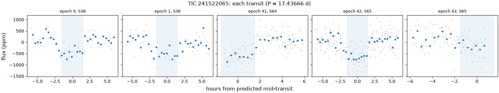
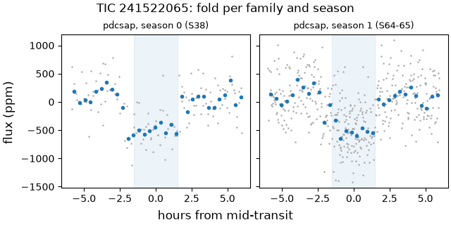
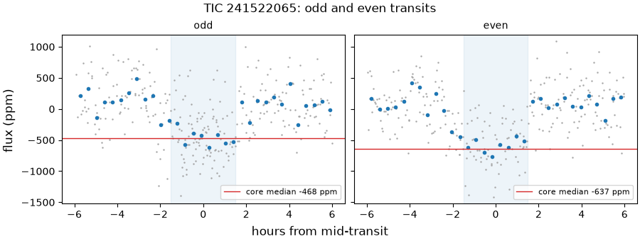
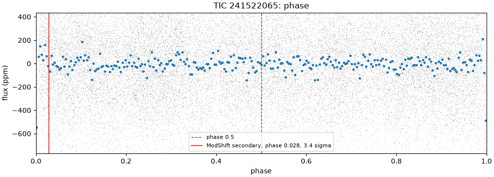
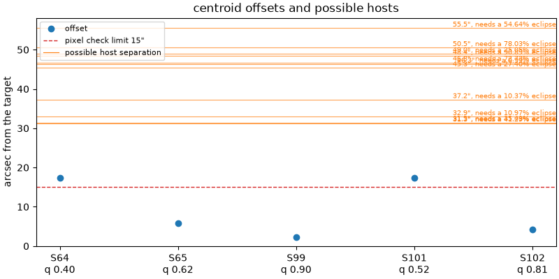

# 241522065-1: TIC 241522065

Call: **held** on 2026-10-22. Rendered from the files in this directory (decision 0028).

## Signal and star

|  |  |
|---|---|
| Signal | 241522065-1, a second-list row (a SPOC TCE that never became a TOI) |
| Names | TIC 241522065, Gaia DR3 6065889518833005312, HIP 67102, HD 119555, TYC 8663-626-1, 2MASS J13451278-5318310 |
| Ephemeris (the search's box) | period 17.436664 d, epoch BTJD 2340.4470, duration 0.1250 d (3.00 h), depth 505 ppm |
| Star (TIC) | Teff 6260 K, radius 1.30 solar radii, Tmag 8.34 |
| RUWE (Gaia DR3) | 0.99 |
| CROWDSAP | S38 0.948; S64 0.949; S65 0.946; none published for S99 (QLP), S101 (QLP), S102 (QLP) |
| Sectors vetted | PDCSAP family: 38, 64 and 65; left out as timing-suspect: 99, 101 and 102 |
| Criteria | search-v2, vet-v3 |
| Runs | vetting 20261020T174317Z-vetting-run-61b5944-2d70 (commit 61b5944, production); TRICERATOPS 20261021T044850Z-vetting-triceratops-cd4e7a2-07c3 (commit cd4e7a2, production); literature 20261021T001540Z-vetting-literature-61b5944-07de (commit 61b5944, production); evidence-only vetting 20261020T175536Z-vetting-run-61b5944-7f4e (commit 61b5944, production); second list 20261020T180844Z-vetting-second-list-61b5944-7096 (commit 61b5944, production) |

## Checks

vet-v3's checks first, then the neighbour table (evidence, never a fail), triage's pixel check as the second list ran it on this row (triage runs it only on novelty passes), TRICERATOPS and the literature search.

| Check | Outcome | Reason |
|---|---|---|
| novelty | inconclusive | matches only SPOC TCE or ExoMiner rows |
| odd_even | pass | pdcsap: odd and even depths agree within 1.9 sigma |
| secondary | pass | no dip at phase 0.5 (-0.7 sigma) |
| sector_depth | pass | pdcsap: depths agree across 3 sectors (p = 0.81) |
| holdout | inconclusive | 0 season(s) could be tested; need 2 |
| signal_present | pass | combined depth is 11.1 sigma |
| shape | pass | U-shaped: grazing in 0% of samples |
| density | pass | transit and TIC densities agree (0.9 sigma) |
| radius | pass | 3.0 Earth radii |
| neighbours | pass | 11 of 93 neighbours could host the signal |
| pixels | pass | centroid offset 2.3" within 15" |
| triceratops | pass | mean FPP 0.0215 < 0.5 and mean NFPP 0.000148 < 0.001 over 10 run(s): likely a planet |
| literature | pass | complete: 15 hits to screen |

## On the star?

Centroids, from the second list's pixel check (pass, centroid offset 2.3" within 15"): the difference-image centroid's offset from the target in each sector. The second list's pass rests on the best-quality sector's offset, S99's, from a timing-suspect sector that vet-v3 leaves out.

| Sector | Offset (arcsec) | Quality | Note |
|---|---|---|---|
| 64 | 17.3 | 0.40 |  |
| 65 | 5.8 | 0.62 |  |
| 99 | 2.3 | 0.90 | timing-suspect: vet-v3 leaves it out; the offset the second list's check judged |
| 101 | 17.3 | 0.52 | timing-suspect: vet-v3 leaves it out |
| 102 | 4.2 | 0.81 | timing-suspect: vet-v3 leaves it out |

Neighbours (pass): 11 of 93 neighbours could host the signal. Each Gaia DR3 star that could make the dip, with its separation from the target (Gaia DR3 6065889518833005312, J2016.0) and the eclipse depth it would need, scaled from the depth in the signals file (505 ppm) as if all its light fell in the aperture, and the TRICERATOPS star matched to it with the distance between them at the TIC's epoch:

| Star | Separation (arcsec) | Eclipse needed | TRICERATOPS's star (distance) | Its depth |
|---|---|---|---|---|
| Gaia DR3 6065889553192741888 | 31.3 | 41.3% | TIC 241522088 (0.0") | 54.9% |
| Gaia DR3 6065889587552484224 | 31.5 | 35.4% | TIC 241522047 (0.0") | 39.5% |
| Gaia DR3 6065889617603724672 | 32.9 | 11% | TIC 241522037 (0.0") | 13.8% |
| Gaia DR3 6065889518833002624 | 37.2 | 10.4% | TIC 241522102 (0.0") | 12.3% |
| Gaia DR3 6065889621912223232 | 45.3 | 27.4% | TIC 241522027 (0.0") | 58.5% |
| Gaia DR3 6065889342725818624 | 46.3 | 0.988% | TIC 241522097 (0.0") | 2.2% |
| Gaia DR3 6065889587552624128 | 46.8 | 72.7% | TIC 241522072 (0.0") | 97.4% |
| Gaia DR3 6065889518833002496 | 48.4 | 90.9% | TIC 241522104 (0.0") | 0% |
| Gaia DR3 6065890343466728832 | 49.0 | 25.1% | TIC 241522032 (0.0") | 39.2% |
| Gaia DR3 6065889553192742400 | 50.5 | 78% | TIC 241522075 (0.0") | 0% |
| Gaia DR3 6065889514525164800 | 55.5 | 54.6% | TIC 241522106 (0.2") | 0% |

TRICERATOPS (pass) took sectors 64 and 65 at 200 s and folded them on the density-prior fit's ephemeris. It gave a mean NFPP 0.000148 (sd 1.1e-05) over 10 run(s) of 1000000 draws. Possible hosts it did not weigh: none. It gave zero depth to Gaia DR3 6065889518833002496 (TIC 241522104), Gaia DR3 6065889553192742400 (TIC 241522075), Gaia DR3 6065889514525164800 (TIC 241522106): its apertures take too little of each one's light to make the dip. Evidence for the review, not a blocker (decision 0026).

RUWE 0.99 (Gaia DR3). A high RUWE points to an unresolved companion, which TRICERATOPS's priors don't condition on; above vet-v3's limit, or without a RUWE, TRICERATOPS is inconclusive.

## A planet rather than a binary?

- Odd and even transits: pass, pdcsap: odd and even depths agree within 1.9 sigma.
- Secondary at phase 0.5: pass, no dip at phase 0.5 (-0.7 sigma).
- Secondary at any phase (LEO-Vetter's ModShift, from triage): the strongest secondary is 3.44 sigma at phase 0.0282, depth 105 ppm; primary 18.8 sigma, tertiary 2.73 sigma at phase 0.359, positive 2.66 sigma at phase 0.335; Fred 1.36.
- The search's other signals on the star: rank 2 at 5.5808 d (period ratio 0.32, SDE 10.5).
- Shape (flat-prior fit): pass, U-shaped: grazing in 0% of samples; median b 0.48.
- Density (flat-prior fit): pass, transit and TIC densities agree (0.9 sigma).
- Radius: pass, 3.0 Earth radii. Rp is 3.00 Earth radii from the flat-prior fit and 3.11 (16th to 84th percentile 3.00 to 3.22) from the density-prior fit; the radius check reads the flat-prior fit.
- Density-prior fit (the TIC density as a prior), whose parameters M4 uses: Rp 3.11 Earth radii (16th to 84th percentile 3.00 to 3.22), b 0.73 (-0.06, +0.05), a/R* 23.67 (-1.72, +1.99), period 17.436716 d (sd 9.7e-05), t0 BTJD 2340.4325 (sd 0.0031 d).
- TRICERATOPS (pass): mean FPP 0.0215 (sd 0.0039) over 10 run(s) of 1000000 draws.

## Real and new?

- Signal present: pass, combined depth is 11.1 sigma.
- Held-out seasons: inconclusive, 0 season(s) could be tested; need 2.
- Sector depths: pass, pdcsap: depths agree across 3 sectors (p = 0.81).
- Novelty, against the catalog snapshot: inconclusive, matches only SPOC TCE or ExoMiner rows. SPOC TCE or ExoMiner rows at the period: ExoMiner vetting_catalog_FFI 241522065-1-S38.
- Literature by name (TIC 241522065, HIP 67102, Gaia DR3 6065889518833005312, HD 119555, TYC 8663-626-1, 2MASS J13451278-5318310) and NASA ADS: pass, complete: 15 hits to screen. The hits are listed below.

ExoFOP, read live: TOIs none; CTOIs none; confirmed planets none.

## Next TESS looks

tess-point places the star in sectors 112, 113 and 114.

Each transit predicted in those sectors, from the density-prior fit's posterior (epochs count periods from its t0); duration 0.1679 d from the density-prior fit:

| Sector | Epoch | Mid (BTJD) | Mid (UTC) | sd (min) | 1 sigma half-width (min) | 3 sigma half-width (min) |
|---|---|---|---|---|---|---|
| 112 | 118 | 4397.965 | 2026-12-23 11:08 | 13.3 | 13.3 | 40.0 |
| 112 | 119 | 4415.402 | 2027-01-09 21:37 | 13.5 | 13.5 | 40.5 |
| 113 | 120 | 4432.838 | 2027-01-27 08:06 | 13.6 | 13.6 | 40.9 |
| 114 | 121 | 4450.275 | 2027-02-13 18:34 | 13.8 | 13.8 | 41.3 |
| 114 | 122 | 4467.712 | 2027-03-03 05:03 | 13.9 | 13.9 | 41.7 |

2-min data and the DDT ask (M3 design, section 4.5): which stars get 2-min data in a sector is decided per cycle, so tess-point can't say whether these sectors will have it. In the sectors fetched, the star never had SPOC 2-min data (QLP at 600 and 200 s; TESS-SPOC at 600 and 200 s). Held: the DDT ask applies only on the maintainer's call and only when the deciding evidence is the transit's shape; a hold on blending does not go, since 2-min data come from the same pixels. Deciding evidence: A third TESS season: sectors 112 to 114 hold predicted transits and give the held-out check a second training season for each held-out one; or a QLP redelivery of sectors 99 to 102 with corrected timestamps, with which the evidence-only run already predicts two held-out seasons (F5).

## Plots

Each transit, against hours from its predicted mid-time:

The fold in each season and each product family:

Odd and even transits side by side:

The whole orbit, with phase 0.5 and LEO-Vetter's ModShift secondary marked:

The second list's pixel check: each sector's centroid offset, with the neighbours that could host the signal:

## Catalogued rows on the star

Every catalogued row on the star in the snapshot. vet-v3 masks only the kinds the search masks (decision 0021); the rest stay unmasked. A row overlaps a transit of ours, numbered by epoch from the signal's t0, when its mask window (2 of its durations, or of 0.25 d where the catalog gives none) meets it. 5 transits of ours have data.

| Source | Kind | Name | Period (d) | Masked | Transits of ours it overlaps |
|---|---|---|---|---|---|
| ExoMiner-v2 | tce | ExoMiner vetting_catalog_FFI 241522065-1-S38 | 17.43766 | no, it is the signal | 5 of 5: 0, 1, 41, 42, 43 |
| eumemic | community | eumemic-allsky f1d17f0 241522065 | 5.58084 | no | 0 of 5 |

## Literature hits

15 paper(s) from the searches that answered, one row per paper.

| Title | Id | Found by |
|---|---|---|
| Validation of the new Hipparcos reduction | doi 10.1051/0004-6361:20078357, arXiv 0708.1752 | ads TIC 241522065 |
|  | 1997A&A...323L..49P | ads TIC 241522065 |
| Stellar and substellar companions of nearby stars from Gaia DR2 | doi 10.1051/0004-6361/201834371, arXiv 1811.08902 | ads TIC 241522065 |
| The Hipparcos–Gaia Catalog of Accelerations: Gaia EDR3 Edition | doi 10.3847/1538-4365/abf93c, arXiv 2105.11662 | ads TIC 241522065 |
|  | 1978mcts.book.....H | ads TIC 241522065 |
| A catalogue of stellar diameters and fluxes for mid-infrared interferometry★ | doi 10.1093/mnras/stz2803, arXiv 1910.00542 | ads TIC 241522065 |
| Fundamental parameters and infrared excesses ofHipparcosstars | doi 10.1111/j.1365-2966.2012.21873.x, arXiv 1208.2037 | ads TIC 241522065 |
|  | 1993yCat.3135....0C | ads TIC 241522065 |
|  | 2014ASPC..485..223B | ads TIC 241522065 |
| Radial Velocity Photon Limits for the Dwarf Stars of Spectral Classes F–M | doi 10.3847/1538-4365/ab609f, arXiv 1912.04120 | ads TIC 241522065 |
| Radial velocities for the HIPPARCOS-GaiaHundred-Thousand-Proper-Motion project | doi 10.1051/0004-6361/201219219, arXiv 1208.3048 | ads TIC 241522065 |
| Bayesian inference of stellar parameters and interstellar extinction using parallaxes and multiband photometry | doi 10.1111/j.1365-2966.2010.17699.x, arXiv 1009.2766 | ads TIC 241522065 |
| Empirical photometric calibration of the Gaia red clump: Colours, effective temperature, and absolute magnitude | doi 10.1051/0004-6361/201731572, arXiv 1710.05803 | ads TIC 241522065 |
| Optimized Trajectories to the Nearest Stars Using Lightweight High-velocity Photon Sails | doi 10.3847/1538-3881/aa813f, arXiv 1704.03871 | ads TIC 241522065 |
|  | 1990A&AS...85..915D | ads TIC 241522065 |

## With the timing-suspect sectors (evidence only)

The same vet with the timing-suspect sectors kept in (decision 0022). It is shown for comparison and never used for the call. Sectors it adds: 99, 101 and 102.

| Check | Without them | With them | Reason with them |
|---|---|---|---|
| novelty | inconclusive | inconclusive | matches only SPOC TCE or ExoMiner rows |
| odd_even | pass | pass | pdcsap: odd and even depths agree within 1.9 sigma; qlp: odd and even depths agree within 0.1 sigma |
| secondary | pass | pass | no dip at phase 0.5 (-0.7 sigma) |
| sector_depth | pass | pass | pdcsap: depths agree across 3 sectors (p = 0.81); qlp: depths agree across 3 sectors (p = 0.86) |
| holdout | inconclusive | pass | 2 held-out seasons predicted |
| signal_present | pass | pass | combined depth is 15.5 sigma |
| shape | pass | pass | U-shaped: grazing in 0% of samples |
| density | pass | pass | transit and TIC densities agree (0.9 sigma) |
| radius | pass | pass | 3.0 Earth radii |

## Review

Reviewer claude-opus-5-5, 2026-10-21. Full brief on 241522065-1, a 505 ppm, 17.437 d dip on HIP 67102 (F7V, Tmag 8.3), promoted from the second list. I found no kill and no hold: the dip is real and periodic from 2021 to 2026 at the same depth in both product families, sits at the target in every sector's difference image, shows no secondary at any phase, and TRICERATOPS's pass rests on stars 33" to 37" out that the pixels exclude and on 0036's drop of an artifact that 2MASS and Gaia show is not a star. Notes for the maintainer: a 4 sigma Hipparcos-Gaia acceleration hints at an unseen companion that high-resolution imaging would test, and the star has a second candidate at 5.58 d (ours and eumemic's).

A finding rated kill or hold is confirmed when no refuter refuted it; a note gets no refuters.

### F1 (on the star, note)

Claim: The second list's pixel pass rests on S99, a timing-suspect sector, but it does not need it: S65, the best sector vet-v3 keeps, gives 5.8", the transit's loss sits at the target in all five sectors, and every possible host is 4.3 or more standard errors from the mean fit; S64's 17.3" fit comes from half a transit that starts at a momentum dump.

Evidence: pixels.json (~/.cache/tess-hunt/drafts/m3-r2/241522065-1): offset_qual 2.33" from S99 (quality 0.90, QLP-era, timing-suspect); S102 4.2" (0.81), S101 17.3" (0.52), S65 5.8" (0.62), S64 17.3" (0.40); S38 was asked but has no image file and no no_image entry. Without the suspect sectors the best-quality sector is S65, 5.8" < 15", so the outcome does not change. /tmp/pixel-diag/summary_second.txt (the diagnosis's printout for the promoted rows, which 0033 says it did not discuss): 3x3-box z at the target against the z the light-curve depth predicts: S102 4.9/3.7, S101 5.2/5.5, S99 4.4/3.3, S65 9.4/8.0, S64 4.0/2.9; fit directions E/N: S102 -0.5/+4.2, S101 -10.1/-14.0, S99 +2.3/-0.3, S65 +3.1/-4.8, S64 -17.2/+1.6; quality-weighted mean E -2.6" N -2.0" (3.3" from the target), sky scatter 10.4". python3 /tmp/t13/241522065-1/pixmean.py (output pixmean.txt): the mean is 0.7 standard errors from the target and 34.3" (7.4 SE) from TIC 241522102 and 35.0" (7.6 SE) from TIC 241522037, the two stars that carry 93% of TRICERATOPS's NFPP (F2); on S64 and S65 alone, 4.3 and 4.6 SE. S64: . ~/.cache/tess-hunt/logs/m3-vars.sh; . ~/.cache/tess-hunt/logs/m3-rerun-vars.sh; cd ~/code/tess-hunt; /tmp/t13/heavy.sh uv run python /tmp/t13/241522065-1/ep43.py $VET2_RUN $SECOND2_RUN/tdi/241522065-1/tic241522065 (ep43.txt): S64 holds one transit, epoch 41 at BTJD 3055.338, inside a data gap 3055.082 to 3055.302 around momentum dumps at 3055.290 to 3055.295 (quality bit 32 in the tdi pickle), so its difference image holds only the post-dump half; its fit (SNRfit 8.1, westward) points at no likely host: the only star in that direction that neighbours.csv marks possible is Gaia DR3 6065889587552624128 (TIC 241522072) at 46.8", which needs a 72.7% eclipse. Inside 15": Gaia DR3 lists only G 19.6 at 7.97" and G 20.8 at 14.6" (neighbours.csv required_depth 9.59 and 23.65, so neither can host), and the TIC's one brighter row there is the ARTIFACT TRICERATOPS drops (F2). No TOI-1399.01-type host is visible; what remains is the usual unresolved zone within about 1" to 2" of the target, which high-resolution imaging would close. ExoFOP lists no imaging (literature.json search.exofop.imaging is empty).

### F2 (on the star, note)

Claim: TRICERATOPS's pass (mean NFPP 0.000148, FPP 0.0215) is carried by stars 33" and 37" out that the pixels exclude, no possible host sits in 0032's 20" to 25" band, and it leans on 0036's drop of ARTIFACT TIC 241522064 at 7.43", which the 2MASS flags and Gaia DR3 show is not a star.

Evidence: python3 /tmp/t13/241522065-1/tric.py ~/.cache/tess-hunt/drafts/m3-r2/241522065-1 (output tric.txt), from triceratops.json and probs.csv (the last of 10 runs): NFPP 1.53e-4, shared by TIC 241522102 (37.0", T 14.14, tdepth 0.123, 59%), TIC 241522037 (33.3", T 14.19, tdepth 0.138, 34%), TIC 241522032 (49.4", 5%) and TIC 241522126 (71.5", 2%). No kept star within 30" has tdepth > 0; the nearest kept star is 17.2" out (T 19.1). The Gaia stars at 19.5" and 23.8" need 115% and 102% (neighbours.csv), so 0032's band holds no possible host. TIC 241522097 (45.9", T 11.54, tdepth 0.022, the easiest host on depth) gets 1e-38: the TIC makes it a giant (R 15.1, d 2489 pc from Gaia plx 0.374 +- 0.035; cd ~/code/tess-hunt; uv run python /tmp/t13/241522065-1/tic_hosts.py, output tic_hosts.txt), so an eclipse on it would last far longer than the 4 h transit. FPP: TP 0.802, PTP 0.144, DTP 0.031, STP 0.022, SEB 3.8e-4, EB 2.4e-29, EBx2P 5.7e-13; contrast list empty. 0036: dropped_stars = ARTIFACT 241522064 and 7 DUPLICATEs whose originals are kept and sit 70" and farther out (/tmp/t13-dup/cone.csv). The ARTIFACT (cd ~/code/tess-hunt; uv run python /tmp/t13/241522065-1/artifact.py ~/.cache/tess-hunt/drafts/m3-r2/241522065-1/neighbours.csv, output artifact.txt, MAST TIC): 2MASS 13451195-5318306, 7.43" at PA 273 deg, Tmag 13.10, J 12.60, H 12.51, Ks 13.81, TWOMflag UUD-002-001-00c-0-0 (J and H not detected, rd_flg 0, so upper limits; Ks flagged c, confused by a bright neighbour's artifact; Ks fainter than J by 1.2 mag), no Gaia id. Gaia DR3's nearest source to that position is G 20.8 at 7.91", while Gaia does list a G 19.6 star 7.97" from the target, so it reaches far fainter than G about 13.5 at this separation. Had the row been a star, it would have needed only a 4.0% eclipse at 6.9" (summary_second.txt), inside the pixel rule's 15", and 0036's measurement expected it weighed (tdepth about 0.04, results/benchmarks/triceratops-tic-duplicates-2026-10-21.md line 114). 0036's limitations don't reach this result: the 12 SPLIT rows (66" to 194") all have tdepth 0, and the NFPP carriers are weighed with TIC parameters (tic_hosts.txt: 241522102 Teff 7228 R 1.63 M 1.62; 241522037 Teff 6421 R 1.81 M 1.29), not 2MASS estimates or solar defaults. 0032 (NFPP moves with the ephemeris): the run used the density-prior fit's ephemeris (t0 2340.4325, P 17.436716, duration 0.168 d; the search's t0 is 21 min later), and any move above 0.001 would land on stars the pixels exclude at 7 SE (F1). If SPOC's CROWDSAP (0.946 to 0.949) counted the artifact's 1.25% of the target's flux (cone.csv flux_vs_target 0.0125), the PDCSAP depth is over-corrected by at most about 1.3%, 0.6% in radius.

### F3 (on the star, note)

Claim: The Hipparcos-Gaia Catalog of Accelerations (EDR3 edition, an ADS hit) gives HIP 67102 a chi-square of 19.2, about a 4 sigma acceleration, so an unseen companion is likely despite RUWE 0.99; TRICERATOPS's priors don't condition on it, but even with a companion taken as certain the dip sits on the companion in only 13.5% of the bound-companion scenarios, and on an eclipsing binary in 0.3%.

Evidence: /tmp/t13/241522065-1/hgca.tsv (curl 'https://vizier.cds.unistra.fr/viz-bin/asu-tsv?-source=J/ApJS/254/42/catalog&HIP=67102&-out=HIP,Gaia,pmRA,e_pmRA,pmDE,e_pmDE,pmRAhg,e_pmRAhg,pmDEhg,e_pmDEhg,pmRAhip,pmDEhip,chi2'): Gaia EDR3 pm -20.197 +- 0.025, 18.565 +- 0.023 mas/yr against the Hipparcos-Gaia long-baseline pm -20.325 +- 0.024, 18.481 +- 0.029; chi2 19.21 (2 dof): p 6.7e-5, 3.99 sigma; 3 sigma is chi2 11.83 (cd ~/code/tess-hunt; uv run python /tmp/t13/241522065-1/hgca.py, output hgca.txt). The RA term alone is 3.7 sigma and Dec 2.3 sigma; the difference is about 72 m/s at the 10.14 mas parallax. Against it: Kervella et al. 2019 (DR2, also an ADS hit; /tmp/t13/241522065-1/kervella.tsv from J/A+A/623/A72/hipgpma) PMa S/N 0.97 (Hipparcos) and 0.82 (DR2), BinH 0, BinG2 0, dVt 58 +- 71 m/s. Gaia DR3 (/tmp/t13/241522065-1/gaia_dr3.csv, Gaia archive TAP): RUWE 0.990, ipd_frac_multi_peak 0, ipd_gof_harmonic_amplitude 0.021, non_single_star 0, RV 36.61 +- 0.15 km/s over 10 transits, rv_chisq_pvalue 0.79, rv_renormalised_gof -1.20, rv_amplitude_robust 0.94 km/s. Hipparcos (I/239) MultFlag empty, HvarType C; WDS (B/wds) has no entry within 2'. So: a possible companion of unknown mass and separation, with no sign of a close stellar one. From probs.csv (last run; tric.txt): PTP 0.1437 against STP 0.0219, SEB 3.8e-4, SEBx2P 4.8e-5, so the companion carries 0.135 of the bound-companion weight, almost all of it a planet on the companion (STP, 4.8 Re), and 0.0026 an eclipsing binary. The transit density agrees with the F7V TIC star (0.9 sigma), which argues against a small dense companion as host. Nothing here moves FPP toward 0.5. What would settle the companion: high-resolution imaging and an RV trend. Flagged in hits_flagged for the measurement, not for any claim in the text.

### F4 (a planet, note)

Claim: No secondary at any phase: LEO-Vetter's ModShift secondary (3.44 sigma at phase 0.028) fails all three of its own tests even without the red-noise scaling, a box scan finds nothing above the light curve's own spread, and odd/even, shape and density agree with a planet.

Evidence: $TRIAGE_RUN/evidence/241522065-1.json leo_flux.evidence.metrics (all 9 transits, 4 of them timing-suspect): sig_sec 3.442 at phs_sec 0.0282 (0.49 d after the primary), dep_sec 105 +- 30 ppm, sig_ter 2.731 (0.359), sig_pos 2.660 (0.335), sig_pri 18.83, Fred 1.362, FA1 5.090, FA2 2.689. LEO's rule (.venv/lib/python3.12/site-packages/leo_vetter/thresholds.py:170-189; criteria/triage-v1.toml MS4 0, MS5 -1, MS6 -1): MS4 = 3.442/1.362 - 5.090 = -2.56 (with Fred 1, -1.65); MS5 = 3.442 - 2.731 - 2.689 = -1.98; MS6 = 3.442 - 2.660 - 2.689 = -1.91. Unlike 370977908-1, it would stay unflagged without the red-noise scaling, and the secondary is only 0.71 sigma above the tertiary. . ~/.cache/tess-hunt/logs/m3-vars.sh; . ~/.cache/tess-hunt/logs/m3-rerun-vars.sh; cd ~/code/tess-hunt; /tmp/t13/heavy.sh uv run python /tmp/t13/241522065-1/scan.py $VET2_RUN (scan.txt), the light curve rebuilt as vet.py builds it, boxes of the density-prior duration 0.168 d: at the ModShift secondary's phase -30 +- 25 ppm (PDCSAP 38, 64, 65) and -53 +- 20 (all six sectors), both rises; phase 0.5 -1 +- 22 and 6 +- 20. Scan over phase 0.02 to 0.98 (PDCSAP): strongest dip 0.802, 103 +- 20 ppm (5.2 sigma white) from events +130, -85, +121, +157, +129 (/tmp/t13/241522065-1/phase802.py, phase802.txt), one of which (BTJD 3086.759) falls on a 5.58 d transit (F6); the scan's sd is 1.72 sigma and its strongest rise -4.9 sigma (phase 0.104), so it is red noise, and it is not in the six-sector top eight. The six-sector scan's dip at 0.358 and rise at 0.334 come from one S101 jump after its gap at 4107.04 to 4107.27 (+536 ppm at 4107.823, -760 at 4107.389), the same feature ModShift's tertiary and positive picked up. Odd/even: vet-v3 1.9 sigma (pdcsap) and 0.1 sigma (qlp) against max 3.0; LEO trapezoid odd 627 +- 26, even 557 +- 25 ppm (1.9 sigma); per event, white errors, -2.6 sigma on PDCSAP, driven by the partial epoch 43 (F5), -1.6 on all six. Shape: b 0.48 (flat-prior) and 0.73 (density-prior), Rp/Rs 0.022, grazing in 0% of samples; density 0.9 sigma from the TIC's; Rp 3.0 to 3.1 Re; TRICERATOPS EB 2.4e-29 and EBx2P 5.7e-13 (probs.csv).

### F5 (real and new, note)

Claim: Two of the five PDCSAP transits are partial and sit at momentum dumps (0031's partly covered transit), and one reads 155 ppm in the flattened box because of a pre-dump ramp; the clean PDCSAP transits and the four QLP transits agree, no sector dominates, and the QLP transits land where the PDCSAP-only fit predicts.

Evidence: . ~/.cache/tess-hunt/logs/m3-vars.sh; . ~/.cache/tess-hunt/logs/m3-rerun-vars.sh; cd ~/code/tess-hunt; /tmp/t13/heavy.sh uv run python /tmp/t13/241522065-1/scan.py $VET2_RUN (scan.txt) per-event box depths, density-prior ephemeris: epoch 0 (S38) 415 +- 57, 1 (S38) 551 +- 62, 41 (S64) 564 +- 50 over 52 cadences, 42 (S65) 582 +- 41, 43 (S65) 155 +- 50 over 56; QLP 98 (S99) 598 +- 42, 99 (S99) 643 +- 42, 102 (S101) 431 +- 73, 103 (S102) 467 +- 60. /tmp/t13/241522065-1/ep43.py (ep43.txt; tdi pickles in $SECOND2_RUN/tdi/241522065-1/tic241522065): epoch 41 at 3055.338 has no data from 3055.082 to 3055.302, around dumps at 3055.290 to 3055.295, so ingress is missing; epoch 43 at 3090.211 has data only to 3090.255, the gap before the dumps at 3090.464 to 3090.469, so egress is missing, and 15 FFI cadences within 0.33 d of mid-transit carry flags 32, 128 or 164. Epoch 42 has no flagged cadence within 0.33 d and its nearest dump is 3.4 d away. . ~/.cache/tess-hunt/logs/m3-vars.sh; . ~/.cache/tess-hunt/logs/m3-rerun-vars.sh; cd ~/code/tess-hunt; /tmp/t13/heavy.sh uv run python /tmp/t13/241522065-1/ep43raw.py $VET2_RUN (ep43raw.txt), unflattened PDCSAP against a line fit to -0.6 to -0.1 d: epoch 43 in transit -547 ppm (pre-ingress slope 1387 ppm/d), epoch 42 -619, so epoch 43's low box depth is the flattened baseline at the gap, not a missing transit. Clean PDCSAP (0, 1, 42) weighted 531 +- 29 ppm; QLP 572 +- 25: the families agree, so no sign of a QLP dilution problem. Events per sector: S38 2, S64 1 half, S65 2 (one partial), S99 2, S101 1, S102 1. Holdout is inconclusive (0 seasons testable, need 2; checks.json), but the QLP transits, 55 to 60 periods after the last PDCSAP one, sit at the times the PDCSAP-only density-prior fit predicts at full depth, which is what the evidence-only run's holdout pass (2 held-out seasons predicted) records. QLP's S99 to S104 timing error (medians under 10 min, 0022) is small against the 4 h box. sector_depth passes (pdcsap p 0.81; qlp p 0.86).

### F6 (a planet, note)

Claim: The star carries a second periodic dip at 5.581 d, found by the search (rank 2) and published by eumemic, at a period ratio of 3.124 that is no harmonic and no eclipsing-binary pair; if both are on the target this is a two-candidate system, which by itself lowers the false-positive odds.

Evidence: checks.json other_signals: rank 2, P 5.580849, t0 2339.0053, SDE 10.5, 127 ppm, period_ratio 0.3201. $SNAP3/raw/eumemic/results_public_candidates_allsky.csv row TIC241522065_P5.581: P 5.580837, depth 148 ppm, MES 8.9, 26 transits, Rp 1.72 Re, tier C (MES < 10), set 'neighbour<15"' with nearest_capable_arcsec 7.43 (the ARTIFACT of F2), centroid_offset_arcsec 14.2, FPP 0.043, NFPP 1.3e-5. The dossier lists it as eumemic-allsky f1d17f0, unmasked (0021). . ~/.cache/tess-hunt/logs/m3-vars.sh; . ~/.cache/tess-hunt/logs/m3-rerun-vars.sh; cd ~/code/tess-hunt; /tmp/t13/heavy.sh uv run python /tmp/t13/241522065-1/scan.py $VET2_RUN (scan.txt): at the search's ephemeris and 3 h box, 153 +- 14 ppm over 14 PDCSAP events (S38 147 +- 30, S64 116 +- 22, S65 192 +- 22) and 133 +- 12 over 23 events in six sectors; no 5.58 d event falls within one duration of a 17.44 d transit. 17.436716 / 5.580849 = 3.1244: not on vet-v3's harmonics, and an eclipsing binary's two eclipses share one period, so the two signals are not one binary's pair. Whether the 5.58 d dip is on the target was not tested here.

### F7 (real and new, note)

Claim: Not known as a planet: the only catalogue row at this period is ExoMiner's FFI row for the S38 TESS-SPOC TCE, ExoFOP held no TOI or CTOI, and none of the 15 ADS hits names the star as a planet host, binary or variable or reports a period; four dismissals need a reason the title doesn't give.

Evidence: $SNAP3/raw/ExoMiner-v2/vetting_catalog_FFI.csv row 241522065-1-S38: P 17.43766, MES 10.30, mean_score 0.811 +- 0.068, label PC, n_tois_in_tic 0. grep for 241522065, 6065889518833005312, HIP 67102 and HD 119555 over $SNAP3/raw (gz files included) finds only that row and eumemic's 5.58 d candidate (F6): nothing in TOI, CTOI, archive, VSX, Gaia-EB or TESS-EB. literature.json search.exofop (LIT3_RUN): status ok, tois, ctois, planets, imaging, files and comments all empty; I could not reread ExoFOP live (connection refused, three tries on 2026-10-21). VSX within 3' (VizieR B/vsx/vsx): four variables 133" to 176" out with periods 0.0775 to 0.467 d, none commensurate (17.4367 / 0.467423 = 37.30). arXiv, OpenAlex and Zenodo returned 0 for all six names; the ADS answer (15) is carried from 20261020T091938Z-vetting-literature-2315775-066c by LIT3's resume (from_run). Screened all 15: catalogues, surveys and calibration samples. Dismissed for reasons the title doesn't show: Kervella et al. 2019 (2019A&A...623A..72K): no proper-motion anomaly for this star (F3); McDonald et al. 2012 (2012MNRAS.427..343M): no infrared excess, EIR 1.036, W4 ratio 1.059 (VizieR J/MNRAS/427/343, HIP 67102); de Geus 1990 Walraven photometry of southern OB associations (1990A&AS...85..915D): the star is not a Sco-Cen member, its pmDec +18.6 mas/yr has the opposite sign to Sco-Cen's and its RV is 36.6 km/s, and Hipparcos rates it constant (HvarType C, Hpscat 0.019 mag); Ruiz-Dern et al. 2018 red clump calibration (2018A&A...609A.116R): the star is a dwarf (TIC logg 4.30, Gaia FLAME logg 4.25, R 1.30 to 1.34), so at most a calibration star. Heller et al. 2017 photon sails (2017AJ....154..115H) computes travel times to about 22,000 stars within about 300 light-years (arXiv 1704.03871 abstract), which is where a star at 98.6 pc comes in. Only the HGCA hit is flagged (F3).

Literature hits flagged for the maintainer to read: doi 10.3847/1538-4365/abf93c, arXiv 2105.11662.

## Call

Outcome: **held**, 2026-10-22.

Reasons: Nothing argues against a planet: the dip is real and periodic from 2021 to 2026 at the same depth in both product families, sits on the target in every sector's difference image, and passes TRICERATOPS and every other check. It can't pass only because TESS's two seasons with trustworthy timestamps can't test each other, so the held-out check is inconclusive.

Rests on: holdout.

Criteria: vet-v3.

Deciding evidence: A third TESS season: sectors 112 to 114 hold predicted transits and give the held-out check a second training season for each held-out one; or a QLP redelivery of sectors 99 to 102 with corrected timestamps, with which the evidence-only run already predicts two held-out seasons (F5).

Promotion: The TCE matched is ExoMiner vetting_catalog_FFI 241522065-1-S38, a SPOC TCE that never became a TOI. Promoted by the maintainer in decision 0033 on the bar the nine shortlisted signals met in triage.
