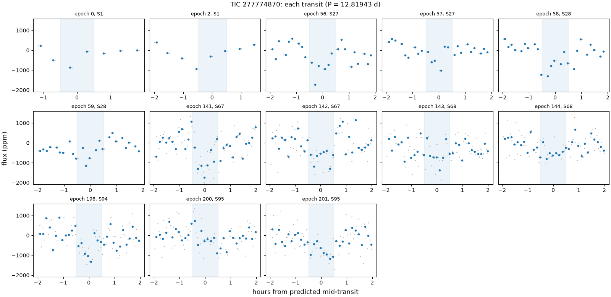
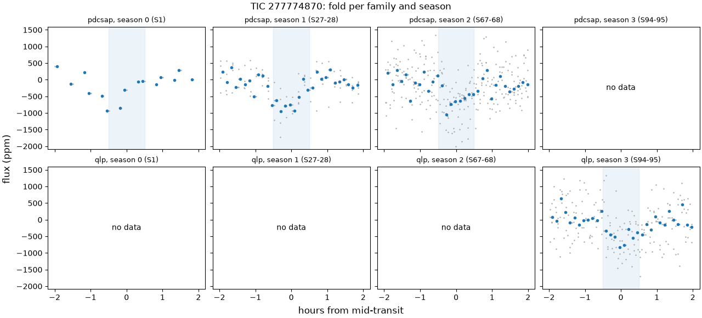
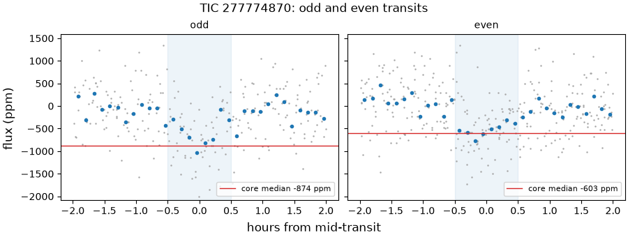
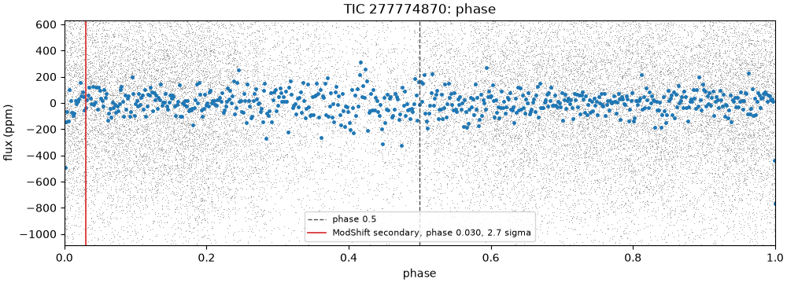
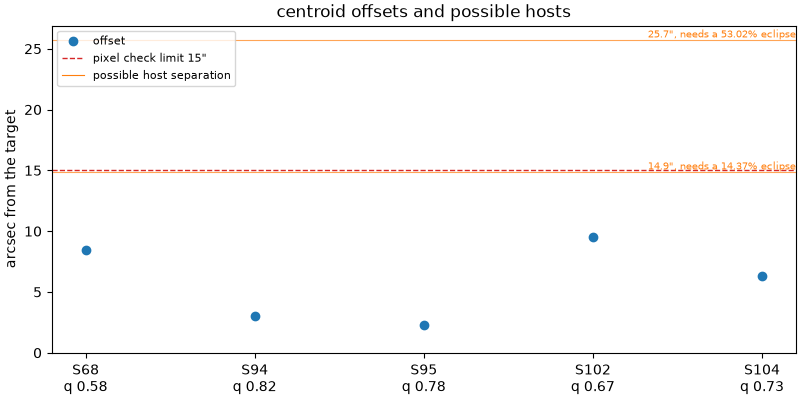

# 277774870-1: TIC 277774870

Call: **held** on 2026-10-22. Rendered from the files in this directory ([decision 0028](../../../docs/decisions/0028-outcomes-and-calls.md)); the review and the call are quoted, not rendered ([decision 0037](../../../docs/decisions/0037-quoted-text-in-the-dossier.md)).

## Signal and star

|  |  |
|---|---|
| Signal | 277774870-1, a second-list row (a SPOC TCE that never became a TOI) |
| Names | TIC 277774870, Gaia DR3 6384126735525555328, TYC 9340-702-1, 2MASS J22542064-7025082 |
| Ephemeris (the search's box) | period 12.819429 d, epoch BTJD 1325.9164, duration 0.0417 d (1.00 h), depth 586 ppm |
| Star (TIC) | Teff 6126 K, radius 1.52 solar radii, Tmag 9.50 |
| RUWE (Gaia DR3) | 1.02 |
| CROWDSAP | S1 0.966; S27 0.987; S28 0.990; S67 0.990; S68 0.990; none published for S94 (QLP), S95 (QLP), S102 (QLP), S103 (QLP), S104 (QLP) |
| Sectors vetted | PDCSAP family: 1, 27, 28, 67 and 68; QLP family: 94 and 95; left out as timing-suspect: 102, 103 and 104 |
| Criteria | search-v2, vet-v3 |
| Runs | vetting 20261020T174317Z-vetting-run-61b5944-2d70 (commit 61b5944, production); TRICERATOPS 20261021T044850Z-vetting-triceratops-cd4e7a2-07c3 (commit cd4e7a2, production); literature 20261021T001540Z-vetting-literature-61b5944-07de (commit 61b5944, production); evidence-only vetting 20261020T175536Z-vetting-run-61b5944-7f4e (commit 61b5944, production); second list 20261020T180844Z-vetting-second-list-61b5944-7096 (commit 61b5944, production); titles 20261026T155726Z-vetting-titles-0b1deac-1d19 (commit 0b1deac, production) |

## Checks

vet-v3's checks first, then the neighbour table (evidence, never a fail), triage's pixel check as the second list ran it on this row (triage runs it only on novelty passes), TRICERATOPS and the literature search.

| Check | Outcome | Reason |
|---|---|---|
| novelty | inconclusive | matches only SPOC TCE or ExoMiner rows |
| odd_even | pass | pdcsap: odd and even depths agree within 1.6 sigma; qlp: odd and even depths agree within 0.3 sigma |
| secondary | pass | no dip at phase 0.5 (-0.7 sigma) |
| sector_depth | pass | pdcsap: depths agree across 4 sectors (p = 0.41); qlp: depths agree across 2 sectors (p = 0.06) |
| holdout | pass | 2 held-out seasons predicted |
| signal_present | pass | combined depth is 13.0 sigma |
| shape | pass | U-shaped: grazing in 7% of samples |
| density | pass | transit and TIC densities agree (2.4 sigma) |
| radius | pass | 4.8 Earth radii |
| neighbours | pass | 2 of 9 neighbours could host the signal |
| pixels | pass | centroid offset 3.0" within 15" |
| triceratops | inconclusive | mean FPP 0.933, mean NFPP 0.045 over 10 run(s): neither likely a planet nor likely a nearby false positive |
| literature | pass | complete: 3 hits to screen |

## On the star?

Centroids, from the second list's pixel check (pass, centroid offset 3.0" within 15"): the difference-image centroid's offset from the target in each sector. The second list's pass rests on the best-quality sector's offset, S94's.

| Sector | Offset (arcsec) | Quality | Note |
|---|---|---|---|
| 68 | 8.5 | 0.58 |  |
| 94 | 3.0 | 0.82 | the offset the second list's check judged |
| 95 | 2.3 | 0.78 |  |
| 102 | 9.5 | 0.67 | timing-suspect: vet-v3 leaves it out |
| 104 | 6.3 | 0.73 | timing-suspect: vet-v3 leaves it out |

Neighbours (pass): 2 of 9 neighbours could host the signal. Each Gaia DR3 star that could make the dip, with its separation from the target (Gaia DR3 6384126735525555328, J2016.0) and the eclipse depth it would need, scaled from the depth in the signals file (586 ppm) as if all its light fell in the aperture, and the TRICERATOPS star matched to it with the distance between them at the TIC's epoch:

| Star | Separation (arcsec) | Eclipse needed | TRICERATOPS's star (distance) | Its depth |
|---|---|---|---|---|
| Gaia DR3 6384126701165816832 | 14.9 | 14.4% | TIC 277774871 (0.0") | 14.4% |
| Gaia DR3 6384126735525555456 | 25.7 | 53% | TIC 277774869 (0.0") | 60.6% |

TRICERATOPS (inconclusive) took sectors 67 and 68 at 200 s and folded them on the density-prior fit's ephemeris. It gave a mean NFPP 0.045 (sd 0.0048) over 10 run(s) of 1000000 draws. Possible hosts it did not weigh: none.

RUWE 1.02 (Gaia DR3). A high RUWE points to an unresolved companion, which TRICERATOPS's priors don't condition on; above vet-v3's limit, or without a RUWE, TRICERATOPS is inconclusive.

## A planet rather than a binary?

- Odd and even transits: pass, pdcsap: odd and even depths agree within 1.6 sigma; qlp: odd and even depths agree within 0.3 sigma.
- Secondary at phase 0.5: pass, no dip at phase 0.5 (-0.7 sigma).
- Secondary at any phase (LEO-Vetter's ModShift, from triage): the strongest secondary is 2.67 sigma at phase 0.0299, depth 125 ppm; primary 12.9 sigma, tertiary 2.46 sigma at phase 0.0111, positive 2.95 sigma at phase 0.864; Fred 1.01.
- The search's other signals on the star: rank 2 at 1.1509 d (period ratio 0.0898, SDE 8.1).
- Shape (flat-prior fit): pass, U-shaped: grazing in 7% of samples; median b 0.76.
- Density (flat-prior fit): pass, transit and TIC densities agree (2.4 sigma).
- Radius: pass, 4.8 Earth radii. Rp is 4.82 Earth radii from the flat-prior fit and 67.94 (16th to 84th percentile 32.45 to 113.07) from the density-prior fit; the radius check reads the flat-prior fit.
- Density-prior fit (the TIC density as a prior), whose parameters M4 uses: Rp 67.94 Earth radii (16th to 84th percentile 32.45 to 113.07), b 1.39 (-0.22, +0.28), a/R* 17.68 (-1.08, +1.35), period 12.819544 d (sd 2.4e-05), t0 BTJD 1325.9017 (sd 0.0034 d).
- TRICERATOPS (inconclusive): mean FPP 0.933 (sd 0.0097) over 10 run(s) of 1000000 draws.

## Real and new?

- Signal present: pass, combined depth is 13.0 sigma.
- Held-out seasons: pass, 2 held-out seasons predicted.
- Sector depths: pass, pdcsap: depths agree across 4 sectors (p = 0.41); qlp: depths agree across 2 sectors (p = 0.06).
- Novelty, against the catalog snapshot: inconclusive, matches only SPOC TCE or ExoMiner rows. SPOC TCE or ExoMiner rows at the period: ExoMiner vetting_catalog_FFI 277774870-1-S56-69.
- Literature by name (TIC 277774870, Gaia DR3 6384126735525555328, TYC 9340-702-1, 2MASS J22542064-7025082) and NASA ADS: pass, complete: 3 hits to screen. The hits are listed below.

ExoFOP, read live: TOIs none; CTOIs none; confirmed planets none.

## Next TESS looks

tess-point places the star in no upcoming sector.

2-min data and the DDT ask ([decision 0026](../../../docs/decisions/0026-triceratops.md)): which stars get 2-min data in a sector is decided per cycle, so tess-point can't say whether these sectors will have it. In the sectors fetched, the star never had SPOC 2-min data (QLP at 200 s; TESS-SPOC at 1800, 600 and 200 s). With no upcoming TESS look there is no DDT ask; M4 decides this signal's route.

## Plots

Each transit, against hours from its predicted mid-time:

The fold in each season and each product family:

Odd and even transits side by side:

The whole orbit, with phase 0.5 and LEO-Vetter's ModShift secondary marked:

The second list's pixel check: each sector's centroid offset, with the neighbours that could host the signal:

## Catalogued rows on the star

Every catalogued row on the star in the snapshot. vet-v3 masks only the kinds the search masks ([decision 0021](../../../docs/decisions/0021-vet-masks-search-kinds.md)); the rest stay unmasked. A row overlaps a transit of ours, numbered by epoch from the signal's t0, when its mask window (2 of its durations, or of 0.25 d where the catalog gives none) meets it. 13 transits of ours have data.

| Source | Kind | Name | Period (d) | Masked | Transits of ours it overlaps |
|---|---|---|---|---|---|
| ExoMiner-v2 | tce | ExoMiner vetting_catalog_FFI 277774870-1-S56-69 | 12.81755 | no, it is the signal | 4 of 13: 141, 142, 143, 144 |

## Literature hits

3 paper(s) from the searches that answered, one row per paper. Titles come only from open sources: the search's own arXiv, OpenAlex and Zenodo hits, else OpenAlex's record for the paper's DOI; a paper none of them titles has a blank title ([decision 0038](../../../docs/decisions/0038-literature-trim-and-username-scrub.md)).

| Title | Id | Found by |
|---|---|---|
| A catalogue of stellar diameters and fluxes for mid-infrared interferometry★ | doi 10.1093/mnras/stz2803, arXiv 1910.00542 | ads TIC 277774870 |
|  | 2014ASPC..485..223B | ads TIC 277774870 |
| Empirical photometric calibration of the Gaia red clump: Colours, effective temperature, and absolute magnitude | doi 10.1051/0004-6361/201731572, arXiv 1710.05803 | ads TIC 277774870 |

## With the timing-suspect sectors (evidence only)

The same vet with the timing-suspect sectors kept in ([decision 0022](../../../docs/decisions/0022-vet-without-timing-suspect-sectors.md)). It is shown for comparison and never used for the call. Sectors it adds: 102, 103 and 104.

| Check | Without them | With them | Reason with them |
|---|---|---|---|
| novelty | inconclusive | inconclusive | matches only SPOC TCE or ExoMiner rows |
| odd_even | pass | pass | pdcsap: odd and even depths agree within 1.6 sigma; qlp: odd and even depths agree within 0.1 sigma |
| secondary | pass | pass | no dip at phase 0.5 (-0.7 sigma) |
| sector_depth | pass | pass | pdcsap: depths agree across 4 sectors (p = 0.41); qlp: depths agree across 2 sectors (p = 0.06) |
| holdout | pass | fail | transits missing where predicted in season(s) [3] |
| signal_present | pass | pass | combined depth is 13.2 sigma |
| shape | pass | pass | U-shaped: grazing in 7% of samples |
| density | pass | pass | transit and TIC densities agree (2.4 sigma) |
| radius | pass | pass | 4.8 Earth radii |

## Review

Quoted from `review.json`, as the reviewer and the refuters wrote it: its numbers, paths and run names are theirs, not rendered from the runs ([decision 0037](../../../docs/decisions/0037-quoted-text-in-the-dossier.md)). [The vetting README](../README.md) says what its paths and run names stand for.

Reviewer claude-opus-5-5, 2026-10-21. Full brief on a second-list row with no failed check. The transit is about a fifth as long as a central transit of the 1.52 Rsun TIC star, so on that star it must graze or be very eccentric; the light curve fits that as well as a central transit across a dense star (delta chi2 0.55), and TRICERATOPS's FPP of 0.933 sits on an M-dwarf pair bound to the target (SEB 0.73, SEBx2P 0.10). Gaia DR3's RVs rule out an eclipsing binary on the target, the pixels place the loss at the target rather than the 14.9 arcsec neighbour, no transit or sector dominates, the evidence-only holdout fail is a baseline offset in one partial S104 transit, and nothing in the literature names the star.

A finding rated kill or hold is confirmed when no refuter refuted it; a note gets no refuters.

### F1 (a planet, hold): confirmed

Claim: On the TIC star the transit lasts about a fifth of a central transit, so a planet there needs a grazing orbit whose size the data can't bound or an eccentricity of 0.7 to 0.9, and the light curve fits a central transit across a much denser star just as well; TRICERATOPS puts 83% on an eclipsing pair bound to the target.

Evidence: Duration: TIC rho 0.333 solar (0.469 g/cm3) and R 1.516 (checks.json star) give a/R* 15.97 and a central T14 of 6.32 h for k 0.03. Observed T14: 1.05 h (0.94 to 1.16, 16th to 84th) from the flat-prior fit's samples, 0.0493 d (1.18 h) from LEO-Vetter's trapezoid (TRIAGE_RUN evidence/277774870-1.json trap_dur), box 1.00 h. LEO-Vetter's own transit fit lands at b 0.977 +- 0.045 and a/R* 25.4 +- 7.6 against 15.98 +- 1.04 from the star (same file). Flat-prior fit (checks.json fit and density): log rho 1.560 (-0.781, +0.352), 36.3 g/cm3, 77 times the TIC's; density passes at 2.40 sigma on the side facing the TIC value (0016), yet only 0.05% of its 96000 samples lie within 3 TIC sd (0.098 dex) of the TIC density and none within 2. Density-prior fit (checks.json fit_prior, fit_prior_samples.npz): b 1.39 (-0.22, +0.28), Rp/R* 0.41, Rp 67.9 Earth radii (p16 32.4, p84 113.1); 95.8% of samples grazing (b > 1 - k); every sample within 2 sd of the TIC density grazes, b 1.20 to 1.65 (16th to 84th); 9.0% fall under the radius check's 22. Likelihood: on vet's fit light curve rebuilt from the run (592 cadences in S1, S27, S28, S67, S68; light curve sha256 18eae3af...c7d3 as VET2_RUN's provenance records; S102 to S104 dropped; nothing masked), the best chi2 of 3000 random samples is 587.34 for the flat-prior fit and 587.89 for the density-prior fit, against 831.06 with no transit. A delta chi2 of 0.55: the data don't separate a grazing transit of the TIC star from a central transit across a dense star. Eccentricity (0031's cause): the photo-eccentric factor (rho ratio)^(1/3) needs e >= 0.896 (omega 90 deg, periastron 1.67 R*) at the fit's median density and e >= 0.691 (periastron 4.93 R*) at its 16th percentile. TRICERATOPS (TRIC3A_RUN signals/277774870-1: mean FPP 0.933 sd 0.0097, mean NFPP 0.045, 10 runs, dropped_stars empty): the last run's probs.csv (FPP 0.9197 and NFPP 0.0521, as fpp[9] and nfpp[9]) gives SEB 0.726 (a 0.21 plus 0.11 Msun pair, radii 0.24 and 0.14 Rsun), SEBx2P 0.104, TP 0.069 (its fit b 1.09, Rp 18.4 Earth radii), STP 0.029, PTP 0.011, NEB 0.045, and every EB-on-target scenario together 0.005. What decides it: tess-point places the star in no upcoming sector (dossier), so no new TESS 2-min data. Ground-based transit photometry in two or more bands tells an M-dwarf pair diluted by a 6126 K star (deeper in the red) from a transit of the target, and higher SNR on the shape separates grazing from flat-bottomed; high-resolution (AO) imaging bounds a bound companion; precise RVs would bound a grazing body's mass. The density-prior ephemeris (period sd 2.4e-05 d, t0 sd 0.0034 d) carries to 9.5 min (1 sd, correlation ignored) on 2026-10-21 and 10.0 min on 2027-06-01, so transits can be scheduled. Numbers from /tmp/t13/277774870-1/chi2.py, run with: /tmp/t13/heavy.sh /bin/bash -lc "cd ~/code/tess-hunt && uv run python /tmp/t13/277774870-1/chi2.py $VET2_RUN" (VET2_RUN=20261020T174317Z-vetting-run-61b5944-2d70); the ephemeris spread is sqrt(0.0034^2 + (n * 2.4e-05)^2) at epochs 235 and 252.

- Refuter 1: did not refute. Every number F1 rests on reproduces from the run files.

What I ran:
- I copied the reviewer's script to /tmp/t13/277774870-1/refute-F1-reproduce/chi2_orig.py and added extra.py there, which uses abs() density windows, a second random seed and a Nelder-Mead optimisation of each fit.
- I ran both with: /tmp/t13/heavy.sh /bin/bash -lc "cd ~/code/tess-hunt && uv run python $D/chi2_orig.py $VET2_RUN && uv run python $D/extra.py $VET2_RUN". The run exited 0 and the output is in out.txt in the same folder.

The rerun output:
- Light curve sha256 18eae3af...c7d3, which matches VET2_RUN/provenance.json light_curve_277774870. S102 to S104 were dropped. 592 cadences in S1, S27, S28, S67 and S68.
- Chi2 with no transit 831.06. Best of 3000 samples: 587.34 for the flat-prior fit and 587.89 for the density-prior fit.
- Flat-prior fit: T14 1.049 h (0.944 to 1.158). 0.05% of samples within 3 TIC sd (51 of 96000 by abs()), none within 2.
- Density-prior fit: 95.75% grazing; 72480 samples within 2 sd of the TIC density, all grazing, b 1.195 to 1.652; P(Rp<22) 0.0897.
- From the TIC star: a/R* 15.97 and a central T14 of 6.321 h.
- Minimum eccentricity 0.896 (periastron 1.67 R*) at the median density and 0.691 (4.93 R*) at the 16th percentile.

Run files I read directly:
- checks.json: density tension 2.3995 and rho 36.29 against 0.469 g/cm3 (77.4 times); fit_prior b 1.388 (-0.219, +0.276), Rp 67.9 (32.4 to 113.1); upcoming_sectors is [].
- TRIAGE_RUN evidence/277774870-1.json: trap_dur 0.04935 d, transit_b 0.977 +- 0.045, transit_aRs 25.45 +- 7.55, aRs 15.98 +- 1.04.
- TRIC3A_RUN triceratops.json: fpp_mean 0.9326, fpp_sd 0.0097, nfpp_mean 0.0450, 10 runs, dropped_stars empty, last fpp 0.9197 and nfpp 0.0521.
- TRIC3A_RUN probs.csv:
  - SEB 0.7259 (0.214 and 0.112 Msun, 0.242 and 0.136 Rsun) and SEBx2P 0.1045. Together 0.830, the claim's 83%.
  - TP 0.0691 (b 1.088, Rp 18.41), STP 0.0293, PTP 0.0111.
  - NEB rows sum to 0.0453. The EB-on-target rows sum to 0.0049.
- The dossier says tess-point places the star in no upcoming sector.
- Ephemeris spread: sqrt(0.00344^2 + (n*2.40e-5)^2) gives 9.51 min at epoch 235 and 10.02 min at epoch 252.

Robustness checks:
- Seed 1 gives 587.42 for the flat-prior fit and 587.69 for the density-prior fit, a delta chi2 of 0.27.
- Optimising the flat-prior fit gives chi2 587.11. Optimising the density-prior fit with its TIC prior penalty gives chi2 588.88 plus a penalty of 1.3.
- Both stay small against the no-transit 831, so "the data don't separate" holds.

Wording nits, not refutations:
- "About a fifth" is 0.17 against the flat-prior fit and 0.19 against LEO-Vetter's trapezoid.
- Epoch 252 falls on 2027-05-31 UTC, not 06-01. Its 10.0 min is unchanged.
- Refuter 2: did not refute. F1 reads the rules correctly, and hold is the right rating for it.

1. It claims no check is wrong, so design 4.8's route to a decision record doesn't apply. The checks in checks.json read the flat-prior fit, as M3 design 4.2 and decision 0024 ("shape, density and radius read the flat-prior fit") require. Shape passes with 7% grazing, density passes at 2.40 sigma on the side of the posterior facing the TIC value, and radius passes at 4.8 Earth radii. F1 states the density pass and cites 0016 correctly: tension_sigma 2.3995 with fit_log_rho_sd = minus side 0.781.

2. It uses the density-prior fit only under the condition "on the TIC star". That is how 0024 describes the second fit: "assumes the signal is on the target ... which is why no check reads them". The checks.json fit_prior values match F1: b 1.388 (-0.219, +0.276), rp_rs 0.411, rp_rearth 67.9 (p16 32.4, p84 113.1).

3. The TRICERATOPS numbers match the files, and F1 reads the outcome correctly. The draft's triceratops.json comes from TRIC3A_RUN (20261021T044850Z-vetting-triceratops-cd4e7a2-07c3): fpp_mean 0.9326, fpp_sd 0.0097, nfpp_mean 0.0450, dropped_stars [], contrast []. Summing probs.csv by scenario gives SEB 0.7259 + SEBx2P 0.1045 = 0.8304, TP 0.0691, and EB+EBx2P+PEB+PEBx2P 0.0049. Under 0026's outcome rules (fail only when NFPP > 0.1, pass only when FPP < 0.5 and NFPP < 0.001), this is inconclusive. So FPP 0.93 cannot ground a kill, and F1 does not try to use it as one. The 83% comes from the last run, the only scenario table 0026 records, and F1's evidence says so.

4. Hold fits the definition in design 4.9 and 0028: "not passed and not killed, because the public data can't decide", naming the deciding evidence. F1 names ground-based photometry and high-resolution imaging, both on the listed examples, plus RVs. checks.json upcoming_sectors is [], which supports "no new TESS 2-min data". Kill would not fit: no check failed, the TRICERATOPS FPP is not a fail, and the delta chi2 of 0.55 leaves a grazing body on the target allowed.

5. The eccentricity reasoning is in scope. 0031 lists "a density tension that an eccentric orbit could explain" as a cause the review screens for. F1's e >= 0.691 and e >= 0.896 follow from (rho ratio)^(1/3) at the 16th percentile and median of the flat-prior density: ratios 12.8 and 77.4. I recomputed both.

6. The duration numbers check out. Recomputed from the TIC density: a/R* = 15.97 and central T14 = 6.32 h. LEO-Vetter's metrics in TRIAGE_RUN/evidence/277774870-1.json match F1: transit_b 0.977 +- 0.045, transit_aRs 25.4 +- 7.6, aRs 15.98 +- 1.04, trap_dur 0.0493 d.

Two wording slips change nothing:
- The claim calls the flat-prior alternative a "central" transit, but that fit's b is 0.76 (0.44 to 0.94), so non-grazing is the accurate word. The delta chi2 comparison and the conclusion stand either way.
- "About a fifth" is 0.17 to 0.19. If anything, that understates the discrepancy.

Neither misreads a rule or inflates the evidence enough to change the rating.

### F2 (a planet, note)

Claim: Gaia DR3's radial velocities rule out an eclipsing binary on the target: a companion on a 12.82 d orbit around it is at most about 12 Jupiter masses, so the density-prior fit's 68 Earth-radius body can't be a star grazing the target.

Evidence: Gaia archive ADQL: SELECT source_id, radial_velocity, radial_velocity_error, rv_nb_transits, rv_amplitude_robust, rv_chisq_pvalue, rv_renormalised_gof, non_single_star FROM gaiadr3.gaia_source WHERE source_id = 6384126735525555328. RV 4.97 +- 0.218 km/s over 20 transits, rv_amplitude_robust 2.07 km/s, rv_chisq_pvalue 0.211, rv_renormalised_gof 0.398, non_single_star 0; no row in gaiadr3.nss_two_body_orbit, nss_acceleration_astro, vari_summary or vari_eclipsing_binary. DR3's error for a bright star, sqrt(pi/(2N) sigma^2 + 0.11^2), implies an epoch scatter of 0.671 km/s; if all of it were orbital, K <= 0.95 km/s, which is M2 sin i <= 12.1 Jupiter masses for M1 1.16 Msun and P 12.8195 d. K would be 37.5 km/s for a 0.6 Msun companion (the size of the density-prior fit's 67.9 Earth radii), 7.8 km/s for 0.1 Msun and 2.4 km/s for 0.03 Msun (Kepler's law). TRICERATOPS agrees: EB, EBx2P, PEB and PEBx2P sum to 0.005 in the last run's probs.csv. What this leaves: a planet or brown dwarf under about 12 Jupiter masses on the target (grazing or eccentric, F1), or a pair off the target (SEB bound, BEB background), which the F star's RVs don't test.

### F3 (a planet, note)

Claim: LEO-Vetter's ModShift finds no secondary at any phase, and unlike 370977908-1 its red-noise scaling decides nothing here; the search's other signal on the star is unrelated.

Evidence: TRIAGE_RUN evidence/277774870-1.json leo_flux metrics: sig_pri 12.87; sig_sec 2.67 at phs_sec 0.0299 (0.38 d, 9.2 h after mid-transit), dep_sec 125 +- 47 ppm; sig_ter 2.46 at 0.0111; sig_pos 2.95 at 0.864; Fred 1.015; FA1 5.24; FA2 2.94. sig_sec / Fred = 2.63, and 2.67 unscaled, both far under FA1; sig_sec - sig_pos = -0.28 and sig_sec - sig_ter = 0.21, both under FA2: the strongest dip is weaker than the strongest positive excursion. Disposition PC, fp_failed and fa_failed empty. vet-v3 secondary at phase 0.5: -37 +- 53 ppm (-0.7 sigma, checks.json). Odd and even (PDCSAP) 835 +- 98 against 639 +- 79 ppm, 1.6 sigma; QLP 0.3 sigma. checks.json other_signals: rank 2 at 1.15087 d, SDE 8.1, 46 ppm, duration 0.125 d; 12.8194 / 1.1509 = 11.14, no simple ratio, so no EB pair at a ratio the harmonics miss.

### F4 (on the star, note)

Claim: The 14.9 arcsec neighbour sits just inside the pixel rule's 15 arcsec and TRICERATOPS's NFPP of 0.045 can't clear it, but the per-sector pixel fits place the loss at the target and none lands near it.

Evidence: neighbours.csv (centre Gaia DR3 6384126735525555328, J2016.0): two possible hosts, Gaia DR3 6384126701165816832 at 14.9" (G 16.12, needs 14.4%) and 6384126735525555456 at 25.7" (G 17.51, needs 53%); Gaia DR3 parallaxes 1.193 and 0.912 mas against the target's 5.407, so both are background. TRICERATOPS weighed both (tdepth 0.1439 and 0.6057, hosts_tdepth_zero empty); in the last run NEB on TIC 277774871 (the 14.9" star) is 0.0431 and NEBx2P 0.0068 of the NFPP 0.0521. The mean NFPP, 0.045, lies between the bars, and per 0032 that doesn't clear a nearby EB (TOI-1058.01's read 0.027). Pixels (pixels.json, SECOND2_RUN): the pass rests on S94 (3.0", quality 0.82), not timing-suspect; S102 (9.5") and S104 (6.3") are. The pixel diagnosis's per-sector printout (results/benchmarks/pixel-check-diagnosis-2026-10-20-scripts.tar.gz, summary_second.txt, the 277774870-1 block): fits at E/N S104 (+6.1, -1.7), S102 (-6.9, +6.5), S95 (-0.9, +2.1), S94 (+0.6, -2.9), S68 (-2.9, +8.0) arcsec; quality-weighted mean (-0.6, +2.0), 2.1" from the target, sky scatter 6.1". The 14.9" star is at (+13.1, -6.7), 16.3" from the mean fit. Box SNR at the target against the light curve's expectation: S94 3.7/3.8, S95 4.2/3.5, S102 4.1/4.5, S104 2.9/2.6, S68 1.9/3.9. Other on-star cases clean: VizieR I/350/gaiaedr3 within 20" holds only the target and the 14.75" star; no WDS (B/wds/wds) entry within 2'; RUWE 1.02, ipd_frac_multi_peak 0, ipd_gof_harmonic_amplitude 0.0046 (Gaia DR3); CROWDSAP 0.966 (S1) to 0.990 (S68); TIC contratio 0.0057. Ground-based photometry that resolves the 14.9" star, as F1's would, closes this.

### F5 (real and new, note)

Claim: The evidence-only holdout fail comes from one partly covered S104 transit whose window sits on a baseline offset: 0031's partly covered transit, in a sector vet-v3 leaves out.

Evidence: checks-with-suspect.json holdout: season 3 (S94 to S95) 'missed', depth 549 +- 109 ppm against a QLP reference of 1837 +- 297 ppm from 7 points (tension 4.08); season 4 (S102 to S104) holds n 3, depth 1862 +- 453. /tmp/t13/277774870-1/transits.py: S102 runs 4140.950 to 4150.756 with a gap 4145.006 to 4146.747 that holds epoch 220 (4146.191); S103 runs 4166.631 to 4176.814 with a gap 4170.136 to 4172.619 that holds epoch 222 (4171.830); epoch 224 (4197.469, S104) has 30 cadences within two durations, 4 in transit, 2 in the core. /tmp/t13/277774870-1/edges.py: around epoch 224 the cadences are broken by dozens of short breaks, and the detrended flux sits below 1 in every 0.4 h bin from -3.6 to +3.6 h (-42 to -2839 ppm): an offset across the window, not the transit. run with: /tmp/t13/heavy.sh /bin/bash -lc "cd ~/code/tess-hunt && uv run python /tmp/t13/277774870-1/transits.py $VET2_RUN"; the same for edges.py.

### F6 (real and new, note)

Claim: No transit or sector carries the signal: dropping any one of the 13 transits leaves it at 12 sigma or more, though one transit sits at S1's start and the deepest follows a data gap in S67.

Evidence: /tmp/t13/277774870-1/transits.py on the checks' light curve (no S102 to S104), core the central half of the 1.0 h box: core depths 307 to 1130 ppm (errors 184 to 206), weighted 700 ppm, SNR 13.1 on white errors (signal_present gives 13.0); leaving one transit out gives 664 to 735 ppm and SNR 12.0 to 13.2. Epoch 0 (S1, 1800 s) sits 0.05 d after S1's first cadence with one core cadence; epoch 141 (S67), the deepest at 1130 +- 193 ppm, has data resume 2.9 h before mid-transit after a 5.3 h gap (3133.115 to 3133.335, edges.py); without it SNR 12.0. vet-v3 sector depths agree (PDCSAP p 0.41; QLP p 0.06, S94 955 +- 200 against S95 504 +- 130); holdout predicted seasons 1 and 2 at 8.5 and 7.7 sigma (checks.json). The light-curve file keeps no quality flags, so momentum dumps were not checked by flag.

### F7 (real and new, note)

Claim: Nothing names the star as a planet host, binary or variable: the only catalogued row is ExoMiner's FFI row for this signal, and the three ADS hits are star catalogues.

Evidence: literature.json (identical to LIT3_RUN's): ExoFOP read live, no TOIs, CTOIs, planets, imaging or files; arXiv, OpenAlex and Zenodo 0 hits on all four names. SIMBAD's page for TIC 277774870 (read live): type '*', 3 references, no notes. Novelty (SNAP3): ExoMiner-v2 vetting_catalog_FFI 277774870-1-S56-69, period 12.81755 d, t0 3133.4594, score 0.573 (PC, second-list.csv); our epoch 141 predicts 3133.4559, 5 min off. No SPOC TCE (second-list.md). The ADS hits, each looked up on VizieR: 2018A&A...609A.116R (Gaia red clump calibration) lists the star only in its 'Low extinction TGAS HR diagram' table (J/A+A/609/A116/lowetgas), not as a clump giant: M_G 3.55 from G 9.89 and parallax 5.407 mas, BP-RP 0.73, logg 4.15. 2019MNRAS.490.3158C (MDFC, II/361/mdfc-v10): G0, CalFlag 0, no WDS components, IRflag 1, which its ReadMe defines as a K-[22] or mid-IR excess; AllWISE W4 is 8.40 at quality B (qph AAAB) against K 8.65. 2014ASPC..485..223B (JSDC v2, II/346/jsdc_v2): G0, CalFlag 0. None names the star as a host, binary, variable or multiple member, or reports a period.

Literature hits flagged for the maintainer to read: none.

## Call

Quoted from `call.toml`, the maintainer's words, not rendered from the runs ([decision 0037](../../../docs/decisions/0037-quoted-text-in-the-dossier.md)).

Outcome: **held**, 2026-10-22.

Reasons: No check fails, but the transit is far too short for a central crossing of this star: on the target it must graze or ride a highly eccentric orbit, and the light curve fits a crossing of a much denser star just as well. TRICERATOPS puts most of its weight on a pair of small stars bound to the target, and Gaia's radial velocities rule out only a stellar companion grazing the target itself.

Rests on: F1 (finding), triceratops.

Criteria: vet-v3.

Deciding evidence: Ground-based transit photometry in two or more bands, which tells a diluted pair of small stars (deeper in the red) from a transit of the target and, at higher signal, a grazing shape from a flat-bottomed one; high-resolution imaging to bound a bound companion; precise radial velocities to bound a grazing body's mass (F1). No TESS sector is scheduled.

Promotion: The TCE matched is ExoMiner vetting_catalog_FFI 277774870-1-S56-69, a SPOC TCE that never became a TOI. Promoted by the maintainer in decision 0033 on the bar the nine shortlisted signals met in triage.
