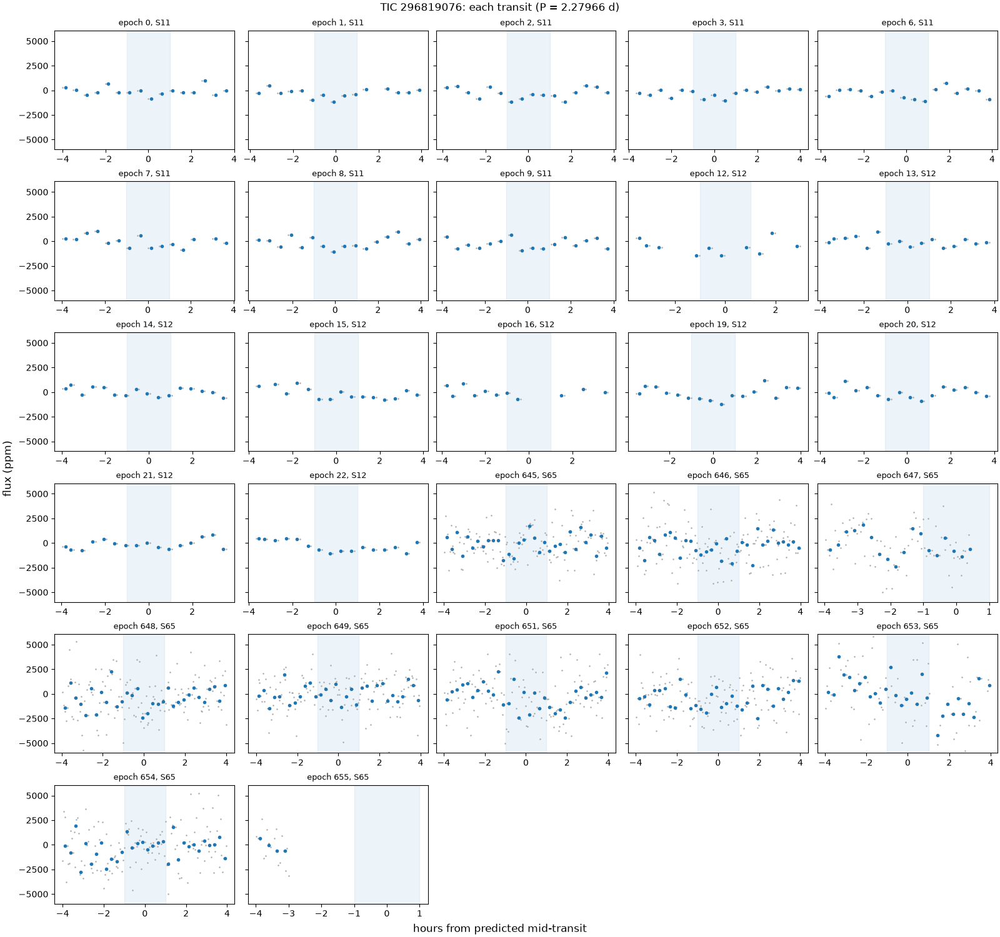
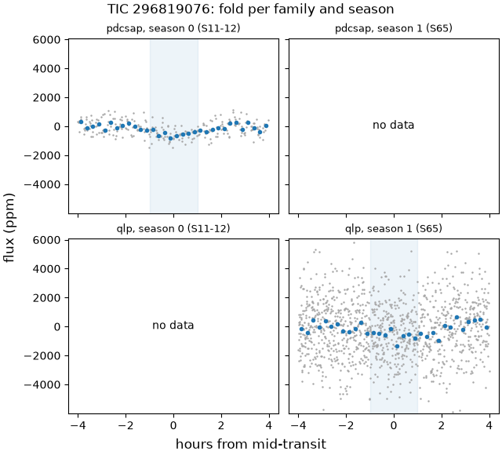
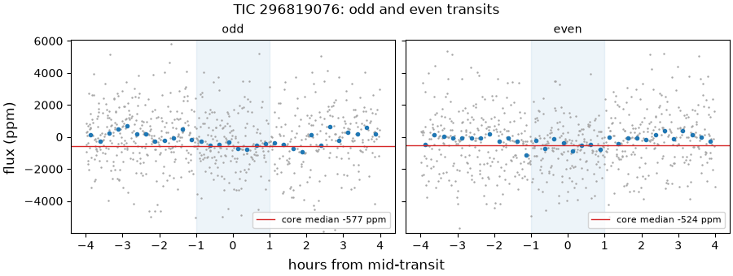
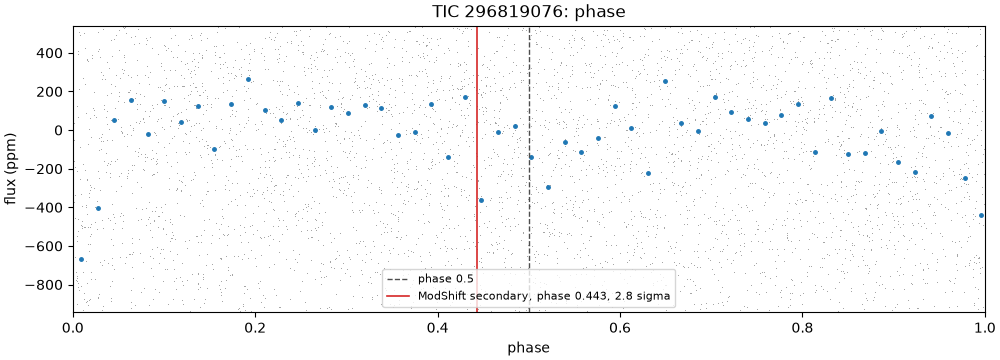
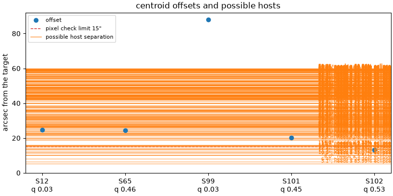

# 296819076-1: TIC 296819076

Call: **held** on 2026-10-22. Rendered from the files in this directory (decision 0028).

## Signal and star

|  |  |
|---|---|
| Signal | 296819076-1, a shortlisted candidate |
| Names | TIC 296819076, Gaia DR3 5877911685214643072, TYC 9020-187-1, 2MASS J14563840-6053286 |
| Ephemeris (the search's box) | period 2.279660 d, epoch BTJD 1601.0147, duration 0.0833 d (2.00 h), depth 390 ppm |
| Star (TIC) | Teff 5450 K, radius 1.31 solar radii, Tmag 10.31 |
| RUWE (Gaia DR3) | 1.02 |
| CROWDSAP | S11 0.738; S12 0.762; none published for S65 (QLP), S99 (QLP), S100 (QLP), S101 (QLP), S102 (QLP) |
| Sectors vetted | PDCSAP family: 11 and 12; QLP family: 65; left out as timing-suspect: 99, 100, 101 and 102 |
| Criteria | search-v2, vet-v3 |
| Runs | vetting 20261020T174317Z-vetting-run-61b5944-2d70 (commit 61b5944, production); TRICERATOPS 20261021T194348Z-vetting-triceratops-cd4e7a2-7821 (commit cd4e7a2, production); literature 20261021T001540Z-vetting-literature-61b5944-07de (commit 61b5944, production); evidence-only vetting 20261020T175536Z-vetting-run-61b5944-7f4e (commit 61b5944, production) |

## Checks

vet-v3's checks first, then the neighbour table (evidence, never a fail), triage's pixel check, TRICERATOPS and the literature search.

| Check | Outcome | Reason |
|---|---|---|
| novelty | pass | no known object matches |
| odd_even | pass | pdcsap: odd and even depths agree within 0.5 sigma; qlp: odd and even depths agree within 0.4 sigma |
| secondary | pass | no dip at phase 0.5 (2.3 sigma) |
| sector_depth | pass | pdcsap: depths agree across 2 sectors (p = 0.40) |
| holdout | inconclusive | 0 season(s) could be tested; need 2 |
| signal_present | pass | combined depth is 7.3 sigma |
| shape | pass | U-shaped: grazing in 4% of samples |
| density | pass | transit and TIC densities agree (0.4 sigma) |
| radius | pass | 3.2 Earth radii |
| neighbours | inconclusive | 10 Gaia DR3 star(s) within the radius have no G magnitude |
| pixels | pass | centroid offset 13.0" within 15" |
| triceratops | inconclusive | the neighbour table is inconclusive: 10 Gaia DR3 star(s) within the radius have no G magnitude |
| literature | pass | complete: 0 hits to screen |

## On the star?

Centroids, from triage's pixel check (pass, centroid offset 13.0" within 15"): the difference-image centroid's offset from the target in each sector. Triage's pass rests on the best-quality sector's offset, S102's, from a timing-suspect sector that vet-v3 leaves out.

| Sector | Offset (arcsec) | Quality | Note |
|---|---|---|---|
| 12 | 24.6 | 0.03 |  |
| 65 | 24.5 | 0.46 |  |
| 99 | 87.9 | 0.03 | timing-suspect: vet-v3 leaves it out |
| 101 | 20.1 | 0.45 | timing-suspect: vet-v3 leaves it out |
| 102 | 13.0 | 0.53 | timing-suspect: vet-v3 leaves it out; the offset triage judged |

Neighbours (inconclusive): 10 Gaia DR3 star(s) within the radius have no G magnitude. Each Gaia DR3 star that could make the dip, with its separation from the target (Gaia DR3 5877911685214643072, J2016.0) and the eclipse depth it would need, scaled from the depth in the signals file (390 ppm) as if all its light fell in the aperture, and the TRICERATOPS star matched to it with the distance between them at the TIC's epoch:

| Star | Separation (arcsec) | Eclipse needed | TRICERATOPS's star (distance) | Its depth |
|---|---|---|---|---|
| Gaia DR3 5877911685182311168 | 5.1 | 86% | TIC 1132493624 (0.0") | 0% |
| Gaia DR3 5877911680887287296 | 6.4 | 23.4% | TIC 296819056 (0.1") | 26.7% |
| Gaia DR3 5877911650854905600 | 8.0 | 3.51% | TIC 296819078 (0.0") | 3.13% |
| Gaia DR3 5877911680887287552 | 9.9 | 46% | TIC 296819111 (0.1") | 55.9% |
| Gaia DR3 5877910924973043712 | 10.2 | 25.3% | TIC 296819103 (0.1") | 30.7% |
| Gaia DR3 5877911685180876544 | 11.5 | 80.1% | TIC 1132493595 (0.0") | 0% |
| Gaia DR3 5877911650821093120 | 11.7 | 72.9% | TIC 1132493505 (0.0") | 94.9% |
| Gaia DR3 5877911685180870272 | 12.7 | 96.9% | TIC 1132493594 (0.1") | 0% |
| Gaia DR3 5877911646527548800 | 13.5 | 36% | TIC 296819120 (0.0") | 37.3% |
| Gaia DR3 5877910929266582400 | 13.7 | 16% | TIC 1132491414 (0.0") | 22.6% |
| Gaia DR3 5877911650821097216 | 14.4 | 80.7% | TIC 1132493509 (0.0") | 0% |
| Gaia DR3 5877910929300396928 | 15.2 | 42.1% | TIC 1132491471 (0.0") | 57.5% |
| Gaia DR3 5877910929300393728 | 15.4 | 9.3% | TIC 296819102 (0.2") | 8.06% |
| Gaia DR3 5877910929300391680 | 15.7 | 2.87% | TIC 296819121 (0.0") | 3.32% |
| Gaia DR3 5877910929266587008 | 15.9 | 19.2% | TIC 1132491418 (0.0") | 50.8% |
| Gaia DR3 5877911685214648320 | 16.0 | 4.59% | TIC 296819030 (0.0") | 4.68% |
| Gaia DR3 5877911650854902272 | 18.7 | 0.708% | TIC 1132493581 (0.0") | 0.807% |
| Gaia DR3 5877910929266592896 | 19.3 | 51.1% | TIC 1132491419 (0.0") | 0% |
| Gaia DR3 5877910929266589312 | 20.0 | 40.6% | TIC 296819092 (0.1") | 66.8% |
| Gaia DR3 5877911650821133824 | 20.3 | 21% | TIC 1132493523 (0.0") | 23.9% |
| Gaia DR3 5877911650854902400 | 21.4 | 0.896% | TIC 296819114 (0.0") | 0.921% |
| Gaia DR3 5877910894906830208 | 21.5 | 59.2% | TIC 1132491344 (0.0") | 88% |
| Gaia DR3 5877911685180900352 | 22.0 | 84.7% | TIC 1132493598 (0.0") | 0% |
| Gaia DR3 5877910929266582272 | 22.1 | 79% | TIC 1132491413 (0.0") | 0% |
| Gaia DR3 5877911650854908160 | 22.1 | 2.73% | TIC 296819054 (0.0") | 3.17% |
| Gaia DR3 5877911650821133696 | 22.6 | 81.5% | TIC 1132493522 (0.0") | 95.9% |
| Gaia DR3 5877910894906822144 | 22.7 | 58% | TIC 1132491342 (0.0") | 0% |
| Gaia DR3 5877911650821138560 | 23.0 | 33% | TIC 1132493525 (0.0") | 41.8% |
| Gaia DR3 5877911685180895744 | 23.4 | 62.3% | TIC 1132493597 (0.0") | 0% |
| Gaia DR3 5877910924970227456 | 23.9 | 39.2% | TIC 296819064 (0.0") | 57.5% |
| Gaia DR3 5877911685214652032 | 24.5 | 51.7% | TIC 1132493673 (0.0") | 77.6% |
| Gaia DR3 5877911646525818240 | 25.0 | 27% | TIC 296819087 (0.2") | 35.9% |
| Gaia DR3 5877910924970222848 | 25.6 | 64% | TIC 1132491383 (0.0") | 0% |
| Gaia DR3 5877911685180901376 | 26.1 | 68.2% | TIC 1132493601 (0.0") | 98.3% |
| Gaia DR3 5877911685214654848 | 26.1 | 6.29% | TIC 1132493675 (0.0") | 7.67% |
| Gaia DR3 5877911685214654464 | 26.2 | 47.5% | TIC 1132493674 (0.1") | 62% |
| Gaia DR3 5877911650821080960 | 26.4 | 24.9% | TIC 296819142 (0.1") | 41% |
| Gaia DR3 5877911650860731264 | 26.6 | 48.1% | TIC 1132493503 (0.0") | 86% |
| Gaia DR3 5877910929268041472 | 26.7 | 93.2% | TIC 1132491429 (0.0") | 0% |
| Gaia DR3 5877911650821109760 | 26.9 | 88% | TIC 1132493511 (0.0") | 0% |
| Gaia DR3 5877911650821146496 | 27.0 | 38.3% | TIC 1132493526 (0.0") | 55.9% |
| Gaia DR3 5877910894906817408 | 27.3 | 30.3% | TIC 1132491341 (0.0") | 56% |
| Gaia DR3 5877911646527546752 | 27.4 | 9.2% | TIC 296819127 (0.0") | 11% |
| Gaia DR3 5877910894906811648 | 27.9 | 56.8% | TIC 1132491337 (0.0") | 0% |
| Gaia DR3 5877910929266623104 | 28.1 | 65.1% | TIC 1132491424 (0.0") | 0% |
| Gaia DR3 5877911650821112320 | 28.4 | 24.6% | TIC 296819110 (0.0") | 34.4% |
| Gaia DR3 5877911650854904320 | 28.4 | 54.5% | TIC 1132493582 (0.0") | 0% |
| Gaia DR3 5877911685214657024 | 28.8 | 3.21% | TIC 296818997 (0.0") | 4.34% |
| Gaia DR3 5877911685180907008 | 29.3 | 66.2% | TIC 1132493605 (0.0") | 0% |
| Gaia DR3 5877910890611559552 | 29.7 | 16.3% | TIC 296819161 (0.0") | 36.7% |
| Gaia DR3 5877910929300400384 | 29.8 | 67.7% | TIC 1132491472 (0.0") | 0% |
| Gaia DR3 5877911646524736384 | 30.2 | 38.1% | TIC 296819039 (0.2") | 60.9% |
| Gaia DR3 5877910894906809088 | 30.7 | 35.4% | TIC 516066139 (0.0") | 78.2% |
| Gaia DR3 5877910894906808832 | 30.8 | 31.6% | TIC 296819170 (0.0") | 76.3% |
| Gaia DR3 5877910894906808960 | 31.0 | 85.3% | TIC 516066139 (0.4") | 78.2% |
| Gaia DR3 5877910929300397184 | 31.1 | 18.6% | TIC 296819058 (0.0") | 39.6% |
| Gaia DR3 5877910894906809216 | 31.4 | 85.9% | TIC 1132491336 (0.0") | 0% |
| Gaia DR3 5877911680887287040 | 31.6 | 34% | TIC 296818988 (0.1") | 57.5% |
| Gaia DR3 5877911685180922624 | 31.7 | 47.7% | TIC 516066129 (0.0") | 0% |
| Gaia DR3 5877910894940647808 | 32.0 | 4.88% | TIC 296819174 (0.0") | 11.1% |
| Gaia DR3 5877910929300401408 | 32.3 | 7.47% | TIC 296819028 (0.0") | 14.4% |
| Gaia DR3 5877911650821074560 | 32.5 | 24.3% | TIC 296819153 (0.0") | 47% |
| Gaia DR3 5877910929268051968 | 32.9 | 77.5% | TIC 1132491435 (0.0") | 0% |
| Gaia DR3 5877910924973046528 | 33.1 | 34.3% | TIC 296819085 (0.0") | 85.1% |
| Gaia DR3 5877910894906802048 | 33.8 | 74.9% | TIC 1132491334 (0.0") | 0% |
| Gaia DR3 5877911650854901760 | 33.8 | 12.6% | TIC 296819134 (0.0") | 20.3% |
| Gaia DR3 5877910894906813056 | 33.9 | 72.5% | TIC 1132491338 (0.0") | 0% |
| Gaia DR3 5877910929266560896 | 34.7 | 59.8% | TIC 1132491404 (0.1") | 0% |
| Gaia DR3 5877910929266573568 | 35.1 | 76% | TIC 1132491412 (0.0") | 0% |
| Gaia DR3 5877911680887287424 | 35.3 | 28.5% | TIC 296818978 (0.1") | 70.2% |
| Gaia DR3 5877911685180920832 | 35.7 | 37.9% | TIC 296818980 (0.0") | 88.4% |
| Gaia DR3 5877911650854917888 | 35.8 | 1.61% | TIC 296819019 (0.0") | 2.78% |
| Gaia DR3 5877911650822529152 | 35.9 | 30.3% | TIC 1132493539 (0.0") | 79.8% |
| Gaia DR3 5877910929266612352 | 36.0 | 61.5% | TIC 1132491422 (0.0") | 0% |
| Gaia DR3 5877910894940645760 | 36.0 | 21% | TIC 296819189 (0.0") | 63.4% |
| Gaia DR3 5877911650821139328 | 36.2 | 40.1% | TIC 296819081 (0.3") | 90.7% |
| Gaia DR3 5877910929266541440 | 36.7 | 91.3% | TIC 1132491397 (0.0") | 0% |
| Gaia DR3 5877911685214660096 | 36.8 | 18.7% | TIC 296818972 (0.0") | 41.1% |
| Gaia DR3 5877911650821095168 | 37.7 | 46.7% | TIC 1132493508 (0.0") | 97.8% |
| Gaia DR3 5877910894906797952 | 37.7 | 72.3% | TIC 1132491333 (0.1") | 0% |
| Gaia DR3 5877910929300382208 | 37.9 | 0.684% | TIC 296819179 (0.1") | 3.04% |
| Gaia DR3 5877911650854898688 | 38.1 | 13.4% | TIC 296819146 (0.0") | 30.3% |
| Gaia DR3 5877911685180931712 | 38.3 | 15.1% | TIC 296818991 (0.1") | 31.2% |
| Gaia DR3 5877910894940642688 | 38.8 | 45.1% | TIC 296819196 (0.1") | 0% |
| Gaia DR3 5877911685180936192 | 39.8 | 90.9% | TIC 1132493615 (0.0") | 0% |
| Gaia DR3 5877911650821147008 | 40.0 | 56.8% | TIC 1132493528 (0.0") | 0% |
| Gaia DR3 5877910929300382464 | 40.3 | 11.6% | TIC 1132491468 (0.0") | 57.2% |
| Gaia DR3 5877911650821138688 | 41.0 | 22% | TIC 296819079 (0.1") | 57.9% |
| Gaia DR3 5877911650821147392 | 42.0 | 78.1% | TIC 1132493529 (0.0") | 0% |
| Gaia DR3 5877911685180940672 | 42.0 | 28.9% | TIC 296818956 (0.1") | 96.4% |
| Gaia DR3 5877910929300382080 | 42.0 | 4.56% | TIC 296819164 (0.0") | 22.9% |
| Gaia DR3 5877910929300393600 | 42.1 | 13.4% | TIC 296819069 (0.0") | 53.4% |
| Gaia DR3 5877910929266599040 | 42.5 | 53.6% | TIC 1132491420 (0.0") | 0% |
| Gaia DR3 5877910894906787328 | 42.7 | 86% | TIC 1132491330 (0.0") | 0% |
| Gaia DR3 5877911685180940800 | 42.8 | 28.5% | TIC 1132493619 (0.0") | 0% |
| Gaia DR3 5877910929266617344 | 42.8 | 87.1% | TIC 1132491423 (0.0") | 0% |
| Gaia DR3 5877911685180945536 | 42.9 | 69.9% | TIC 1132493620 (0.0") | 0% |
| Gaia DR3 5877910929266586752 | 43.0 | 94.5% | TIC 1132491417 (0.0") | 0% |
| Gaia DR3 5877911680885570176 | 43.2 | 21.2% | TIC 296818993 (0.0") | 93.6% |
| Gaia DR3 5877911680885574144 | 43.4 | 45.6% | TIC 296818969 (0.2") | 0% |
| Gaia DR3 5877911719540673920 | 43.4 | 43.8% | TIC 1132493702 (0.0") | 0% |
| Gaia DR3 5877911650854892032 | 43.7 | 8.46% | TIC 296819194 (0.0") | 33.2% |
| Gaia DR3 5877911685180946304 | 43.8 | 59% | TIC 1132493621 (0.0") | 0% |
| Gaia DR3 5877910929266521216 | 44.0 | 81.7% | TIC 1132491391 (0.0") | 0% |
| Gaia DR3 5877911646539880064 | 44.1 | 17.6% | TIC 296819177 (0.0") | 67.2% |
| Gaia DR3 5877910929266604928 | 44.1 | 93.7% | TIC 1132491421 (0.0") | 0% |
| Gaia DR3 5877911650854911232 | 44.3 | 93.7% | TIC 1132493584 (0.0") | 0% |
| Gaia DR3 5877910894906784000 | 44.5 | 95% | TIC 1132491329 (0.0") | 0% |
| Gaia DR3 5877911715245314176 | 44.5 | 36% | TIC 296818998 (0.1") | 0% |
| Gaia DR3 5877911719540657280 | 44.6 | 96.8% | TIC 1132493695 (0.0") | 0% |
| Gaia DR3 5877910894906777728 | 44.7 | 95.8% | TIC 1132491327 (0.0") | 0% |
| Gaia DR3 5877911749605054464 | 44.8 | 50.2% | TIC 1132493794 (0.0") | 0% |
| Gaia DR3 5877911685214664448 | 44.9 | 36.2% | TIC 1132493676 (0.0") | 0% |
| Gaia DR3 5877910929266584832 | 45.0 | 88.4% | TIC 1132491415 (0.0") | 0% |
| Gaia DR3 5877910890611552256 | 45.0 | 28.1% | TIC 296819218 (0.1") | 0% |
| Gaia DR3 5877911646525800448 | 45.5 | 31.8% | TIC 1132493495 (0.0") | 0% |
| Gaia DR3 5877910929266522496 | 45.7 | 27.5% | TIC 1132491392 (0.0") | 0% |
| Gaia DR3 5877910929300380544 | 46.0 | 14.2% | TIC 296819173 (0.0") | 0% |
| Gaia DR3 5877911650854904064 | 46.0 | 40.7% | TIC 296819128 (0.4") | 0% |
| Gaia DR3 5877910929266548864 | 46.1 | 60.3% | TIC 1132491400 (0.0") | 0% |
| Gaia DR3 5877910890610480384 | 46.4 | 34.7% | TIC 1132491306 (0.0") | 0% |
| Gaia DR3 5877911650854912640 | 46.5 | 5.28% | TIC 296819067 (0.0") | 20.4% |
| Gaia DR3 5877911685180918528 | 46.8 | 67.7% | TIC 1132493610 (0.0") | 0% |
| Gaia DR3 5877910894940639872 | 46.9 | 2.88% | TIC 296819215 (0.0") | 25.5% |
| Gaia DR3 5877910890613185920 | 47.2 | 29.9% | TIC 296819217 (0.0") | 0% |
| Gaia DR3 5877911680885585536 | 47.5 | 9.23% | TIC 296818945 (0.0") | 41.6% |
| Gaia DR3 5877911719574391168 | 47.7 | 22.3% | TIC 1132493777 (0.0") | 0% |
| Gaia DR3 5877911719540684928 | 48.1 | 36.1% | TIC 1132493705 (0.0") | 0% |
| Gaia DR3 5877910929300378752 | 48.2 | 9.06% | TIC 296819192 (0.0") | 86.4% |
| Gaia DR3 5877910924971314176 | 48.3 | 8.23% | TIC 296819053 (0.0") | 48.7% |
| Gaia DR3 5877911788260121984 | 48.6 | 72.1% | TIC 1132493907 (0.0") | 0% |
| Gaia DR3 5877910929266519552 | 48.7 | 70.6% | TIC 1132491390 (0.0") | 0% |
| Gaia DR3 5877911715244216320 | 48.8 | 51.3% | TIC 1132493681 (0.0") | 0% |
| Gaia DR3 5877911719540658176 | 49.0 | 74.2% | TIC 1132493697 (0.0") | 0% |
| Gaia DR3 5877911719574752256 | 49.0 | 6.39% | TIC 1132493790 (0.0") | 27.7% |
| Gaia DR3 5877911650854908032 | 49.0 | 1.69% | TIC 296819105 (0.0") | 5.71% |
| Gaia DR3 5877911719540658304 | 49.2 | 75.1% | TIC 1132493698 (0.1") | 0% |
| Gaia DR3 5877911032345847040 | 49.2 | 97.8% | TIC 1132491715 (0.0") | 0% |
| Gaia DR3 5877911719574402432 | 49.5 | 7.16% | TIC 296818983 (0.0") | 27.6% |
| Gaia DR3 5877910929300378112 | 49.9 | 76.9% | TIC 1132491466 (0.0") | 0% |
| Gaia DR3 5877910929266531712 | 49.9 | 23.2% | TIC 296819148 (0.1") | 0% |
| Gaia DR3 5877911032379620736 | 50.3 | 1.95% | TIC 296818990 (0.0") | 16.8% |
| Gaia DR3 5877910924987792896 | 50.4 | 19.1% | TIC 296819082 (0.0") | 0% |
| Gaia DR3 5877911719540643456 | 50.5 | 93.3% | TIC 1132493690 (0.0") | 0% |
| Gaia DR3 5877910929266571264 | 50.6 | 50.6% | TIC 1132491411 (0.0") | 0% |
| Gaia DR3 5877911719540694016 | 51.0 | 28.7% | TIC 1132493709 (0.0") | 0% |
| Gaia DR3 5877911650821093504 | 51.2 | 67.6% | TIC 1132493507 (0.0") | 0% |
| Gaia DR3 5877911650821128192 | 51.6 | 68.6% | TIC 1132493521 (0.0") | 0% |
| Gaia DR3 5877911788260137344 | 51.7 | 60.6% | TIC 1132493911 (0.0") | 0% |
| Gaia DR3 5877911715244570112 | 51.7 | 1.84% | TIC 296819027 (0.0") | 11.1% |
| Gaia DR3 5877911685214664832 | 51.8 | 64.7% | TIC 1132493677 (0.0") | 0% |
| Gaia DR3 5877910894940642560 | 52.4 | 12.2% | TIC 296819231 (0.0") | 0% |
| Gaia DR3 5877911719574396672 | 52.5 | 17% | TIC 1132493780 (0.0") | 0% |
| Gaia DR3 5877911646524732800 | 52.5 | 27.8% | TIC 1132493494 (0.0") | 0% |
| Gaia DR3 5877911032379616384 | 52.7 | 9.31% | TIC 296819014 (0.0") | 0% |
| Gaia DR3 5877911685214667008 | 52.7 | 13.7% | TIC 296818925 (0.0") | 0% |
| Gaia DR3 5877910890625671680 | 52.8 | 11.7% | TIC 296819239 (0.0") | 0% |
| Gaia DR3 5877910929266523136 | 53.0 | 80.8% | TIC 1132491393 (0.0") | 0% |
| Gaia DR3 5877910929266567680 | 53.1 | 99.4% | TIC 1132491407 (0.0") | 0% |
| Gaia DR3 5877910894940637696 | 53.2 | 34.4% | TIC 1132491378 (0.0") | 0% |
| Gaia DR3 5877910929266567808 | 54.1 | 47.8% | TIC 1132491408 (0.0") | 0% |
| Gaia DR3 5877911715259317120 | 54.1 | 25.8% | TIC 296819007 (0.2") | 0% |
| Gaia DR3 5877910890611552128 | 54.1 | 16.2% | TIC 296819242 (0.0") | 0% |
| Gaia DR3 5877910929300376192 | 54.2 | 40.7% | TIC 1132491465 (0.0") | 0% |
| Gaia DR3 5877910894906771072 | 54.6 | 84.6% | TIC 1132491326 (0.0") | 0% |
| Gaia DR3 5877910894940638336 | 54.7 | 14.6% | TIC 296819250 (0.0") | 0% |
| Gaia DR3 5877911788260136960 | 55.1 | 65.2% | TIC 1132493910 (0.0") | 0% |
| Gaia DR3 5877910894906762496 | 55.3 | 86.1% | TIC 1132491324 (0.0") | 0% |
| Gaia DR3 5877911788293878528 | 55.5 | 11.7% | TIC 296818931 (0.0") | 0% |
| Gaia DR3 5877911753900455424 | 55.7 | 61.2% | TIC 1132493797 (0.0") | 0% |
| Gaia DR3 5877911646525810688 | 55.8 | 36.4% | TIC 1132493497 (0.0") | 0% |
| Gaia DR3 5877911032345827328 | 56.1 | 90.9% | TIC 1132491710 (0.0") | 0% |
| Gaia DR3 5877911788260127744 | 56.1 | 57.6% | TIC 1132493908 (0.0") | 0% |
| Gaia DR3 5877911719540627328 | 56.2 | 91.2% | TIC 1132493689 (0.1") | 0% |
| Gaia DR3 5877911753900459136 | 56.4 | 66.2% | TIC 1132493802 (0.0") | 0% |
| Gaia DR3 5877910924971310720 | 56.8 | 17.6% | TIC 296819077 (0.0") | 0% |
| Gaia DR3 5877910929266500096 | 57.2 | 70.2% | TIC 1132491386 (0.0") | 0% |
| Gaia DR3 5877910894906757632 | 57.7 | 83.5% | TIC 1132491323 (0.0") | 0% |
| Gaia DR3 5877911715244574208 | 57.8 | 5.14% | TIC 296818985 (0.0") | 49.1% |
| Gaia DR3 5877910929300384768 | 57.9 | 12.2% | TIC 296819132 (0.0") | 0% |
| Gaia DR3 5877911753900457984 | 57.9 | 97% | TIC 1132493798 (0.0") | 0% |
| Gaia DR3 5877910924971292928 | 58.1 | 19.3% | TIC 296819181 (0.1") | 0% |
| Gaia DR3 5877911788260154240 | 58.1 | 97.8% | TIC 1132493916 (0.1") | 0% |
| Gaia DR3 5877911032345814272 | 58.4 | 91.3% | TIC 1132491703 (0.0") | 0% |
| Gaia DR3 5877911028052263040 | 58.7 | 25.6% | TIC 296819066 (0.0") | 0% |
| Gaia DR3 5877911719574392192 | 58.8 | 39% | TIC 1132493778 (0.0") | 0% |
| Gaia DR3 5877910894906756608 | 58.9 | 97.2% | TIC 1132491322 (0.1") | 0% |
| Gaia DR3 5877911719540662016 | 58.9 | 73.7% | TIC 1132493699 (0.0") | 0% |
| Gaia DR3 5877910929300374784 | 59.0 | 7.51% | TIC 296819206 (0.0") | 0% |
| Gaia DR3 5877911032345860736 | 59.0 | 59.9% | TIC 1132491720 (0.0") | 0% |
| Gaia DR3 5877911753900464768 | 59.0 | 28.6% | TIC 296818910 (0.5") | 0% |
| Gaia DR3 5877911715259291392 | 59.1 | 20.4% | TIC 296819100 (0.0") | 0% |
| Gaia DR3 5877911719540705536 | 59.2 | 85.4% | TIC 1132493714 (0.1") | 0% |
| Gaia DR3 5877911028050545024 | 59.4 | 30.6% | TIC 296818965 (0.0") | 0% |
| Gaia DR3 5877910894940635904 | 59.5 | 24.1% | TIC 296819268 (0.0") | 0% |
| Gaia DR3 5877910924970569216 | 59.6 | 8.98% | TIC 296819235 (0.0") | 0% |
| Gaia DR3 5877911719540705408 | 59.7 | 34.7% | TIC 1132493713 (0.2") | 0% |
| Gaia DR3 5877911788260170112 | 59.8 | 60.8% | TIC 1132493923 (0.0") | 0% |
| Gaia DR3 5877911753900458752 | 59.8 | 81.6% | TIC 1132493800 (0.0") | 0% |
| Gaia DR3 5877911719540657024 | 59.9 | 52.6% | TIC 1132493694 (0.0") | 0% |

TRICERATOPS (inconclusive) took sectors 11 and 12 at 1800 s and folded them on the density-prior fit's ephemeris. It gave a mean NFPP 0.0545 (sd 0.00058) over 10 run(s) of 1000000 draws. The neighbour table lists possible hosts, but it could not judge every star: 10 Gaia DR3 star(s) within the radius have no G magnitude. Possible hosts it did not weigh: none. It gave zero depth to Gaia DR3 5877911685182311168 (TIC 1132493624), Gaia DR3 5877911685180876544 (TIC 1132493595), Gaia DR3 5877911685180870272 (TIC 1132493594), Gaia DR3 5877911650821097216 (TIC 1132493509), Gaia DR3 5877910929266592896 (TIC 1132491419), Gaia DR3 5877911685180900352 (TIC 1132493598), Gaia DR3 5877910929266582272 (TIC 1132491413), Gaia DR3 5877910894906822144 (TIC 1132491342), Gaia DR3 5877911685180895744 (TIC 1132493597), Gaia DR3 5877910924970222848 (TIC 1132491383), Gaia DR3 5877910929268041472 (TIC 1132491429), Gaia DR3 5877911650821109760 (TIC 1132493511), Gaia DR3 5877910894906811648 (TIC 1132491337), Gaia DR3 5877910929266623104 (TIC 1132491424), Gaia DR3 5877911650854904320 (TIC 1132493582), Gaia DR3 5877911685180907008 (TIC 1132493605), Gaia DR3 5877910929300400384 (TIC 1132491472), Gaia DR3 5877910894906809216 (TIC 1132491336), Gaia DR3 5877911685180922624 (TIC 516066129), Gaia DR3 5877910929268051968 (TIC 1132491435), Gaia DR3 5877910894906802048 (TIC 1132491334), Gaia DR3 5877910894906813056 (TIC 1132491338), Gaia DR3 5877910929266560896 (TIC 1132491404), Gaia DR3 5877910929266573568 (TIC 1132491412), Gaia DR3 5877910929266612352 (TIC 1132491422), Gaia DR3 5877910929266541440 (TIC 1132491397), Gaia DR3 5877910894906797952 (TIC 1132491333), Gaia DR3 5877910894940642688 (TIC 296819196), Gaia DR3 5877911685180936192 (TIC 1132493615), Gaia DR3 5877911650821147008 (TIC 1132493528), Gaia DR3 5877911650821147392 (TIC 1132493529), Gaia DR3 5877910929266599040 (TIC 1132491420), Gaia DR3 5877910894906787328 (TIC 1132491330), Gaia DR3 5877911685180940800 (TIC 1132493619), Gaia DR3 5877910929266617344 (TIC 1132491423), Gaia DR3 5877911685180945536 (TIC 1132493620), Gaia DR3 5877910929266586752 (TIC 1132491417), Gaia DR3 5877911680885574144 (TIC 296818969), Gaia DR3 5877911719540673920 (TIC 1132493702), Gaia DR3 5877911685180946304 (TIC 1132493621), Gaia DR3 5877910929266521216 (TIC 1132491391), Gaia DR3 5877910929266604928 (TIC 1132491421), Gaia DR3 5877911650854911232 (TIC 1132493584), Gaia DR3 5877910894906784000 (TIC 1132491329), Gaia DR3 5877911715245314176 (TIC 296818998), Gaia DR3 5877911719540657280 (TIC 1132493695), Gaia DR3 5877910894906777728 (TIC 1132491327), Gaia DR3 5877911749605054464 (TIC 1132493794), Gaia DR3 5877911685214664448 (TIC 1132493676), Gaia DR3 5877910929266584832 (TIC 1132491415), Gaia DR3 5877910890611552256 (TIC 296819218), Gaia DR3 5877911646525800448 (TIC 1132493495), Gaia DR3 5877910929266522496 (TIC 1132491392), Gaia DR3 5877910929300380544 (TIC 296819173), Gaia DR3 5877911650854904064 (TIC 296819128), Gaia DR3 5877910929266548864 (TIC 1132491400), Gaia DR3 5877910890610480384 (TIC 1132491306), Gaia DR3 5877911685180918528 (TIC 1132493610), Gaia DR3 5877910890613185920 (TIC 296819217), Gaia DR3 5877911719574391168 (TIC 1132493777), Gaia DR3 5877911719540684928 (TIC 1132493705), Gaia DR3 5877911788260121984 (TIC 1132493907), Gaia DR3 5877910929266519552 (TIC 1132491390), Gaia DR3 5877911715244216320 (TIC 1132493681), Gaia DR3 5877911719540658176 (TIC 1132493697), Gaia DR3 5877911719540658304 (TIC 1132493698), Gaia DR3 5877911032345847040 (TIC 1132491715), Gaia DR3 5877910929300378112 (TIC 1132491466), Gaia DR3 5877910929266531712 (TIC 296819148), Gaia DR3 5877910924987792896 (TIC 296819082), Gaia DR3 5877911719540643456 (TIC 1132493690), Gaia DR3 5877910929266571264 (TIC 1132491411), Gaia DR3 5877911719540694016 (TIC 1132493709), Gaia DR3 5877911650821093504 (TIC 1132493507), Gaia DR3 5877911650821128192 (TIC 1132493521), Gaia DR3 5877911788260137344 (TIC 1132493911), Gaia DR3 5877911685214664832 (TIC 1132493677), Gaia DR3 5877910894940642560 (TIC 296819231), Gaia DR3 5877911719574396672 (TIC 1132493780), Gaia DR3 5877911646524732800 (TIC 1132493494), Gaia DR3 5877911032379616384 (TIC 296819014), Gaia DR3 5877911685214667008 (TIC 296818925), Gaia DR3 5877910890625671680 (TIC 296819239), Gaia DR3 5877910929266523136 (TIC 1132491393), Gaia DR3 5877910929266567680 (TIC 1132491407), Gaia DR3 5877910894940637696 (TIC 1132491378), Gaia DR3 5877910929266567808 (TIC 1132491408), Gaia DR3 5877911715259317120 (TIC 296819007), Gaia DR3 5877910890611552128 (TIC 296819242), Gaia DR3 5877910929300376192 (TIC 1132491465), Gaia DR3 5877910894906771072 (TIC 1132491326), Gaia DR3 5877910894940638336 (TIC 296819250), Gaia DR3 5877911788260136960 (TIC 1132493910), Gaia DR3 5877910894906762496 (TIC 1132491324), Gaia DR3 5877911788293878528 (TIC 296818931), Gaia DR3 5877911753900455424 (TIC 1132493797), Gaia DR3 5877911646525810688 (TIC 1132493497), Gaia DR3 5877911032345827328 (TIC 1132491710), Gaia DR3 5877911788260127744 (TIC 1132493908), Gaia DR3 5877911719540627328 (TIC 1132493689), Gaia DR3 5877911753900459136 (TIC 1132493802), Gaia DR3 5877910924971310720 (TIC 296819077), Gaia DR3 5877910929266500096 (TIC 1132491386), Gaia DR3 5877910894906757632 (TIC 1132491323), Gaia DR3 5877910929300384768 (TIC 296819132), Gaia DR3 5877911753900457984 (TIC 1132493798), Gaia DR3 5877910924971292928 (TIC 296819181), Gaia DR3 5877911788260154240 (TIC 1132493916), Gaia DR3 5877911032345814272 (TIC 1132491703), Gaia DR3 5877911028052263040 (TIC 296819066), Gaia DR3 5877911719574392192 (TIC 1132493778), Gaia DR3 5877910894906756608 (TIC 1132491322), Gaia DR3 5877911719540662016 (TIC 1132493699), Gaia DR3 5877910929300374784 (TIC 296819206), Gaia DR3 5877911032345860736 (TIC 1132491720), Gaia DR3 5877911753900464768 (TIC 296818910), Gaia DR3 5877911715259291392 (TIC 296819100), Gaia DR3 5877911719540705536 (TIC 1132493714), Gaia DR3 5877911028050545024 (TIC 296818965), Gaia DR3 5877910894940635904 (TIC 296819268), Gaia DR3 5877910924970569216 (TIC 296819235), Gaia DR3 5877911719540705408 (TIC 1132493713), Gaia DR3 5877911788260170112 (TIC 1132493923), Gaia DR3 5877911753900458752 (TIC 1132493800), Gaia DR3 5877911719540657024 (TIC 1132493694): its apertures take too little of each one's light to make the dip. Evidence for the review, not a blocker (decision 0026).

RUWE 1.02 (Gaia DR3). A high RUWE points to an unresolved companion, which TRICERATOPS's priors don't condition on; above vet-v3's limit, or without a RUWE, TRICERATOPS is inconclusive.

## A planet rather than a binary?

- Odd and even transits: pass, pdcsap: odd and even depths agree within 0.5 sigma; qlp: odd and even depths agree within 0.4 sigma.
- Secondary at phase 0.5: pass, no dip at phase 0.5 (2.3 sigma).
- Secondary at any phase (LEO-Vetter's ModShift, from triage): the strongest secondary is 2.76 sigma at phase 0.443, depth 95 ppm; primary 11.6 sigma, tertiary 1.9 sigma at phase 0.0747, positive 2.11 sigma at phase 0.212; Fred 0.975.
- The search's other signals on the star: rank 2 at 33.3083 d (period ratio 14.6, SDE 9.7).
- Shape (flat-prior fit): pass, U-shaped: grazing in 4% of samples; median b 0.54.
- Density (flat-prior fit): pass, transit and TIC densities agree (0.4 sigma).
- Radius: pass, 3.2 Earth radii. Rp is 3.18 Earth radii from the flat-prior fit and 2.99 (16th to 84th percentile 2.75 to 3.27) from the density-prior fit; the radius check reads the flat-prior fit.
- Density-prior fit (the TIC density as a prior), whose parameters M4 uses: Rp 2.99 Earth radii (16th to 84th percentile 2.75 to 3.27), b 0.37 (-0.24, +0.21), a/R* 5.48 (-0.36, +0.38), period 2.280317 d (sd 0.00075), t0 BTJD 1601.0154 (sd 0.01 d).
- TRICERATOPS (inconclusive): mean FPP 0.0698 (sd 0.00071) over 10 run(s) of 1000000 draws.

## Real and new?

- Signal present: pass, combined depth is 7.3 sigma.
- Held-out seasons: inconclusive, 0 season(s) could be tested; need 2.
- Sector depths: pass, pdcsap: depths agree across 2 sectors (p = 0.40).
- Novelty, against the catalog snapshot: pass, no known object matches.
- Literature by name (TIC 296819076, Gaia DR3 5877911685214643072, TYC 9020-187-1, 2MASS J14563840-6053286) and NASA ADS: pass, complete: 0 hits to screen. The hits are listed below.

ExoFOP, read live: TOIs none; CTOIs none; confirmed planets none.

## Next TESS looks

tess-point places the star in sectors 114.

Each transit predicted in those sectors, from the density-prior fit's posterior (epochs count periods from its t0); duration 0.1246 d from the density-prior fit:

| Sector | Epoch | Mid (BTJD) | Mid (UTC) | sd (min) | 1 sigma half-width (min) | 3 sigma half-width (min) |
|---|---|---|---|---|---|---|
| 114 | 1250 | 4451.410 | 2027-02-14 21:49 | 1341.8 | 1341.8 | 4025.4 |
| 114 | 1251 | 4453.690 | 2027-02-17 04:32 | 1342.9 | 1342.9 | 4028.6 |
| 114 | 1252 | 4455.971 | 2027-02-19 11:16 | 1344.0 | 1344.0 | 4031.9 |
| 114 | 1253 | 4458.251 | 2027-02-21 18:00 | 1345.0 | 1345.0 | 4035.1 |
| 114 | 1254 | 4460.531 | 2027-02-24 00:43 | 1346.1 | 1346.1 | 4038.4 |
| 114 | 1255 | 4462.812 | 2027-02-26 07:27 | 1347.2 | 1347.2 | 4041.6 |
| 114 | 1256 | 4465.092 | 2027-02-28 14:11 | 1348.3 | 1348.3 | 4044.9 |
| 114 | 1257 | 4467.372 | 2027-03-02 20:54 | 1349.4 | 1349.4 | 4048.1 |
| 114 | 1258 | 4469.653 | 2027-03-05 03:38 | 1350.5 | 1350.5 | 4051.4 |
| 114 | 1259 | 4471.933 | 2027-03-07 10:22 | 1351.5 | 1351.5 | 4054.6 |
| 114 | 1260 | 4474.213 | 2027-03-09 17:05 | 1352.6 | 1352.6 | 4057.9 |
| 114 | 1261 | 4476.494 | 2027-03-11 23:49 | 1353.7 | 1353.7 | 4061.1 |

2-min data and the DDT ask (M3 design, section 4.5): which stars get 2-min data in a sector is decided per cycle, so tess-point can't say whether these sectors will have it. In the sectors fetched, the star never had SPOC 2-min data (QLP at 600 and 200 s; TESS-SPOC at 1800 s). Held: the DDT ask applies only on the maintainer's call and only when the deciding evidence is the transit's shape; a hold on blending does not go, since 2-min data come from the same pixels. Deciding evidence: Seeing-limited ground-based photometry on a predicted transit that resolves the target from TIC 296819054 and the two fainter stars beside it, west of the target (F1). The dossier's next-look windows are too wide for that, so the ephemeris needs refitting first, from the sector 114 light curve or a QLP redelivery of sectors 99 to 102; the same data give the held-out check a testable season.

## Plots

Each transit, against hours from its predicted mid-time:

The fold in each season and each product family:

Odd and even transits side by side:

The whole orbit, with phase 0.5 and LEO-Vetter's ModShift secondary marked:

Triage's centroid offset per sector, with the neighbours that could host the signal:

## Catalogued rows on the star

No catalogued row on this star.

## Literature hits

0 paper(s) from the searches that answered, one row per paper.

## With the timing-suspect sectors (evidence only)

The same vet with the timing-suspect sectors kept in (decision 0022). It is shown for comparison and never used for the call. Sectors it adds: 99, 100, 101 and 102.

| Check | Without them | With them | Reason with them |
|---|---|---|---|
| novelty | pass | pass | no known object matches |
| odd_even | pass | pass | pdcsap: odd and even depths agree within 0.5 sigma; qlp: odd and even depths agree within 1.1 sigma |
| secondary | pass | pass | no dip at phase 0.5 (1.2 sigma) |
| sector_depth | pass | fail | qlp: depths disagree across sectors (p = 6.2e-05) |
| holdout | inconclusive | inconclusive | 1 season(s) could be tested; need 2 |
| signal_present | pass | pass | combined depth is 10.0 sigma |
| shape | pass | pass | U-shaped: grazing in 4% of samples |
| density | pass | pass | transit and TIC densities agree (0.4 sigma) |
| radius | pass | pass | 3.2 Earth radii |

## Review

Reviewer claude-opus-5-5, 2026-10-21, updated 2026-10-22. I ran the three lenses and rebuilt triage's pixel check from its saved difference images, with null images and fixed-position fits. In S12, S65, S101 and S102 the in-transit loss sits 13 to 25" west of the target, at TIC 296819054 (T 14.9) and two fainter stars beside it, and the target carries almost none of it; triage's pass rests on S102 alone, whose fit points west too, so I rate the dip off-target (kill). Nothing else argues against a planet: nine of the ten no-G Gaia stars are too faint to host it (one at 4.3" has no photometry and can't be ruled out), an eclipsing binary on the target can't last 3 h at this depth, and the literature search found nothing. Updated 2026-10-22 for the 0036 TRICERATOPS rerun.

A finding rated kill or hold is confirmed when no refuter refuted it; a note gets no refuters.

### F1 (on the star, kill): refuted

Claim: The transit's loss in the difference images sits 20 to 24" west of the target, on TIC 296819054 (T 14.9) or one of two fainter stars beside it, not on TIC 296819076; triage's pixel pass rests on S102 alone, and S102's fit points west too.

Evidence: (1) Triage's record (~/.cache/tess-hunt/drafts/m3-r2/296819076-1/checks.json, pixels.evidence.sectors): S102 13.0" quality 0.534 (the one judged, timing-suspect), S101 20.1" q 0.452, S65 24.5" q 0.458, S12 24.6" q 0.032, S99 87.9" q 0.031. S65 and S101 fail the 15" rule at nearly S102's quality. S100 has an image but no offset: its PRF fit raises ValueError('x must be strictly increasing') in the rebuild as well. (2) Directions, rebuilt from triage's saved pickles with the published diagnosis's own script (sha256 a52fdb505e9d5f49196c6e4cc03836cfd4b425c2495e918b2d4bb553ade49ce6, byte-identical to sector_detail.py in results/benchmarks/pixel-check-diagnosis-2026-10-20-scripts.tar.gz): `/tmp/t13/heavy.sh uv run python /tmp/t13/296819076-1/sector_detail.py /tmp/t13/296819076-1/detail.json /tmp/t13/296819076-1/jobs.json`; every refit reproduces its saved image (phase-0 check true). Fit east/north of the target in arcsec: S102 (-11.6, +6.0) PA 297; S101 (-19.5, +4.6) PA 283; S65 (-23.7, +6.0) PA 284; S12 (-24.4, +3.1) PA 277; that is 9.1, 2.4, 3.0 and 4.8" from TIC 296819054 at (-20.7, +6.7). The four come from four camera/CCD pairs (S12 cam2 ccd1, S65 cam2 ccd3, S101 cam3 ccd1, S102 cam2 ccd4) with detector offsets of opposite sign (dcol -1.11 px in S12, +1.16 px in S65), so the position is fixed on the sky, not on the detector. None of the 64 null-image fits (16 transit-free phases per sector) lands as close to TIC 296819054 as the real fit in its sector, and their directions scatter all round. S99's fit (q 0.03) sits 87" north on an image whose target fit is -0.93 sigma: no transit there. (3) Fixed-position PRF fits, two_star.py's method (`/tmp/t13/heavy.sh uv run python /tmp/t13/296819076-1/two_star_multi.py /tmp/t13/296819076-1/two_star_multi.json`), SNR against the same nulls: target + TIC 296819054 gives the neighbour 2.94 (S102), 6.30 (S101), 2.94 (S65), 3.53 (S12), combined 7.9, and the target 1.25, 0.73, 0.23, -1.13, combined 0.5, where a dip on the target would have given it 4.3 (a 3.7 sigma shortfall). TIC 1132493523 (T 17.13, 20.3") or TIC 1132493525 (T 17.62, 23.0") in its place give the same (combined 7.9 and 8.3, target 0.0 and 0.8): the fits can't tell the three apart. Three PRFs at once (`/tmp/t13/heavy.sh uv run python /tmp/t13/296819076-1/three_star.py /tmp/t13/296819076-1/three_star.json`) keep the loss on TIC 296819054 against TIC 296819078 (8" west) and TIC 1132493581 (19" south-west): 6.65 and 3.41 in S65, 3.58 and 4.68 in S101, 1.08 and 3.18 in S102, with the other stars between -0.70 and 1.03; S12 is ambiguous. A single PRF at the target shows 3.6, 3.4 and 2.6 sigma in S102, S101 and S65: the western loss leaking into the target's 21" PRF. (4) Depth: the S65, S101 and S102 amplitudes put a 3.3 to 4.5% eclipse on TIC 296819054 (its flux scaled from T 14.89 against the target's 10.31, since the two-PRF fit to the crowded mean image gives it a negative flux), against the 2.73% the neighbour table needs at 390 ppm (3.9% at the 562 ppm PDCSAP depth) and TRICERATOPS's tdepth of 3.17% (~/.cache/tess-hunt/drafts/m3-r2/296819076-1/dossier.md, Gaia DR3 5877911650854908160). It is G 15.64, BP-RP 1.47, parallax 0.50 mas, RUWE 1.04 (`uv run python -I /tmp/t13/296819076-1/gaia_w.py`), a distant star TRICERATOPS sizes at 2.09 solar radii: a few-percent eclipse there is an ordinary binary. (5) The project's own standard: decision 0033 item 5 says a fit that repeats its sky position across sectors and cameras, with nothing at the target in a fixed-position fit, marks a real off-target source; 0032 says the pixel check is what catches binaries 20 to 25" out (TOI-1058.01 at 21.5", TOI-1175.01 at 25.1"), and it would have caught this one from S65 or S101. Caveat: the images hold the transit weakly, the 3x3 box at the target expecting z 1.15 to 1.31 in S65, S101 and S102 and 3.59 in S12 (detail.json expected_snr), so each sector alone is 2 to 4 sigma; the case rests on the four agreeing and the nulls not. Confirmation: seeing-limited ground-based photometry that resolves the target from TIC 296819054 (22" west) on a predicted transit. Updated 2026-10-22 for the 0036 TRICERATOPS rerun: the dossier's TRICERATOPS depth for Gaia DR3 5877911650854908160 (TIC 296819054) now comes from TRIC3B_RUN 20261021T194348Z-vetting-triceratops-cd4e7a2-7821 instead of TRIC2_RUN 20261020T181658Z-vetting-triceratops-61b5944-1bbf: tdepth 0.031733 to 0.0317279 (triceratops.json hosts), 3.17% both times; its radius in probs.csv is 2.09038 both times. Nothing else in F1 reads TRICERATOPS.

- Refuter 1: did not refute. F1 reproduces. Every number the kill rests on holds when rerun from the run files and the commands in its evidence. One derived figure, the "4.3 (3.7 sigma)", is loose, but it sits inside the range the methods give. Scratch is in /tmp/t13/296819076-1/addendum-0036/refute-F1-reproduce/.

(0) The update itself:
- TRIC3B_RUN's triceratops.json and probs.csv for 296819076-1 are byte-identical (sha256) to the draft's copies.
- evidence.hosts gives source_id 5877911650854908160 (TIC 296819054) tdepth 0.031727933 and required_depth 0.027288. TRIC2_RUN gave 0.031732982, a relative change of 1.6e-4.
- probs.csv gives R_s 2.09038 in both runs.
- dossier.md line 79 reads "Gaia DR3 5877911650854908160 | 22.1 | 2.73% | TIC 296819054 (0.0") | 3.17%", the same as pre-0036/dossier.md. `grep -c 5877911650854908160 addendum-0036/dossier.diff` gives 0.
- None of the stars F1 names (296819054, 1132493523, 1132493525, 1132493581, 296819078) is in TRIC3B's dropped_stars.

(1) Triage's record:
- The draft's checks.json has the same sha256 as VET2_RUN/signals/296819076-1/checks.json (cd5b60f9...).
- pixels.evidence.sectors: S102 13.02" q 0.534, S101 20.08" q 0.452, S65 24.46" q 0.458, S12 24.60" q 0.032, S99 87.94" q 0.031. S100's pickle is listed with no offset. offset_qual is 13.02, and dossier lines 47-49 mark S102 as the sector judged and timing-suspect.
- All seven of triage's saved files (six pickles and the ticKey) match their sha256 in the files map.

(2) Directions:
- sector_detail.py has sha256 a52fdb50...ce6, the same as the copy I extracted from results/benchmarks/pixel-check-diagnosis-2026-10-20-scripts.tar.gz.
- I ran `/tmp/t13/heavy.sh uv run python /tmp/t13/296819076-1/sector_detail.py $O/detail.json /tmp/t13/296819076-1/jobs.json` (exit 0).
- Fits (east, north): S102 (-11.6, +6.0) PA 297, S101 (-19.5, +4.6) PA 283, S65 (-23.7, +6.0) PA 284, S12 (-24.4, +3.1) PA 277.
- They land 9.1, 2.4, 3.0 and 4.8" from TIC 296819054, which sits at (-20.7, +6.7).
- Detectors: cam2 ccd4, cam3 ccd1, cam2 ccd3 and cam2 ccd1. dcol is +1.16 in S65 and -1.11 in S12.
- The phase-0 rebuild reproduces the saved image in every sector. S100 raises ValueError('x must be strictly increasing...').
- Nulls: 64 of 64 fitted, and none lands closer to TIC 296819054 than the real fit in its sector. The closest are 15.4, 5.2, 11.1 and 15.8". Their PAs spread from 7 to 358 degrees.
- expected_snr is 1.15, 1.31, 1.22 and 3.59.

(3) Fixed-position fits:
- `/tmp/t13/heavy.sh uv run python /tmp/t13/296819076-1/two_star_multi.py $O/two_star_multi.json` and the same for three_star.py both exit 0. `cmp` shows both outputs byte-identical to the reviewer's JSON.
- Target plus TIC 296819054: the neighbour gets 2.94, 6.30, 2.94 and 3.53 (sum/2 = 7.86). The target gets 1.25, 0.73, 0.23 and -1.13 (0.54).
- With TIC 1132493523 or TIC 1132493525 in its place: 7.90 with the target at 0.03, and 8.26 with the target at 0.76.
- Three-star fits give TIC 296819054 6.65/3.41 (S65), 3.58/4.68 (S101) and 1.08/3.18 (S102). The rival neighbours fall between -0.70 and 1.03.
- Target alone: 3.61, 3.39 and 2.57, and -0.93 in S99.
- The labels T 17.13 at 20.3" and T 17.62 at 23.0" match neighbours.csv rows 5877911650821133824 and 5877911650821138560.

(4) Depth:
- calc.py on my outputs gives the S102, S101 and S65 eclipse on TIC 296819054 as 3.27, 4.48 and 3.29%, using the single-PRF target flux and the T 14.89 against 10.306 scaling.
- 2.7288% x 561.56/390.382 = 3.93%, where 561.56 ppm is checks.json pdcsap mean_depth.
- `uv run python -I /tmp/t13/296819076-1/gaia_w.py` gives G 15.639, BP-RP 1.468, parallax 0.496 and RUWE 1.037.
- Wording: the two-PRF fit gives the neighbour negative flux in three of four sectors. S65 is +780, not negative.

(5) Citations:
- 0032 line 36 gives "21.5" and 25.1"".
- 0033 item 5 says "a fit that repeats its sky position across sectors and cameras, with nothing at the target in a fixed-position fit, marks a real off-target source" (quoted correctly; refuter 2 judges its rule status).

Loose number:
- No method I tried gives exactly "4.3 (3.7 sigma shortfall)". variants.py at 390 ppm over the four sectors gives 4.00 with the single-PRF flux and 4.45 with the two-PRF flux, so the shortfall is 3.5 to 3.9 sigma.
- 4.3 and 3.7 lie inside that range, and every variant puts the expected target SNR at 4.0 or more against the measured 0.54. This matches the first round's refuter 1. It does not change what the evidence shows.
- Refuter 2: refuted. Refuted as a kill, because the rating doesn't fit the brief's definitions. The loss in the difference images does sit west of the target. Measured against the project's own calibration, though, this is a hold on blending, and F1 names the evidence that would decide it.

1. Definitions. The brief's Ratings, M3 design 4.9 and 0028 ("Three outcomes") define a hold this way: the public data can't decide, and the record names what would decide it, with ground-based photometry among the examples. Design 4.5 names "held on blending" as a case. F1 names exactly that ("Confirmation: seeing-limited ground-based photometry that resolves the target from TIC 296819054"). It also concedes that the fits "can't tell the three apart". No check failed: in the dossier's Checks table, pixels pass at 13.0", and neighbours, TRICERATOPS and holdout are inconclusive. So a kill would rest only on a pixel reanalysis outside the pipeline, against the frozen check's pass. 0033 item 2 and the diagnosis's section 4 made sure that even the firm pixel cases did not rest on pixels alone. Of 295140687-1, section 4 says "a kill on pixels alone would rest on S38".

2. Strength against the diagnosis's calibration (results/benchmarks/pixel-check-diagnosis-2026-10-20.md, "Failure modes" and section 2). On that scale the controls sit 7.8 to 26.6 standard errors from the target and unsaturated known planets 1.4 at most. Rows rated "supported" sit at 13.5 to 48.8, and 295140687-1, rated "supported, weakly", at 3.0. I applied summary.py's formulas in `uv run python -I /tmp/t13/296819076-1/addendum-0036/refute-F1-rules/se_metric.py /tmp/t13/296819076-1/detail.json`:
- all five measured sectors: 1.1 standard errors (sky scatter 38.5");
- F1's four sectors, with S99 dropped: 6.8 (5.6");
- S102, S101 and S65 only: 6.4.

So even with S99 dropped it is below every control, and counting every measured sector, as the diagnosis did for each row, it is at the known-planet level. The fixed-position fit test (neighbour z of 3 or more, and above the target) holds in 2 of 4 sectors: S101 at 6.30 and S12 at 3.53, with S102 and S65 at 2.94 (two_star_multi.json). 295140687-1 met it in 4 of 5 and was still rated "weakly", because it "rests on a measurement outside the check at separations of about one pixel". TIC 296819054 is 21.7" out, about one pixel. In S12, every candidate star from 7.8" to 22.8" gets 3.53 to 3.69, so that sector picks out no position. The two-PRF fit to the mean image gives TIC 296819054 a flux of -5697, -1183, -3928 and -4968 e-/s in S102, S101, S99 and S12. Its T 14.89 implies about +100 to +215, so the PRF model fails at the separation the attribution rests on.

3. Misread rule. F1 calls 0033 item 5 "the project's own standard". Item 5 sits under "The check itself keeps its weaknesses in M3: pixels.py is frozen", as the diagnosis's findings "for a later version". It records an observation, not a kill rule. The diagnosis's numbers for a fit that repeats its sky position (point 2) are not met here either.

4. Numbers overstated or unsourced.
- F1's caveat (expected z of 1.15 to 1.31, and 3.59) and its "4.3" use detail.json's expected_snr. That is the depth over transitDiffImage's diffImageSigma, which .venv/lib/python3.12/site-packages/transitDiffImage/tessDiffImage.py lines 461 to 466 build as the per-cadence error (sqrt(sum err^2/N)), not the error of the in-transit mean. The diagnosis's "Null images" paragraph says it does not use that.
- The "4.3" and the "3.7 sigma shortfall" come from no command F1 shows. They appear only as typed text, in /tmp/t13/296819076-1/write_findings.py line 30. That breaks the brief's Numbers rule.
- The diagnosis's own null-based expectation, from `uv run python -I .../refute-F1-rules/tar/summary.py .../detail_variants.json second`, is 9.8, 6.8, 5.9 and 6.5 in S102, S101, S65 and S12. In S99 it gives the target box a z of 4.8 against 7.1 expected. That contradicts F1's "no transit there", which is its reason for dropping S99 (quality 0.03) while keeping S12, also at quality 0.03.

The 0036 update itself checks out. TRIC3B's hosts entry gives tdepth 0.0317279 and probs.csv gives R_s 2.09038, with mean NFPP 0.0545. The tdepth moved 1.6e-4 relative, inside the 3e-3 of 0036 item 5. None of it bears on the points above. F1 should stand as a hold on blending, decided by seeing-limited ground-based photometry that resolves the target from the stars 20 to 23" west, not as a kill.

### F2 (on the star, note)

Claim: Nine of the ten Gaia DR3 stars without a G magnitude are TIC stars of T 19.73 to 20.85, which would need eclipses of 230% or more; the tenth, 4.3" south-east of the target, has no photometry anywhere and looks spurious, but nothing public rules it out.

Evidence: ~/.cache/tess-hunt/drafts/m3-r2/296819076-1/checks.json neighbours.evidence.no_g lists 10 stars at 4.3, 13.5, 31.2, 35.6, 40.0, 41.2, 44.3, 49.6, 50.4 and 51.0". Gaia DR3 (`uv run python -I /tmp/t13/296819076-1/gaia_nog.py`, public archive): all have phot_g_n_obs 0; six have RP 19.31 to 19.91. Matched to TRICERATOPS's TIC star list (~/.cache/tess-hunt/drafts/m3-r2/296819076-1/triceratops.json evidence.stars), each moved to J2000 with its DR3 proper motion where it has one: nine sit within 0.14" of a TIC star with Tmag 19.73 to 20.85 (TIC 1132493625, T 20.31, for the 13.5" one), all given tdepth 0. A host needs T at most 18.83 for a total eclipse at 390 ppm (10.3055 + 2.5 log10(1/0.000390)), 18.43 at 562 ppm; T 19.73 needs 2.30 (230%). The tenth, Gaia DR3 5877911685180852608 at 4.3" (PA 120): a two-parameter solution, 4 visibility periods, 11 matched transits, no G, BP or RP, ipd_frac_multi_peak 13; no TIC star within 3.9" of it (the nearest is the target); VVV DR2 and DR4 (VizieR II/348/vvv2 and II/376/vvv4; `curl "https://vizier.cds.unistra.fr/viz-bin/asu-tsv?-source=II/348/vvv2&-c=224.16166+-60.89201&-c.rs=6&-out.add=_r&-sort=_r"`) list nothing within 2.3" of it, though they list a J 17.59 star at that distance; the target (2MASS J 9.55) saturates there, so a faint companion could hide. It is 0.2 pixel from the target, inside any pixel rule, and the pixel fits point the other way (F1). High-resolution imaging would settle it. Removing it would not change TRICERATOPS's outcome (F3). Updated 2026-10-22 for the 0036 TRICERATOPS rerun: triceratops.json evidence.stars is now TRIC3B_RUN 20261021T194348Z-vetting-triceratops-cd4e7a2-7821's list, 6,036 stars to 5,977 after 0036 dropped 58 DUPLICATE rows and one ARTIFACT (was TRIC2_RUN 20261020T181658Z-vetting-triceratops-61b5944-1bbf's). Rematched against both lists (`uv run python -I /tmp/t13/296819076-1/gaia_nog.py > /tmp/t13/296819076-1/addendum-0036/gaia_nog.csv`, then `uv run python -I /tmp/t13/296819076-1/addendum-0036/nog_match.py /tmp/t13/296819076-1/addendum-0036/gaia_nog.csv /tmp/t13/296819076-1/pre-0036/triceratops.json ~/.cache/tess-hunt/drafts/m3-r2/296819076-1/triceratops.json`): the nine match the same TIC stars at 0.00 to 0.14", T 19.73 to 20.85, tdepth 0, none of them a dropped row, and the tenth's nearest TIC star is still the target at 3.9".

### F3 (on the star, note)

Claim: TRICERATOPS's blocker is not what stops it passing: its mean NFPP of 0.0545 sits between the bars and above both nearby-binary controls', and it puts most of that on a star the pixels don't favour while weighing the western stars at 0.008.

Evidence: ~/.cache/tess-hunt/drafts/m3-r2/296819076-1/triceratops.json: nfpp_mean 0.05453 (sd 0.00058), fpp_mean 0.0698, 10 runs of 1,000,000; criteria/vet-v3.toml nfpp_pass 0.001 and nfpp_fail 0.1, so without the no-G blocker it is still inconclusive. Decision 0032's nearby-binary controls read 0.027 (TOI-1058.01) and 0.0341 (TOI-1175.01). The last run's ~/.cache/tess-hunt/drafts/m3-r2/296819076-1/probs.csv: TIC 1132493581 (T 13.45, 18.7" south-west) carries 0.0365 (NEBx2P 0.0279, NEB 0.0085), 66% of that run's 0.0554; TIC 296819054 0.0032, TIC 1132493523 0.0049 and TIC 1132493525 0.00005, 0.0082 together. TRICERATOPS reads no pixel positions, so F1 is outside what it tests. It ran on the signals file's 390 ppm while the PDCSAP fold it fits is 562 ppm deep (checks.json sector_depth pdcsap mean_depth 0.000562), a ratio of 1.44 (0026's limitation on crowded stars), so every neighbour tdepth it gave is that much too shallow. Its ephemeris is the density-prior fit's (P 2.280317, t0 1601.0154), which folds S11 and S12 well; 0032 warns NFPP can move with it. RUWE 1.02, no contrast curve, no possible host left unweighed. Updated 2026-10-22 for the 0036 TRICERATOPS rerun: triceratops.json and probs.csv are now TRIC3B_RUN 20261021T194348Z-vetting-triceratops-cd4e7a2-7821's (were TRIC2_RUN 20261020T181658Z-vetting-triceratops-61b5944-1bbf's); nfpp_mean 0.05543 (sd 0.00065) to 0.05453 (sd 0.00058); fpp_mean 0.0707 to 0.0698; in the last run TIC 1132493581 0.0364 to 0.0365, its NEBx2P 0.0278 to 0.0279, and 65% of 0.0563 to 66% of 0.0554. The fall is 0036's drop of the DUPLICATE rows, chiefly TIC 1132493585 (a copy of TIC 296819067; 0.00099 in the old last run), and lands where 0036 predicted (about 0.0545). TIC 296819054, 1132493523 and 1132493525 (0.0032, 0.0049, 0.00005, together 0.0082), the ephemeris, the 390 ppm input depth, RUWE, contrast and missing hosts are the same.

### F4 (a planet, note)

Claim: An eclipsing binary on the target can't make this event: a grazing eclipse 390 to 560 ppm deep lasts 0.7 to 1.1 h, the event lasts about 3 h, and nothing else points to a binary on the star; the binary case left is F1's blend.

Evidence: `uv run python /tmp/t13/296819076-1/grazing.py` (batman, quadratic u1 0.45 u2 0.20, dark companion, a/R* 5.48 from the density-prior fit): for companion radius ratios 0.1 to 1.0 the eclipse lasts 0.71 to 0.92 h at P 2.2797 d and 0.88 to 1.10 h at twice the period (a/R* 8.70); a luminous companion makes it shallower still. The fits put the duration near 3 h (~/.cache/tess-hunt/drafts/m3-r2/296819076-1/checks.json window_duration 0.1246 d, density-prior fit; the box was 2.0 h); shape: grazing in 4% of samples, b 0.54. probs.csv (last run): EB 8.0e-14, EBx2P 1.3e-7, PEB 7.4e-15, PEBx2P 1.1e-6, DEB 2.0e-15. Odd and even: 521 +- 120 and 602 +- 120 ppm (0.5 sigma, PDCSAP), QLP 0.4 sigma. Phase 0.5: 117 +- 51 ppm (2.3 sigma, under the 3 sigma bar); a planet's occultation is at most 8.7 ppm here (results/benchmarks/vet-v3-control-diagnosis-2026-10-17.md, the shortlist table), but with S99 to S102 in it falls to 34 +- 29 ppm (~/.cache/tess-hunt/drafts/m3-r2/296819076-1/checks-with-suspect.json), so it does not grow with four times the data. ModShift: 95 ppm at phase 0.443, 2.76 sigma, Fred 0.975. The search's other signal on the star, 33.308 d at ratio 14.61, is no harmonic. Density agrees at 0.4 sigma. If on the target, Rp 2.99 Earth radii at 2.28 d and about 1200 times Earth's insolation (L = 1.3137^2 x (5450/5772)^4 = 1.37 solar; a = 5.48 x 1.3137 solar radii = 0.0335 AU) puts it in the hot-Neptune desert (Mazeh et al. 2016), where planets are rare, so the false-positive prior is higher than for a typical sub-Neptune. Updated 2026-10-22 for the 0036 TRICERATOPS rerun: probs.csv's last run is now TRIC3B_RUN 20261021T194348Z-vetting-triceratops-cd4e7a2-7821's (was TRIC2_RUN 20261020T181658Z-vetting-triceratops-61b5944-1bbf's): EB 7.981e-14 to 7.991e-14, EBx2P 1.341e-7 to 1.343e-7, PEB 7.435e-15 to 7.445e-15, PEBx2P 1.108e-6 to 1.109e-6, DEB 2.021e-15 to 2.017e-15, the same at the precision given.

### F5 (real and new, note)

Claim: With S99 to S102 kept in (evidence only), the QLP depths disagree, mostly because S100 shows no dip, and holdout misses the 2026 season; neither counts, and the holdout miss is the refit period's imprecision, not a missing transit.

Evidence: ~/.cache/tess-hunt/drafts/m3-r2/296819076-1/checks-with-suspect.json sector_depth qlp: S65 549 +- 177, S99 317 +- 107, S100 -52 +- 105, S101 579 +- 99, S102 514 +- 90 ppm; chi2 24.5 on 4 dof, p 6.2e-5. Holdout season 2 (BTJD 4046.6 to 4150.6), trained on seasons 0 and 1: predicted period 2.279710 and t0 1601.0220 against the search's 2.279660 and 1601.0147; depth 13 +- 45 ppm against 470 expected (SNR 10.5), status missed. Over about 1095 cycles to BTJD 4098 that moves the window by 0.0073 + 0.0000493 x 1095 = 0.061 d (1.5 h), past the core's +-0.5 h: the kind of miss decision 0031 warns about. At the search ephemeris S101 and S102 show the dip at 5.8 and 5.7 sigma, and their pixel images hold loss (F1). S100's no-dip is 4 sigma off S101 and S102; QLP's timing errors (single transits up to 35 min, 0022) shave a 2 h transit's core but would not erase every transit in a sector. A blend 1 pixel from the target whose share of each sector's QLP aperture changes would also do it; QLP publishes no aperture and S100 has no usable difference image, so neither can be checked. vet-v3's own run (S11, S12, S65): sector depths agree (p 0.40), signal_present 7.3 sigma against a 7.0 bar, holdout untestable.

### F6 (real and new, note)

Claim: Nothing public names a planet, a binary or a variable on the target or the western stars, and no single transit or flagged cadence drives the S11 to S12 signal.

Evidence: ~/.cache/tess-hunt/drafts/m3-r2/296819076-1/literature.json: 0 hits from ADS, arXiv and OpenAlex for TIC 296819076, Gaia DR3 5877911685214643072, TYC 9020-187-1 and 2MASS J14563840-6053286; ExoFOP no TOI, CTOI or planet; novelty 0 rows within 2.5' among 951,362. Gaia DR3 (`uv run python -I /tmp/t13/296819076-1/gaia_vari.py`): within 90" four sources are flagged VARIABLE, none of them the target or the western stars (phot_variable_flag NOT_AVAILABLE and non_single_star 0 for the target and TIC 296819054, 1132493523, 1132493525 in gaia_w.py): 5877910929300382208 (G 14.93, 37.7", LPV) and 5877911753900458752 (G 19.53, 60.0", eclipsing, P 2.8353 d, 1.244 times this period, no harmonic, needing an 81.6% eclipse by the neighbour table), two more beyond 75". VSX within 3' (VizieR B/vsx/vsx): GDS_J1456408-605401 at 37.9" (VAR) and the same Gaia binary. TESS EB catalogue (J/ApJS/258/16/tess-ebs, 3') and WDS (B/wds/wds, 2'): none. The name searches covered the target only; VSX and the TESS EB catalogue hold nothing for TIC 296819054 either, so no catalogue settles F1. Per transit (`/tmp/t13/heavy.sh uv run python /tmp/t13/296819076-1/per_transit.py`, S11 and S12 PDCSAP, 1-day running median, quality 0): 15 transits with core cadences give 47 to 1105 ppm at +-320 to 452 ppm each, mean 569 ppm; reaction-wheel desaturation flags fall within 1.5 durations of epochs 7 and 16 only.

Literature hits flagged for the maintainer to read: none.

## Call

Outcome: **held**, 2026-10-22.

Reasons: Nothing failed, but the public data can't place the dip on the target. A reanalysis of triage's difference images puts the transit's loss west of the target, on TIC 296819054 or two fainter stars beside it, but it rests on weak images outside the frozen pixel check and falls short of the project's binary controls, so it holds rather than kills. TRICERATOPS, the neighbour table and the held-out check are inconclusive.

Rests on: F1 (finding), triceratops, neighbours, holdout.

Criteria: vet-v3.

Deciding evidence: Seeing-limited ground-based photometry on a predicted transit that resolves the target from TIC 296819054 and the two fainter stars beside it, west of the target (F1). The dossier's next-look windows are too wide for that, so the ephemeris needs refitting first, from the sector 114 light curve or a QLP redelivery of sectors 99 to 102; the same data give the held-out check a testable season.
