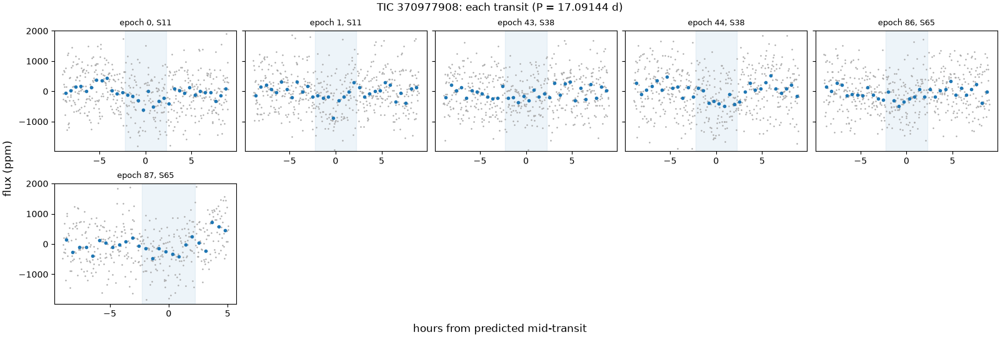
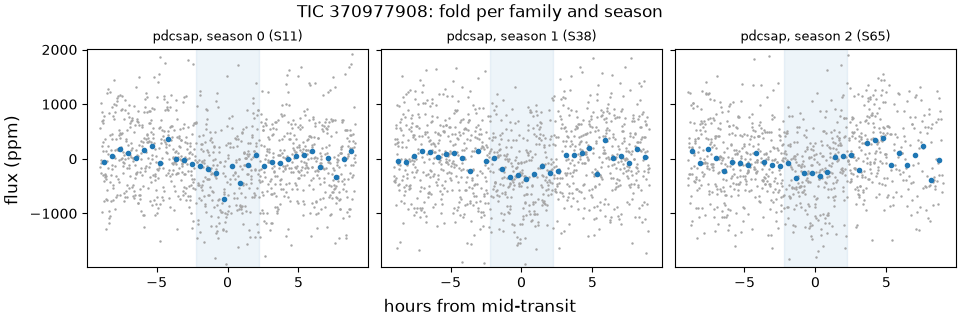
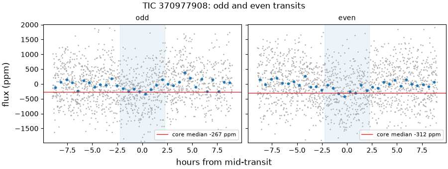
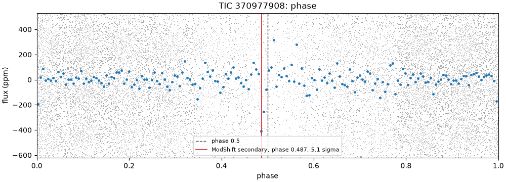
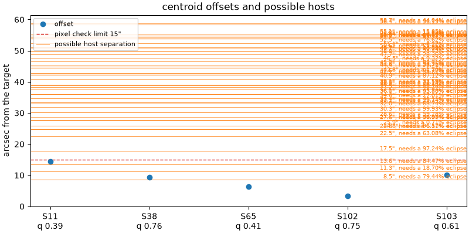

# 370977908-1: TIC 370977908

Call: **held** on 2026-10-22. Rendered from the files in this directory ([decision 0028](../../../docs/decisions/0028-outcomes-and-calls.md)); the review and the call are quoted, not rendered ([decision 0037](../../../docs/decisions/0037-quoted-text-in-the-dossier.md)).

## Signal and star

|  |  |
|---|---|
| Signal | 370977908-1, a second-list row (a SPOC TCE that never became a TOI) |
| Names | TIC 370977908, Gaia DR3 5900598183502439296, HIP 73866, HD 133325, TYC 8305-2147-1, 2MASS J15054863-5127257 |
| Ephemeris (the search's box) | period 17.091442 d, epoch BTJD 1603.0924, duration 0.1875 d (4.50 h), depth 279 ppm |
| Star (TIC) | Teff 6203 K, radius 1.55 solar radii, Tmag 9.01 |
| RUWE (Gaia DR3) | 0.89 |
| CROWDSAP | S11 0.930; S38 0.927; S65 0.937; none published for S102 (QLP), S103 (QLP) |
| Sectors vetted | PDCSAP family: 11, 38 and 65; left out as timing-suspect: 102 and 103 |
| Criteria | search-v2, vet-v3 |
| Runs | vetting 20261020T174317Z-vetting-run-61b5944-2d70 (commit 61b5944, production); TRICERATOPS 20261021T044850Z-vetting-triceratops-cd4e7a2-07c3 (commit cd4e7a2, production); literature 20261021T001540Z-vetting-literature-61b5944-07de (commit 61b5944, production); evidence-only vetting 20261020T175536Z-vetting-run-61b5944-7f4e (commit 61b5944, production); second list 20261020T180844Z-vetting-second-list-61b5944-7096 (commit 61b5944, production); titles 20261026T155726Z-vetting-titles-0b1deac-1d19 (commit 0b1deac, production) |

## Checks

vet-v3's checks first, then the neighbour table (evidence, never a fail), triage's pixel check as the second list ran it on this row (triage runs it only on novelty passes), TRICERATOPS and the literature search.

| Check | Outcome | Reason |
|---|---|---|
| novelty | inconclusive | matches only SPOC TCE or ExoMiner rows |
| odd_even | pass | pdcsap: odd and even depths agree within 0.8 sigma |
| secondary | pass | no dip at phase 0.5 (-0.1 sigma) |
| sector_depth | pass | pdcsap: depths agree across 3 sectors (p = 0.82) |
| holdout | inconclusive | 1 season(s) could be tested; need 2 |
| signal_present | pass | combined depth is 8.0 sigma |
| shape | pass | U-shaped: grazing in 2% of samples |
| density | pass | transit and TIC densities agree (0.5 sigma) |
| radius | pass | 2.6 Earth radii |
| neighbours | inconclusive | 1 Gaia DR3 star(s) within the radius have no G magnitude |
| pixels | pass | centroid offset 9.3" within 15" |
| triceratops | inconclusive | the neighbour table is inconclusive: 1 Gaia DR3 star(s) within the radius have no G magnitude |
| literature | pass | complete: 12 hits to screen |

## On the star?

Centroids, from the second list's pixel check (pass, centroid offset 9.3" within 15"): the difference-image centroid's offset from the target in each sector. The second list's pass rests on the best-quality sector's offset, S38's.

| Sector | Offset (arcsec) | Quality | Note |
|---|---|---|---|
| 11 | 14.5 | 0.39 |  |
| 38 | 9.3 | 0.76 | the offset the second list's check judged |
| 65 | 6.3 | 0.41 |  |
| 102 | 3.4 | 0.75 | timing-suspect: vet-v3 leaves it out |
| 103 | 10.0 | 0.61 | timing-suspect: vet-v3 leaves it out |

Neighbours (inconclusive): 1 Gaia DR3 star(s) within the radius have no G magnitude. Each Gaia DR3 star that could make the dip, with its separation from the target (Gaia DR3 5900598183502439296, J2016.0) and the eclipse depth it would need, scaled from the depth in the signals file (279 ppm) as if all its light fell in the aperture, and the TRICERATOPS star matched to it with the distance between them at the TIC's epoch:

| Star | Separation (arcsec) | Eclipse needed | TRICERATOPS's star (distance) | Its depth |
|---|---|---|---|---|
| Gaia DR3 5900598179180606976 | 8.5 | 79.4% | TIC 370977897 (0.2") | 79.7% |
| Gaia DR3 5900598183502438272 | 11.3 | 18.7% | TIC 370977918 (0.0") | 19% |
| Gaia DR3 5900598179174680704 | 13.6 | 84.5% | TIC 370977892 (0.1") | 97.2% |
| Gaia DR3 5900598179176024192 | 17.5 | 97.2% | TIC 370977878 (0.0") | 0% |
| Gaia DR3 5900598179177371392 | 22.5 | 63.1% | TIC 370977880 (0.0") | 74.7% |
| Gaia DR3 5900598149142700288 | 24.8 | 6.51% | TIC 370977937 (0.0") | 6.88% |
| Gaia DR3 5900597938662438656 | 24.8 | 96.2% | TIC 370977954 (0.0") | 0% |
| Gaia DR3 5900597977344007552 | 25.9 | 0.71% | TIC 370977930 (0.0") | 0.834% |
| Gaia DR3 5900598183477215232 | 27.6 | 96.9% | TIC 370977859 (0.0") | 0% |
| Gaia DR3 5900597977318762752 | 27.7 | 40% | TIC 1150965460 (0.0") | 0% |
| Gaia DR3 5900597938657834496 | 28.6 | 59.3% | TIC 370977959 (0.0") | 68.8% |
| Gaia DR3 5900598183502442624 | 30.3 | 99.9% | TIC 370977854 (0.0") | 0% |
| Gaia DR3 5900598149117459968 | 32.0 | 63.7% | TIC 370977942 (0.0") | 75.3% |
| Gaia DR3 5900597977344006912 | 33.1 | 25.7% | TIC 370977928 (0.0") | 43.1% |
| Gaia DR3 5900597977344009216 | 33.4 | 46.1% | TIC 370977890 (0.0") | 80.5% |
| Gaia DR3 5900597973017575040 | 34.6 | 27% | TIC 370977953 (0.0") | 40.1% |
| Gaia DR3 5900597973017578240 | 36.0 | 93.8% | TIC 370977941 (0.0") | 0% |
| Gaia DR3 5900597973018929920 | 36.1 | 45.7% | TIC 370977931 (0.0") | 90.2% |
| Gaia DR3 5900598179174688768 | 37.5 | 88.7% | TIC 370977846 (0.0") | 0% |
| Gaia DR3 5900598149142700416 | 38.3 | 28.2% | TIC 370977944 (0.0") | 37.4% |
| Gaia DR3 5900598179177377408 | 38.8 | 23.2% | TIC 370977849 (0.0") | 54% |
| Gaia DR3 5900597973022178304 | 39.1 | 32.6% | TIC 370977924 (0.0") | 73.3% |
| Gaia DR3 5900598247894162688 | 40.9 | 87.1% | TIC 370977855 (0.0") | 0% |
| Gaia DR3 5900598144815646720 | 42.1 | 34.8% | TIC 370977950 (0.0") | 54.3% |
| Gaia DR3 5900598183502444160 | 42.6 | 96.7% | TIC 1150965695 (0.0") | 0% |
| Gaia DR3 5900598183502444032 | 42.8 | 1.7% | TIC 370977833 (0.0") | 5.38% |
| Gaia DR3 5900598179176036224 | 44.4 | 53.7% | TIC 370977843 (0.0") | 0% |
| Gaia DR3 5900598183507721088 | 44.8 | 94% | TIC 370977837 (0.2") | 0% |
| Gaia DR3 5900597973016243712 | 45.2 | 83.7% | TIC 370977900 (0.0") | 0% |
| Gaia DR3 5900598183502443776 | 46.5 | 9.32% | TIC 370977831 (0.0") | 38.2% |
| Gaia DR3 5900598217862181632 | 47.7 | 28.4% | TIC 370977874 (0.0") | 50.4% |
| Gaia DR3 5900597977344004992 | 48.8 | 25.4% | TIC 370977977 (0.0") | 67.3% |
| Gaia DR3 5900598080397982976 | 49.7 | 84.1% | TIC 1150965553 (0.0") | 0% |
| Gaia DR3 5900597942984266368 | 49.7 | 40.8% | TIC 370977997 (0.0") | 88.3% |
| Gaia DR3 5900598076096806144 | 50.6 | 75.5% | TIC 370977889 (0.5") | 0% |
| Gaia DR3 5900598149142699136 | 51.1 | 8.27% | TIC 370977969 (0.0") | 21.1% |
| Gaia DR3 5900598217836953472 | 52.5 | 76.6% | TIC 1150965700 (0.0") | 0% |
| Gaia DR3 5900598213534410624 | 53.9 | 84.6% | TIC 370977913 (0.0") | 0% |
| Gaia DR3 5900598080423224704 | 53.9 | 29.7% | TIC 370977872 (0.0") | 0% |
| Gaia DR3 5900598286581658624 | 54.0 | 69.4% | TIC 370977824 (0.0") | 0% |
| Gaia DR3 5900598252221922176 | 54.4 | 0.48% | TIC 370977823 (0.0") | 3.71% |
| Gaia DR3 5900597977344004480 | 54.4 | 11.6% | TIC 370977979 (0.0") | 50.6% |
| Gaia DR3 5900598183502445312 | 54.8 | 15.8% | TIC 370977807 (0.0") | 0% |
| Gaia DR3 5900598217862180352 | 55.1 | 15.9% | TIC 370977898 (0.0") | 34% |
| Gaia DR3 5900598247895522688 | 58.4 | 96.2% | TIC 370977803 (0.0") | 0% |
| Gaia DR3 5900597766859137536 | 58.7 | 44% | TIC 370977985 (0.0") | 0% |

TRICERATOPS (inconclusive) took sectors 11, 38 and 65 at 120 s and folded them on the density-prior fit's ephemeris. It gave a mean NFPP 0.126 (sd 0.004) over 10 run(s) of 1000000 draws. The neighbour table lists possible hosts, but it could not judge every star: 1 Gaia DR3 star(s) within the radius have no G magnitude. Possible hosts it did not weigh: none. It gave zero depth to Gaia DR3 5900598179176024192 (TIC 370977878), Gaia DR3 5900597938662438656 (TIC 370977954), Gaia DR3 5900598183477215232 (TIC 370977859), Gaia DR3 5900597977318762752 (TIC 1150965460), Gaia DR3 5900598183502442624 (TIC 370977854), Gaia DR3 5900597973017578240 (TIC 370977941), Gaia DR3 5900598179174688768 (TIC 370977846), Gaia DR3 5900598247894162688 (TIC 370977855), Gaia DR3 5900598183502444160 (TIC 1150965695), Gaia DR3 5900598179176036224 (TIC 370977843), Gaia DR3 5900598183507721088 (TIC 370977837), Gaia DR3 5900597973016243712 (TIC 370977900), Gaia DR3 5900598080397982976 (TIC 1150965553), Gaia DR3 5900598076096806144 (TIC 370977889), Gaia DR3 5900598217836953472 (TIC 1150965700), Gaia DR3 5900598213534410624 (TIC 370977913), Gaia DR3 5900598080423224704 (TIC 370977872), Gaia DR3 5900598286581658624 (TIC 370977824), Gaia DR3 5900598183502445312 (TIC 370977807), Gaia DR3 5900598247895522688 (TIC 370977803), Gaia DR3 5900597766859137536 (TIC 370977985): its apertures take too little of each one's light to make the dip. Evidence for the review, not a blocker ([decision 0026](../../../docs/decisions/0026-triceratops.md)).

RUWE 0.89 (Gaia DR3). A high RUWE points to an unresolved companion, which TRICERATOPS's priors don't condition on; above vet-v3's limit, or without a RUWE, TRICERATOPS is inconclusive.

## A planet rather than a binary?

- Odd and even transits: pass, pdcsap: odd and even depths agree within 0.8 sigma.
- Secondary at phase 0.5: pass, no dip at phase 0.5 (-0.1 sigma).
- Secondary at any phase (LEO-Vetter's ModShift, from triage): the strongest secondary is 5.12 sigma at phase 0.487, depth 267 ppm; primary 11.9 sigma, tertiary 2.81 sigma at phase 0.858, positive 2.6 sigma at phase 0.195; Fred 1.62.
- The search's other signals on the star: rank 2 at 22.1987 d (period ratio 1.3, SDE 9.4).
- Shape (flat-prior fit): pass, U-shaped: grazing in 2% of samples; median b 0.47.
- Density (flat-prior fit): pass, transit and TIC densities agree (0.5 sigma).
- Radius: pass, 2.6 Earth radii. Rp is 2.64 Earth radii from the flat-prior fit and 2.71 (16th to 84th percentile 2.41 to 3.06) from the density-prior fit; the radius check reads the flat-prior fit.
- Density-prior fit (the TIC density as a prior), whose parameters M4 uses: Rp 2.71 Earth radii (16th to 84th percentile 2.41 to 3.06), b 0.66 (-0.17, +0.11), a/R* 19.44 (-1.39, +1.48), period 17.090965 d (sd 0.00027), t0 BTJD 1603.0982 (sd 0.017 d).
- TRICERATOPS (inconclusive): mean FPP 0.288 (sd 0.01) over 10 run(s) of 1000000 draws.

## Real and new?

- Signal present: pass, combined depth is 8.0 sigma.
- Held-out seasons: inconclusive, 1 season(s) could be tested; need 2.
- Sector depths: pass, pdcsap: depths agree across 3 sectors (p = 0.82).
- Novelty, against the catalog snapshot: inconclusive, matches only SPOC TCE or ExoMiner rows. SPOC TCE or ExoMiner rows at the period: TCE s0001-s0039 00370977908-01, TCE s0001-s0065 00370977908-01, ExoMiner 370977908-1-S1-39, ExoMiner 370977908-1-S1-65, ExoMiner vetting_catalog_2-min 370977908-1-S1-65, ExoMiner vetting_catalog_2-min 370977908-1-S1-39.
- Literature by name (TIC 370977908, HIP 73866, Gaia DR3 5900598183502439296, HD 133325, TYC 8305-2147-1, 2MASS J15054863-5127257) and NASA ADS: pass, complete: 12 hits to screen. The hits are listed below.

ExoFOP, read live: TOIs none; CTOIs none; confirmed planets none.

## Next TESS looks

tess-point places the star in no upcoming sector.

2-min data and the DDT ask ([decision 0026](../../../docs/decisions/0026-triceratops.md)): which stars get 2-min data in a sector is decided per cycle, so tess-point can't say whether these sectors will have it. In the sectors fetched, the star had SPOC 2-min data in sectors 11, 38 and 65. With no upcoming TESS look there is no DDT ask; M4 decides this signal's route.

## Plots

Each transit, against hours from its predicted mid-time:

The fold in each season and each product family:

Odd and even transits side by side:

The whole orbit, with phase 0.5 and LEO-Vetter's ModShift secondary marked:

The second list's pixel check: each sector's centroid offset, with the neighbours that could host the signal:

## Catalogued rows on the star

Every catalogued row on the star in the snapshot. vet-v3 masks only the kinds the search masks ([decision 0021](../../../docs/decisions/0021-vet-masks-search-kinds.md)); the rest stay unmasked. A row overlaps a transit of ours, numbered by epoch from the signal's t0, when its mask window (2 of its durations, or of 0.25 d where the catalog gives none) meets it. 6 transits of ours have data.

| Source | Kind | Name | Period (d) | Masked | Transits of ours it overlaps |
|---|---|---|---|---|---|
| SPOC-TCE | tce | TCE s0001-s0039 00370977908-01 | 17.09170 | no, it is the signal | 6 of 6: 0, 1, 43, 44, 86, 87 |
| SPOC-TCE | tce | TCE s0001-s0065 00370977908-01 | 17.09060 | no, it is the signal | 6 of 6: 0, 1, 43, 44, 86, 87 |
| ExoMiner-v1 | tce | ExoMiner 370977908-1-S1-39 | 17.09200 | no, it is the signal | 6 of 6: 0, 1, 43, 44, 86, 87 |
| ExoMiner-v1 | tce | ExoMiner 370977908-1-S1-65 | 17.09100 | no, it is the signal | 6 of 6: 0, 1, 43, 44, 86, 87 |
| ExoMiner-v2 | tce | ExoMiner vetting_catalog_2-min 370977908-1-S1-65 | 17.09063 | no, it is the signal | 6 of 6: 0, 1, 43, 44, 86, 87 |
| ExoMiner-v2 | tce | ExoMiner vetting_catalog_2-min 370977908-1-S1-39 | 17.09165 | no, it is the signal | 6 of 6: 0, 1, 43, 44, 86, 87 |

## Literature hits

12 paper(s) from the searches that answered, one row per paper. Titles come only from open sources: the search's own arXiv, OpenAlex and Zenodo hits, else OpenAlex's record for the paper's DOI; a paper none of them titles has a blank title ([decision 0038](../../../docs/decisions/0038-literature-trim-and-username-scrub.md)).

| Title | Id | Found by |
|---|---|---|
| Validation of the new Hipparcos reduction | doi 10.1051/0004-6361:20078357, arXiv 0708.1752 | ads TIC 370977908 |
|  | 1997A&A...323L..49P | ads TIC 370977908 |
| Stellar and substellar companions of nearby stars from Gaia DR2 | doi 10.1051/0004-6361/201834371, arXiv 1811.08902 | ads TIC 370977908 |
| The Hipparcos–Gaia Catalog of Accelerations: Gaia EDR3 Edition | doi 10.3847/1538-4365/abf93c, arXiv 2105.11662 | ads TIC 370977908 |
|  | 1978mcts.book.....H | ads TIC 370977908 |
| A catalogue of stellar diameters and fluxes for mid-infrared interferometry★ | doi 10.1093/mnras/stz2803, arXiv 1910.00542 | ads TIC 370977908 |
| Fundamental parameters and infrared excesses ofHipparcosstars | doi 10.1111/j.1365-2966.2012.21873.x, arXiv 1208.2037 | ads TIC 370977908 |
|  | 1993yCat.3135....0C | ads TIC 370977908 |
|  | 2014ASPC..485..223B | ads TIC 370977908 |
| Radial Velocity Photon Limits for the Dwarf Stars of Spectral Classes F–M | doi 10.3847/1538-4365/ab609f, arXiv 1912.04120 | ads TIC 370977908 |
| Radial velocities for the HIPPARCOS-GaiaHundred-Thousand-Proper-Motion project | doi 10.1051/0004-6361/201219219, arXiv 1208.3048 | ads TIC 370977908 |
| Bayesian inference of stellar parameters and interstellar extinction using parallaxes and multiband photometry | doi 10.1111/j.1365-2966.2010.17699.x, arXiv 1009.2766 | ads TIC 370977908 |

## With the timing-suspect sectors (evidence only)

The same vet with the timing-suspect sectors kept in ([decision 0022](../../../docs/decisions/0022-vet-without-timing-suspect-sectors.md)). It is shown for comparison and never used for the call. Sectors it adds: 102 and 103.

| Check | Without them | With them | Reason with them |
|---|---|---|---|
| novelty | inconclusive | inconclusive | matches only SPOC TCE or ExoMiner rows |
| odd_even | pass | pass | pdcsap: odd and even depths agree within 0.8 sigma; qlp: odd and even depths agree within 0.2 sigma |
| secondary | pass | pass | no dip at phase 0.5 (0.4 sigma) |
| sector_depth | pass | pass | pdcsap: depths agree across 3 sectors (p = 0.82); qlp: depths agree across 2 sectors (p = 0.54) |
| holdout | inconclusive | inconclusive | 1 season(s) could be tested; need 2 |
| signal_present | pass | pass | combined depth is 9.5 sigma |
| shape | pass | pass | U-shaped: grazing in 2% of samples |
| density | pass | pass | transit and TIC densities agree (0.5 sigma) |
| radius | pass | pass | 2.6 Earth radii |

## Review

Quoted from `review.json`, as the reviewer and the refuters wrote it: its numbers, paths and run names are theirs, not rendered from the runs ([decision 0037](../../../docs/decisions/0037-quoted-text-in-the-dossier.md)). [The vetting README](../README.md) says what its paths and run names stand for.

Reviewer claude-opus-5-5, 2026-10-21. Full brief on 370977908-1, a 279 ppm, 17.09 d SPOC TCE on a Tmag 9.0 F star, promoted from the second list. The main finding is a dip at phase 0.487, as deep as the transit, in all three orbits with data there and at the target's pixels: vet-v3's phase-0.5 check can't see it, LEO-Vetter misses flagging it only on red noise, and if real it makes this an eclipsing binary. TRICERATOPS's no-G blocker is immaterial (the star is TIC 1150965440, T 20.1), so NFPP 0.126 is a would-be fail, yet every star carrying it sits 4 or more sigma from SPOC's difference-image centroid; ground-based photometry at the transit and phase-0.487 times decides both.

A finding rated kill or hold is confirmed when no refuter refuted it; a note gets no refuters.

### F1 (a planet, hold): confirmed

Claim: A dip at phase 0.487, about as deep as the transit, sits in every orbit with data at that phase (one PDCSAP event, two QLP S103 events) and at the target's pixels; vet-v3's secondary check only looks at phase 0.5, LEO-Vetter's ModShift leaves it unflagged only on its red-noise test, and if it is real it is an eclipsing binary's second eclipse, not this planet.

Evidence: (1) Triage's LEO-Vetter, $TRIAGE_RUN/evidence/370977908-1.json (leo_flux.evidence.metrics, all five sectors, 9 transits): sig_sec 5.12 at phs_sec 0.4867, dep_sec 267 +- 52 ppm against the primary's dep 342 +- 29 ppm; Fred 1.623, FA1 5.009, FA2 2.544. LEO's rule (.venv/lib/python3.12/site-packages/leo_vetter/thresholds.py:173-189) flags a secondary when MS4 = sig_sec/Fred - FA1 > 0 and MS5 or MS6 > -1: MS4 = 3.15 - 5.01 = -1.85 fails; MS5 = 5.12 - 2.81 - 2.54 = -0.24 and MS6 = 5.12 - 2.60 - 2.54 = -0.03 both pass. Only the red-noise scaling keeps it unflagged. albedo 260 +- 73, so it can't be the planet's own occultation (0031's first cause). (2) vet-v3's secondary (src/tess_hunt/checks/photometry.py:127-129) measures phase 0.5 over one duration; phase 0.487 is 0.227 d (5.4 h) earlier, outside its 0.094 d half-window, hence its -0.1 sigma pass. (3) Per event, on the light curve rebuilt as the plots rebuild it, a 4.5 h box against a local baseline (. ~/.cache/tess-hunt/logs/m3-vars.sh; . ~/.cache/tess-hunt/logs/m3-rerun-vars.sh; cd ~/code/tess-hunt; /tmp/t13/heavy.sh uv run python /tmp/t13/370977908-1/secondary.py $VET2_RUN): phase 0.487 has data in three orbits: S65 epoch 86 (BTJD 3081.275, PDCSAP) 360 +- 53 ppm; S103 epoch 149 (4158.036, QLP) 215 +- 56; S103 epoch 150 (4175.127, QLP) 355 +- 64. S11's, S38's and S102's fall in data gaps. Combined 308 +- 33 ppm (white errors) against the primary's 271 +- 20 over its nine transits; phase 0.5 gives 55 +- 33. 4158.036 - 3081.275 = 1076.761 d = 63.000 periods, so the dips keep the signal's period. A phase scan of all five sectors (every 0.002, 3 or more events) puts the strongest dip away from the transit at 0.488 (8.9 sigma white); the next, unrelated, at 0.858 (5.4); the scan's sd is 1.86. With each sector's empirical single-box scatter (same setup, /tmp/t13/370977908-1/events.py: S65 96 ppm, S103 131 ppm) the three events combine to 321 +- 67 ppm, 4.8 sigma. Implied e cos w about (pi/2)(0.4867 - 0.5) = -0.021. (4) Pixels (. ~/.cache/tess-hunt/logs/m3-vars.sh; . ~/.cache/tess-hunt/logs/m3-rerun-vars.sh; cd ~/code/tess-hunt; /tmp/t13/heavy.sh .venv/bin/python /tmp/t13/370977908-1/pix2.py $SECOND2_RUN/tdi/370977908-1/tic370977908 370977918 370977897 370977937 370977930; output in /tmp/t13/370977908-1/pix2.txt): difference images at phase 0.487, 3x3 box at the target against each sector's null images: S65 z 3.6 (320 ppm), S103 z 3.5 (232 ppm, both events); the transit's own images give z 2.4 and 6.0 in the same sectors. S11's and S38's phase-0.487 windows sit in gaps (5 and 16 cadences). No quality flag or momentum dump within 0.25 d of the three events (/tmp/t13/370977908-1/flags.py, same tdi directory). QLP's S99-S104 timing error (medians under 10 min, single transits up to 35 min; decision 0022) is far below the 5.4 h offset from phase 0.5. Against: SPOC DV s0001-s0065 ($SNAP3/raw/SPOC-TCE/tess2018206190142-s0001-s0065_dvr-tcestats.csv) gives its weak-secondary maximum at MES 2.57, -3.33 d (phase 0.805), wst_depth 78.9 ppm; its 2-min data hold only the S65 event at 0.487. S65 also holds a second single dip of the same size away from 0.487 (3078.84, 343 ppm, phase 0.344; events.py). QLP S102 and S103 are redder than PDCSAP (red-noise beta 1.84 and 1.60 against 1.04 to 1.31; checks-with-suspect.json red_noise). If real, the eclipses are nearly equal, so a host must reach the required depth at both: TIC 370977897 (8.5", needs 79%) and TIC 370977892 (13.6", 84% to 97%) cannot; TIC 370977918 (11.3", 19%) can (neighbours.csv). What decides it: ground-based photometry at predicted phase-0.487 times (signal t0 1603.0924, P 17.091442, t0 + (n + 0.4867) P) on the target and the neighbours within 1'. A QLP redelivery of S102 and S103, or an independent FFI extraction, would test the two S103 events. No TESS sector is scheduled (checks.json upcoming_sectors empty).

- Refuter 1: did not refute. Every number F1 rests on reproduces. My outputs are in /tmp/t13/370977908-1/refute-F1-reproduce/ (secondary.out, events.out, pix2.out, flags.out). All four reruns went through /tmp/t13/heavy.sh with the evidence's own commands and exited 0.

(1) LEO-Vetter, from $TRIAGE_RUN/evidence/370977908-1.json leo_flux.evidence.metrics:
- sig_sec 5.1186 at phs_sec 0.48670; dep_sec 266.8 +- 52.1 ppm against dep 342.0 +- 29.2 ppm.
- Fred 1.6232, FA1 5.0085, FA2 2.5436, sig_ter 2.8138, sig_pos 2.6004, albedo 259.7 +- 73.0, N_transit 9.
- The rule is at .venv/lib/python3.12/site-packages/leo_vetter/thresholds.py:170-189, with defaults MS4 0, MS5 -1, MS6 -1 at lines 21-23. It gives MS4 = 3.154 - 5.009 = -1.855, MS5 = -0.239 and MS6 = -0.025. Without the Fred division, sig_sec - FA1 = +0.11 > 0, and albedo > 1 means the albedo exemption cannot apply. So only the red-noise scaling keeps it unflagged, as claimed.
- The VET2_RUN checks.json modshift block matches triage exactly.

(2) vet-v3's secondary check:
- src/tess_hunt/checks/photometry.py:127-129 builds the window at t0 + 0.5P with width 1.0 (ephemeris.py:23: half-window 0.5*duration = 0.094 d).
- VET2_RUN checks.json has secondary depth -5.4 ppm, sigma -0.076.
- The offset from phase 0.5 is (0.5 - 0.4867)*17.0914 = 0.227 d (5.45 h). e cos w = -0.0209.

(3) Per event, from `/tmp/t13/heavy.sh uv run python /tmp/t13/370977908-1/secondary.py $VET2_RUN`. This uses the same rebuild as vetting.py:223-228 _plots.
- Phase 0.487 events: S65 epoch 86 at 3081.275 is 360 +- 53 ppm; S103 epoch 149 at 4158.036 is 215 +- 56; S103 epoch 150 at 4175.127 is 355 +- 64. Combined 308 +- 33.
- Primary 271 +- 20 over nine transits. Phase 0.5 gives 55 +- 33.
- The phase scan's strongest dip is at 0.488 (8.9 sigma), the next at 0.858 (5.4), scan sd 1.86.
- (4158.036 - 3081.275)/17.091442 = 63.000 periods.
- events.py gives box sd S65 96 ppm and S103 131 ppm. Weighting the three events by those gives 321 +- 67 ppm (4.8 sigma).
- S11, S38 and S102 events are NaN, in light-curve gaps. S65 also holds a second dip at 3078.84 (343 ppm, phase 0.344).

(4) Pixels: my pix2.out is byte-identical to the reviewer's pix2.txt (`diff` printed nothing).
- Phase 0.487: S65 z 3.6 (320 ppm), S103 z 3.5 (232 ppm).
- Transit: S65 z 2.4, S103 z 6.0.
- In-cadences at phase 0.487: S11 5, S38 16.
- flags.py shows 0 flagged cadences and no momentum dumps within +-0.25 d of 3081.275, 4158.036 and 4175.127.

Other evidence checked:
- SPOC DV row for TIC 370977908 in $SNAP3/raw/SPOC-TCE/tess2018206190142-s0001-s0065_dvr-tcestats.csv: tce_ws_maxmes 2.574, tce_ws_maxmesd -3.334 d (phase 0.805), wst_depth 78.9.
- checks-with-suspect.json red_noise beta: S102 1.836, S103 1.602, S11/38/65 1.28/1.04/1.31.
- neighbours.csv and dossier lines 55-57: required depth 79.4% for TIC 370977897 (8.5"), 18.7% for TIC 370977918 (11.3"), 84.5% (Gaia) and 97.2% (TIC) for TIC 370977892 (13.6").
- Decision 0022 lines 11-13: medians under 10 min, single transits up to +35.25 min.
- upcoming_sectors is [].

One omission that does not cut against the claim: the S102 FFI pixels do have data at the 4140.944 phase-0.487 event, which the QLP light curve lacks. pix2 shows 248 ppm there, z 0.5, in a sector where the transit itself only reaches z 0.8. That is a positive dip of similar size, not a contradiction.
- Refuter 2: did not refute. F1 reads the rules correctly, and a hold is the right rating under the brief and decision 0028. I checked each rule claim.

(1) vet-v3's secondary looks only at phase 0.5. In src/tess_hunt/checks/photometry.py, secondary() shifts t0 by 0.5 P and calls box_depth with fraction 1.0, which gives a half-window of duration/2 = 0.1875/2 = 0.094 d (checks.json ephemeris). The M3 design (tess-hunt-m3-design.md, 4.2) says the same thing: "vet's secondary looks at phase 0.5 only". It hands any-phase secondaries to LEO-Vetter's ModShift in the dossier, and the brief's planet lens names ModShift as the test for "an eccentric secondary away from phase 0.5". The offset to phase 0.4867 is 0.227 d, so checks.json's secondary pass at -0.1 sigma tells us nothing about this dip.

(2) "Unflagged only on its red-noise test" matches the rule. leo_vetter/thresholds.py secondary() returns MS4 & (MS5 | MS6) & ~albedo, and criteria/triage-v1.toml [leo] sets MS4 = 0, MS5 = -1, MS6 = -1. I fed it $TRIAGE_RUN/evidence/370977908-1.json leo_flux.evidence.metrics (output in /tmp/t13/370977908-1/refute-F1-rules/rules.txt):
- MS4 = 5.1186/1.6232 - 5.0085 = -1.855, so it fails.
- MS5 = -0.239 and MS6 = -0.025, so both pass.
- The albedo clause is false (albedo 259.7 is not below 1, and dep_sec 267 ppm is not below 0.1 x 342 ppm), so the secondary is not excused as a planet's.
- With Fred = 1, MS4 = +0.110 and the secondary is flagged. Fred is the only thing keeping it clear.

(3) Decision 0031's first cause, the planet's own occultation, is ruled out. 0031 bounds it at 15.2 ppm or less at albedo 1.0, against 267 to 308 ppm here.

(4) Using the S103 QLP events doesn't break a rule.
- Decision 0022 bars the evidence-only vet's outcomes from the call because a timing error of up to 35.25 min can shave depths. It does not forbid reviewer evidence, and the brief tells reviewers to examine S99 to S104.
- The finding argues the timing point correctly: 35 min cannot move a dip 5.4 h.
- Decision 0023 lets dip-existence tests combine both families ("Dilution only makes a dip smaller").
- The phase arithmetic holds: the S65 event sits at phase 0.48671, and S65 to S103 is 63.00001 periods.

(5) The rating fits. The brief and 0028 define hold as "the public data can't decide" plus a named decider, and the finding names ground-based photometry and a QLP redelivery (both on 0028's list) and an independent FFI extraction. It doesn't claim a kill, and the evidence it lays out is mixed:
- LEO leaves the secondary unflagged.
- SPOC DV s0001-s0065 puts its weak-secondary maximum elsewhere: tce_ws_maxmes 2.57 at -3.33 d, which I confirmed from $SNAP3/raw/SPOC-TCE.
- Only one of the three events is outside the timing-suspect sectors, and S65 holds a second dip of the same size at another phase.
Since the finding discloses all of this, it doesn't overstate. "If it is real it is an EB" is stated as a condition. "At the target's pixels" is literal: the 3x3 box, which F3 says can't separate the 8.5" and 11.3" stars. The physics that rules out the 79% and 84-97% hosts under equal eclipses is sound and goes beyond design 4.4's 100% rule without contradicting it.

One minor point that doesn't change the verdict: the predicted-times formula uses the search ephemeris (P 17.091442). Design 4.2 gives M4's predictions to the density-prior fit (P 17.090965 +- 0.00027). Near epoch 160 the two differ by 0.071 d, about 1.7 h against a 4.5 h event.

### F2 (on the star, hold): confirmed

Claim: TRICERATOPS's only blocker is immaterial, so its inconclusive is a would-be fail (mean NFPP 0.126, all ten runs above 0.1); the NFPP is spread over seven stars 11" to 55" out, each 4.0 sigma or more from SPOC's difference-image centroid, and the public data can't settle which of the two is right.

Evidence: triceratops.json (TRIC3A_RUN, copied in the draft): inconclusive on one blocker, the neighbour table's no-G star. That star is Gaia DR3 5900597942960134272, 52.4" out (neighbours.csv: no G, no BP-RP). TRICERATOPS's own star list holds it as TIC 1150965440, 0.05" away, Tmag 20.12, tdepth 0; at that magnitude it would need a 775% eclipse (python3 /tmp/t13/370977908-1/nfpp_hosts.py). It is already in the NFPP, at zero, and can't host. Without the blocker tricera.outcome gives fail: runs 0.119 to 0.132, mean 0.1261 (sd 0.0040) against nfpp_fail 0.1 (criteria/vet-v3.toml); mean FPP 0.288. The 10 DUPLICATE rows dropped under 0036 (dropped_stars) copy stars 101" to 193" out whose tdepth is 0, so the fix doesn't move the NFPP. Who carries it (probs.csv, the last run, NTP+NEB+NEBx2P = 0.1256; nfpp_hosts.py): TIC 370977937 (24.7", T 14.92, 0.037), 370977823 (54.7", T 12.11, 0.031), 370977918 (11.2", T 16.05, 0.025), 370977898 (55.2", 0.019), 370977969 (50.9", 0.011), 370977953 (34.4", 0.003), 370977928 (33.0", 0.0004). No star dominates; the largest share sits in 0032's 20" to 25" band. Against those hosts: SPOC DV's multi-sector difference-image centroid offset from the TIC position, s0001-s0065 tce_ditco_mra +0.79 +- 2.53", tce_ditco_mdec +2.23 +- 4.96" (s0001-s0039: -1.29 +- 2.64, -9.18 +- 7.40; $SNAP3/raw/SPOC-TCE tcestats files), puts each from 4.0 sigma (370977918; 4.5 in s0001-s0039) to 22 sigma from the source; the pixel check's quality-weighted mean fit (E -3.2", N -1.6", /tmp/pixel-diag/summary_second.txt) puts them 3.3 to 13 standard errors away. For the fail: 0.126 is above every known planet in the controls (largest 0.0081, TOI-451.03) and both 20" to 25" binary controls (0.027, 0.034), results/benchmarks/20261020T082333Z-benchmark-controls-16418d2-f45a/controls.csv. Those small control planets sit on Tmag 5 to 7 stars where few neighbours can host; here 46 Gaia stars within 1' can (checks.json neighbours possible_hosts), so the comparison is not like for like. CROWDSAP is 0.927 to 0.937 (checks.json sources): other stars do share the aperture. Decision 0032 says an NFPP fail is not a reliable kill for a 20" to 25" binary, which the pixel check catches instead, and that NFPP can move with the ephemeris; it says nothing that clears a fail. What decides it: seeing-limited ground-based photometry of the stars within 1' at the transit and phase-0.487 times (F1), TIC 370977918 first (a 19% eclipse would be needed; inside the pixel rule's 15", the TOI-1399.01 case).

- Refuter 1: did not refute. Every number F2 rests on reproduces from the run files. My scripts are in /tmp/t13/370977908-1/refute-F2-reproduce/ (r1.py to r4.py). I also reran the reviewer's nfpp_hosts.py and got the same output.

(1) Blocker and outcome. TRIC3A_RUN/signals/370977908-1/triceratops.json and probs.csv are byte-identical to the draft copies (cmp). The outcome is inconclusive on one blocker, "1 Gaia DR3 star(s) within the radius have no G magnitude". r4.py calls tricera.outcome with the [triceratops] section of criteria/vet-v3.toml:
- with the blocker: inconclusive
- without it: "fail | mean NFPP 0.126 > 0.1 over 10 run(s)"
- NFPP runs 0.1193 to 0.1322, all above 0.1; mean 0.12615, sd 0.00397; mean FPP 0.2877.

(2) The no-G star. neighbours.csv lists Gaia DR3 5900597942960134272 at sep 52.36" with no G and no BP-RP. r1.py matches it to TIC 1150965440 in TRICERATOPS's star list: 0.046" away at J2016, 0.026" after moving it back to J2000. That star has Tmag 20.1209 and tdepth 0.0. The depth it would need is 0.000279 x 10^(0.4 x (20.12 - 9.01)) = 7.75, so 775%. One wording point: it has no rows in probs.csv, because only stars with tdepth > 0 get rows. "In the NFPP at zero" therefore means it adds nothing to the NFPP, which is right.

(3) The dropped DUPLICATE rows. The ten duplicate_ids sit 100.8" to 193.2" out, each with tdepth 0 (r2.py). A public MAST TIC query shows each DUPLICATE row has the same Tmag and position as its SPLIT original. So those rows would also need over 100%, and dropping them does not move the NFPP.

(4) Who carries the NFPP. NTP+NEB+NEBx2P in probs.csv sums to 0.125602, equal to the last run's NFPP. Per star (r2.py):

| TIC | Sep | Tmag | Share |
|---|---|---|---|
| 370977937 | 24.7" | 14.92 | 0.0367 |
| 370977823 | 54.7" | 12.11 | 0.0313 |
| 370977918 | 11.2" | 16.05 | 0.0249 (tdepth 0.1896) |
| 370977898 | 55.2" | | 0.0190 |
| 370977969 | 50.9" | | 0.0107 |
| 370977953 | 34.4" | | 0.0026 |
| 370977928 | 33.0" | | 0.0004 |

(5) SPOC centroid. $SNAP3/raw/SPOC-TCE:
- tess2018206190142-s0001-s0065_dvr-tcestats.csv gives tce_ditco_mra 0.78705 +- 2.52612 and mdec 2.225992 +- 4.955749.
- s0001-s0039 gives -1.28984 +- 2.640273 and -9.182559 +- 7.396021.
- msky equals hypot(mra, mdec), so mra is an on-sky offset.

r3.py gives s1-s65 sigmas of 9.03, 13.72, 4.00, 22.01, 16.82, 11.05, 12.35, and 4.46 for 370977918 in s1-s39. The exact minimum is 3.997, so "4.0 or more" holds only to rounding. With the offset's sign flipped it would be 4.42. The pixel-check side reproduces too: /tmp/pixel-diag/summary_second.txt reads "quality-weighted mean fit E -3.2" N -1.6"" with sky scatter 9.3" over 5 sectors, which puts the stars 3.31 to 13.19 standard errors away.

(6) Controls and context.
- In controls.csv the largest known-planet NFPP is TOI-451.03 at 0.00808. The binaries are TOI-1058.01 at 0.0270 and TOI-1175.01 at 0.0341, which decision 0032 puts at 20.90" and 23.53".
- checks.json gives neighbours possible_hosts 46, all within 58.7".
- CROWDSAP is 0.9305, 0.9269 and 0.9368.
- Decision 0032 says what F2 says it does.

One minor inaccuracy, which the claim doesn't rest on: "Those small control planets sit on Tmag 5 to 7 stars". The control planets span Tmag 5.05 to 10.49, and TOI-451.03, the one the finding names, is on Tmag 10.27 (stars[0] in 20261017T162256Z-vetting-triceratops-62882b5-d0f8). The shallowest ones (TOI-144.01, TOI-396.01/.03, TOI-4307.01) are on Tmag 5.1 to 6.6. The point it supports still holds: no control planet has more than 9 possible hosts, against 46 here.
- Refuter 2: did not refute. F2 reads the rules correctly and the hold rating fits. I checked it against M3 design 4.4, 4.5, 4.8 and 4.9 (tess-hunt-m3-design.md), decisions 0025, 0026, 0028, 0032, 0034 and 0036, and criteria/vet-v3.toml. Script: uv run python /tmp/t13/370977908-1/refute-F2-rules/check.py, run from ~/code/tess-hunt.

(1) "Only blocker": triceratops.json evidence.blockers holds one item, "the neighbour table is inconclusive: 1 Gaia DR3 star(s) within the radius have no G magnitude". No other blocker 0026 lists applies: missing_hosts is [] (all 46 possible hosts matched, the farthest at 0.49" against match_arcsec 2.0), RUWE is 0.888 (max_ruwe 1.4), field_population is True, raised is null and no run is degenerate.

(2) "Would-be fail": tricera.outcome(fpp, nfpp, cfg, [], False) on the record's ten runs returns "fail mean NFPP 0.126 > 0.1 over 10 run(s)" (src/tess_hunt/tricera.py:100-117; nfpp_fail = 0.1 in vet-v3.toml). The runs go from 0.1193 to 0.1322, so all ten sit above 0.1.

(3) "Immaterial": 0025 makes a no-G star a blocker "since the table can't say whether that star could host the signal". M3 design 4.4 says the same. The no-G star, Gaia DR3 5900597942960134272, sits about 0.02" to 0.05" from TRICERATOPS's TIC 1150965440 (T 20.12, tdepth 0.0), well inside match_arcsec. 0026's Ruling M treats a matched star with tdepth 0 as one "TRICERATOPS judged ... unable to make the dip ... the better-informed of the two" and calls it evidence, not a blocker. The finding follows that reasoning. It does not claim the check is wrong, so it owes no decision record (design 4.8).

(4) 0032 is quoted correctly. It says an NFPP fail is "not a reliable kill for a nearby binary 20" to 25" out. The pixel check catches those", and Task 13 reviewers are told NFPP "can move with the ephemeris". The finding adds that 0032 clears nothing, which is accurate.

(5) The 0036 point holds: all ten dropped DUPLICATE rows copy stars with tdepth 0.

(6) The controls comparison holds. The largest known-planet NFPP is TOI-451.03 at 0.00808. The binary controls are at 0.027 and 0.034. The most possible hosts any known-planet control has is 9, against 46 here. One wording slip that changes nothing: the sub-300 ppm controls sit on Tmag 5.05 to 7.76 stars (benchmarks/known_planets.csv), not strictly 5 to 7. The point is a caveat against the fail side anyway.

(7) Rating: a kill needs evidence that the signal is not a planet on this star (brief; 0028). A mean NFPP of 0.126 is the paper's "likely nearby false positive" label, not a majority probability. The check's recorded outcome is inconclusive, so no failed check exists for a kill to rest on (0028). The SPOC DV centroid points the other way: tce_ditco_mra 0.787 +- 2.526 and mdec 2.226 +- 4.956 (s0001-s0065), confirmed in $SNAP3/raw/SPOC-TCE tcestats. That puts TIC 370977918 at E10.3 N-4.2 about 4.0 sigma away. The finding names ground-based photometry as what decides it, which is on 0028's and design 4.9's list for a hold. So hold fits, and the finding doesn't overstate its evidence into a kill.

### F3 (on the star, note)

Claim: Triage's pixel pass can't place the source to better than about 10" to 15": S38's image holds the transit at its expected strength but too weakly to locate it, the five sector fits point every way, and the 15" rule says nothing about the possible hosts at 8.5" and 11.3".

Evidence: $SECOND2_RUN/signals/370977908-1/pixels.json: pass on S38, 9.32", quality 0.76 (S38 is a SPOC sector, not timing-suspect). The pixel diagnosis's rebuild of the same images from the first second-list run (identical offsets; /tmp/pixel-diag/summary_second.txt lines 83-98): S38's 3x3-box loss at the target is z 1.1 against 1.0 expected (0 of 16 nulls reach its quality). Unlike TOI-396.01's pass (z -1.2 against 1.8 expected) the image holds what an on-target transit would give, but at z 1 it can't place it. Fits (E, N): S103 (-8.0, -6.1), S102 (-1.2, -3.1), S65 (+2.6, +5.7), S38 (-4.5, -8.2), S11 (-3.3, +14.1); sky scatter 9.3" against detector scatter 9.6", the diagnosis's 'too little transit' mode; quality-weighted mean 3.6" from the target. S103 holds the transit best (box z 6.0 against 4.2 expected), but the box spans 63". Fixed target-plus-neighbour fits (pix2.txt, command in F1) are degenerate for the 8.4" and 11.4" stars: their fitted out-of-transit flux comes out negative (TIC 370977918: -446 e/s in S65, -55 in S38; TIC 370977897: -6412 in S102), so the pixels can't split those stars from the target. For the 24.8" and 26.0" stars, S65's phase-0.487 loss goes to the target (z 2.9 and 3.7), not to them (0.0 and -0.4). F2 covers TIC 370977918.

### F4 (real and new, note)

Claim: Both S11 transits sit on momentum dumps, but the signal holds in S38 and S65 without them; it is a low-SNR signal that one held-out season supports.

Evidence: Quality bit 32 in S11's FFI pixel series at BTJD 1603.078 and 1620.203, 0.014 and 0.019 d from mid-transit; S11 dumps come every 3.125 d (. ~/.cache/tess-hunt/logs/m3-vars.sh; . ~/.cache/tess-hunt/logs/m3-rerun-vars.sh; cd ~/code/tess-hunt; /tmp/t13/heavy.sh .venv/bin/python /tmp/t13/370977908-1/dumps.py $SECOND2_RUN/tdi/370977908-1/tic370977908 ~/.cache/tess-hunt/lc/370977908.npz). The 2-min light curve has a 16-minute hole at each (1603.068, 1620.194). S38's and S65's four transits have no dump within 1.2 d, except S65 epoch 87 (a dump 0.42 d after, 0.21 d before the orbit gap; events.py). checks.json: sector_depth S11 354 +- 78, S38 293 +- 59, S65 320 +- 73 ppm (p 0.82); holdout predicts S38 at 5.36 sigma (tension 0.09) and is inconclusive only because S11 and S65 are underpowered (expected SNR 3.8 and 3.9 against 4.0). signal_present 8.0 sigma against 7.0; SPOC's MES 7.32 (s0001-s0065) and 7.66 (s0001-s0039), just over 7.1. QLP S102 and S103 give 427 ppm against PDCSAP's 316 (1.2 sigma; checks-with-suspect.json); QLP publishes no CROWDSAP.

### F5 (real and new, note)

Claim: No paper, catalogue or ExoFOP entry names the star as a planet host, binary or variable, but the signal is not undetected: two SPOC TCEs and ExoMiner (PC, 0.782) have it, and a claim must credit them.

Evidence: checks.json novelty: two SPOC DV TCEs (s0001-s0039 updated 2021-08-31, s0001-s0065 updated 2023-08-05) and four ExoMiner rows; $SECOND2_RUN/second-list.csv: ExoMiner-v2 2-min score 0.782, PC; never a TOI. literature.json search.exofop: no TOI, CTOI, comments, files or imaging. SIMBAD (sim-script query 'HD 133325'): otypes NIR,*; G2/3V; its 12 bibcodes are the 12 ADS hits. No WDS, VSX or Gaia DR3 eclipsing-binary row within 90" (VizieR asu-tsv on B/wds/wds, B/vsx/vsx, I/358/veb at 226.452627 -51.457178). All 12 hits are catalogues. Two of them test binarity and clear it: Kervella et al. 2019 (doi 10.1051/0004-6361/201834371; VizieR J/A+A/623/A72: PMa S/N 0.68, BinG2 0) and its EDR3 update (J/A+A/657/A7: S/N 0.70 and 1.04, no flag), and Brandt 2021 HGCA EDR3 (doi 10.3847/1538-4365/abf93c; J/ApJS/254/42: chi2 0.057, no acceleration). Gaia DR3 (TAP on gaiadr3.gaia_source): RUWE 0.888, ipd_frac_multi_peak 0, non_single_star 0. None flagged.

### F6 (a planet, note)

Claim: The transit's own shape and density fit a planet on this star, odd and even disagree mildly only in LEO-Vetter's fits with QLP in, and the search's second signal is noise, not an eclipsing-binary partner.

Evidence: checks.json: density 0.5 sigma from the TIC's; grazing in 2% of samples, b 0.47 (flat) and 0.66 (prior); Rp 2.64 and 2.71 Earth radii; odd and even 0.76 sigma in PDCSAP (odd 286, even 347 ppm) and 0.2 sigma in QLP (checks-with-suspect.json). Triage's LEO-Vetter on all nine transits leans the other way: odd 389 +- 39 against even 282 +- 44 ppm (1.8 sigma), trapezoid 499 +- 38 against 356 +- 38 (2.7 sigma), b 0.91 +- 0.07. Rank 2 (22.1987 d, ratio 1.30, SDE 9.4; checks.json other_signals) is not at a novelty harmonic: its t0 1613.755 sits 0.12 d after S11's orbit gap ends (1613.637) and its S65 event (66 periods, 3078.87) is the 343 ppm single dip at 3078.84 (events.py), not one of F1's phase-0.487 events.

Literature hits flagged for the maintainer to read: none.

## Call

Quoted from `call.toml`, the maintainer's words, not rendered from the runs ([decision 0037](../../../docs/decisions/0037-quoted-text-in-the-dossier.md)).

Outcome: **held**, 2026-10-22.

Reasons: Probably an eclipsing binary, not a planet, though the public data don't show it. A dip about as deep as the transit sits just before the half-orbit point in every orbit with data there, at the target's pixels, which vet-v3's half-orbit check can't see; if real, it is a binary's second eclipse. TRICERATOPS's only blocker is immaterial, and without it its NFPP would fail, though SPOC's difference-image centroid sits well away from every star that carries it.

Rests on: F1 (finding), F2 (finding), triceratops, holdout.

Criteria: vet-v3.

Deciding evidence: Seeing-limited ground-based photometry at predicted transit times and at the times of the near-half-orbit dip, showing whether either dip is on the target or on one of the neighbours that carry TRICERATOPS's NFPP (F1, F2). No TESS sector is scheduled, so the held-out check stays at one testable season.

Promotion: The TCEs matched are SPOC's multi-sector TCE 00370977908-01 (s0001-s0039 and s0001-s0065) and ExoMiner's planet-candidate rows on it; it never became a TOI. Promoted by the maintainer in decision 0033 on the bar the nine shortlisted signals met in triage.
