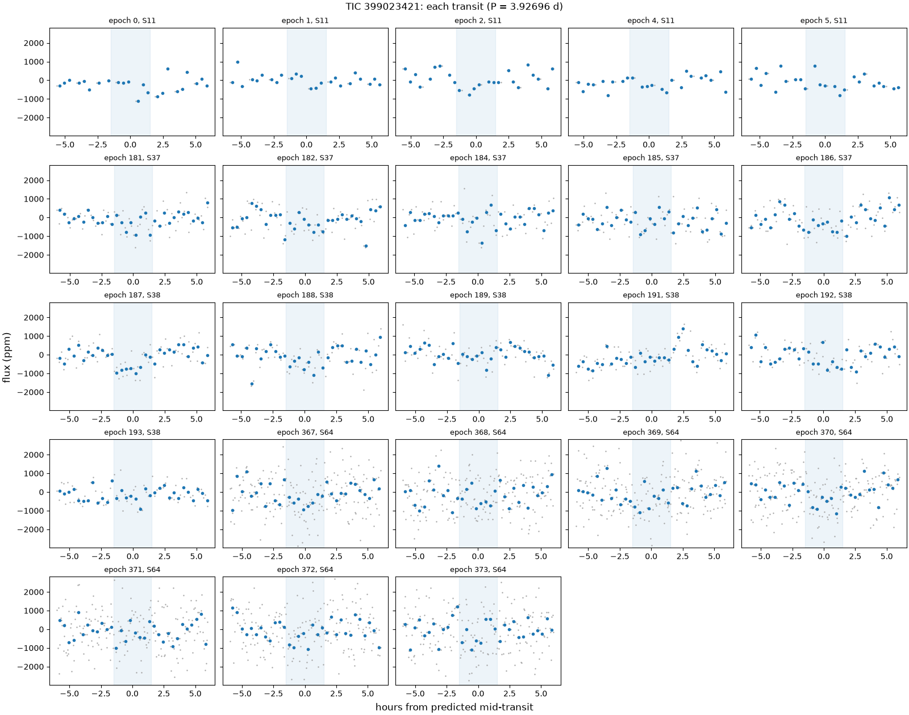
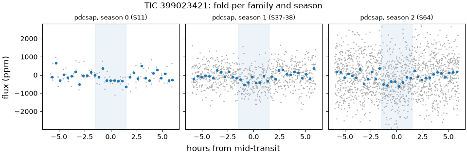
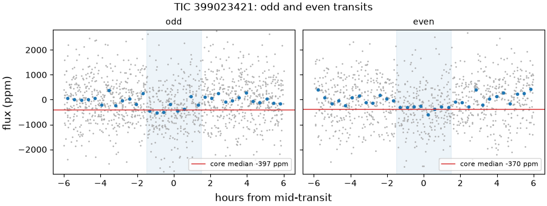
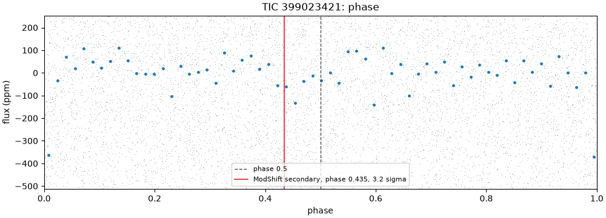
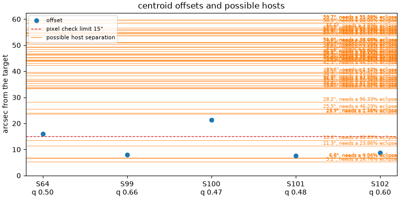

# 399023421-1: TIC 399023421

Call: **held** on 2026-10-22. Rendered from the files in this directory (decision 0028).

## Signal and star

|  |  |
|---|---|
| Signal | 399023421-1, a shortlisted candidate |
| Names | TIC 399023421, Gaia DR3 6080509411401414016, TYC 8259-638-1, 2MASS J13131587-5156489 |
| Ephemeris (the search's box) | period 3.926959 d, epoch BTJD 1600.8528, duration 0.1250 d (3.00 h), depth 298 ppm |
| Star (TIC) | Teff 6320 K, radius 1.55 solar radii, Tmag 10.36 |
| RUWE (Gaia DR3) | 0.95 |
| CROWDSAP | S11 0.902; S37 0.890; S38 0.923; S64 0.909; none published for S99 (QLP), S100 (QLP), S101 (QLP), S102 (QLP) |
| Sectors vetted | PDCSAP family: 11, 37, 38 and 64; left out as timing-suspect: 99, 100, 101 and 102 |
| Criteria | search-v2, vet-v3 |
| Runs | vetting 20261020T174317Z-vetting-run-61b5944-2d70 (commit 61b5944, production); TRICERATOPS 20261021T194348Z-vetting-triceratops-cd4e7a2-7821 (commit cd4e7a2, production); literature 20261021T001540Z-vetting-literature-61b5944-07de (commit 61b5944, production); evidence-only vetting 20261020T175536Z-vetting-run-61b5944-7f4e (commit 61b5944, production) |

## Checks

vet-v3's checks first, then the neighbour table (evidence, never a fail), triage's pixel check, TRICERATOPS and the literature search.

| Check | Outcome | Reason |
|---|---|---|
| novelty | pass | no known object matches |
| odd_even | pass | pdcsap: odd and even depths agree within 0.7 sigma |
| secondary | pass | no dip at phase 0.5 (1.8 sigma) |
| sector_depth | pass | pdcsap: depths agree across 4 sectors (p = 0.89) |
| holdout | pass | 2 held-out seasons predicted |
| signal_present | pass | combined depth is 9.1 sigma |
| shape | pass | U-shaped: grazing in 0% of samples |
| density | pass | transit and TIC densities agree (0.3 sigma) |
| radius | pass | 3.1 Earth radii |
| neighbours | pass | 53 of 82 neighbours could host the signal |
| pixels | pass | centroid offset 7.9" within 15" |
| triceratops | inconclusive | mean FPP 0.0589, mean NFPP 0.0161 over 10 run(s): neither likely a planet nor likely a nearby false positive |
| literature | pass | complete: 0 hits to screen |

## On the star?

Centroids, from triage's pixel check (pass, centroid offset 7.9" within 15"): the difference-image centroid's offset from the target in each sector. Triage's pass rests on the best-quality sector's offset, S99's, from a timing-suspect sector that vet-v3 leaves out.

| Sector | Offset (arcsec) | Quality | Note |
|---|---|---|---|
| 64 | 16.1 | 0.50 |  |
| 99 | 7.9 | 0.66 | timing-suspect: vet-v3 leaves it out; the offset triage judged |
| 100 | 21.4 | 0.47 | timing-suspect: vet-v3 leaves it out |
| 101 | 7.6 | 0.48 | timing-suspect: vet-v3 leaves it out |
| 102 | 8.7 | 0.60 | timing-suspect: vet-v3 leaves it out |

Neighbours (pass): 53 of 82 neighbours could host the signal. Each Gaia DR3 star that could make the dip, with its separation from the target (Gaia DR3 6080509411401414016, J2016.0) and the eclipse depth it would need, scaled from the depth in the signals file (298 ppm) as if all its light fell in the aperture, and the TRICERATOPS star matched to it with the distance between them at the TIC's epoch:

| Star | Separation (arcsec) | Eclipse needed | TRICERATOPS's star (distance) | Its depth |
|---|---|---|---|---|
| Gaia DR3 6080509415699611008 | 5.2 | 16.8% | TIC 993417193 (0.0") | 16.4% |
| Gaia DR3 6080509415706208640 | 6.6 | 9.56% | TIC 993417201 (0.0") | 19% |
| Gaia DR3 6080509415699614464 | 6.8 | 4.04% | TIC 399023424 (0.0") | 4.05% |
| Gaia DR3 6080509411408080512 | 11.3 | 23.9% | TIC 399023427 (0.0") | 24.8% |
| Gaia DR3 6080509415699616000 | 13.6 | 68.9% | TIC 993417195 (0.0") | 95.9% |
| Gaia DR3 6080509415706211584 | 23.7 | 1.46% | TIC 399023429 (0.0") | 1.8% |
| Gaia DR3 6080509415706205952 | 23.9 | 2.16% | TIC 399023414 (0.0") | 2.31% |
| Gaia DR3 6080509411404637696 | 25.5 | 46.2% | TIC 993417189 (0.0") | 52.6% |
| Gaia DR3 6080509342685078016 | 28.2 | 96.3% | TIC 993417167 (0.0") | 0% |
| Gaia DR3 6080509342685069440 | 33.4 | 74.8% | TIC 993417166 (0.0") | 0% |
| Gaia DR3 6080509415706204288 | 33.5 | 4.62% | TIC 399023399 (0.0") | 6.07% |
| Gaia DR3 6080509411404593024 | 34.0 | 81.8% | TIC 993417187 (0.0") | 0% |
| Gaia DR3 6080509445764324224 | 34.6 | 87.1% | TIC 993417202 (0.0") | 0% |
| Gaia DR3 6080509342685083008 | 35.5 | 10.3% | TIC 399023401 (0.0") | 17.4% |
| Gaia DR3 6080509346980125184 | 36.2 | 94.4% | TIC 993417168 (0.0") | 0% |
| Gaia DR3 6080509411404620672 | 36.4 | 82.6% | TIC 993417188 (0.0") | 0% |
| Gaia DR3 6080509346986727424 | 37.0 | 18% | TIC 399023395 (0.0") | 27.8% |
| Gaia DR3 6080509415706204416 | 38.4 | 97.9% | TIC 993417200 (0.0") | 0% |
| Gaia DR3 6080509342685060992 | 39.4 | 16.1% | TIC 399023391 (0.0") | 31.5% |
| Gaia DR3 6080509621864640512 | 39.6 | 1.42% | TIC 399023447 (0.0") | 3.58% |
| Gaia DR3 6080509377044862592 | 42.3 | 46.5% | TIC 993417174 (0.0") | 77.4% |
| Gaia DR3 6080509518785429248 | 43.2 | 9.63% | TIC 399023443 (0.0") | 25.5% |
| Gaia DR3 6080509621858039296 | 43.9 | 69.4% | TIC 399023436 (0.4") | 0% |
| Gaia DR3 6080509346986727040 | 44.0 | 8.66% | TIC 399023390 (0.0") | 18.3% |
| Gaia DR3 6080509617563084416 | 44.2 | 76.9% | TIC 399023436 (0.2") | 0% |
| Gaia DR3 6080509617563092480 | 44.4 | 80% | TIC 993417269 (0.0") | 0% |
| Gaia DR3 6080509621858051200 | 45.1 | 48.2% | TIC 993417278 (0.0") | 0% |
| Gaia DR3 6080509445764339200 | 45.3 | 18.9% | TIC 993417203 (0.0") | 57.8% |
| Gaia DR3 6080509514485485952 | 46.2 | 18.8% | TIC 993417237 (0.0") | 60.7% |
| Gaia DR3 6080509445772608256 | 46.6 | 91.1% | TIC 993417210 (0.0") | 0% |
| Gaia DR3 6080509514483905920 | 46.6 | 18.1% | TIC 399023454 (0.0") | 62.3% |
| Gaia DR3 6080509445764375936 | 46.7 | 62.1% | TIC 993417207 (0.0") | 0% |
| Gaia DR3 6080509518785429504 | 47.6 | 6.46% | TIC 399023452 (0.0") | 22.9% |
| Gaia DR3 6080509342685043840 | 48.4 | 77.4% | TIC 993417165 (0.0") | 0% |
| Gaia DR3 6080509450065949056 | 49.1 | 3.39% | TIC 399023402 (0.0") | 11.8% |
| Gaia DR3 6080509377044845824 | 49.3 | 40% | TIC 993417172 (0.0") | 90% |
| Gaia DR3 6080508586770809216 | 50.4 | 8.53% | TIC 399023389 (0.0") | 36.2% |
| Gaia DR3 6080509514483889536 | 50.9 | 38.7% | TIC 993417233 (0.0") | 0% |
| Gaia DR3 6080509518785430016 | 51.0 | 36.1% | TIC 993417245 (0.0") | 0% |
| Gaia DR3 6080509617563123456 | 51.1 | 48.2% | TIC 993417270 (0.0") | 0% |
| Gaia DR3 6080509617563111296 | 53.7 | 20.2% | TIC 399023440 (0.0") | 0% |
| Gaia DR3 6080509621858034816 | 54.0 | 82.4% | TIC 993417272 (0.1") | 0% |
| Gaia DR3 6080509377044856320 | 54.6 | 70.1% | TIC 993417173 (0.0") | 0% |
| Gaia DR3 6080509621858035072 | 54.8 | 81.5% | TIC 993417273 (0.0") | 0% |
| Gaia DR3 6080509445764355712 | 55.0 | 67.5% | TIC 993417204 (0.0") | 0% |
| Gaia DR3 6080509514492082816 | 55.7 | 94.3% | TIC 993417240 (0.0") | 0% |
| Gaia DR3 6080509621864636672 | 56.0 | 2.03% | TIC 399023437 (0.0") | 14.6% |
| Gaia DR3 6080509621864638720 | 56.6 | 3.99% | TIC 399023450 (0.0") | 34.9% |
| Gaia DR3 6080509377044801536 | 58.5 | 28.9% | TIC 245107132 (0.0") | 0% |
| Gaia DR3 6080509514483886080 | 58.5 | 68.9% | TIC 993417231 (0.0") | 0% |
| Gaia DR3 6080509445765991424 | 59.7 | 55.1% | TIC 993417209 (0.0") | 0% |
| Gaia DR3 6080509377044821504 | 59.7 | 91.1% | TIC 993417171 (0.0") | 0% |
| Gaia DR3 6080509514483886208 | 59.7 | 51.5% | TIC 993417232 (0.0") | 0% |

TRICERATOPS (inconclusive) took sectors 64 at 200 s and folded them on the density-prior fit's ephemeris. It gave a mean NFPP 0.0161 (sd 0.00029) over 10 run(s) of 1000000 draws. Possible hosts it did not weigh: none. It gave zero depth to Gaia DR3 6080509342685078016 (TIC 993417167), Gaia DR3 6080509342685069440 (TIC 993417166), Gaia DR3 6080509411404593024 (TIC 993417187), Gaia DR3 6080509445764324224 (TIC 993417202), Gaia DR3 6080509346980125184 (TIC 993417168), Gaia DR3 6080509411404620672 (TIC 993417188), Gaia DR3 6080509415706204416 (TIC 993417200), Gaia DR3 6080509621858039296 (TIC 399023436), Gaia DR3 6080509617563084416 (TIC 399023436), Gaia DR3 6080509617563092480 (TIC 993417269), Gaia DR3 6080509621858051200 (TIC 993417278), Gaia DR3 6080509445772608256 (TIC 993417210), Gaia DR3 6080509445764375936 (TIC 993417207), Gaia DR3 6080509342685043840 (TIC 993417165), Gaia DR3 6080509514483889536 (TIC 993417233), Gaia DR3 6080509518785430016 (TIC 993417245), Gaia DR3 6080509617563123456 (TIC 993417270), Gaia DR3 6080509617563111296 (TIC 399023440), Gaia DR3 6080509621858034816 (TIC 993417272), Gaia DR3 6080509377044856320 (TIC 993417173), Gaia DR3 6080509621858035072 (TIC 993417273), Gaia DR3 6080509445764355712 (TIC 993417204), Gaia DR3 6080509514492082816 (TIC 993417240), Gaia DR3 6080509377044801536 (TIC 245107132), Gaia DR3 6080509514483886080 (TIC 993417231), Gaia DR3 6080509445765991424 (TIC 993417209), Gaia DR3 6080509377044821504 (TIC 993417171), Gaia DR3 6080509514483886208 (TIC 993417232): its apertures take too little of each one's light to make the dip. Evidence for the review, not a blocker (decision 0026).

RUWE 0.95 (Gaia DR3). A high RUWE points to an unresolved companion, which TRICERATOPS's priors don't condition on; above vet-v3's limit, or without a RUWE, TRICERATOPS is inconclusive.

## A planet rather than a binary?

- Odd and even transits: pass, pdcsap: odd and even depths agree within 0.7 sigma.
- Secondary at phase 0.5: pass, no dip at phase 0.5 (1.8 sigma).
- Secondary at any phase (LEO-Vetter's ModShift, from triage): the strongest secondary is 3.25 sigma at phase 0.435, depth 82 ppm; primary 12.8 sigma, tertiary 1.84 sigma at phase 0.214, positive 2.24 sigma at phase 0.117; Fred 1.09.
- The search's other signals on the star: rank 2 at 26.0740 d (period ratio 6.64, SDE 13.5).
- Shape (flat-prior fit): pass, U-shaped: grazing in 0% of samples; median b 0.53.
- Density (flat-prior fit): pass, transit and TIC densities agree (0.3 sigma).
- Radius: pass, 3.1 Earth radii. Rp is 3.06 Earth radii from the flat-prior fit and 2.98 (16th to 84th percentile 2.67 to 3.31) from the density-prior fit; the radius check reads the flat-prior fit.
- Density-prior fit (the TIC density as a prior), whose parameters M4 uses: Rp 2.98 Earth radii (16th to 84th percentile 2.67 to 3.31), b 0.58 (-0.26, +0.14), a/R* 7.43 (-0.52, +0.53), period 3.926845 d (sd 4e-05), t0 BTJD 1600.8824 (sd 0.0099 d).
- TRICERATOPS (inconclusive): mean FPP 0.0589 (sd 0.0023) over 10 run(s) of 1000000 draws.

## Real and new?

- Signal present: pass, combined depth is 9.1 sigma.
- Held-out seasons: pass, 2 held-out seasons predicted.
- Sector depths: pass, pdcsap: depths agree across 4 sectors (p = 0.89).
- Novelty, against the catalog snapshot: pass, no known object matches.
- Literature by name (TIC 399023421, Gaia DR3 6080509411401414016, TYC 8259-638-1, 2MASS J13131587-5156489) and NASA ADS: pass, complete: 0 hits to screen. The hits are listed below.

ExoFOP, read live: TOIs none; CTOIs none; confirmed planets none.

## Next TESS looks

tess-point places the star in sectors 112, 113 and 114.

Each transit predicted in those sectors, from the density-prior fit's posterior (epochs count periods from its t0); duration 0.1403 d from the density-prior fit:

| Sector | Epoch | Mid (BTJD) | Mid (UTC) | sd (min) | 1 sigma half-width (min) | 3 sigma half-width (min) |
|---|---|---|---|---|---|---|
| 112 | 712 | 4396.796 | 2026-12-22 07:04 | 30.3 | 30.3 | 90.9 |
| 112 | 713 | 4400.723 | 2026-12-26 05:19 | 30.3 | 30.3 | 91.0 |
| 112 | 714 | 4404.649 | 2026-12-30 03:34 | 30.4 | 30.4 | 91.2 |
| 112 | 715 | 4408.576 | 2027-01-03 01:48 | 30.5 | 30.5 | 91.4 |
| 112 | 716 | 4412.503 | 2027-01-07 00:03 | 30.5 | 30.5 | 91.5 |
| 112 | 717 | 4416.430 | 2027-01-10 22:18 | 30.6 | 30.6 | 91.7 |
| 112 | 718 | 4420.357 | 2027-01-14 20:32 | 30.6 | 30.6 | 91.9 |
| 113 | 719 | 4424.284 | 2027-01-18 18:47 | 30.7 | 30.7 | 92.0 |
| 113 | 720 | 4428.211 | 2027-01-22 17:02 | 30.7 | 30.7 | 92.2 |
| 113 | 721 | 4432.137 | 2027-01-26 15:16 | 30.8 | 30.8 | 92.4 |
| 113 | 722 | 4436.064 | 2027-01-30 13:31 | 30.8 | 30.8 | 92.5 |
| 113 | 723 | 4439.991 | 2027-02-03 11:45 | 30.9 | 30.9 | 92.7 |
| 113 | 724 | 4443.918 | 2027-02-07 10:00 | 31.0 | 31.0 | 92.9 |
| 113 | 725 | 4447.845 | 2027-02-11 08:15 | 31.0 | 31.0 | 93.0 |
| 114 | 726 | 4451.772 | 2027-02-15 06:29 | 31.1 | 31.1 | 93.2 |
| 114 | 727 | 4455.698 | 2027-02-19 04:44 | 31.1 | 31.1 | 93.4 |
| 114 | 728 | 4459.625 | 2027-02-23 02:59 | 31.2 | 31.2 | 93.6 |
| 114 | 729 | 4463.552 | 2027-02-27 01:13 | 31.2 | 31.2 | 93.7 |
| 114 | 730 | 4467.479 | 2027-03-02 23:28 | 31.3 | 31.3 | 93.9 |
| 114 | 731 | 4471.406 | 2027-03-06 21:43 | 31.4 | 31.4 | 94.1 |
| 114 | 732 | 4475.333 | 2027-03-10 19:57 | 31.4 | 31.4 | 94.2 |

2-min data and the DDT ask (M3 design, section 4.5): which stars get 2-min data in a sector is decided per cycle, so tess-point can't say whether these sectors will have it. In the sectors fetched, the star never had SPOC 2-min data (QLP at 600 and 200 s; TESS-SPOC at 1800, 600 and 200 s). Held: the DDT ask applies only on the maintainer's call and only when the deciding evidence is the transit's shape; a hold on blending does not go, since 2-min data come from the same pixels. Deciding evidence: Seeing-limited ground-based photometry on a predicted transit that resolves the three nearest stars and shows which one dims (F1), with the windows refitted on the QLP times first, since the transits run late against the dossier's (F9). Under vet-v3 TRICERATOPS can't drop cleared neighbours, so a pass also needs a recorded decision on how such photometry enters it.

## Plots

Each transit, against hours from its predicted mid-time:

The fold in each season and each product family:

Odd and even transits side by side:

The whole orbit, with phase 0.5 and LEO-Vetter's ModShift secondary marked:

Triage's centroid offset per sector, with the neighbours that could host the signal:

## Catalogued rows on the star

Every catalogued row on the star in the snapshot. vet-v3 masks only the kinds the search masks (decision 0021); the rest stay unmasked. A row overlaps a transit of ours, numbered by epoch from the signal's t0, when its mask window (2 of its durations, or of 0.25 d where the catalog gives none) meets it. 23 transits of ours have data.

| Source | Kind | Name | Period (d) | Masked | Transits of ours it overlaps |
|---|---|---|---|---|---|
| RAVEN | candidate | RAVEN 399023421 | 9.82477 | no | 3 of 23: 182, 187, 192 |

## Literature hits

0 paper(s) from the searches that answered, one row per paper.

## With the timing-suspect sectors (evidence only)

The same vet with the timing-suspect sectors kept in (decision 0022). It is shown for comparison and never used for the call. Sectors it adds: 99, 100, 101 and 102.

| Check | Without them | With them | Reason with them |
|---|---|---|---|
| novelty | pass | pass | no known object matches |
| odd_even | pass | pass | pdcsap: odd and even depths agree within 0.7 sigma; qlp: odd and even depths agree within 1.1 sigma |
| secondary | pass | pass | no dip at phase 0.5 (1.3 sigma) |
| sector_depth | pass | pass | pdcsap: depths agree across 4 sectors (p = 0.89); qlp: depths agree across 4 sectors (p = 0.85) |
| holdout | pass | pass | 2 held-out seasons predicted |
| signal_present | pass | pass | combined depth is 11.5 sigma |
| shape | pass | pass | U-shaped: grazing in 0% of samples |
| density | pass | pass | transit and TIC densities agree (0.3 sigma) |
| radius | pass | pass | 3.1 Earth radii |

## Review

Reviewer claude-opus-5-5, 2026-10-21, updated 2026-10-22. Full brief. I re-measured the transits epoch by epoch, tested the RAVEN row's epochs, refitted triage's difference images with free and fixed-position PRF fits, read TRICERATOPS's scenarios and star list, and checked Gaia DR3, the TIC, WDS, VSX and the quality flags. Nothing kills it: the dip is consistent across 23 PDCSAP transits and the four QLP sectors, the RAVEN row on the star looks like this signal at a 5:2 alias, and the pixels favour the target over the possible hosts 23" and farther. It holds on blending: three Gaia stars 5.2" to 6.8" out that TESS pixels can't separate (NFPP 0.0161), which seeing-limited ground-based photometry would decide; TRICERATOPS had counted one of them twice through a TIC duplicate, which decision 0036 fixed. Updated 2026-10-22 for the 0036 TRICERATOPS rerun.

A finding rated kill or hold is confirmed when no refuter refuted it; a note gets no refuters.

### F1 (on the star, hold): confirmed

Claim: Three Gaia stars 5.2" to 6.8" from the target could make the dip with 4% to 17% eclipses, TESS pixels can't tell them from the target, and TRICERATOPS's NFPP of 0.0161 sits between its pass and fail bars, so the public data can't say the dip is on the target.

Evidence: ~/.cache/tess-hunt/drafts/m3-r2/399023421-1/triceratops.json: outcome inconclusive, nfpp_mean 0.0161 (sd 0.00029), fpp_mean 0.0589, blockers [], missing_hosts []; criteria/vet-v3.toml nfpp_pass 0.001, nfpp_fail 0.1. ~/.cache/tess-hunt/drafts/m3-r2/399023421-1/probs.csv (last run) summed by ID: NTP+NEB+NEBx2P 0.0158, of it TIC 399023424 0.00337, 399023414 0.00295, 399023447 0.00318, 993417193 0.00131, 993417201 0.00112. ~/.cache/tess-hunt/drafts/m3-r2/399023421-1/neighbours.csv: Gaia DR3 6080509415699611008 at 5.21" needs 0.168 (TIC 993417193, TRICERATOPS tdepth 0.164), 6080509415706208640 at 6.65" needs 0.0956 (TIC 993417201, tdepth 0.190), 6080509415699614464 at 6.77" needs 0.0404 (TIC 399023424, tdepth 0.0405). Gaia DR3 gaia_source for 6080509415699614464 (astroquery.gaia by source_id, 2026-10-21): ruwe 1.596, ipd_frac_multi_peak 31, astrometric_excess_noise_sig 19.9, signs of its own unresolved companion. Fixed-position fits (target, one neighbour, a constant) to triage's saved difference images: /tmp/t13/399023421-1/two_star.py on /tmp/t13/399023421-1/jobs_two.json and /tmp/t13/399023421-1/pairs.json (the method of results/benchmarks/pixel-check-diagnosis-2026-10-20.md), output /tmp/t13/399023421-1/two_star.json and two_star.txt. With TIC 399023424 the target's z is -0.1, 0.3, -1.1, 2.4, 2.0 and the neighbour's 0.6, 1.1, 1.9, -2.0, -2.1 in S64, S99, S100, S101, S102; with 993417193 and 993417201 the two amplitudes trade sign the same way. At a third of a pixel the fit can't place the loss between them. Shape doesn't separate them either (F6): TRICERATOPS's NEB fit on TIC 399023424 has R_EB 0.22 on R_s 0.92 (probs.csv), an ingress near a fifth of the transit, which the 9-sigma fold can't exclude. Nothing in vet-v3 lets cleared neighbours lower the NFPP. What would decide it: seeing-limited ground-based photometry on a predicted transit (the dossier's windows, sd about 30 min, or a refit with the QLP times, F9) that resolves stars 5" from the target and shows whether any of the three dims by 4% to 17%, and whether TIC 399023414, 399023429 and 399023447 (23.7" to 39.6", 1.8% to 3.6% by TRICERATOPS's tdepth) dim. 2-min TESS data use the same 21" pixels and would not decide it. Updated 2026-10-22 for the 0036 TRICERATOPS rerun: triceratops.json and probs.csv are now TRIC3B_RUN's (20261021T194348Z-vetting-triceratops-cd4e7a2-7821, sha256 equal; the old files are in /tmp/t13/399023421-1/pre-0036/), and its dropped_stars lists TIC 993417194, DUPLICATE of 399023424. nfpp_mean 0.0191 -> 0.0161, its sd 0.00039 -> 0.00029, fpp_mean 0.0617 -> 0.0589; last run's NTP+NEB+NEBx2P 0.0186 -> 0.0158; shares 399023424 0.00336 -> 0.00337, 993417194 0.00275 -> none (no rows), 399023414 0.00313 -> 0.00295, 399023447 0.00306 -> 0.00318. The two far stars' shares move by Monte Carlo noise: every star after the dropped row in the star list gets new draws, while 993417193, 993417201 and 399023424, listed before it, keep theirs exactly (/tmp/t13/399023421-1/addendum-0036/check_order.py). Unchanged: the outcome, blockers, missing_hosts, the hosts' TICs and tdepths, 993417193's and 993417201's shares at the precision quoted, and 399023424's NEB R_EB 0.219 and R_s 0.921.

- Refuter 1: did not refute. Every number F1 rests on reproduces from the new run files and from rerunning its commands. Scratch is in /tmp/t13/399023421-1/addendum-0036/refute-F1-reproduce/.

1. Provenance. sha256sum shows the draft triceratops.json (460576a5...) and probs.csv (75d4e380...) equal TRIC3B_RUN's signals/399023421-1 copies. The draft neighbours.csv (c41b78b4...) equals VET2_RUN's. triceratops.json names vetting_run 20261020T174317Z-vetting-run-61b5944-2d70. The pre-0036 copies in /tmp/t13/399023421-1/pre-0036/ (a1a7d34f..., 249a1266...) equal TRIC2_RUN 1bbf's.

2. triceratops.json, read with uv run python:
- outcome inconclusive; blockers []; missing_hosts [].
- nfpp_mean 0.016135. Recomputed from the 10 nfpp values, the mean is the same and the sample sd is 0.000295.
- fpp_mean 0.05886.
- dropped_stars [{ID 993417194, DUPLICATE, duplicate_id 399023424}].
- Hosts: 993417193 at 5.214" has required_depth 0.1676 and tdepth 0.1637. 993417201 at 6.645" has 0.0956 and 0.1900. 399023424 at 6.772" has 0.0404 and 0.0405. 399023429 (23.68"), 399023414 (23.92") and 399023447 (39.63") have tdepth 0.0180, 0.0231 and 0.0358.
- criteria/vet-v3.toml lines 92-93: nfpp_pass = 0.001, nfpp_fail = 0.1. So 0.0161 sits between the bars, and tricera.py lines 112-127 make that inconclusive.

3. probs.csv (last run), NTP+NEB+NEBx2P summed by ID:
- Total 0.015785, which equals nfpp[9].
- 399023424 0.003365, 399023447 0.003184, 399023414 0.002948, 993417193 0.001314, 993417201 0.001120.
- 993417194 has no rows.
- 399023424's NEB row has R_s 0.9209, R_EB 0.2191 and b 0.171. That gives an ingress fraction of about 0.197, so "about a fifth" holds.

4. Pre-0036 files: nfpp_mean 0.01911, sd 0.000395, fpp_mean 0.0617, total 0.01858. Shares: 399023424 0.003356, 993417194 0.002753, 399023414 0.003129, 399023447 0.003059, 993417193 0.001311, 993417201 0.001117. Host TICs and tdepths are identical to the new run's. All match the update text.

5. check_order.py rerun: the dup sat at old index 4 and 399023424 at index 3. 993417193 (index 1), 993417201 (2) and 399023424 (3) keep identical draws. Every star after index 4 has new draws.

6. Gaia DR3 by source_id, astroquery.gaia, 2026-10-21. 6080509415699614464 has ruwe 1.596, ipd_frac_multi_peak 31 and astrometric_excess_noise_sig 19.93. The other two neighbours have ruwe 1.05 and 1.04.

7. Two-star fits. I reran /tmp/t13/heavy.sh uv run python /tmp/t13/399023421-1/two_star.py on jobs_two.json and pairs.json (exit 0; output two_star.out and two_star.json in my folder):
- With 399023424, target SNR is -0.1, 0.3, -1.1, 2.4, 2.0 and the neighbour's is 0.6, 1.1, 1.9, -2.0, -2.1 for S64, S99, S100, S101, S102. That is identical to the finding.
- 993417193 (target 1.7, 2.9, -0.9, -0.1, 0.6; neighbour -1.4, -1.7, 1.2, 0.8, -0.1) and 993417201 (target -0.2, 0.1, -1.0, 2.4, 1.8; neighbour 0.8, 1.3, 1.8, -2.1, -1.8) show the same sign trade.

8. Decision 0036 item 5 and section 3 record the 0.0191 to 0.0161 NFPP move, which is far above the 3e-3 run-to-run noise. The hold's basis, an NFPP between the bars with no blockers, is unchanged.
- Refuter 2: did not refute. The rating and the claim match the rules.

1. Rating. The M3 design, section 2 row 5, says of TRICERATOPS: "NFPP > 0.1 fails; anything between is held." Section 4.5 and decision 0026 (Outcomes) give the same bars, and criteria/vet-v3.toml [triceratops] has nfpp_pass 0.001, nfpp_fail 0.1 and fpp_pass 0.5. The draft's triceratops.json has the same sha256 as TRIC3B_RUN's (460576a5...), and its evidence gives outcome inconclusive, nfpp_mean 0.016135 (sd 0.000295), fpp_mean 0.058856, blockers [], missing_hosts [], target ruwe 0.949 and dropped_stars [993417194 DUPLICATE of 399023424]. So the only thing between the signal and a pass is the NFPP, and NFPP sits far from both bars, well outside 0036 item 5's 3e-3 relative noise. Design 4.9 bar 3 and decision 0028 bar 3 require a TRICERATOPS pass, so the signal can't pass. It isn't a fail, so it can't be killed on this either. That is the brief's and 4.9's "held".

2. Deciding evidence. The finding names ground-based photometry, which is on the brief's list and on 4.9's and 0028's. It also says 2-min data would not decide it. That agrees with M3 design 4.5, section 2 row 5, 0026 ("The DDT ask") and 0028 (DDT note): a hold on blending may not go to the DDT ask, because 2-min data use the same 21" pixels.

3. "TESS pixels can't tell them from the target." The three hosts sit 5.2" to 6.8" out (neighbours.csv). That is inside the pixel rule's 15", where 0025 (Context) and 0032 (Decision) say the pixel check can miss a blend (TOI-1399.01). checks.json /pixels passes at 7.9" against 15", so the pixel pass does not clear them.

4. "Nothing in vet-v3 lets cleared neighbours lower the NFPP." This holds. Under 0026 the only outside input is ExoFOP contrast curves. `grep -n "remove_star\|_drop_flagged" src/tess_hunt/tricera.py` shows the only star removal is 0036's drop of DUPLICATE and ARTIFACT rows.

5. "Public data can't decide." The draft's literature.json ExoFOP record has empty files, imaging, comments, tois and ctois, so no public ground-based photometry exists.

6. Host handling follows the rules. All three hosts were weighed, matched to their own TIC stars at 0.008" to 0.016" under Ruling S. Table and TRICERATOPS agree they are possible hosts (design 4.4): required depth 0.168, 0.0956 and 0.0404 against tdepth 0.164, 0.190 and 0.0405. The finding uses the neighbour's RUWE 1.596 as evidence only, not as the target blocker of 0026.

Two imprecisions that don't change the rating:
- "4% to 17%" uses the table's depths. 0025 calls those the least a star could need, and 0026 Ruling M calls TRICERATOPS's tdepth the better-informed number. By TRICERATOPS, 993417201 needs about 19%. The evidence field prints both numbers.
- The list of far stars in the deciding evidence is incomplete. I ran /tmp/t13/399023421-1/addendum-0036/refute-F1-rules/shares.py on the draft probs.csv: last-run NFPP 0.01578. Shares are 399023424 0.00337, 399023447 0.00318, 399023414 0.00295, 993417193 0.00131 and 993417201 0.00112. 399023429 has about 0 (R_s 11.0, a giant). Stars the finding doesn't name hold about 0.0038: 399023401 0.00089, 399023399 0.00079, 399023443 0.00061, 399023427 (11.3") 0.00058, 399023452 0.00049 and smaller ones. The kind of evidence named, seeing-limited photometry on a predicted transit, covers them as well, and the claim never says only those stars matter.

The finding doesn't misread a rule or overstate its evidence, and hold is the rating the design prescribes for an NFPP between the bars.

### F2 (on the star, note)

Claim: Triage's pixel pass rests on S99, a timing-suspect QLP sector, and S64, the one pixel sector vet-v3 keeps, would read 16.1" by itself; the refitted images show a weak transit in S64 and fits that scatter around the target with no repeated off-target position, and fixed-position fits put the loss on the target rather than on the possible hosts 23.7" to 39.6" out in four of five sectors.

Evidence: ~/.cache/tess-hunt/drafts/m3-r2/399023421-1/checks.json pixels: S102 8.75" q 0.598, S101 7.59" q 0.480, S100 21.37" q 0.468, S99 7.93" q 0.660, S64 16.06" q 0.497; the rule judges the best-quality sector, S99. The difference images come from TESScut cutouts (src/tess_hunt/pixels.py:22), not from QLP's light curves, whose timestamps 0022 flags, and S99's image holds the transit where the ephemeris puts it (below). Refits of triage's pickles (~/.cache/tess-hunt/tdi/20261015T155441Z-triage-7b12e25-3f57/399023421-1/tic399023421/): /tmp/t13/399023421-1/sector_detail.py (copied from /tmp/t13/44926986-1, the diagnosis's method) on /tmp/t13/399023421-1/jobs.json, output /tmp/t13/399023421-1/detail.json, summarised by /tmp/t13/399023421-1/summ.py into /tmp/t13/399023421-1/summ.txt. Every refit reproduces the recorded offset and the saved image. Fit east, north in arcsec: S64 (2.9, 15.8), S99 (-1.0, 7.9), S100 (-20.8, -5.1), S101 (2.1, -7.3), S102 (7.0, -5.2), on cameras 2, 4, 3, 2 and 1; quality-weighted mean (-1.4, 1.5), 2.0" from the target, sky scatter 12.8", 0.35 standard errors from the target. Target 3x3 box over the sd of 16 null images per sector (box_snr / null sd): S64 0.33/0.17 = 1.9 against 0.58/0.17 = 3.4 expected from the depth, S99 6.9 (6.0 expected), S100 3.6 (4.6), S101 3.5 (4.7), S102 2.4 (2.2); in S64 1 of 16 nulls reaches the transit fit's quality. Fixed-position fits (/tmp/t13/399023421-1/two_star.txt), target z / neighbour z in S64, S99, S100, S101, S102: TIC 399023414 (23.9") 1.4/-0.5, 4.2/-0.3, 0.1/4.4, 2.4/-0.6, 1.4/-0.7; TIC 399023429 (23.7") 0.9/2.3, 3.6/1.5, 0.5/1.4, 2.6/-1.5, 1.0/0.6; TIC 399023447 (39.6") 2.0/1.0, 4.4/1.6, 1.1/1.3, 2.8/-1.7, 1.3/0.2; TIC 399023399 (33.5") 1.9/-0.3, 4.5/-1.0, 0.7/3.4, 2.8/-0.6, 1.4/0.3. S100 alone favours 399023414 (its free fit lands 5.7" from that star); a source there would show in every sector. 399023429 is the least excluded of the far hosts: positive in 4 of 5 sectors, summed (Stouffer) 1.9 against the target's 3.9.

### F3 (on the star, note)

Claim: On the pre-0036 TRICERATOPS run (TRIC2_RUN 20261020T181658Z-vetting-triceratops-61b5944-1bbf), TRICERATOPS weighed TIC 399023424 twice through its TIC duplicate 993417194, which added about 0.003 to the NFPP; decision 0036 fixed it, and the rerun no longer weighs the duplicate.

Evidence: Original claim: "TRICERATOPS weighs TIC 399023424 twice, because TIC 993417194 is its catalogued duplicate and TRICERATOPS 1.1.0 never drops the TIC's duplicates; here that adds about 0.003 to the NFPP, and it can do so on any star, so it is a defect in the check's input for a decision record." Decision 0036 (docs/decisions/0036-triceratops-tic-duplicates.md) names this finding and drops the TIC's DUPLICATE and ARTIFACT rows before TRICERATOPS uses the star list. On TRIC3B_RUN 20261021T194348Z-vetting-triceratops-cd4e7a2-7821 (~/.cache/tess-hunt/drafts/m3-r2/399023421-1/triceratops.json and probs.csv, sha256 equal to the run's): dropped_stars [{ID 993417194, disposition DUPLICATE, duplicate_id 399023424}]; stars 844 -> 843, with 399023424 kept (disposition SPLIT, tdepth 0.0405); probs.csv rows with ID 993417194 3 -> 0. Last run's NTP+NEB+NEBx2P 0.0186 -> 0.0158 (this finding's renormalised estimate was 0.0159); mean NFPP 0.0191 -> 0.0161 (0036 predicted about 0.0163; per-run sd 0.00029); outcome inconclusive before and after (/tmp/t13/399023421-1/addendum-0036/compare.txt).

### F4 (real and new, note)

Claim: The RAVEN row on this star (9.825 d, 395 ppm) is most likely this signal at a 5:2 alias, not a second body: the three transits it shares with ours carry no extra depth and neither carry nor make our signal, its other epochs show about half its depth, and RAVEN publishes no row at our period, so our period is not catalogued but the star's dip is, and a CTOI should cite RAVEN.

Evidence: Snapshot row ($SNAP3/known.parquet; raw RAVEN/nsfp09_table.csv line 12790): candidate 5, bls_per 9.824768, bls_t0 2345.0358, bls_tdur 3.93 h, bls_depth 394.7 ppm, bls_sde 10.65, bls_mes 1.23, prob_NSFP_mean 0.9975. 9.824768 / 3.926854 (flat fit) = 2.502, and RAVEN's t0 sits at our phase 0.506, so in S37 and S38 its epochs alternate between our transits (182, 187, 192) and our phase 0.5. The paper (Lafarga et al. 2026, MNRAS, arXiv:2603.22597, Zenodo 19661443) searches TESS-SPOC FFIs of S1 to S55, keeps the five highest BLS peaks per star as candidates 1 to 5, and skips only peaks at twice or half a stronger one's period, so a 2.5x alias can survive as peak 5. The star is in neither vet_table.csv nor val_table.csv (downloaded to /tmp/t13/399023421-1/zenodo/; that nsfp09_table.csv has the snapshot's sha256 7b4fb0b02a85...), and nsfp09 holds no other row for it. /tmp/t13/399023421-1/lc_epochs.py (output lc_epochs.txt), on vet-v3's light curve (PDCSAP S11, S37, S38, S64, the checks' detrending, box ephemeris, core half): all 388.2 +- 42.9 ppm (9.06 sigma, equal to checks.json signal_present); without epochs 182, 187, 192 390.1 +- 46.1 (8.47 sigma); those three alone 375.9 +- 116.7; per-epoch depths about their mean chi2 15.0 on 22 dof (p 0.86), epoch 182 -0.87, 187 +1.47, 192 -0.86 sigma; S64, which no RAVEN epoch meets, 420.6 +- 73.9. RAVEN's own ephemeris with our transits masked: 179.9 +- 72.6 ppm over its other epochs (S11 241, 133; S37 170; S38 253; S64 215, 181, -298 ppm); against 116 shifts of its t0 (/tmp/t13/399023421-1/lc_null.py, lc_null.txt) z 3.06, but RAVEN's ephemeris was chosen on S11, S37 and S38, and S64 alone, outside RAVEN's data, gives 148.3 +- 114.0 (1.3 sigma; /tmp/t13/399023421-1/shape_misc.txt), 2.2 sigma short of 395 ppm. A BLS of the residual light curve (our transits masked, lc_null.txt) finds nothing near 9.82 d (SDE 1.74; top peak SDE 4.78 at 13.63 d). Novelty's harmonics (1, 0.5, 2, 1/3, 3) leave out 2.5, so neither novelty nor the 'passed' bar's ExoFOP period match can see such a row.

### F5 (a planet, note)

Claim: Nothing points to an eclipsing binary on the target: the depth and U shape rule out a stellar eclipse there, odd and even transits agree, phase 0.5 holds no significant dip, and LEO-Vetter's ModShift secondary at phase 0.435 is not in vet-v3's light curve.

Evidence: ~/.cache/tess-hunt/drafts/m3-r2/399023421-1/checks.json: odd_even 0.66 sigma (even 358 +- 63, odd 415 +- 59 ppm); secondary 57 +- 32 ppm, 1.81 sigma; shape grazing probability 0.0016, rp_rs 0.0182, b 0.53; density tension 0.26 sigma, so no eccentricity is needed. /tmp/t13/399023421-1/lc_null.txt: our phase 0.5 74.1 +- 44.8 ppm against nulls at other phases mean -8.5, sd 47.4, z 1.74. The diagnosis's occultation bound for this signal is 3.8 ppm (albedo 0.5) or 6.6 ppm (albedo 1.0) (results/benchmarks/vet-v3-control-diagnosis-2026-10-17.md line 167), so a real 57 ppm dip would not be the planet's occultation, but it is not significant. ModShift ($TRIAGE_RUN/evidence/399023421-1.json): sig_sec 3.25 at phase 0.435, 82 ppm, sig_ter 1.84, sig_pos 2.24, Fred 1.09, LEO-Vetter fp_failed [], on triage's eight-sector light curve. /tmp/t13/399023421-1/lc_epochs.txt, PDCSAP at phase 0.435: 45.1 +- 43.6 ppm (1.0 sigma); S11 199 +- 112, S37 -140 +- 97, S38 90 +- 80, S64 46 +- 74. ~/.cache/tess-hunt/drafts/m3-r2/399023421-1/probs.csv: EB 1.7e-9, EBx2P 7.0e-5, PEB 4.9e-6. The binary scenarios left are blends (F1). Updated 2026-10-22 for the 0036 TRICERATOPS rerun: probs.csv is now TRIC3B_RUN's last run (20261021T194348Z-vetting-triceratops-cd4e7a2-7821); EB 1.683e-9 -> 1.688e-9, EBx2P 6.952e-5 -> 6.971e-5, PEB 4.933e-6 -> 4.946e-6, the same at the precision quoted.

### F6 (a planet, note)

Claim: The transit's shape is weakly pinned: LEO-Vetter's fit on triage's light curve reads b 0.93, and trapezoids on the PDCSAP fold give ingress fractions from 0.09 to 0.35 depending on the ephemeris, so shape alone can't exclude a diluted eclipsing binary with a radius ratio near 0.2, which keeps F1 open.

Evidence: $TRIAGE_RUN/evidence/399023421-1.json leo_flux metrics: transit_b 0.928 +- 0.044, transit_aRs 4.22 +- 1.15 (aRs 7.30 from the star), trap_qin 0.15, on 39 transits of which 21 are timing-suspect QLP. ~/.cache/tess-hunt/drafts/m3-r2/399023421-1/checks.json fit (flat prior, PDCSAP only): b 0.53 (-0.35, +0.29), grazing probability 0.0016, log rho -0.20 against the TIC's -0.32. /tmp/t13/399023421-1/shape_misc.py (output shape_misc.txt), least-squares trapezoids: PDCSAP at the flat-fit ephemeris ingress fraction 0.353 +- 0.077 (chi2 16.4 worse at 0.02), at the box ephemeris 0.092 +- 0.061 (chi2 0.4 better at 0.02, 2.5 worse at 0.3); QLP 0.180 +- 0.077; all eight sectors 0.322 +- 0.059. A trapezoid's ramp also takes up limb darkening, so these don't overturn the physical fit; they show the ingress is not measured well at 9 sigma. TRICERATOPS's NEB fits (~/.cache/tess-hunt/drafts/m3-r2/399023421-1/probs.csv) imply ingress fractions of about 0.19 (TIC 399023424, R_EB/R_s 0.219/0.921) to 0.33 (993417193, 0.507/1.062). Updated 2026-10-22 for the 0036 TRICERATOPS rerun: probs.csv is now TRIC3B_RUN's last run (20261021T194348Z-vetting-triceratops-cd4e7a2-7821); its NEB rows for TIC 399023424 (R_EB/R_s 0.219/0.921 -> 0.219/0.921) and 993417193 (0.507/1.062 -> 0.507/1.062) carry the same draws, so nothing quoted changed.

### F7 (a planet, note)

Claim: The search's second signal on the star (26.07 d, 508 ppm, 8 h) comes from two 8-hour dips in QLP S99 and S101 alone, is absent from the PDCSAP data at that period, and is no eclipsing-binary partner of this signal.

Evidence: ~/.cache/tess-hunt/drafts/m3-r2/399023421-1/checks.json other_signals: rank 2, P 26.07397, t0 1616.524, depth 508 ppm, duration 0.333 d, SDE 13.5, ratio 6.64. /tmp/t13/399023421-1/shape_misc.txt with our transits masked: PDCSAP 28.5 +- 114.2 ppm (0.25 sigma), QLP 843.4 +- 93.6 (9.0 sigma); epochs S11 162 +- 138, S64 24 +- 119, S99 868 +- 130 (BTJD 4067.48), S101 817 +- 135 (BTJD 4119.63). S64's 24 +- 119 rules out an 850 ppm dip every 26.07 d. Ratio 6.64 is no harmonic, and the depth and duration (8 h against our 3.4 h) differ from ours, so it is not the other eclipse of a binary at our period. Whether the two QLP dips are systematics in the timing-suspect sectors or single events on some star was not tested. It decides nothing for 399023421-1.

### F8 (real and new, note)

Claim: No artefact makes the signal: no momentum dump falls near a transit, dropping the two transits on raised background moves the depth by at most 15 ppm, no sector dominates, and the per-transit depths agree.

Evidence: /tmp/t13/399023421-1/quality.py on the four TESS-SPOC files from MAST (/tmp/t13/399023421-1/fits/, sha256 equal to checks.json sources), output quality.txt: no desat (bit 32) flag within 1.5 durations of any transit with data; nearest gap or edge to any such transit 0.68 d. Epoch 0 (BTJD 1600.88): every S11 cadence before 1601.37 carries QUALITY 8192, SPOC's planet-search-exclude bit, while SAP_BKG falls from 3063 to 2183 e/s; fetch keeps that bit (src/tess_hunt/fetch.py:51, lightkurve's default bitmask), 158 such cadences in the slim S11. Epoch 187: in-transit background 1.32 times the S38 median, 1.33 d after its first good cadence. /tmp/t13/399023421-1/shape_misc.txt: all 388.2 +- 42.9 ppm; without epoch 0 386.2 +- 43.7; without 187 373.7 +- 43.9; without 0, 182, 187 and 192 387.9 +- 47.1 (8.2 sigma). Inverse-variance weights from sector_depth's errors (100, 97, 80, 74 ppm): S11 18%, S37 19%, S38 29%, S64 34%. Per-epoch chi2 15.0 on 22 dof (/tmp/t13/399023421-1/lc_epochs.txt). Holdout: seasons 1 and 2 predicted at 5.25 and 5.69 sigma, tensions 0.35 and 0.91, season 0 underpowered (~/.cache/tess-hunt/drafts/m3-r2/399023421-1/checks.json).

### F9 (real and new, note)

Claim: The timing-suspect QLP sectors S99 to S102 show the transit at a consistent, diluted depth, but about 30 to 50 minutes later than the density-prior ephemeris predicts there, so the S112 to S114 windows may run early by about one of their standard deviations.

Evidence: ~/.cache/tess-hunt/drafts/m3-r2/399023421-1/checks-with-suspect.json: signal_present 11.5 sigma; qlp sector depths 307 +- 95, 345 +- 107, 297 +- 82, 400 +- 95 ppm (p 0.85); qlp odd and even 1.1 sigma; QLP weighted mean 333 +- 47 against PDCSAP 388 +- 43, ratio 0.86, as expected from CROWDSAP 0.89 to 0.92 and QLP depths that keep the crowding (0023). Timing: /tmp/t13/399023421-1/shape_misc.txt, a trapezoid on the QLP fold at the box ephemeris, shift -28.6 +- 4.7 min; the box ephemeris (P 3.926959, t0 1600.8528) runs 62 min after the density-prior one (P 3.9268447, t0 1600.8824) at epoch 636, so the QLP transits sit about 34 min after the windows' ephemeris. /tmp/t13/399023421-1/qlp_timing.py (a box model on the prior ephemeris, rough errors), output qlp_timing.txt: QLP combined +50 min, per sector +29, +65, +7, +43; S11 +22, S37-38 +7, S64 -14; the prediction's sd at epoch 636 is 39 min. 0022 puts reliable QLP minus SPOC median offsets under 10 min (single transits up to +35 min), so most of the shift is likely the ephemeris. The dossier's S112 windows have sd 30 min and 3-sigma half-widths of 91 min; a follow-up plan should refit with these times or widen the window late.

### F10 (on the star, note)

Claim: The target shows no visual double or bound companion in the public data, none of the stars within 7" moves with it, and the only catalogued variable among the possible hosts is a rotational variable 43" out.

Evidence: Gaia DR3 gaia_source (astroquery.gaia, 2026-10-21) for 6080509411401414016: ruwe 0.949, ipd_frac_multi_peak 0, ipd_gof_harmonic_amplitude 0.005, non_single_star 0, duplicated_source false, parallax 3.596 +- 0.016 mas, pm (1.19, -28.01) mas/yr, astrometric_excess_noise 0.077 mas (significance 8.1, common at G 10.8; RUWE is the indicator vet-v3 uses). The stars at 5.2", 6.6" and 6.8": pm (-5.99, -1.11), (-27.11, -5.93), (-5.65, 0.96) mas/yr, parallaxes 0.21, 1.13, 0.44 mas: background stars, none bound. Vizier B/wds/wds within 60": none; literature.json's SIMBAD names hold no WDS name. Vizier B/vsx/vsx within 60": Gaia DR3 6080509518785429248 at 42.8", type ROT, G 17.31 to 17.37, Gaia DR3 classifier SOLAR_LIKE (I/358/vclassre); it is the possible host at 43.2" needing 9.63% (TIC 399023443, TRICERATOPS tdepth 0.255). $SNAP3/known.parquet within 5': only the RAVEN row. CROWDSAP 0.902, 0.890, 0.923, 0.909 (checks.json sources), TIC contratio 0.085. Gaia can miss companions inside about 1"; TRICERATOPS's FPP of 0.0589 (STP 0.036, SEB 0.0024) carries that without a contrast curve and passes its own bar. Updated 2026-10-22 for the 0036 TRICERATOPS rerun: mean FPP 0.0617 -> 0.0589 (~/.cache/tess-hunt/drafts/m3-r2/399023421-1/triceratops.json, now TRIC3B_RUN 20261021T194348Z-vetting-triceratops-cd4e7a2-7821); last run's STP 0.0356 -> 0.0357 and SEB 0.00237 -> 0.00238 (probs.csv), the same at the precision quoted; TIC 399023443's tdepth 0.255 is unchanged; the FPP stays under fpp_pass 0.5.

Literature hits flagged for the maintainer to read: none.

## Call

Outcome: **held**, 2026-10-22.

Reasons: Every vet-v3 check, the pixel check and the literature search pass, and nothing on the target looks like a binary. TRICERATOPS can't place the dip on the target: three faint background stars a few arcseconds away could make it with deep eclipses, and TESS's pixels can't separate them from the target.

Rests on: F1 (finding), triceratops.

Criteria: vet-v3.

Deciding evidence: Seeing-limited ground-based photometry on a predicted transit that resolves the three nearest stars and shows which one dims (F1), with the windows refitted on the QLP times first, since the transits run late against the dossier's (F9). Under vet-v3 TRICERATOPS can't drop cleared neighbours, so a pass also needs a recorded decision on how such photometry enters it.
