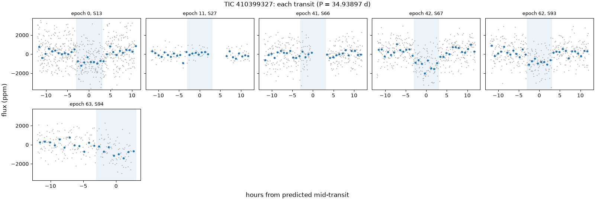
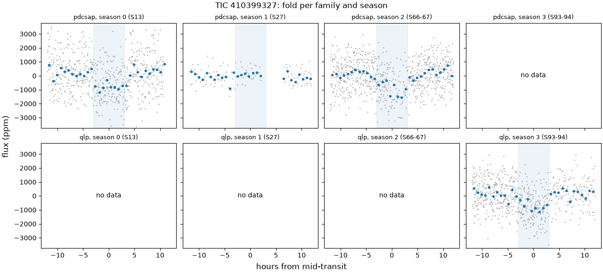
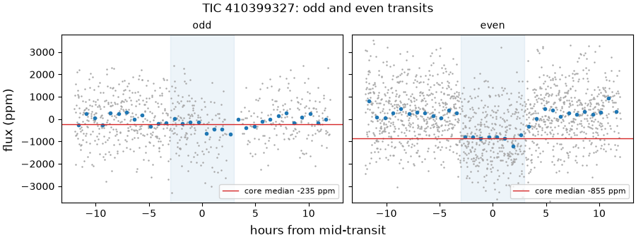
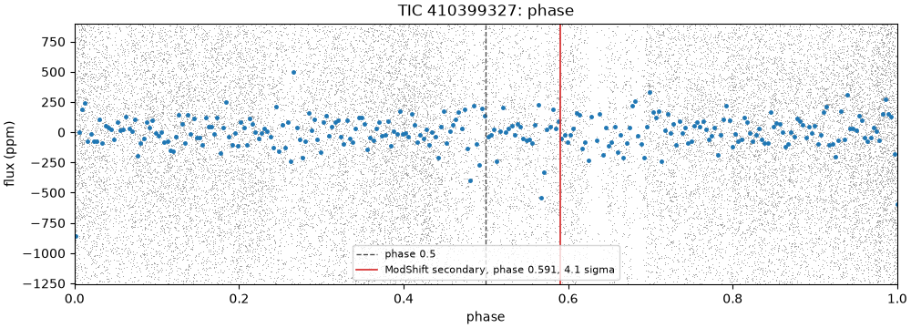
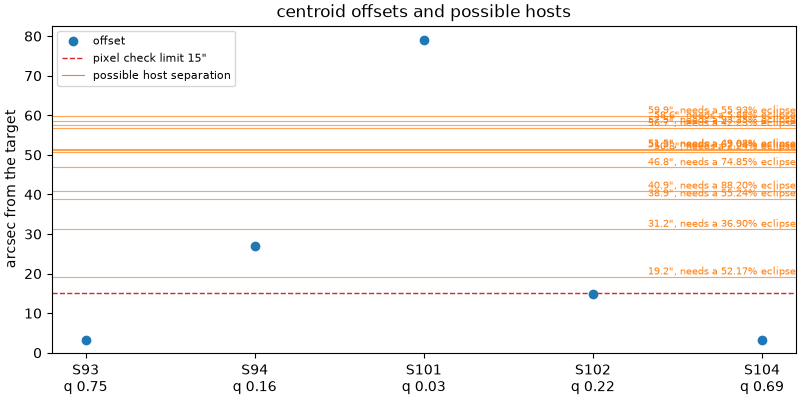

# 410399327-1: TIC 410399327

Call: **killed** on 2026-10-22. Rendered from the files in this directory ([decision 0028](../../../docs/decisions/0028-outcomes-and-calls.md)); the review and the call are quoted, not rendered ([decision 0037](../../../docs/decisions/0037-quoted-text-in-the-dossier.md)).

## Signal and star

|  |  |
|---|---|
| Signal | 410399327-1, a shortlisted candidate |
| Names | TIC 410399327, Gaia DR3 6434209387095086336, TYC 9083-939-1, 2MASS J19245952-6609244 |
| Ephemeris (the search's box) | period 34.938966 d, epoch BTJD 1666.7511, duration 0.2500 d (6.00 h), depth 604 ppm |
| Star (TIC) | Teff 5752 K, radius 0.87 solar radii, Tmag 10.47 |
| RUWE (Gaia DR3) | 1.03 |
| CROWDSAP | S13 0.991; S27 0.977; S66 0.974; S67 0.976; none published for S93 (QLP), S94 (QLP), S101 (QLP), S102 (QLP), S103 (QLP), S104 (QLP) |
| Sectors vetted | PDCSAP family: 13, 27, 66 and 67; QLP family: 93 and 94; left out as timing-suspect: 101, 102, 103 and 104 |
| Criteria | search-v2, vet-v3 |
| Runs | vetting 20261020T174317Z-vetting-run-61b5944-2d70 (commit 61b5944, production); TRICERATOPS 20261020T181658Z-vetting-triceratops-61b5944-1bbf (commit 61b5944, production); literature 20261021T001540Z-vetting-literature-61b5944-07de (commit 61b5944, production); evidence-only vetting 20261020T175536Z-vetting-run-61b5944-7f4e (commit 61b5944, production); titles 20261026T184940Z-vetting-titles-af322af-9b15 (commit af322af, production) |

## Checks

vet-v3's checks first, then the neighbour table (evidence, never a fail), triage's pixel check, TRICERATOPS and the literature search.

| Check | Outcome | Reason |
|---|---|---|
| novelty | pass | no known object matches |
| odd_even | fail | pdcsap: odd and even depths differ by 5.7 sigma |
| secondary | pass | no dip at phase 0.5 (-1.1 sigma) |
| sector_depth | fail | pdcsap: depths disagree across sectors (p = 7.5e-09) |
| holdout | fail | transits missing where predicted in season(s) [0, 1] |
| signal_present | pass | combined depth is 8.9 sigma |
| shape | pass | U-shaped: grazing in 0% of samples |
| density | pass | transit and TIC densities agree (3.0 sigma) |
| radius | pass | 2.1 Earth radii |
| neighbours | pass | 12 of 24 neighbours could host the signal |
| pixels | pass | centroid offset 3.3" within 15" |
| triceratops | not run | TRICERATOPS run 20261020T181658Z-vetting-triceratops-61b5944-1bbf did not judge this signal. |
| literature | pass | complete: 5 hits to screen |

## On the star?

Centroids, from triage's pixel check (pass, centroid offset 3.3" within 15"): the difference-image centroid's offset from the target in each sector. Triage's pass rests on the best-quality sector's offset, S93's.

| Sector | Offset (arcsec) | Quality | Note |
|---|---|---|---|
| 93 | 3.3 | 0.75 | the offset triage judged |
| 94 | 27.1 | 0.16 |  |
| 101 | 78.9 | 0.03 | timing-suspect: vet-v3 leaves it out |
| 102 | 14.8 | 0.22 | timing-suspect: vet-v3 leaves it out |
| 104 | 3.2 | 0.69 | timing-suspect: vet-v3 leaves it out |

Neighbours (pass): 12 of 24 neighbours could host the signal. Each Gaia DR3 star that could make the dip, with its separation from the target (Gaia DR3 6434209387095086336, J2016.0) and the eclipse depth it would need, scaled from the depth in the signals file (604 ppm) as if all its light fell in the aperture:

| Star | Separation (arcsec) | Eclipse needed |
|---|---|---|
| Gaia DR3 6434209314080910208 | 19.2 | 52.2% |
| Gaia DR3 6434209352734428800 | 31.2 | 36.9% |
| Gaia DR3 6434209318374685056 | 38.9 | 55.2% |
| Gaia DR3 6434209314077634816 | 40.9 | 88.2% |
| Gaia DR3 6434209279717891200 | 46.8 | 74.8% |
| Gaia DR3 6434209490173377536 | 50.8 | 2.24% |
| Gaia DR3 6434221099467914368 | 51.3 | 62% |
| Gaia DR3 6434221099467909120 | 51.5 | 49.1% |
| Gaia DR3 6434221099467909248 | 56.7 | 42.2% |
| Gaia DR3 6434209490170948992 | 57.5 | 93.2% |
| Gaia DR3 6434221103764952064 | 58.6 | 5.88% |
| Gaia DR3 6434209107919208064 | 59.9 | 55.9% |

TRICERATOPS: TRICERATOPS run 20261020T181658Z-vetting-triceratops-61b5944-1bbf did not judge this signal.

RUWE 1.03 (Gaia DR3). A high RUWE points to an unresolved companion, which TRICERATOPS's priors don't condition on; above vet-v3's limit, or without a RUWE, TRICERATOPS is inconclusive.

## A planet rather than a binary?

- Odd and even transits: fail, pdcsap: odd and even depths differ by 5.7 sigma.
- Secondary at phase 0.5: pass, no dip at phase 0.5 (-1.1 sigma).
- Secondary at any phase (LEO-Vetter's ModShift, from triage): the strongest secondary is 4.09 sigma at phase 0.591, depth 260 ppm; primary 19.1 sigma, tertiary 3.56 sigma at phase 0.443, positive 3.74 sigma at phase 0.939; Fred 1.49.
- The search's other signals on the star: rank 2 at 38.9156 d (period ratio 1.11, SDE 12.5).
- Shape (flat-prior fit): pass, U-shaped: grazing in 0% of samples; median b 0.45.
- Density (flat-prior fit): pass, transit and TIC densities agree (3.0 sigma).
- Radius: pass, 2.1 Earth radii. Rp is 2.09 Earth radii from the flat-prior fit and 2.11 (16th to 84th percentile 1.97 to 2.25) from the density-prior fit; the radius check reads the flat-prior fit.
- Density-prior fit (the TIC density as a prior), whose parameters M4 uses: Rp 2.11 Earth radii (16th to 84th percentile 1.97 to 2.25), b 0.15 (-0.10, +0.17), a/R* 47.45 (-3.77, +3.62), period 34.938151 d (sd 0.00058), t0 BTJD 1666.7983 (sd 0.022 d).
- TRICERATOPS: TRICERATOPS run 20261020T181658Z-vetting-triceratops-61b5944-1bbf did not judge this signal.

## Real and new?

- Signal present: pass, combined depth is 8.9 sigma.
- Held-out seasons: fail, transits missing where predicted in season(s) [0, 1].
- Sector depths: fail, pdcsap: depths disagree across sectors (p = 7.5e-09).
- Novelty, against the catalog snapshot: pass, no known object matches.
- Literature by name (TIC 410399327, Gaia DR3 6434209387095086336, TYC 9083-939-1, 2MASS J19245952-6609244) and NASA ADS: pass, complete: 5 hits to screen. The hits are listed below.

ExoFOP, read live: TOIs TOI 7925.01 (PC); CTOIs none; confirmed planets none.

Planet parameters on ExoFOP:

- TOI 7925.01 (TIC 410399327.01), TOIs (TESS Project): 2.6071 d, 0.0746 times ours

## Next TESS looks

tess-point places the star in sectors 114.

Each transit predicted in those sectors, from the density-prior fit's posterior (epochs count periods from its t0); duration 0.2347 d from the density-prior fit. Mid (UTC) is when the transit is seen from Earth: the barycentric time less the light's travel time toward the star:

| Sector | Epoch | Mid (BTJD) | Mid (UTC) | sd (min) | 1 sigma half-width (min) | 3 sigma half-width (min) |
|---|---|---|---|---|---|---|
| 114 | 80 | 4461.847 | 2027-02-25 08:22 | 47.6 | 47.6 | 142.9 |

2-min data and the DDT ask ([decision 0026](../../../docs/decisions/0026-triceratops.md)): which stars get 2-min data in a sector is decided per cycle, so tess-point can't say whether these sectors will have it. In the sectors fetched, the star had SPOC 2-min data in sectors 13. Killed: no DDT ask.

## Plots

Each transit, against hours from its predicted mid-time:

The fold in each season and each product family:

Odd and even transits side by side:

The whole orbit, with phase 0.5 and LEO-Vetter's ModShift secondary marked:

Triage's centroid offset per sector, with the neighbours that could host the signal:

## Catalogued rows on the star

Every catalogued row on the star in the snapshot. vet-v3 masks only the kinds the search masks ([decision 0021](../../../docs/decisions/0021-vet-masks-search-kinds.md)); the rest stay unmasked. A row overlaps a transit of ours, numbered by epoch from the signal's t0, when its mask window (2 of its durations, or of 0.25 d where the catalog gives none) meets it. 6 transits of ours have data.

| Source | Kind | Name | Period (d) | Masked | Transits of ours it overlaps |
|---|---|---|---|---|---|
| TOI | candidate | TOI-7925.01 | 2.60710 | yes | 2 of 6: 11, 41 |
| ExoMiner-v2 | tce | ExoMiner vetting_catalog_FFI 410399327-1-S56-69 | 2.60811 | no | 1 of 6: 41 |

## Literature hits

5 paper(s) from the searches that answered, one row per paper. Titles come only from open sources: the search's own arXiv, OpenAlex and Zenodo hits, else OpenAlex's record for the paper's DOI; a paper none of them titles has a blank title ([decision 0038](../../../docs/decisions/0038-literature-trim-and-username-scrub.md)).

| Title | Id | Found by |
|---|---|---|
| THE RADIAL VELOCITY EXPERIMENT (RAVE): FIFTH DATA RELEASE | doi 10.3847/1538-3881/153/2/75, arXiv 1609.03210 | ads TIC 410399327 |
| THE RADIAL VELOCITY EXPERIMENT (RAVE): FOURTH DATA RELEASE | doi 10.1088/0004-6256/146/5/134, arXiv 1309.4284 | ads TIC 410399327 |
| The Sixth Data Release of the Radial Velocity Experiment (Rave). II. Stellar Atmospheric Parameters, Chemical Abundances, and Distances | doi 10.3847/1538-3881/ab9ab8, arXiv 2002.04512 | ads TIC 410399327 |
| Empirical photometric calibration of the Gaia red clump: Colours, effective temperature, and absolute magnitude | doi 10.1051/0004-6361/201731572, arXiv 1710.05803 | ads TIC 410399327 |
| APASS LANDOLT-SLOAN BVgri PHOTOMETRY OF RAVE STARS. I. DATA, EFFECTIVE TEMPERATURES, AND REDDENINGS | doi 10.1088/0004-6256/148/5/81, arXiv 1408.5476 | ads TIC 410399327 |

## With the timing-suspect sectors (evidence only)

The same vet with the timing-suspect sectors kept in ([decision 0022](../../../docs/decisions/0022-vet-without-timing-suspect-sectors.md)). It is shown for comparison and never used for the call. Sectors it adds: 101, 102, 103 and 104.

| Check | Without them | With them | Reason with them |
|---|---|---|---|
| novelty | pass | pass | no known object matches |
| odd_even | fail | fail | pdcsap: odd and even depths differ by 5.7 sigma |
| secondary | pass | pass | no dip at phase 0.5 (-1.6 sigma) |
| sector_depth | fail | fail | pdcsap: depths disagree across sectors (p = 7.5e-09) |
| holdout | fail | fail | transits missing where predicted in season(s) [0, 1] |
| signal_present | pass | pass | combined depth is 9.7 sigma |
| shape | pass | pass | U-shaped: grazing in 0% of samples |
| density | pass | pass | transit and TIC densities agree (3.0 sigma) |
| radius | pass | pass | 2.1 Earth radii |

## Review

Quoted from `review.json`, as the reviewer and the refuters wrote it: its numbers, paths and run names are theirs, not rendered from the runs ([decision 0037](../../../docs/decisions/0037-quoted-text-in-the-dossier.md)). [The vetting README](../README.md) says what its paths and run names stand for.

Reviewer claude-opus-5-5, 2026-10-20. I rebuilt the light curve vet-v3 saw and measured every epoch to test the three kills (odd_even, sector_depth, holdout) against partial coverage, TTVs, low SNR, dilution and one-sector artefacts. All three stand at 34.94 d, and all three rest on one fact: both odd epochs with data (11 in S27, 41 in S66) are flat at full coverage, while every even epoch with usable data (0, 42, 62, and 72 in the timing-suspect S104) shows a 6-hour dip within 0.3 h of a linear ephemeris. The dips look like a 69.878-day signal, twice the search's period and past its 40-day cap, at which vet-v3's five light-curve checks pass; that is the one hold.

A finding rated kill or hold is confirmed when no refuter refuted it; a note gets no refuters.

### F1 (a planet, kill): confirmed

Claim: The odd_even kill stands at 34.94 d: both odd transits with data are flat at full coverage, so it is not a partly covered transit, a TTV, low SNR or a dilution change.

Evidence: checks.json odd_even pdcsap: odd -117 +- 133 ppm (n 34) vs even 841 +- 101 (n 144), 5.7 sigma. Per epoch (/tmp/t13/410399327-1/scan.out, from /tmp/t13/heavy.sh bash -c 'cd ~/code/tess-hunt && uv run python /tmp/t13/410399327-1/scan.py ~/.cache/tess-hunt/drafts/m3/410399327-1/checks.json ~/.cache/tess-hunt/drafts/m3/410399327-1/checks-with-suspect.json'; plot /tmp/t13/410399327-1/epochs.png): epoch 11 (S27) core -156 +- 149 ppm on 18 of 18 core cadences, raw data -36 h to +36 h; epoch 41 (S66) 41 +- 298 on 16 of 54 core cadences because TOI-7925.01's mask cuts the rest (its transit falls 1.52 h after our mid, mask +-2.12 h), and 97 +- 164 on all 54 with the mask off and +-0.3 d held out of the trend. A 6-h box slid +-12 h around each odd epoch finds nothing above 2.3 sigma (epoch 11: +6.3 h, 198 +- 106 ppm, where TOI-7925.01's own transit falls at +4.31 h; epoch 41: +3.3 h, 266 +- 116), so no TTV-shifted transit hides nearby, and the even dips sit within 0.3 h of the linear ephemeris (epoch 0 +0.3 h, 42 0.0 h, 62 -0.3 h, 72 -0.3 h). Not low SNR: the expected depth is 0.75 to 0.84 ppt against errors of 0.15 to 0.16 ppt (holdout season 1 expected SNR 4.9). Not dilution: CROWDSAP S27 0.977, S66 0.974, S67 0.976 (checks.json sources); S66 and S67 are consecutive TESS-SPOC sectors with the same crowding, yet epoch 41 is flat and epoch 42, one period later, is 1106 +- 140 ppm. QLP's odd_even pass rests on its one odd transit, epoch 63, which is a sector-end ramp (F5). Empty odd epochs are what a period of twice 34.94 d gives, not a binary's alternating depths (F4).

No refuter has answered yet.

### F2 (real and new, kill): confirmed

Claim: The sector_depth kill stands at 34.94 d: the chi-square comes from S27's empty odd epoch and S67's deep even one, not from the partly covered S66 transit or dilution.

Evidence: checks.json sector_depth pdcsap: S13 551 +- 146, S27 -156 +- 149 (n 18), S66 41 +- 298 (n 16), S67 1106 +- 140 ppm; chi2 40.7, dof 3, p 7.5e-09. Chi-square terms (/tmp/t13/410399327-1/twice.out, from /tmp/t13/heavy.sh bash -c 'cd ~/code/tess-hunt && uv run python /tmp/t13/410399327-1/twice.py ~/.cache/tess-hunt/drafts/m3/410399327-1/checks.json ~/.cache/tess-hunt/drafts/m3/410399327-1/checks-with-suspect.json'): S13 0.16, S27 18.93, S66 2.29, S67 19.33. Without the partly covered S66: chi2 38.25, dof 2, p 4.95e-09, still a fail. Without S27: p 9.1e-04, still a fail. Without S27 and S66: p 5.9e-03, a pass. So the fail needs S27, a fully covered epoch with no dip (F1). PDCSAP is crowding-corrected and CROWDSAP runs 0.974 to 0.991 over S13, S27, S66 and S67, so a dilution change of 2% cannot take 0.8 ppt to -0.16 ppt. QLP is compared only with itself and passes (p 0.72) on S93 and S94, S94 being the ramp of F5.

No refuter has answered yet.

### F3 (real and new, kill): confirmed

Claim: The holdout kill stands on season 1 (S27); season 0's miss is the refit ephemeris drifting 5.2 hours, not a missing transit.

Evidence: checks.json holdout season 1: predicted P 34.93872, t0 1666.7528, so epoch 11 at BTJD 2051.079 (the search's own epoch-11 time is 2051.080); depth -150 +- 153 ppm against an expected 753, tension 5.0, expected SNR 4.9, with S27 fully covered (F1). Season 0: the refit without S13 gives P 34.935329, t0 2051.2559, which puts epoch 0 at BTJD 1666.9673, 5.19 h after the search t0 (/tmp/t13/410399327-1/twice.out); with the refit's 0.1875 d duration the core window spans +4.1 h to +6.3 h, after the dip's egress. The dip is there: the best 6-h box sits +0.3 h from the search t0 at 936 +- 103 ppm (scan.out), and checks.json gives S13 551 +- 146 at the search ephemeris. The drift comes from extrapolating 42 cycles back from training dips at epochs 42 and 62 alone (the refit puts epoch 42 1.52 h late) and stays without S94 (+5.23 h), so it is not the S94 ramp. Not TTVs: the even dips sit within 0.3 h of a linear ephemeris. The fail therefore rests on season 1 alone, the same empty odd epoch as F1 and F2.

No refuter has answered yet.

### F4 (a planet, hold): refuted

Claim: The three kills show that 34.94 d is the wrong period, not that the dips are no planet: every usable dip falls on an even epoch, consistent with a 69.878-d transit that the search's 40-d cap could not find and that no check has vetted, and at that period vet-v3's five light-curve checks pass.

Evidence: Dips at epochs 0 (S13), 42 (S67), 62 (S93) and 72 (S104, timing-suspect; 0022 puts QLP's offsets under 36 min, small against a 6-h transit): best 6-h boxes within 0.3 h of the linear ephemeris at 936 +- 103, 1194 +- 98, 1063 +- 117 and 1002 +- 125 ppm (/tmp/t13/410399327-1/scan.out). Odd epochs 11 and 41 are flat (F1), odd epoch 63 is a ramp (F5), and epoch 70 has no core data (cut at a gap edge). Shorter periods the even epochs also allow fail: at 2P/3 (23.29 d) the one extra window reads 139 +- 149 ppm, at 2P/5 (13.98 d) the eight extra windows read 19 +- 59 (/tmp/t13/410399327-1/aliases.out, from /tmp/t13/heavy.sh bash -c 'cd ~/code/tess-hunt && uv run python /tmp/t13/410399327-1/aliases.py ~/.cache/tess-hunt/drafts/m3/410399327-1/checks.json ~/.cache/tess-hunt/drafts/m3/410399327-1/checks-with-suspect.json'). vet-v3's own check functions at P = 69.877932 d on the light curve vet-v3 saw (/tmp/t13/410399327-1/twice.out): odd_even pass at 2.8 sigma (S13 551 +- 146 vs S67 1106 +- 140, close to the 3.0 line), secondary pass (+1.4 sigma, 111 +- 81 ppm over the odd epochs), sector_depth pass (p 0.006), holdout pass (2 seasons predicted, season 0 at 575 +- 148), signal_present 9.9 sigma; with the suspect sectors in, all pass, holdout on 3 seasons, 10.6 sigma. Density: the flat fit's log rho -0.227 (+0.167) rises by log10(2) at twice the period (rho scales with P at a fixed transit shape), to 0.074 (1.19 g/cm3) against the TIC's 0.340 +- 0.091: 1.40 sigma instead of 2.98. Radius roughly 2.5 Earth radii (2.09 x sqrt(841/599), even-epoch core depth over the combined one, checks.json). criteria/search-v2.toml [search] period_max_days = 40.0. Triage's two good-quality centroids are on sectors with even-epoch dips: S93 3.3" (quality 0.75) and S104 3.2" (0.69). Untested at 69.88 d: the shape, density and radius fits, ModShift (it ran at 34.94 d: 4.09 sigma at phase 0.591), TRICERATOPS (it did not judge this signal) and the neighbours (Gaia DR3 6434209314080910208 at 19.6" needs a 52% eclipse). What would decide: the maintainer's call, with a decision record, on vetting these dips at 69.878 d, since the search cannot propose that period; then S114's transit at BTJD 4461.87 (epoch 80, even, predicted at both periods; the dossier's window is 4461.847 +- 47.6 min) with 2-min data for the shape.

- Refuter 1: did not refute. F4 reproduces. I reran all three of the reviewer's scripts and got byte-identical output, and every other number in the finding matches its run file.

Command: copies of scan.py, aliases.py and twice.py in /tmp/t13/410399327-1/refute-F4-reproduce/. The only edit was scan.py's savefig path. twice.py and aliases.py diff identical to the originals. All three ran through `/tmp/t13/heavy.sh bash -c "cd ~/code/tess-hunt && uv run python $D/<script>.py $C/checks.json $C/checks-with-suspect.json > $D/<script>.out"` (C = ~/.cache/tess-hunt/drafts/m3/410399327-1), exit 0. `diff` against /tmp/t13/410399327-1/{twice,scan,aliases}.out: identical for all three.

1. **The light curve is vet-v3's.** twice.py's first block (the search ephemeris) matches checks.json to the ppm: odd_even pdcsap -117+-133 (n 34) vs 841+-101 (n 144), 5.7 sigma; the sector depths; p 7.5e-09; holdout seasons 0 and 1 missed at tensions 7.62 and 5.00. twice.py's thresholds (3.0, 0.001, 7.0, min_points 5) match criteria/vet-v3.toml. It calls the checks the same way src/tess_hunt/vet.py lines 179-245 does (good_timestamps, detrend with the masks, red_noise_beta at core times duration, per_family split).

2. **At P = 69.877932 d** the reproduced output gives:
   - odd_even pass, 2.8 sigma (1106+-140 vs 551+-146)
   - secondary pass, +1.4 sigma (111+-81 ppm, n 161)
   - sector_depth p 0.00594, above min_p_value 0.001
   - holdout pass: 2 seasons predicted, season 0 at 575+-148
   - signal_present 9.9 sigma
   - suspect sectors in: all pass, 3 holdout seasons predicted, 10.6 sigma

3. **Epochs and aliases.** Best 6-h boxes: epoch 0 +0.3 h, 936+-103; epoch 42 0.0 h, 1194+-98; epoch 62 -0.3 h, 1063+-117; epoch 72 -0.3 h, 1002+-125 ppm. Epoch 70 has n 0 core cadences. Aliases: 2P/3 extra window 139+-149 ppm; 2P/5 eight extra windows 19+-59 ppm.

4. **Density, checks.json.** fit_log_rho -0.22705, plus 0.16720; tic_log_rho 0.34035, sd 0.09139; tension 2.978. physical.py line 64 computes tension as abs(mid - log_tic)/hypot(err_fit, err_tic). Recomputed with log10(2) added: 0.074, 1.186 g/cm3, 1.398 sigma.

5. **Radius.** 2.0864 x sqrt(841/598.74) = 2.47.

6. **Other values in checks.json.**
   - ModShift sig_sec 4.089 at phs_sec 0.5908.
   - Pixels: S93 3.31" (quality 0.749), S104 3.24" (0.692), S94 27.08" (0.159).
   - windows: epoch 80, sector 114, mid 4461.8474, sd 47.65 min. Search t0 + 80P = 4461.8684.

7. **Citations and other files.**
   - criteria/search-v2.toml [search] has period_max_days = 40.0.
   - neighbours.csv: 6434209314080910208 at sep 19.589", required_depth 0.5217, possible True. Recomputed from the DR3 positions: 19.59".
   - Decision 0022, lines 12-13: single transits in reliable pairs at up to +35.25 min.
   - dossier.md line 36: TRICERATOPS "did not judge this signal".

No number the finding rests on fails to reproduce.
- Refuter 2: refuted. The kill stands under the rules. F4 does not show it is wrong. It proposes a different signal, and its hold rating does not fit the short brief.

1. The checks worked as designed. docs/design.md 5.2 gives odd/even's planted failure as "Eclipsing binary at twice the period" and the held-out season's as "Wrong period". F4's own account, every dip on an even epoch with the true period at twice 34.94 d, is exactly that case. F1 to F3, from the same reviewer, find no bug, no misread artefact and none of 0031's causes behind the three fails: partial coverage, TTVs, low SNR and dilution are all ruled out. 0031 handles its nearest control the same way. For TOI-396.01, a linear ephemeris that can't fold the planet, it says "the checks did what they are built to do" and keeps "a fail on any of these checks still kills a candidate (decision 0028)". Decision 0028 and M3 design 4.9 define the outcomes: killed means a check failed, and held means "not passed and not killed".

2. The rating does not fit the brief. The short brief rates hold "when the kill looks wrong". F4 accepts the kills at 34.94 d and asks to vet a 69.878-d signal instead. The frozen search cannot produce that period (criteria/search-v2.toml [search] period_max_days = 40.0; docs/design.md 4.1 "BLS ... 1-40 d"), and M3 design section 5 says "No change to the search". The first thing F4 says would decide it is "the maintainer's call, with a decision record". That is a process step, not public data the case is waiting on, so it misses the brief's hold definition: "the public data can't decide". Shape, density, radius, ModShift and neighbours at 69.88 d can all be run on data already in hand. A 2-min transit already exists: checks.json sources list S13 as SPOC, cadence_s 120.0. Under 0028 a confirmed hold reaches the maintainer as a recommended hold on 410399327-1, a signal whose three failed checks the review itself confirms. This belongs in a note, which goes to the maintainer's eye and decides nothing.

3. The evidence is overstated. "vet-v3's five light-curve checks pass" counts one comparison twice. At 69.88 d, odd_even and sector_depth both rest on the single PDCSAP pair S13 551 +- 146 vs S67 1106 +- 140. In QLP, odd_even is inconclusive and sector_depth has only S93, which cannot be tested (/tmp/t13/410399327-1/twice.out). Running python3 on those numbers (/tmp/t13/410399327-1/refute-F4-rules/calc.out) gives z = 2.744 and chi2 = 7.53 on 1 dof, p = 0.0061. That is the reviewer's sector_depth p of 0.0059 to rounding. So the two passes are one statistic, 0.26 sigma from the 3.0 line (vet-v3.toml [odd_even] max_sigma = 3.0). The holdout's two predicted seasons pass at tensions of 2.85 and 2.69 against [holdout] max_depth_tension = 3.0 (twice.out). The maintainer should still see the 69.878-d possibility as a note, or as a proposal for a decision record. As a hold on this signal, it misreads 0028's outcomes and the brief's definition of hold.

### F5 (real and new, note)

Claim: The one odd-epoch dip, epoch 63 in QLP S94, sits on a steep sector-end ramp, so QLP's odd_even and sector_depth passes at 34.94 d don't support that period.

Evidence: Raw S94 flux, normalized to the sector median (/tmp/t13/410399327-1/twice.out): -3848 ppm 2.25 to 2.0 d before the last cadence (BTJD 3868.503), -6528 ppm 1.0 to 0.75 d before, -15054 ppm in the last 6 h, steepening throughout. Epoch 63's mid (3867.906) is 14.3 h before the end, 2.3 h before the detrend's 0.5-d edge cut (criteria/search-v2.toml edge_cutoff_days), and its depth moves from 803 +- 189 ppm to 1616 +- 187 ppm depending only on how the trend is fitted (scan.out). Triage's S94 centroid (27.1", quality 0.16) measures this ramp. Epoch 70 in S101 sits on a similar ramp before a gap at BTJD 4112.92. See /tmp/t13/410399327-1/epochs.png.

### F6 (real and new, note)

Claim: ExoFOP's TOI-7925.01 note already names two of these dips, epochs 42 and 62, as possible unrelated transits, without a period.

Evidence: literature.json search.exofop.tois: TOI 7925.01 (2.607 d, PC, source qlp-s93-ffi, TOI date 2026-08-27) notes "potential deeper unrelated transits near TBJD 3134 and 3833"; our epochs 42 and 62 fall at BTJD 3134.188 and 3832.967. CTOIs on the star: none. No TOI, CTOI or paper gives these dips a period, so a 69.878-d signal would be new, but a CTOI should credit the note.

### F7 (on the star, note)

Claim: The literature hit 2018A&A...609A.116R (a Gaia red clump calibration) doesn't make the star a giant: Gaia DR3 puts it on the main sequence.

Evidence: checks.json star: TIC radius 0.872 solar radii, Gaia DR3 FLAME radius 0.884, logg_flame 4.548, logg_gspphot 4.543, RUWE 1.03. The other four hits (2013AJ....146..134K, 2017AJ....153...75K, 2020AJ....160...83S, 2014AJ....148...81M) are RAVE data releases and APASS photometry of RAVE stars; the star is a RAVE target (SIMBAD name RAVE J192459.5-660924). None names it as a planet host, a binary, a variable or a multiple.

Literature hits flagged for the maintainer to read: none.

## Call

Quoted from `call.toml`, the maintainer's words, not rendered from the runs ([decision 0037](../../../docs/decisions/0037-quoted-text-in-the-dossier.md)).

Outcome: **killed**, 2026-10-22.

Reasons: At the search's period the odd transits are missing: both odd epochs with full data are flat while the even ones dip, so odd and even, the sector depths and the held-out seasons all fail, as they are built to for a wrong period. The dips fit a period twice as long, past the search's period limit; that is a different signal, not vetted here, and goes to the long-period search with M5's slice B as a lead. Sector 114's transit, due on the same date at both periods, is a free check. ExoFOP's note on TOI-7925.01 already names two of these dips.

Rests on: odd_even, sector_depth, holdout, F1 (finding), F2 (finding), F3 (finding).

Criteria: vet-v3.
