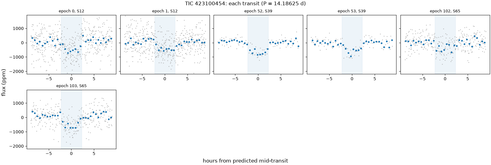
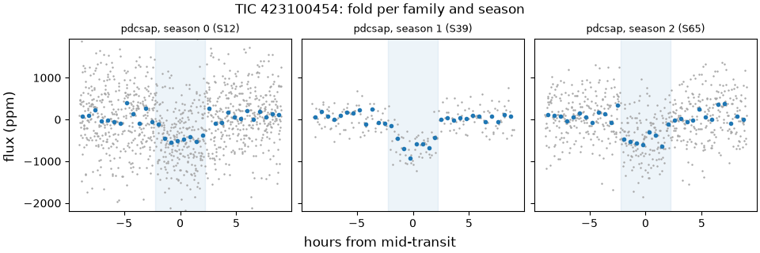
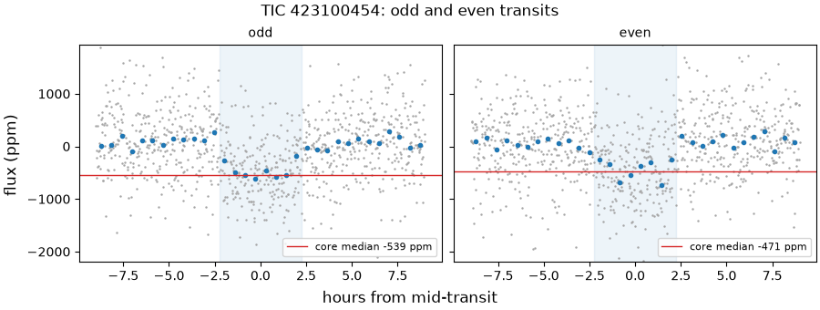
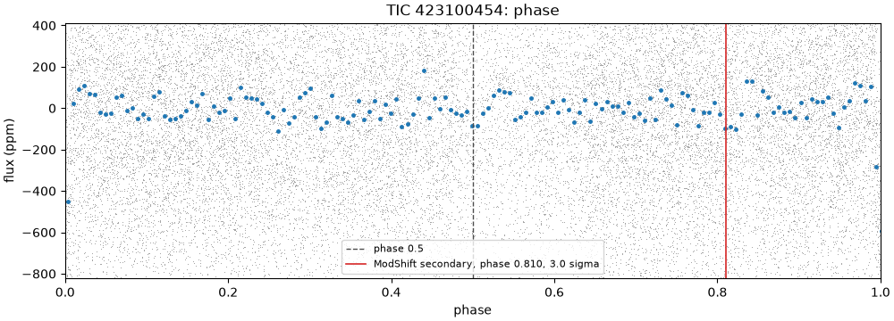
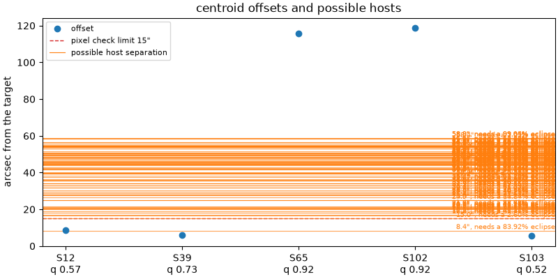

# 423100454-1: TIC 423100454

Call: **held** on 2026-10-22. Rendered from the files in this directory ([decision 0028](../../../docs/decisions/0028-outcomes-and-calls.md)); the review and the call are quoted, not rendered ([decision 0037](../../../docs/decisions/0037-quoted-text-in-the-dossier.md)).

## Signal and star

|  |  |
|---|---|
| Signal | 423100454-1, a second-list row (a SPOC TCE that never became a TOI) |
| Names | TIC 423100454, Gaia DR3 5836452847014268800, HIP 78393, HD 142959, TYC 8714-2056-1, 2MASS J16001569-5533485 |
| Ephemeris (the search's box) | period 14.186255 d, epoch BTJD 1631.4629, duration 0.1875 d (4.50 h), depth 448 ppm |
| Star (TIC) | Teff 5627 K, radius 0.96 solar radii, Tmag 8.62 |
| RUWE (Gaia DR3) | 0.74 |
| CROWDSAP | S12 0.840; S39 0.858; S65 0.793; none published for S102 (QLP), S103 (QLP) |
| Sectors vetted | PDCSAP family: 12, 39 and 65; left out as timing-suspect: 102 and 103 |
| Criteria | search-v2, vet-v3 |
| Runs | vetting 20261020T174317Z-vetting-run-61b5944-2d70 (commit 61b5944, production); TRICERATOPS 20261021T044850Z-vetting-triceratops-cd4e7a2-07c3 (commit cd4e7a2, production); literature 20261021T001540Z-vetting-literature-61b5944-07de (commit 61b5944, production); evidence-only vetting 20261020T175536Z-vetting-run-61b5944-7f4e (commit 61b5944, production); second list 20261020T180844Z-vetting-second-list-61b5944-7096 (commit 61b5944, production); titles 20261026T155726Z-vetting-titles-0b1deac-1d19 (commit 0b1deac, production) |

## Checks

vet-v3's checks first, then the neighbour table (evidence, never a fail), triage's pixel check as the second list ran it on this row (triage runs it only on novelty passes), TRICERATOPS and the literature search.

| Check | Outcome | Reason |
|---|---|---|
| novelty | inconclusive | matches only SPOC TCE or ExoMiner rows |
| odd_even | pass | pdcsap: odd and even depths agree within 0.1 sigma |
| secondary | pass | no dip at phase 0.5 (0.5 sigma) |
| sector_depth | pass | pdcsap: depths agree across 3 sectors (p = 0.03) |
| holdout | pass | 3 held-out seasons predicted |
| signal_present | pass | combined depth is 13.4 sigma |
| shape | pass | U-shaped: grazing in 0% of samples |
| density | pass | transit and TIC densities agree (0.9 sigma) |
| radius | pass | 2.3 Earth radii |
| neighbours | inconclusive | 1 Gaia DR3 star(s) within the radius have no G magnitude |
| pixels | fail | centroid offset 118.6" exceeds 15" |
| triceratops | inconclusive | the neighbour table is inconclusive: 1 Gaia DR3 star(s) within the radius have no G magnitude |
| literature | pass | complete: 24 hits to screen |

## On the star?

Centroids, from the second list's pixel check (fail, centroid offset 118.6" exceeds 15"): the difference-image centroid's offset from the target in each sector. The second list's fail rests on the best-quality sector's offset, S102's, from a timing-suspect sector that vet-v3 leaves out.

| Sector | Offset (arcsec) | Quality | Note |
|---|---|---|---|
| 12 | 8.7 | 0.57 |  |
| 39 | 5.8 | 0.73 |  |
| 65 | 115.7 | 0.92 |  |
| 102 | 118.6 | 0.92 | timing-suspect: vet-v3 leaves it out; the offset the second list's check judged |
| 103 | 5.7 | 0.52 | timing-suspect: vet-v3 leaves it out |

Neighbours (inconclusive): 1 Gaia DR3 star(s) within the radius have no G magnitude. Each Gaia DR3 star that could make the dip, with its separation from the target (Gaia DR3 5836452847014268800, J2016.0) and the eclipse depth it would need, scaled from the depth in the signals file (448 ppm) as if all its light fell in the aperture, and the TRICERATOPS star matched to it with the distance between them at the TIC's epoch:

| Star | Separation (arcsec) | Eclipse needed | TRICERATOPS's star (distance) | Its depth |
|---|---|---|---|---|
| Gaia DR3 5836452846954130944 | 8.4 | 83.9% | TIC 1218261909 (0.0") | 0% |
| Gaia DR3 5836453499849301760 | 15.0 | 2.6% | TIC 423105440 (0.0") | 2.42% |
| Gaia DR3 5836452739540607232 | 16.8 | 69.5% | TIC 423108734 (0.0") | 68.9% |
| Gaia DR3 5836453495454849792 | 17.2 | 41.4% | TIC 423094488 (0.0") | 38.6% |
| Gaia DR3 5836452846953362560 | 18.1 | 57.5% | TIC 423102849 (0.1") | 69.4% |
| Gaia DR3 5836452846953304832 | 19.0 | 93.2% | TIC 1218261861 (0.0") | 0% |
| Gaia DR3 5836453602867660544 | 19.9 | 71.3% | TIC 423099073 (0.0") | 81.4% |
| Gaia DR3 5836452847014262400 | 20.2 | 11.8% | TIC 423095503 (0.0") | 14.1% |
| Gaia DR3 5836452743935048832 | 20.4 | 66.2% | TIC 423106690 (0.0") | 69.8% |
| Gaia DR3 5836452846953412992 | 20.8 | 45.3% | TIC 1218261896 (0.0") | 50% |
| Gaia DR3 5836452842634396800 | 21.3 | 83.8% | TIC 423099235 (0.1") | 0% |
| Gaia DR3 5836452842610260608 | 21.6 | 53.6% | TIC 1218261824 (0.0") | 0% |
| Gaia DR3 5836453499849304576 | 24.9 | 14.8% | TIC 423105439 (0.0") | 16.5% |
| Gaia DR3 5836453598527876480 | 25.0 | 81.3% | TIC 423092815 (0.0") | 0% |
| Gaia DR3 5836452847014269824 | 26.4 | 31.6% | TIC 423095498 (0.0") | 44.1% |
| Gaia DR3 5836452846953307648 | 27.5 | 16.8% | TIC 423105442 (0.0") | 22.2% |
| Gaia DR3 5836452743874071168 | 28.0 | 46.9% | TIC 423105441 (0.0") | 59.8% |
| Gaia DR3 5836453495445289856 | 28.2 | 20.3% | TIC 423095502 (0.0") | 24.1% |
| Gaia DR3 5836452743935038848 | 28.9 | 76.2% | TIC 1218261520 (0.0") | 0% |
| Gaia DR3 5836452743935035264 | 29.7 | 15.1% | TIC 423095504 (0.0") | 21.7% |
| Gaia DR3 5836452847014259840 | 30.4 | 61.4% | TIC 423108643 (0.1") | 0% |
| Gaia DR3 5836452739555181824 | 31.7 | 87.2% | TIC 1218261394 (0.0") | 0% |
| Gaia DR3 5836453499849295360 | 31.9 | 19.9% | TIC 423104977 (0.0") | 23% |
| Gaia DR3 5836452847014250624 | 33.0 | 98.2% | TIC 1218261976 (0.0") | 0% |
| Gaia DR3 5836452846953260672 | 33.1 | 26.2% | TIC 1218261838 (0.0") | 47.5% |
| Gaia DR3 5836452842610251520 | 33.9 | 12% | TIC 423090504 (0.0") | 22.9% |
| Gaia DR3 5836452846953252096 | 34.0 | 13.3% | TIC 1218261833 (0.0") | 21.8% |
| Gaia DR3 5836453499849306752 | 34.1 | 0.963% | TIC 423100450 (0.0") | 1.31% |
| Gaia DR3 5836453499849310720 | 35.4 | 19.9% | TIC 423104386 (0.0") | 23.6% |
| Gaia DR3 5836453598534065792 | 35.7 | 81.1% | TIC 423091820 (0.0") | 0% |
| Gaia DR3 5836453602928529408 | 36.1 | 61.3% | TIC 423109328 (0.0") | 92.4% |
| Gaia DR3 5836452847014261120 | 36.4 | 3.93% | TIC 423105438 (0.0") | 7.8% |
| Gaia DR3 5836452842610251392 | 37.7 | 0.433% | TIC 423100457 (0.0") | 0.898% |
| Gaia DR3 5836452743935040896 | 38.4 | 3.94% | TIC 423100455 (0.0") | 6.26% |
| Gaia DR3 5836453499849291264 | 39.4 | 34.2% | TIC 1218262933 (0.1") | 50.9% |
| Gaia DR3 5836453602867693312 | 39.5 | 62.4% | TIC 423099861 (0.1") | 0% |
| Gaia DR3 5836453602928528512 | 39.7 | 93.1% | TIC 1218263347 (0.1") | 0% |
| Gaia DR3 5836453602928532480 | 39.9 | 72.3% | TIC 423101927 (0.2") | 0% |
| Gaia DR3 5836452846953373056 | 40.0 | 18.3% | TIC 423105111 (0.0") | 44.9% |
| Gaia DR3 5836452847014270848 | 41.6 | 45.7% | TIC 1218261981 (0.0") | 0% |
| Gaia DR3 5836453499849290240 | 41.7 | 60.7% | TIC 423107213 (0.3") | 93.9% |
| Gaia DR3 5836453499788350976 | 42.0 | 58.7% | TIC 423107213 (0.3") | 93.9% |
| Gaia DR3 5836453499849437952 | 42.3 | 81.1% | TIC 421886838 (0.0") | 0% |
| Gaia DR3 5836452743935043584 | 42.7 | 41.5% | TIC 423107322 (0.0") | 71.5% |
| Gaia DR3 5836452743935024384 | 43.8 | 18.5% | TIC 423105443 (0.0") | 52.1% |
| Gaia DR3 5836453602928534656 | 44.2 | 57.3% | TIC 423108583 (0.0") | 0% |
| Gaia DR3 5836452881374009344 | 44.3 | 30.8% | TIC 423095497 (0.0") | 0% |
| Gaia DR3 5836452743874081920 | 44.8 | 97.8% | TIC 1218261442 (0.0") | 0% |
| Gaia DR3 5836453495454847488 | 44.8 | 80.3% | TIC 423107301 (0.4") | 0% |
| Gaia DR3 5836452743935040640 | 45.0 | 71.3% | TIC 423101820 (0.0") | 0% |
| Gaia DR3 5836452881374011648 | 45.5 | 94% | TIC 1218262125 (0.0") | 0% |
| Gaia DR3 5836452847014259584 | 45.6 | 43.5% | TIC 1218261978 (0.0") | 0% |
| Gaia DR3 5836452743935030400 | 45.7 | 32.5% | TIC 423098452 (0.0") | 69.7% |
| Gaia DR3 5836452743935024256 | 45.9 | 76.3% | TIC 1218261518 (0.0") | 0% |
| Gaia DR3 5836453499849296896 | 46.2 | 29.9% | TIC 421877945 (0.0") | 70.5% |
| Gaia DR3 5836453499849316992 | 46.8 | 3.65% | TIC 423105436 (0.0") | 6.31% |
| Gaia DR3 5836452743935024000 | 47.5 | 3.42% | TIC 423105444 (0.0") | 9.54% |
| Gaia DR3 5836452743935190144 | 47.7 | 34.5% | TIC 423090506 (0.0") | 0% |
| Gaia DR3 5836452876970003456 | 48.1 | 50.8% | TIC 423093599 (0.2") | 0% |
| Gaia DR3 5836453602928530176 | 48.4 | 59.6% | TIC 423098216 (0.1") | 0% |
| Gaia DR3 5836452847014259072 | 48.5 | 20.9% | TIC 423095501 (0.0") | 0% |
| Gaia DR3 5836453499849307136 | 49.1 | 1.29% | TIC 423100451 (0.0") | 3.29% |
| Gaia DR3 5836452846953273856 | 49.1 | 45% | TIC 1218261845 (0.0") | 0% |
| Gaia DR3 5836452743935034368 | 49.4 | 66.8% | TIC 423106493 (0.0") | 0% |
| Gaia DR3 5836453598526915712 | 49.8 | 79.9% | TIC 423101859 (0.4") | 0% |
| Gaia DR3 5836452778294770688 | 50.0 | 41.2% | TIC 423097087 (0.0") | 0% |
| Gaia DR3 5836452739540605184 | 50.5 | 12.2% | TIC 421893040 (0.0") | 28.1% |
| Gaia DR3 5836452778233792256 | 50.8 | 28.6% | TIC 423100453 (0.0") | 0% |
| Gaia DR3 5836453465428629120 | 50.8 | 95.1% | TIC 423093279 (0.1") | 0% |
| Gaia DR3 5836452743935019776 | 50.9 | 28.2% | TIC 423090505 (0.2") | 0% |
| Gaia DR3 5836452778294761216 | 51.4 | 74.2% | TIC 1218261689 (0.0") | 0% |
| Gaia DR3 5836452876970010880 | 52.9 | 1% | TIC 423090502 (0.0") | 6.07% |
| Gaia DR3 5836452705171282432 | 52.9 | 17.4% | TIC 423100456 (0.0") | 52.7% |
| Gaia DR3 5836452881374013696 | 53.8 | 55.8% | TIC 423105055 (0.0") | 0% |
| Gaia DR3 5836452709575294208 | 53.9 | 23.6% | TIC 1218261387 (0.0") | 0% |
| Gaia DR3 5836453499849323904 | 54.2 | 61.9% | TIC 423108040 (0.0") | 0% |
| Gaia DR3 5836453495445288192 | 54.3 | 28.6% | TIC 423099739 (0.0") | 0% |
| Gaia DR3 5836452743935017984 | 54.3 | 40.5% | TIC 423100458 (0.0") | 0% |
| Gaia DR3 5836453499788482688 | 54.6 | 68.9% | TIC 421883101 (0.1") | 0% |
| Gaia DR3 5836452876972411392 | 54.7 | 85.7% | TIC 423107670 (0.4") | 0% |
| Gaia DR3 5836452709514286592 | 54.8 | 34.4% | TIC 1218261314 (0.0") | 0% |
| Gaia DR3 5836452881374001792 | 54.9 | 19.8% | TIC 423095500 (0.0") | 0% |
| Gaia DR3 5836453602928541440 | 55.9 | 17.1% | TIC 423095496 (0.0") | 0% |
| Gaia DR3 5836452709575291776 | 56.5 | 44.8% | TIC 1218261386 (0.0") | 0% |
| Gaia DR3 5836453465428651008 | 56.5 | 63.4% | TIC 423108053 (0.0") | 0% |
| Gaia DR3 5836453499849322112 | 58.4 | 7.05% | TIC 423105435 (0.0") | 34% |
| Gaia DR3 5836452739533401088 | 58.8 | 94% | TIC 423108938 (0.5") | 0% |
| Gaia DR3 5836452881313202432 | 58.9 | 99% | TIC 1218262058 (0.0") | 0% |

TRICERATOPS (inconclusive) took sectors 12 and 65 at 200 s and folded them on the density-prior fit's ephemeris. It gave a mean NFPP 0.0067 (sd 0.00085) over 10 run(s) of 1000000 draws. The neighbour table lists possible hosts, but it could not judge every star: 1 Gaia DR3 star(s) within the radius have no G magnitude. Possible hosts it did not weigh: none. It gave zero depth to Gaia DR3 5836452846954130944 (TIC 1218261909), Gaia DR3 5836452846953304832 (TIC 1218261861), Gaia DR3 5836452842634396800 (TIC 423099235), Gaia DR3 5836452842610260608 (TIC 1218261824), Gaia DR3 5836453598527876480 (TIC 423092815), Gaia DR3 5836452743935038848 (TIC 1218261520), Gaia DR3 5836452847014259840 (TIC 423108643), Gaia DR3 5836452739555181824 (TIC 1218261394), Gaia DR3 5836452847014250624 (TIC 1218261976), Gaia DR3 5836453598534065792 (TIC 423091820), Gaia DR3 5836453602867693312 (TIC 423099861), Gaia DR3 5836453602928528512 (TIC 1218263347), Gaia DR3 5836453602928532480 (TIC 423101927), Gaia DR3 5836452847014270848 (TIC 1218261981), Gaia DR3 5836453499849437952 (TIC 421886838), Gaia DR3 5836453602928534656 (TIC 423108583), Gaia DR3 5836452881374009344 (TIC 423095497), Gaia DR3 5836452743874081920 (TIC 1218261442), Gaia DR3 5836453495454847488 (TIC 423107301), Gaia DR3 5836452743935040640 (TIC 423101820), Gaia DR3 5836452881374011648 (TIC 1218262125), Gaia DR3 5836452847014259584 (TIC 1218261978), Gaia DR3 5836452743935024256 (TIC 1218261518), Gaia DR3 5836452743935190144 (TIC 423090506), Gaia DR3 5836452876970003456 (TIC 423093599), Gaia DR3 5836453602928530176 (TIC 423098216), Gaia DR3 5836452847014259072 (TIC 423095501), Gaia DR3 5836452846953273856 (TIC 1218261845), Gaia DR3 5836452743935034368 (TIC 423106493), Gaia DR3 5836453598526915712 (TIC 423101859), Gaia DR3 5836452778294770688 (TIC 423097087), Gaia DR3 5836452778233792256 (TIC 423100453), Gaia DR3 5836453465428629120 (TIC 423093279), Gaia DR3 5836452743935019776 (TIC 423090505), Gaia DR3 5836452778294761216 (TIC 1218261689), Gaia DR3 5836452881374013696 (TIC 423105055), Gaia DR3 5836452709575294208 (TIC 1218261387), Gaia DR3 5836453499849323904 (TIC 423108040), Gaia DR3 5836453495445288192 (TIC 423099739), Gaia DR3 5836452743935017984 (TIC 423100458), Gaia DR3 5836453499788482688 (TIC 421883101), Gaia DR3 5836452876972411392 (TIC 423107670), Gaia DR3 5836452709514286592 (TIC 1218261314), Gaia DR3 5836452881374001792 (TIC 423095500), Gaia DR3 5836453602928541440 (TIC 423095496), Gaia DR3 5836452709575291776 (TIC 1218261386), Gaia DR3 5836453465428651008 (TIC 423108053), Gaia DR3 5836452739533401088 (TIC 423108938), Gaia DR3 5836452881313202432 (TIC 1218262058): its apertures take too little of each one's light to make the dip. Evidence for the review, not a blocker ([decision 0026](../../../docs/decisions/0026-triceratops.md)).

RUWE 0.74 (Gaia DR3). A high RUWE points to an unresolved companion, which TRICERATOPS's priors don't condition on; above vet-v3's limit, or without a RUWE, TRICERATOPS is inconclusive.

## A planet rather than a binary?

- Odd and even transits: pass, pdcsap: odd and even depths agree within 0.1 sigma.
- Secondary at phase 0.5: pass, no dip at phase 0.5 (0.5 sigma).
- Secondary at any phase (LEO-Vetter's ModShift, from triage): the strongest secondary is 3 sigma at phase 0.81, depth 97 ppm; primary 16 sigma, tertiary 2.08 sigma at phase 0.141, positive 3.02 sigma at phase 0.119; Fred 1.25.
- The search's other signals on the star: rank 2 at 25.2677 d (period ratio 1.78, SDE 11.2).
- Shape (flat-prior fit): pass, U-shaped: grazing in 0% of samples; median b 0.45.
- Density (flat-prior fit): pass, transit and TIC densities agree (0.9 sigma).
- Radius: pass, 2.3 Earth radii. Rp is 2.33 Earth radii from the flat-prior fit and 2.27 (16th to 84th percentile 2.19 to 2.35) from the density-prior fit; the radius check reads the flat-prior fit.
- Density-prior fit (the TIC density as a prior), whose parameters M4 uses: Rp 2.27 Earth radii (16th to 84th percentile 2.19 to 2.35), b 0.21 (-0.14, +0.17), a/R* 24.80 (-1.19, +0.97), period 14.186186 d (sd 4.9e-05), t0 BTJD 1631.4662 (sd 0.0037 d).
- TRICERATOPS (inconclusive): mean FPP 0.0353 (sd 0.0043) over 10 run(s) of 1000000 draws.

## Real and new?

- Signal present: pass, combined depth is 13.4 sigma.
- Held-out seasons: pass, 3 held-out seasons predicted.
- Sector depths: pass, pdcsap: depths agree across 3 sectors (p = 0.03).
- Novelty, against the catalog snapshot: inconclusive, matches only SPOC TCE or ExoMiner rows. SPOC TCE or ExoMiner rows at the period: ExoMiner 423100454-1-S12, ExoMiner vetting_catalog_2-min 423100454-1-S12, ExoMiner vetting_catalog_FFI 423100454-1-S39.
- Literature by name (TIC 423100454, HIP 78393, Gaia DR3 5836452847014268800, HD 142959, TYC 8714-2056-1, 2MASS J16001569-5533485) and NASA ADS: pass, complete: 24 hits to screen. The hits are listed below.

ExoFOP, read live: TOIs none; CTOIs none; confirmed planets none.

## Next TESS looks

tess-point places the star in sectors 113.

Each transit predicted in those sectors, from the density-prior fit's posterior (epochs count periods from its t0); duration 0.1808 d from the density-prior fit. Mid (UTC) is when the transit is seen from Earth: the barycentric time less the light's travel time toward the star:

| Sector | Epoch | Mid (BTJD) | Mid (UTC) | sd (min) | 1 sigma half-width (min) | 3 sigma half-width (min) |
|---|---|---|---|---|---|---|
| 113 | 197 | 4426.145 | 2027-01-20 15:31 | 10.2 | 10.2 | 30.5 |
| 113 | 198 | 4440.331 | 2027-02-03 19:58 | 10.2 | 10.2 | 30.7 |

2-min data and the DDT ask ([decision 0026](../../../docs/decisions/0026-triceratops.md)): which stars get 2-min data in a sector is decided per cycle, so tess-point can't say whether these sectors will have it. In the sectors fetched, the star had SPOC 2-min data in sectors 12. Held: the DDT ask applies only on the maintainer's call and only when the deciding evidence is the transit's shape; a hold on blending does not go, since 2-min data come from the same pixels. Deciding evidence: Seeing-limited ground-based photometry on a predicted transit showing no eclipse on TIC 423100450 or TIC 423100455, or the dip on the target (F1). A pass would also need two recorded decisions, made on controls for every signal: how stars cleared by such photometry leave TRICERATOPS's NFPP, and how a pixel fail that measures a variable neighbour is treated (0033, item 3).

## Plots

Each transit, against hours from its predicted mid-time:

The fold in each season and each product family:

Odd and even transits side by side:

The whole orbit, with phase 0.5 and LEO-Vetter's ModShift secondary marked:

The second list's pixel check: each sector's centroid offset, with the neighbours that could host the signal:

## Catalogued rows on the star

Every catalogued row on the star in the snapshot. vet-v3 masks only the kinds the search masks ([decision 0021](../../../docs/decisions/0021-vet-masks-search-kinds.md)); the rest stay unmasked. A row overlaps a transit of ours, numbered by epoch from the signal's t0, when its mask window (2 of its durations, or of 0.25 d where the catalog gives none) meets it. 6 transits of ours have data.

| Source | Kind | Name | Period (d) | Masked | Transits of ours it overlaps |
|---|---|---|---|---|---|
| ExoMiner-v1 | tce | ExoMiner 423100454-1-S12 | 14.20700 | no, it is the signal | 2 of 6: 0, 1 |
| ExoMiner-v2 | tce | ExoMiner vetting_catalog_2-min 423100454-1-S12 | 14.20651 | no, it is the signal | 2 of 6: 0, 1 |
| ExoMiner-v2 | tce | ExoMiner vetting_catalog_FFI 423100454-1-S39 | 14.19094 | no, it is the signal | 6 of 6: 0, 1, 52, 53, 102, 103 |

## Literature hits

24 paper(s) from the searches that answered, one row per paper. Titles come only from open sources: the search's own arXiv, OpenAlex and Zenodo hits, else OpenAlex's record for the paper's DOI; a paper none of them titles has a blank title ([decision 0038](../../../docs/decisions/0038-literature-trim-and-username-scrub.md)).

| Title | Id | Found by |
|---|---|---|
| Validation of the new Hipparcos reduction | doi 10.1051/0004-6361:20078357, arXiv 0708.1752 | ads TIC 423100454 |
|  | 1997A&A...323L..49P | ads TIC 423100454 |
| The Geneva-Copenhagen survey of the Solar neighbourhood | doi 10.1051/0004-6361:20035959, arXiv astro-ph/0405198 | ads TIC 423100454 |
| Stellar and substellar companions of nearby stars from Gaia DR2 | doi 10.1051/0004-6361/201834371, arXiv 1811.08902 | ads TIC 423100454 |
| The Hipparcos–Gaia Catalog of Accelerations: Gaia EDR3 Edition | doi 10.3847/1538-4365/abf93c, arXiv 2105.11662 | ads TIC 423100454 |
| New constraints on the chemical evolution of the solar neighbourhood and Galactic disc(s) | doi 10.1051/0004-6361/201016276, arXiv 1103.4651 | ads TIC 423100454 |
| Gaia Early Data Release 3 | doi 10.1051/0004-6361/202039498, arXiv 2012.02061 | ads TIC 423100454 |
|  | 1975mcts.book.....H | ads TIC 423100454 |
| The Geneva-Copenhagen survey of the solar neighbourhood | doi 10.1051/0004-6361/200811191, arXiv 0811.3982 | ads TIC 423100454 |
| Pulkovo Compilation of Radial Velocities for 35 495 Hipparcos stars in a common system | doi 10.1134/s1063773706110065, arXiv 1606.08053 | ads TIC 423100454 |
| A catalogue of stellar diameters and fluxes for mid-infrared interferometry★ | doi 10.1093/mnras/stz2803, arXiv 1910.00542 | ads TIC 423100454 |
| Fundamental parameters and infrared excesses ofHipparcosstars | doi 10.1111/j.1365-2966.2012.21873.x, arXiv 1208.2037 | ads TIC 423100454 |
|  | 1993yCat.3135....0C | ads TIC 423100454 |
| The PASTEL catalogue: 2016 version | doi 10.1051/0004-6361/201628497, arXiv 1605.07384 | ads TIC 423100454 |
|  | 2005yCat.3244....0G | ads TIC 423100454 |
|  | 2014ASPC..485..223B | ads TIC 423100454 |
| A new catalogue of Strömgren-Crawforduvbyβphotometry | doi 10.1051/0004-6361/201526413, arXiv 1506.04568 | ads TIC 423100454 |
| Radial Velocity Photon Limits for the Dwarf Stars of Spectral Classes F–M | doi 10.3847/1538-4365/ab609f, arXiv 1912.04120 | ads TIC 423100454 |
| Radial velocities for the HIPPARCOS-GaiaHundred-Thousand-Proper-Motion project | doi 10.1051/0004-6361/201219219, arXiv 1208.3048 | ads TIC 423100454 |
| Bayesian inference of stellar parameters and interstellar extinction using parallaxes and multiband photometry | doi 10.1111/j.1365-2966.2010.17699.x, arXiv 1009.2766 | ads TIC 423100454 |
| THE CORRELATION BETWEEN METALLICITY AND DEBRIS DISK MASS | doi 10.3847/0004-637x/826/2/171, arXiv 1604.07403 | ads TIC 423100454 |
| Optimized Trajectories to the Nearest Stars Using Lightweight High-velocity Photon Sails | doi 10.3847/1538-3881/aa813f, arXiv 1704.03871 | ads TIC 423100454 |
|  | 1994A&AS..104..429O | ads TIC 423100454 |
| Space distribution of stars in the southern Milky Way. I. A region in Nor. | doi 10.1086/110666 | ads TIC 423100454 |

## With the timing-suspect sectors (evidence only)

The same vet with the timing-suspect sectors kept in ([decision 0022](../../../docs/decisions/0022-vet-without-timing-suspect-sectors.md)). It is shown for comparison and never used for the call. Sectors it adds: 102 and 103.

| Check | Without them | With them | Reason with them |
|---|---|---|---|
| novelty | inconclusive | inconclusive | matches only SPOC TCE or ExoMiner rows |
| odd_even | pass | pass | pdcsap: odd and even depths agree within 0.1 sigma; qlp: odd and even depths agree within 1.2 sigma |
| secondary | pass | pass | no dip at phase 0.5 (0.8 sigma) |
| sector_depth | pass | pass | pdcsap: depths agree across 3 sectors (p = 0.03); qlp: depths agree across 2 sectors (p = 0.24) |
| holdout | pass | pass | 3 held-out seasons predicted |
| signal_present | pass | pass | combined depth is 14.4 sigma |
| shape | pass | pass | U-shaped: grazing in 0% of samples |
| density | pass | pass | transit and TIC densities agree (0.9 sigma) |
| radius | pass | pass | 2.3 Earth radii |

## Review

Quoted from `review.json`, as the reviewer and the refuters wrote it: its numbers, paths and run names are theirs, not rendered from the runs ([decision 0037](../../../docs/decisions/0037-quoted-text-in-the-dossier.md)). [The vetting README](../README.md) says what its paths and run names stand for.

Reviewer claude-opus-5-5, 2026-10-21. I tested the pixel fail's attribution, TRICERATOPS's blocker, NFPP and apertures, the star's companions and radial velocities, the secondary and second signal, the transit depths, SPOC's own S12 DV report and the literature. The pixel fail measured a catalogued variable star (Gaia DR3 VARIABLE, 2' away), the target's PRF carries the transit in every sector, and nothing shows an eclipsing binary, a companion or a prior claim. The row still can't pass TRICERATOPS: its NFPP of 0.0067, almost all from the dwarf TIC 423100450 34" out, sits between the bars whatever the blocker does, and ground-based photometry of a transit would decide it.

A finding rated kill or hold is confirmed when no refuter refuted it; a note gets no refuters.

### F1 (on the star, hold): confirmed

Claim: TRICERATOPS can't pass this row on the public data even with its blocker cleared: the mean NFPP of 0.0067 sits between the 0.001 pass bar and the 0.1 fail bar, and 95% of it is one dwarf 34" out, TIC 423100450, which the pixels argue against but TRICERATOPS can't take in; seeing-limited ground-based photometry of a predicted transit would decide it.

Evidence: ~/.cache/tess-hunt/drafts/m3-r2/423100454-1/triceratops.json: nfpp_mean 0.006695 (sd 0.00085), fpp_mean 0.0353; criteria/vet-v3.toml [triceratops] nfpp_pass 0.001, nfpp_fail 0.1, fpp_pass 0.5; src/tess_hunt/tricera.py:85-121 gives inconclusive between the bars with no blocker, and decision 0028's bar 3 needs a TRICERATOPS pass. ~/.cache/tess-hunt/drafts/m3-r2/423100454-1/probs.csv is the tenth run (NFPP 0.006485, the last value of nfpp): summing prob by ID gives TIC 423100450 NTP 0.003805 + NEB 0.002330 + NEBx2P 4.4e-7 = 0.006135 (94.6%), TIC 423100455 0.000341 (5.3%), the rest under 1e-5. TIC 423100450 is Gaia DR3 5836453499849306752: 34.1" in neighbours.csv, Tmag 11.96, required depth 0.96% (neighbours.csv) and 1.31% (TRICERATOPS tdepth); Gaia DR3 parallax 2.71 mas (S/N 199), Teff 5955 K, logg 4.18, radius 1.22 Rsun (gaiadr3.gaia_source joined with astrophysical_parameters on the Gaia TAP): a dwarf that can host a 4.3 h transit at 14.19 d. The other bright stars near the target are giants and get about 1e-52 in probs.csv: TIC 423105440 (15.0", Gaia DR3 5836453499849301760, parallax 0.267 mas, logg 2.0, radius_flame 18.4 Rsun) and TIC 423100457 (37.7", Gaia DR3 5836452842610251392, parallax 0.399 mas, G 11.99, BP-RP 1.96). Inside 15" the only other possible host, Gaia DR3 5836452846954130944 (8.4", needs 84%), gets zero depth in TRICERATOPS. Pixels, outside the pipeline (a fixed-position PRF fit like the diagnosis's two_star.py, with the target, TIC 423100450, 423100457, 423100455 and 423100496 held at their catalogue positions plus a constant, errors from the same fit to each sector's null images): MSYS_NO_PATHCONV=1 wsl.exe -d Ubuntu-26.04 --cd /tmp/t13/423100454-1 -- /tmp/t13/heavy.sh ~/code/tess-hunt/.venv/bin/python multi_star.py multi_no5440.json 423100454 423100450 423100457 423100455 423100496, then .venv/bin/python exclude.py multi_no5440.json (outputs /tmp/t13/423100454-1/multi_no5440.txt and .json; the saved difference images of SECOND2_RUN, the sha256s in pixels.json). TIC 423100450's amplitude is 1.7 +- 3.3, 1.8 +- 11.9, 2.6 +- 5.2, -3.5 +- 13.7, -2.2 +- 11.1 e-/s in S103, S102, S65, S39, S12, against the 19.6, 24.3, 12.6, 19.7, 19.2 e-/s it would need as the host (the loss the target's aperture sees, 448 ppm x FLFRCSAP 0.83 x the fitted target flux; its aperture share is at most 1): pooled 0.08 +- 0.14 of that minimum (6.5 null sds below), 0.04 +- 0.30 (3.2 sds) from S12, S39 and S65 alone; TIC 423100455 5.4 and 1.9 sds. The target's amplitudes, 38.3 +- 11.1, 33.3 +- 11.0, 19.4 +- 16.5, 34.9 +- 62.1, 39.3 +- 35.9 e-/s, match the 30.1, 37.2, 19.3, 30.2, 29.4 that the PDCSAP depth (570 ppm) predicts on it. What would decide it: ground-based seeing-limited photometry at a predicted transit (checks.json windows, e.g. S113 BTJD 4426.145 and 4440.331, sd 10.2 min, or any epoch of the density-prior ephemeris) showing no 0.96 to 1.31% eclipse on TIC 423100450 and no 3.9 to 6.3% eclipse on TIC 423100455 (38.4"), or the dip on the target.

- Refuter 1: did not refute. Every number F1 rests on reproduces, and the evidence shows what the claim says.

1. TRICERATOPS record. Read `~/.cache/tess-hunt/drafts/m3-r2/423100454-1/triceratops.json`:
   - outcome inconclusive, with one blocker: a Gaia star with no G magnitude, at 49.8" in neighbours.csv.
   - nfpp_mean 0.0066954, nfpp_sd 0.00085, fpp_mean 0.03534. nfpp[9] is 0.0064849.
   - `criteria/vet-v3.toml [triceratops]` sets nfpp_pass 0.001, nfpp_fail 0.1, fpp_pass 0.5.
   - `src/tess_hunt/tricera.py outcome()` (lines 85-121) fails only when the mean NFPP is above nfpp_fail and passes only when FPP < 0.5 and NFPP < 0.001. Anything else is inconclusive. So 0.0067 stays inconclusive even with the blocker cleared.
   - `docs/decisions/0028-outcomes-and-calls.md` line 61: bar 3 is "TRICERATOPS passed".

2. probs.csv sums (python csv over the file). The N* scenarios add up to 0.0064849, which equals nfpp[9], so this is the tenth run.
   - TIC 423100450: NTP 0.0038051 + NEB 0.0023298 + NEBx2P 4.36e-7 = 0.0061353, 94.6% of the NFPP.
   - TIC 423100455: 0.000341, 5.3%.
   - Next is TIC 423105439 at 7.8e-6, so everything else is under 1e-5.
   - The giants TIC 423105440 and 423100457 get between 3e-53 and 1e-51 per scenario.

3. Star lists.
   - neighbours.csv, row 5836453499849306752: sep 34.125", tmag 11.954, required_depth 0.00963.
   - triceratops.json hosts[27], TIC 423100450: Tmag 11.9571, tdepth 0.01312.
   - TIC 423100455: 38.43", required 0.0394, tdepth 0.0626.
   - Within 15" the only possible hosts in neighbours.csv are 5836452846954130944 (8.42", required 0.839, tdepth 0 in TRICERATOPS) and 423105440 (14.98").

4. Gaia DR3 TAP. I ran this join myself:
   `curl --data-urlencode "QUERY=SELECT g.source_id,g.parallax,g.parallax_over_error,g.phot_g_mean_mag,g.bp_rp,a.teff_gspphot,a.logg_gspphot,a.radius_gspphot,a.radius_flame FROM gaiadr3.gaia_source g LEFT JOIN gaiadr3.astrophysical_parameters a ON a.source_id=g.source_id WHERE g.source_id IN (...)" https://gea.esac.esa.int/tap-server/tap/sync`
   - 5836453499849306752: parallax 2.713, S/N 199.5, Teff 5955, logg 4.177, radius 1.225 (FLAME 1.222).
   - 5836453499849301760: parallax 0.267, logg 2.00, radius_flame 18.37.
   - 5836452842610251392: parallax 0.399, G 11.993, BP-RP 1.959.
   - triceratops.json ephemeris gives period 14.186 d and duration 0.1808 d (4.34 h).

5. Pixels. multi_star.py and exclude.py were copied unchanged (sha256 9a9be716... and c9b7aa4e...) to `/tmp/t13/423100454-1/refute-F1-reproduce/`.
   - The five SECOND2_RUN pickles hash to the values in pixels.json.
   - Rerun from that directory: `MSYS_NO_PATHCONV=1 wsl.exe -d Ubuntu-26.04 --cd /tmp/t13/423100454-1/refute-F1-reproduce -- bash -l -c '/tmp/t13/heavy.sh ~/code/tess-hunt/.venv/bin/python multi_star.py multi_no5440.json 423100454 423100450 423100457 423100455 423100496'`. Exit 0.
   - The output txt is diff-identical to the reviewer's, and the json compares equal.
   - Then `.venv/bin/python exclude.py multi_no5440.json`.
   - TIC 423100450 amplitudes: 1.7+-3.3, 1.8+-11.9, 2.6+-5.2, -3.5+-13.7, -2.2+-11.1, against A_min 19.6, 24.3, 12.6, 19.7, 19.2.
   - Pooled amp/A_min: 0.08+-0.14 (6.5 sd below 1); without S102 and S103, 0.04+-0.30 (3.2 sd).
   - TIC 423100455: 5.4 and 1.9 sd.
   - Target amplitudes: 38.3, 33.3, 19.4, 34.9, 39.3, against 30.1, 37.2, 19.3, 30.2, 29.4 predicted.

6. Inputs to exclude.py, from checks.json:
   - FLFRCSAP: S12 0.865, S39 0.828, S65 0.867.
   - PDCSAP mean_depth 0.0005698.
   - The 448 ppm is TRICERATOPS's ephemeris depth, 0.0004477.
   - S113 windows: mid_btjd 4426.1447 and 4440.3309, sd_minutes 10.17 and 10.24.
- Refuter 2: did not refute. F1 reads the rules correctly, and the hold fits the brief's definition.

1. Outcome rule. vet-v3.toml [triceratops] sets fpp_pass 0.5, nfpp_pass 0.001 and nfpp_fail 0.1. src/tess_hunt/tricera.py outcome() (about lines 85 to 121) passes only when mean FPP < 0.5 and mean NFPP < 0.001, and fails only when mean NFPP > 0.1. Anything else is inconclusive, with blockers checked first. Decision 0026's Outcomes section and M3 design 4.5 say the same.

2. The record. triceratops.json in drafts/m3-r2/423100454-1 is byte-identical (cmp) to TRIC3A_RUN 20261021T044850Z-vetting-triceratops-cd4e7a2-07c3, which runs on 0036's code. It gives nfpp_mean 0.006695 (sd 0.00085) and fpp_mean 0.0353, with blockers holding only "the neighbour table is inconclusive: 1 Gaia DR3 star(s) within the radius have no G magnitude". With that blocker removed, the code still returns inconclusive, as the claim says.

3. Bar 3. Decision 0028 bar 3 (M3 design 4.9) needs a TRICERATOPS pass, so the claim that it can't pass on the public data is a correct reading. Two other routes don't change that:
   - Contrast curves act on unresolved companions, not on resolved nearby stars, and none exist here.
   - QLP sectors are left out of TRICERATOPS (design 4.5, pin P3), so a QLP redelivery doesn't change its input.
   The 0032 caveat that NFPP can move with the ephemeris doesn't undercut this. 0026 fixes the input to the density-prior ephemeris, and NFPP would have to fall 6.7 times, far beyond 0036's run-to-run noise of 3e-3 relative.

4. Composition. Summing probs.csv by ID over NTP, NEB and NEBx2P gives an NFPP of 0.006485, matching that run's NFPP. TIC 423100450 has 0.006135 (94.6%) and TIC 423100455 has 0.000341 (5.3%). In triceratops.json hosts:
   - TIC 423100450: sep 34.13", required depth 0.963%, tdepth 1.312%.
   - TIC 423100455: sep 38.43", required depth 3.94%, tdepth 6.26%.
   - Inside 15", only 5836452846954130944 (8.42", tdepth 0) and the giant TIC 423105440 (14.98").
   The "95%" comes from the tenth run's probs.csv, the only scenario table the record keeps (0026), and the evidence says so. It is not an overstatement that changes the outcome: every run's NFPP (0.0055 to 0.0084) sits between the bars.

5. Rating.
   - The brief and 0028 define hold as: the public data can't decide, and the finding names what would. Ground-based photometry is on both lists. The windows it cites (S113 BTJD 4426.145 and 4440.331, sd 10.2 min) are in checks.json windows.
   - 0026 and 0028 send a hold on blending to ground-based work, not to the DDT ask. F1 rests on blending and doesn't ask for 2-min data.
   - The finding uses the out-of-pipeline PRF fit only to say the pixels "argue against" TIC 423100450, never to clear it. That respects 0033 item 5 (pixels.py frozen, the diagnosis gates nothing).
   - It gives both pooled numbers: with the timing-suspect sectors (6.5 sds) and without them (3.2 sds). 0022's timing exclusion covers the QLP light curves, not TESScut images.
   - 0033 item 3 leaves stars within 15" to TRICERATOPS. TIC 423100450 at 34" is outside that, so naming it as the deciding neighbour is consistent.

### F2 (on the star, note)

Claim: TRICERATOPS's inputs hold up: the star without a G magnitude can't host the dip, so the blocker changes nothing; S65's aperture is the one the S65 photometry used; and the 62 dropped TIC rows don't matter.

Evidence: The no-G star is Gaia DR3 5836452881314264576 (~/.cache/tess-hunt/drafts/m3-r2/423100454-1/checks.json neighbours.evidence.no_g; neighbours.csv: 49.8" out, tmag_from none). Gaia DR3 (/tmp/t13/423100454-1/queries.sh): phot_g_n_obs 0, no BP, RP 19.504 from 6 RP observations, astrometric_params_solved 3 (no parallax or proper motion). Stassun et al. eq. 1 (src/tess_hunt/neighbours.py:40-43) with Gaia's G-RP colours puts T within about 0.1 mag of RP for BP-RP 0 to 3, so T is about 19.4 to 19.6. It would need T 17.00 or brighter to need even a total eclipse (8.6228 + 2.5 log10(1/0.000448)); at T 19.4 it needs 920% (448 ppm x 10^(0.4 x (19.4 - 8.6228))). Without the blocker TRICERATOPS stays inconclusive on NFPP (F1). S65: tricera.apertures (src/tess_hunt/tricera.py:333-368) takes SPOC 2-min sectors from TRICERATOPS's get_spoc_apertures and TESS-SPOC sectors from the light-curve file's APERTURE extension (bit 2). The run log's 'No SPOC aperture for sector(s) 65' (~/.cache/tess-hunt/logs/m3-rerun-tric3-five.log lines 16 and 40) is get_spoc_apertures' warning, which the code doesn't use for a TESS-SPOC sector. Read through heavy.sh (/tmp/t13/423100454-1/peek_lc.py): hlsp_tess-spoc_tess_phot_0000000423100454-s0065_tess_v1_lc.fits has CRVAL1P 416, CRVAL2P 613 and 14 bit-2 pixels, the same 14 (column, row) pairs as triceratops.json apertures.65.ccd_pixels, and its CROWDSAP 0.79285467 is the one checks.json records; target_in_aperture is true in both sectors. S12 took its 12-pixel SPOC aperture; S39 (600 s) was left out as slower than the 200 s group. Dropped: triceratops.json dropped_stars holds 61 DUPLICATE rows, each naming the kept TIC it duplicates, and one ARTIFACT, TIC 423100507, which the MAST TIC (Mast.Catalogs.Filtered.Tic) gives as Tmag 15.6, 62.8" from the target, no Gaia id: outside the 1' table and too faint to matter.

### F3 (on the star, note)

Claim: The pixel fail measured a catalogued variable star, as the diagnosis says: TIC 423100496 is Gaia DR3 VARIABLE (a DSCT|GDOR|SXPHE candidate, period 5.37 d in VSX), and in the two sectors that fail, its PRF carries a large loss while the target's carries the transit.

Evidence: MAST TIC (Mast.Catalogs.Filtered.Tic) gives TIC 423100496 as Gaia DR3 5836546649077319168, Tmag 9.958, 118.3" from the target's TIC position. Gaia DR3 (queries.sh): phot_variable_flag VARIABLE; vari_classifier_result best_class_name DSCT|GDOR|SXPHE (score 0.026); vari_summary std_dev_mag_g_fov 0.0141, range_mag_g_fov 0.073, in_vari_ms_oscillator true. VSX (VizieR B/vsx/vsx, 3' cone sorted by distance, in queries.sh) lists it at 118.32" as DSCT|GDOR|SXPHE, G 10.24 to 10.32, period 5.3725 d, not commensurate with 14.186 d (ratio 2.64). The fixed fit (/tmp/t13/423100454-1/multi_no5440.txt) gives TIC 423100496 202.5 +- 100.2 e-/s in S102 and 114.6 +- 41.3 in S65, against -7.0, -2.4 and 11.2 in S103, S39 and S12, and /tmp/pixel-diag/nulls_423.py shows a no-transit image landing on it with a larger loss in each failing sector (S102 phase 0.625: amp 385.5, q 0.97; S65 phase 0.375: amp 170.1, q 0.94). It can't make the dip: TRICERATOPS gives it tdepth 0.0 (~/.cache/tess-hunt/drafts/m3-r2/423100454-1/triceratops.json stars), and the target's own amplitudes match the light curve (F1).

### F4 (on the star, note)

Claim: The fits seeded on the target in S102 and S65 put nothing on the target; the pixels that place the dip on or near the target come mostly from S103 and S102, which are timing-suspect only as QLP light curves, so the three sectors vet-v3 keeps localize it only weakly; the fail doesn't hinge on S102.

Evidence: Seeded fits (/tmp/pixel-diag/seed_check.txt): S102 7.3" at quality 0.12, S65 7.0" at 0.17. The same sectors' no-transit images reach higher qualities (/tmp/pixel-diag/nulls_423.py: S102 up to 0.29 at phase 0.575 and 0.27 at 0.850; S65 up to 0.44 at 0.850, 0.38, 0.36, 0.34), so those seeded fits are no more PRF-like than noise. The check's own fits that sit near the target: S103 (+3.8" E, +4.3" N) 5.7" at q 0.52, above all 14 nulls (best 0.34); S39 (+3.7, -4.5) 5.8" at q 0.73, nulls best 0.37; S12 (+3.2, -8.1) 8.7" at q 0.57, nulls best 0.49. Fixed fit (/tmp/t13/423100454-1/multi_no5440.txt): target z 3.5 (S103), 3.0 (S102), 1.2 (S65), 0.6 (S39), 1.1 (S12); pooled 599 +- 124 ppm (z 4.8) with all five, 638 +- 378 ppm (z 1.7) without S102 and S103. The diagnosis's box z at the star (section 2): 4.7, 5.4, 3.2, 1.9, 1.5 against 3.7, 6.6, 3.5, 1.6, 1.4 expected (S103, S102, S65, S39, S12). S102 and S103 are flagged because QLP's barycentric timestamps are wrong there (decisions 0010, 0022); the pixel check builds its images from TESScut FFI cutouts (t13/pixel-epoch.md, code path), not from QLP, so the flag does not reach them, and their box z matching the expected z shows the windows sit on transits. The outcome: ~/.cache/tess-hunt/drafts/m3-r2/423100454-1/pixels.json gives S102 quality 0.91653 and S65 0.91611; without S102, S65's 115.7" is the best-quality sector and the check fails the same way. The 'would pass if seeded' reading in pixel-epoch.md rests on S39 (5.8", q 0.73), whose image holds a weak transit.

### F5 (on the star, note)

Claim: SPOC found this signal as a TCE in S12 and published a DV report that puts the difference-image centroid 15.3" from the target, but SPOC rates that image below its own quality threshold and the image's largest loss is on the target's brightest pixel; the second list's table says 'no SPOC TCE' because the snapshot's S12 TCE table lacks the row.

Evidence: MAST lists DV products for TIC 423100454 in S12 (https://stpubdata.s3.amazonaws.com/?list-type=2&prefix=tess/public/tid/s0012/0000/0004/2310/0454/, in queries.sh): dvr.xml, dvr.pdf, dvs.pdf for TCE 01, pipeline run 00219. /tmp/t13/423100454-1/spoc/tess2019141104532-s0012-s0012-0000000423100454-00219_dvr.xml (sha256 4adc6ea031b0b4dbb5829b556447dcd46d8d6d3b86d6ea59abfad532ceba92e3): period 14.206939 d, epoch 1631.4706, MES 8.22 over 2 transits, suspectedEclipsingBinary false, odd-even statistic 0.457; ticCentroidOffsets skyOffset 15.26" +- 1.25" (RA +5.63", Dec -14.18"; the multi-sector mean's error is 2.79"), controlCentroidOffsets 13.23" +- 1.25"; qualityMetric 0.611 against qualityThreshold 0.7, numberOfGoodMetrics 0; weak secondary MES 3.1 at 5.81 d (phase 0.41), 219 +- 74 ppm; ghost core 0.35, halo 1.58. Per pixel (.venv/bin/python /tmp/t13/423100454-1/spoc_map.py <the xml>): the largest loss, 8.6 sigma, is at row 774, column 490, the brightest out-of-transit pixel, and the adjacent pixel (row 773, column 490) shows a 6.3-sigma gain, which drags a one-PRF centroid off the star. The nearest possible host in that direction, Gaia DR3 5836452739540607232 (16.8" at +5.1" E, -16.0" N, Tmag 16.59, neighbours.csv), would need a 69.5% eclipse and gets 6.9e-54 in probs.csv. SECOND2_RUN second-list.md and second-list.csv say 'no SPOC TCE at the period' for this row, and decision 0033's table repeats 'none'; grep 423100454 ~/.cache/tess-hunt/catalogs/2026-10-17T142814Z/raw/SPOC-TCE/*.csv finds nothing, including tess2019141104532-s0012-s0012_dvr-tcestats.csv. The ExoMiner rows novelty matched (423100454-1-S12, 2-min) are ExoMiner's scores of this SPOC TCE.

### F6 (on the star, note)

Claim: Nothing points to a bound companion or a visual double: RUWE, Gaia's image parameters, two proper-motion-anomaly catalogues and WDS are all clean; the 0.026 that a planet on an unresolved companion (STP) adds to the FPP is a prior, which high-resolution imaging would cut, but FPP already passes.

Evidence: ~/.cache/tess-hunt/drafts/m3-r2/423100454-1/checks.json star.ruwe 0.745; Gaia DR3 ipd_frac_multi_peak 0, ipd_gof_harmonic_amplitude 0.0064 (queries.sh). Kervella et al. 2022 (VizieR J/A+A/657/A7/tablea1): snrPMaH2EG3b 0.72, BinH2EG3b 0; its CPM tables A2 and A3 list no companion for HIP 78393. Kervella et al. 2019 (J/A+A/623/A72): PMa S/N 0.12, BinG2 0. Brandt 2021 HGCA (J/ApJS/254/42/catalog): chisq 0.866. WDS (B/wds/wds): no entry within 1'. neighbours.csv: the nearest Gaia DR3 star is 5.5" out at G 19.33. probs.csv (tenth run): FPP 0.0325, of which STP 0.0260; fpp_mean 0.0353 < fpp_pass 0.5.

### F7 (a planet, note)

Claim: An eclipsing binary on the target is ruled out: the target's radial velocities are constant to about 1 km/s across Gaia's 12 epochs and the older surveys, where even a 0.02 solar-mass companion on this orbit would swing 1.7 km/s, and the transit is U-shaped with a 2.3 Earth-radius depth.

Evidence: Gaia DR3 (queries.sh): radial_velocity -35.61 +- 0.17 km/s, rv_nb_transits 12, rv_chisq_pvalue 0.44, rv_renormalised_gof -0.41, rv_amplitude_robust 1.33 km/s. Nordstrom et al. 2004 (VizieR V/117): 2 RVs over 293 d, P(chi2) 0.837, binary flag blank; Holmberg et al. 2009 (V/130/gcs3) fb 0; Kervella 2022 lists RV -35.73 +- 0.20 (ref H07). Kepler's law for a 1.0 Msun star at P 14.186 d, edge-on: K = 8.25 km/s for 0.1 Msun, 1.74 km/s for 0.02 Msun (python one-liner, G 6.674e-11). ~/.cache/tess-hunt/drafts/m3-r2/423100454-1/checks.json: shape grazing probability 0.0, b 0.45 (flat fit) and 0.21 (density-prior fit); density tension 0.9 sigma; Rp 2.33 and 2.27 Earth radii. probs.csv: EB 1.4e-43, EBx2P 2.8e-28.

### F8 (a planet, note)

Claim: ModShift's 3-sigma secondary at phase 0.81 and the search's rank-2 signal at 25.27 d are not an eclipsing binary's: the rank-2 signal's first event sits at that phase, and its other events sit at data-gap edges or show a brightening; the phase-0.81 windows don't repeat a dip.

Evidence: ~/.cache/tess-hunt/drafts/m3-r2/423100454-1/checks.json modshift: phs_sec 0.810, sig_sec 3.00, Fred 1.25 (3.00/1.25 = 2.4), dep_sec 97 +- 32 ppm; other_signals: P 25.2677 d, t0 1643.0609, SDE 11.2, depth 216 ppm, duration 10.0 h, ratio 1.781. /tmp/t13/heavy.sh .venv/bin/python /tmp/t13/423100454-1/lc_events.py (the cached light curve ~/.cache/tess-hunt/lc/423100454.npz; local depth = central quarter-duration window against a line fitted 1 to 3 durations out; white-noise errors): rank-2 events at BTJD 1643.061 (S12, 239 +- 56 ppm, primary phase 0.817), 2375.826 (S39, inside the end of the 2374.86 to 2375.87 gap), 3083.322 (S65, 0.16 d before the 3083.48 gap), 4144.568 (S102, -1 +- 80), 4169.836 (S103, -462 +- 116, a brightening). Phase 0.81 windows: 146, 171 (S12), -55, 262 (S39), -7, 381 (S65, 0.31 d before the 3090.26 gap), 1, 105 (S103) ppm, each +- 79 to 100. SPOC's S12 DV weak secondary is at a different phase (0.41, MES 3.1; F5). A 97 ppm occultation is out of reach for a 2.3 Earth-radius planet at 14 d, so a real one would point to a blend, but none is established.

### F9 (real and new, note)

Claim: The transits are fully covered and spread evenly (two per sector, none near a gap), but the depths scatter: S39 is the deepest sector and S65's two transits differ by about 2.4 sigma; the QLP depths are about 0.8 of PDCSAP's, as 0010's QLP dilution allows.

Evidence: lc_events.py (F8's command): E0 642 +- 90, E1 489 +- 82 (S12); E52 781 +- 80, E53 738 +- 83 (S39); E102 366 +- 79, E103 754 +- 84 (S65); evidence only: E176 465 +- 69, E177 404 +- 74 (S102), E178 618 +- 86 (S103) ppm. E102 minus E103 is 388 ppm, 3.4 sigma white, about 2.4 with S65's red-noise beta 1.41 (~/.cache/tess-hunt/drafts/m3-r2/423100454-1/checks.json red_noise). Gaps printed by the same script: every vet-kept transit sits at least 2.1 d from a gap and 3.9 d from a sector edge. checks.json sector_depth: S12 479 +- 77, S39 706 +- 67, S65 474 +- 79 ppm, p 0.030 (bar 0.001); holdout tensions 1.26, 2.42, 1.56 (bar 3.0). CROWDSAP 0.840, 0.858, 0.793; TIC contratio 0.252. ~/.cache/tess-hunt/drafts/m3-r2/423100454-1/checks-with-suspect.json: QLP S102 369 +- 115, S103 565 +- 120 ppm (mean 462, p 0.24), 0.81 of the PDCSAP mean 570; decision 0010 found QLP depths at 0.60 to 0.99 of SPOC's on crowded stars. The scatter fits 0031's causes (crowding, red noise) and decides nothing.

### F10 (real and new, note)

Claim: No paper names the star a planet host, eclipsing binary, variable or multiple, no TOI or CTOI exists, and the signal is public only as SPOC's S12 TCE and ExoMiner's planet-candidate rows.

Evidence: literature.json in LIT3_RUN (signals/423100454-1) equals the draft's (sorted-key diff); its 24 hits all came from ADS's object search, and arXiv, OpenAlex and Zenodo found 0 for all six names; every source's result there carries from_run 20261020T091938Z (LIT_RUN), so these searches date from 2026-10-20. None names the star as a host, binary, variable or multiple. Those whose dismissal isn't obvious from the title: 2019A&A...623A..72K and Kervella 2022 (no proper-motion anomaly, no CPM companion; F6); 2021ApJS..254...42B (HGCA chisq 0.866); 2004A&A...418..989N and 2009A&A...501..941H (no binary flag, 2 RVs, P(chi2) 0.837; F7); 2006AstL...32..759G and 2012A&A...546A..61D (RV compilations); 2016ApJ...826..171G (a row of its metallicity sample, [Fe/H] 0.03, VizieR J/ApJ/826/171); 2012MNRAS.427..343M (EIR 1.004, no infrared excess, J/MNRAS/427/343); 2017AJ....154..115H (its photon-sail trajectories cover about 22,000 stars within about 300 ly, per arXiv 1704.03871's abstract; the star is at 69 pc). ExoFOP read live on 2026-10-21 returned a maintenance page ('System Calibration in Progress'), so the dossier's ExoFOP read (LIT3_RUN, status ok, no TOI, CTOI or planet) is the latest; NASA Exoplanet Archive TAP, toi table where tid=423100454: no rows (queries.sh). SIMBAD lists HD 142959 as PM*, G6IV/V, with no binary or variable type. Public detections: SPOC's S12 TCE 01 with DV products on MAST (F5) and ExoMiner rows 423100454-1-S12 (v1 and v2 2-min) and 423100454-1-S39 (v2 FFI, score 0.785, PC) (~/.cache/tess-hunt/drafts/m3-r2/423100454-1/checks.json novelty). Decision 0033's promotion names the ExoMiner row; the SPOC TCE is missing from the second list's table (F5).

Literature hits flagged for the maintainer to read: none.

## Call

Quoted from `call.toml`, the maintainer's words, not rendered from the runs ([decision 0037](../../../docs/decisions/0037-quoted-text-in-the-dossier.md)).

Outcome: **held**, 2026-10-22.

Reasons: Every light-curve check passes, the held-out seasons included, and the transit sits on the target in every sector's difference image; the pixel check's fail measured a variable star two arcminutes away (decision 0033). It can't pass because TRICERATOPS can't place the dip on the target: almost all of its NFPP is one dwarf star half an arcminute away, which the pixels argue against but TRICERATOPS can't take in.

Rests on: F1 (finding), triceratops, pixels.

Criteria: vet-v3.

Deciding evidence: Seeing-limited ground-based photometry on a predicted transit showing no eclipse on TIC 423100450 or TIC 423100455, or the dip on the target (F1). A pass would also need two recorded decisions, made on controls for every signal: how stars cleared by such photometry leave TRICERATOPS's NFPP, and how a pixel fail that measures a variable neighbour is treated (0033, item 3).

Promotion: The TCE matched is ExoMiner vetting_catalog_FFI 423100454-1-S39; SPOC's own S12 TCE also exists, though the snapshot's TCE table lacks it (F5). Promoted by the maintainer in decision 0033 as an exception to design 4.10's pixel kill, because the pixel fail measured a variable star two arcminutes away.
