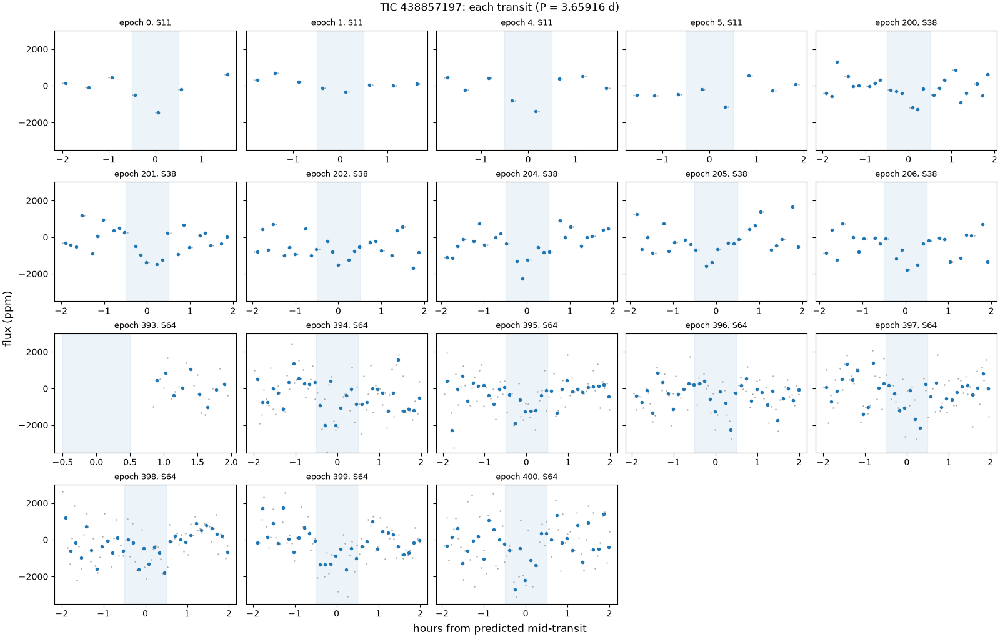
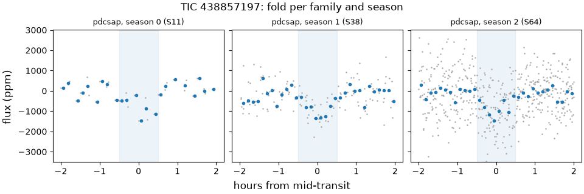
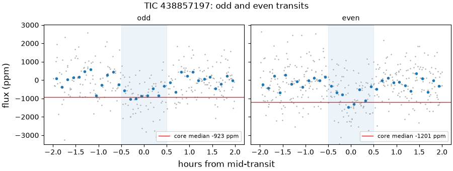
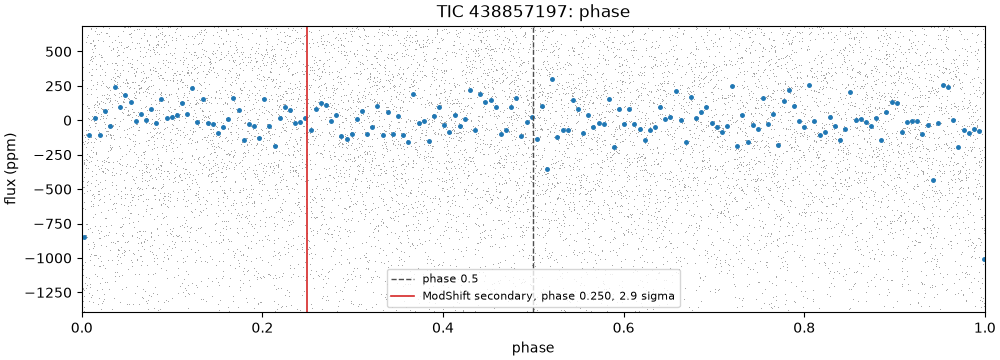
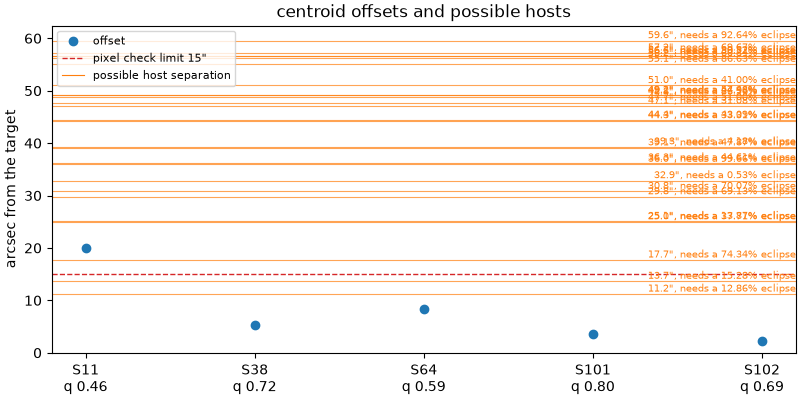

# 438857197-1: TIC 438857197

Call: **held** on 2026-10-22. Rendered from the files in this directory (decision 0028).

## Signal and star

|  |  |
|---|---|
| Signal | 438857197-1, a second-list row (a SPOC TCE that never became a TOI) |
| Names | TIC 438857197, Gaia DR3 6083427102945445888, TYC 8252-954-1, 2MASS J13290921-4807399 |
| Ephemeris (the search's box) | period 3.659160 d, epoch BTJD 1603.5364, duration 0.0417 d (1.00 h), depth 779 ppm |
| Star (TIC) | Teff 6212 K, radius 1.67 solar radii, Tmag 10.43 |
| RUWE (Gaia DR3) | 0.93 |
| CROWDSAP | S11 0.901; S38 0.905; S64 0.892; none published for S101 (QLP), S102 (QLP) |
| Sectors vetted | PDCSAP family: 11, 38 and 64; left out as timing-suspect: 101 and 102 |
| Criteria | search-v2, vet-v3 |
| Runs | vetting 20261020T174317Z-vetting-run-61b5944-2d70 (commit 61b5944, production); TRICERATOPS 20261021T044850Z-vetting-triceratops-cd4e7a2-07c3 (commit cd4e7a2, production); literature 20261021T001540Z-vetting-literature-61b5944-07de (commit 61b5944, production); evidence-only vetting 20261020T175536Z-vetting-run-61b5944-7f4e (commit 61b5944, production); second list 20261020T180844Z-vetting-second-list-61b5944-7096 (commit 61b5944, production) |

## Checks

vet-v3's checks first, then the neighbour table (evidence, never a fail), triage's pixel check as the second list ran it on this row (triage runs it only on novelty passes), TRICERATOPS and the literature search.

| Check | Outcome | Reason |
|---|---|---|
| novelty | inconclusive | matches only SPOC TCE or ExoMiner rows |
| odd_even | pass | pdcsap: odd and even depths agree within 1.6 sigma |
| secondary | pass | no dip at phase 0.5 (1.0 sigma) |
| sector_depth | pass | pdcsap: depths agree across 2 sectors (p = 0.34) |
| holdout | pass | 2 held-out seasons predicted |
| signal_present | pass | combined depth is 12.3 sigma |
| shape | pass | U-shaped: grazing in 12% of samples |
| density | pass | transit and TIC densities agree (1.7 sigma) |
| radius | pass | 5.5 Earth radii |
| neighbours | pass | 26 of 57 neighbours could host the signal |
| pixels | pass | centroid offset 3.6" within 15" |
| triceratops | inconclusive | mean FPP 0.743, mean NFPP 0.0168 over 10 run(s): neither likely a planet nor likely a nearby false positive |
| literature | pass | complete: 0 hits to screen |

## On the star?

Centroids, from the second list's pixel check (pass, centroid offset 3.6" within 15"): the difference-image centroid's offset from the target in each sector. The second list's pass rests on the best-quality sector's offset, S101's, from a timing-suspect sector that vet-v3 leaves out.

| Sector | Offset (arcsec) | Quality | Note |
|---|---|---|---|
| 11 | 19.9 | 0.46 |  |
| 38 | 5.4 | 0.72 |  |
| 64 | 8.3 | 0.59 |  |
| 101 | 3.6 | 0.80 | timing-suspect: vet-v3 leaves it out; the offset the second list's check judged |
| 102 | 2.3 | 0.69 | timing-suspect: vet-v3 leaves it out |

Neighbours (pass): 26 of 57 neighbours could host the signal. Each Gaia DR3 star that could make the dip, with its separation from the target (Gaia DR3 6083427102945445888, J2016.0) and the eclipse depth it would need, scaled from the depth in the signals file (779 ppm) as if all its light fell in the aperture, and the TRICERATOPS star matched to it with the distance between them at the TIC's epoch:

| Star | Separation (arcsec) | Eclipse needed | TRICERATOPS's star (distance) | Its depth |
|---|---|---|---|---|
| Gaia DR3 6083427107255912960 | 11.2 | 12.9% | TIC 438857201 (0.0") | 13.3% |
| Gaia DR3 6083427038536431744 | 13.7 | 15.3% | TIC 438857186 (0.0") | 17.2% |
| Gaia DR3 6083428584724663296 | 17.7 | 74.3% | TIC 1048012266 (0.0") | 96.6% |
| Gaia DR3 6083427107255911936 | 25.0 | 37.7% | TIC 438857198 (0.0") | 47.4% |
| Gaia DR3 6083428516005182080 | 25.1 | 13.9% | TIC 438857190 (0.0") | 25.4% |
| Gaia DR3 6083427102946084096 | 29.8 | 69.1% | TIC 1048011906 (0.0") | 0% |
| Gaia DR3 6083428580414836608 | 30.8 | 70.1% | TIC 438857212 (0.0") | 0% |
| Gaia DR3 6083428516005177984 | 32.9 | 0.525% | TIC 438857177 (0.0") | 1.23% |
| Gaia DR3 6083428515990500736 | 36.0 | 99.7% | TIC 1048012249 (0.1") | 0% |
| Gaia DR3 6083428511695343616 | 36.3 | 44.6% | TIC 438857194 (0.0") | 0% |
| Gaia DR3 6083428580414839424 | 39.1 | 47.9% | TIC 438857215 (0.0") | 0% |
| Gaia DR3 6083428511695355008 | 39.3 | 4.18% | TIC 438857203 (0.0") | 15.1% |
| Gaia DR3 6083427313414345856 | 44.3 | 33.3% | TIC 438808688 (0.0") | 0% |
| Gaia DR3 6083427309104521728 | 44.4 | 43.1% | TIC 438857218 (0.0") | 0% |
| Gaia DR3 6083427107255905536 | 47.1 | 31.1% | TIC 438808709 (0.0") | 58.9% |
| Gaia DR3 6083427309104508288 | 47.7 | 51% | TIC 1048011949 (0.0") | 0% |
| Gaia DR3 6083427068586323328 | 48.8 | 86.6% | TIC 438857188 (0.0") | 0% |
| Gaia DR3 6083428584724669568 | 49.1 | 44.9% | TIC 438857223 (0.0") | 0% |
| Gaia DR3 6083428511695353216 | 49.2 | 57.5% | TIC 438857204 (0.0") | 0% |
| Gaia DR3 6083428516005184128 | 51.0 | 41% | TIC 438857196 (0.0") | 0% |
| Gaia DR3 6083428580414849024 | 55.1 | 86.6% | TIC 1048012261 (0.0") | 0% |
| Gaia DR3 6083428584710014976 | 56.2 | 60.8% | TIC 1048012263 (0.0") | 0% |
| Gaia DR3 6083424079289064448 | 56.6 | 39.8% | TIC 438857166 (0.0") | 0% |
| Gaia DR3 6083427068586315520 | 56.7 | 50.5% | TIC 438808711 (0.0") | 0% |
| Gaia DR3 6083428511695357056 | 57.2 | 69.7% | TIC 438857208 (0.0") | 0% |
| Gaia DR3 6083427309104519296 | 59.6 | 92.6% | TIC 1048011952 (0.0") | 0% |

TRICERATOPS (inconclusive) took sectors 64 at 200 s and folded them on the density-prior fit's ephemeris. It gave a mean NFPP 0.0168 (sd 0.0008) over 10 run(s) of 1000000 draws. Possible hosts it did not weigh: none. It gave zero depth to Gaia DR3 6083427102946084096 (TIC 1048011906), Gaia DR3 6083428580414836608 (TIC 438857212), Gaia DR3 6083428515990500736 (TIC 1048012249), Gaia DR3 6083428511695343616 (TIC 438857194), Gaia DR3 6083428580414839424 (TIC 438857215), Gaia DR3 6083427313414345856 (TIC 438808688), Gaia DR3 6083427309104521728 (TIC 438857218), Gaia DR3 6083427309104508288 (TIC 1048011949), Gaia DR3 6083427068586323328 (TIC 438857188), Gaia DR3 6083428584724669568 (TIC 438857223), Gaia DR3 6083428511695353216 (TIC 438857204), Gaia DR3 6083428516005184128 (TIC 438857196), Gaia DR3 6083428580414849024 (TIC 1048012261), Gaia DR3 6083428584710014976 (TIC 1048012263), Gaia DR3 6083424079289064448 (TIC 438857166), Gaia DR3 6083427068586315520 (TIC 438808711), Gaia DR3 6083428511695357056 (TIC 438857208), Gaia DR3 6083427309104519296 (TIC 1048011952): its apertures take too little of each one's light to make the dip. Evidence for the review, not a blocker (decision 0026).

RUWE 0.93 (Gaia DR3). A high RUWE points to an unresolved companion, which TRICERATOPS's priors don't condition on; above vet-v3's limit, or without a RUWE, TRICERATOPS is inconclusive.

## A planet rather than a binary?

- Odd and even transits: pass, pdcsap: odd and even depths agree within 1.6 sigma.
- Secondary at phase 0.5: pass, no dip at phase 0.5 (1.0 sigma).
- Secondary at any phase (LEO-Vetter's ModShift, from triage): the strongest secondary is 2.87 sigma at phase 0.25, depth 152 ppm; primary 15.4 sigma, tertiary 2.54 sigma at phase 0.874, positive 2.52 sigma at phase 0.807; Fred 0.926.
- The search's other signals on the star: rank 2 at 12.7872 d (period ratio 3.49, SDE 11.0).
- Shape (flat-prior fit): pass, U-shaped: grazing in 12% of samples; median b 0.56.
- Density (flat-prior fit): pass, transit and TIC densities agree (1.7 sigma).
- Radius: pass, 5.5 Earth radii. Rp is 5.52 Earth radii from the flat-prior fit and 67.25 (16th to 84th percentile 22.43 to 132.23) from the density-prior fit; the radius check reads the flat-prior fit.
- Density-prior fit (the TIC density as a prior), whose parameters M4 uses: Rp 67.25 Earth radii (16th to 84th percentile 22.43 to 132.23), b 1.33 (-0.26, +0.36), a/R* 6.55 (-0.39, +0.48), period 3.659157 d (sd 1.3e-05), t0 BTJD 1603.5387 (sd 0.0027 d).
- TRICERATOPS (inconclusive): mean FPP 0.743 (sd 0.022) over 10 run(s) of 1000000 draws.

## Real and new?

- Signal present: pass, combined depth is 12.3 sigma.
- Held-out seasons: pass, 2 held-out seasons predicted.
- Sector depths: pass, pdcsap: depths agree across 2 sectors (p = 0.34).
- Novelty, against the catalog snapshot: inconclusive, matches only SPOC TCE or ExoMiner rows. SPOC TCE or ExoMiner rows at the period: ExoMiner vetting_catalog_FFI 438857197-1-S38, ExoMiner vetting_catalog_FFI 438857197-1-S64.
- Literature by name (TIC 438857197, Gaia DR3 6083427102945445888, TYC 8252-954-1, 2MASS J13290921-4807399) and NASA ADS: pass, complete: 0 hits to screen. The hits are listed below.

ExoFOP, read live: TOIs none; CTOIs none; confirmed planets none.

## Next TESS looks

tess-point places the star in sectors 112 and 114.

Each transit predicted in those sectors, from the density-prior fit's posterior (epochs count periods from its t0); duration 0.0570 d from the density-prior fit:

| Sector | Epoch | Mid (BTJD) | Mid (UTC) | sd (min) | 1 sigma half-width (min) | 3 sigma half-width (min) |
|---|---|---|---|---|---|---|
| 112 | 764 | 4399.135 | 2026-12-24 15:13 | 11.1 | 11.1 | 33.3 |
| 112 | 765 | 4402.794 | 2026-12-28 07:02 | 11.1 | 11.1 | 33.4 |
| 112 | 766 | 4406.453 | 2026-12-31 22:51 | 11.1 | 11.1 | 33.4 |
| 112 | 767 | 4410.112 | 2027-01-04 14:40 | 11.2 | 11.2 | 33.5 |
| 112 | 768 | 4413.772 | 2027-01-08 06:29 | 11.2 | 11.2 | 33.6 |
| 112 | 769 | 4417.431 | 2027-01-11 22:19 | 11.2 | 11.2 | 33.6 |
| 112 | 770 | 4421.090 | 2027-01-15 14:08 | 11.2 | 11.2 | 33.7 |
| 114 | 778 | 4450.363 | 2027-02-13 20:41 | 11.4 | 11.4 | 34.1 |
| 114 | 779 | 4454.022 | 2027-02-17 12:30 | 11.4 | 11.4 | 34.2 |
| 114 | 780 | 4457.681 | 2027-02-21 04:20 | 11.4 | 11.4 | 34.2 |
| 114 | 781 | 4461.341 | 2027-02-24 20:09 | 11.4 | 11.4 | 34.3 |
| 114 | 782 | 4465.000 | 2027-02-28 11:58 | 11.4 | 11.4 | 34.3 |
| 114 | 783 | 4468.659 | 2027-03-04 03:47 | 11.5 | 11.5 | 34.4 |
| 114 | 784 | 4472.318 | 2027-03-07 19:36 | 11.5 | 11.5 | 34.4 |
| 114 | 785 | 4475.977 | 2027-03-11 11:26 | 11.5 | 11.5 | 34.5 |

2-min data and the DDT ask (M3 design, section 4.5): which stars get 2-min data in a sector is decided per cycle, so tess-point can't say whether these sectors will have it. In the sectors fetched, the star never had SPOC 2-min data (QLP at 200 s; TESS-SPOC at 1800, 600 and 200 s). Held: the DDT ask applies only on the maintainer's call and only when the deciding evidence is the transit's shape; a hold on blending does not go, since 2-min data come from the same pixels. Deciding evidence: Precise radial velocities to weigh a grazing body (F1); high-resolution imaging and multi-band transit photometry for a bound companion (F2); seeing-limited ground-based photometry on a predicted transit that resolves the stars 11 to 14 arcseconds away (F3). Sectors 112 and 114 add transits that sharpen the shape but decide none of these.

## Plots

Each transit, against hours from its predicted mid-time:

The fold in each season and each product family:

Odd and even transits side by side:

The whole orbit, with phase 0.5 and LEO-Vetter's ModShift secondary marked:

The second list's pixel check: each sector's centroid offset, with the neighbours that could host the signal:

## Catalogued rows on the star

Every catalogued row on the star in the snapshot. vet-v3 masks only the kinds the search masks (decision 0021); the rest stay unmasked. A row overlaps a transit of ours, numbered by epoch from the signal's t0, when its mask window (2 of its durations, or of 0.25 d where the catalog gives none) meets it. 21 transits of ours have data.

| Source | Kind | Name | Period (d) | Masked | Transits of ours it overlaps |
|---|---|---|---|---|---|
| ExoMiner-v2 | tce | ExoMiner vetting_catalog_FFI 438857197-1-S38 | 3.65729 | no, it is the signal | 7 of 21: 200, 201, 202, 203, 204, 205, 206 |
| ExoMiner-v2 | tce | ExoMiner vetting_catalog_FFI 438857197-1-S64 | 3.65850 | no, it is the signal | 8 of 21: 393, 394, 395, 396, 397, 398, 399, 400 |

## Literature hits

0 paper(s) from the searches that answered, one row per paper.

## With the timing-suspect sectors (evidence only)

The same vet with the timing-suspect sectors kept in (decision 0022). It is shown for comparison and never used for the call. Sectors it adds: 101 and 102.

| Check | Without them | With them | Reason with them |
|---|---|---|---|
| novelty | inconclusive | inconclusive | matches only SPOC TCE or ExoMiner rows |
| odd_even | pass | pass | pdcsap: odd and even depths agree within 1.6 sigma; qlp: odd and even depths agree within 0.4 sigma |
| secondary | pass | pass | no dip at phase 0.5 (1.3 sigma) |
| sector_depth | pass | pass | pdcsap: depths agree across 2 sectors (p = 0.34); qlp: depths agree across 2 sectors (p = 0.98) |
| holdout | pass | pass | 2 held-out seasons predicted |
| signal_present | pass | pass | combined depth is 15.2 sigma |
| shape | pass | pass | U-shaped: grazing in 12% of samples |
| density | pass | pass | transit and TIC densities agree (1.7 sigma) |
| radius | pass | pass | 5.5 Earth radii |

## Review

Reviewer claude-opus-5-5, 2026-10-21. I ran the full brief: the fits against the star, TRICERATOPS's scenarios, the pixel record beside SPOC's public FFI DV reports, ModShift, holdout, the ExoMiner score and novelty. The dip is real and not known, but on this F star it must be grazing (at least 7 to 9 Earth radii, no upper bound), and Gaia DR3's flat RVs leave a grazing giant planet or brown dwarf on the target. Otherwise it sits on another star: TRICERATOPS's FPP rests mostly on a bound companion, and the pixels, including SPOC's 3.7-sigma S64 centroid flag, can't separate the neighbours at 11 to 14 arcsec.

A finding rated kill or hold is confirmed when no refuter refuted it; a note gets no refuters.

### F1 (a planet, hold): confirmed

Claim: On TIC 438857197 the 1.1 to 1.4 h transit can only be grazing, by a body of at least about 7 to 9 Earth radii that the light curve can't bound from above; the U-shaped 5.5 Earth-radius planet that shape, density and radius pass needs a host about 44 times denser than this star.

Evidence: Duration: LEO-Vetter's metrics for this signal ($TRIAGE_RUN/evidence/438857197-1.json (leo_flux.evidence.metrics)) give a central-transit duration on the TIC star of q 0.0502 x P = 4.40 h against the trapezoid's trap_qtran 0.01538 x P = 1.35 h (ratio 0.31; /tmp/t13/438857197-1/numbers.py). The flat fit puts the host at 16.2 g/cm3 against the TIC's 0.365 (~/.cache/tess-hunt/drafts/m3-r2/438857197-1/checks.json, density evidence fit_rho_gcc and tic_rho_gcc; ratio 44); the density check passes at 1.71 sigma only because it uses the fit's lower error, 0.96 dex (fit.log_rho minus). Profiles on the light curve the vet fit (lc sha256 7d9651a8... as in $VET2_RUN/provenance.json; PDCSAP S11, S38, S64; scripts /tmp/t13/438857197-1/lik.py and kprof.py run through /tmp/t13/heavy.sh, outputs lik.out and kprof.out): best fit with the density free chi2 1076.38 (k 0.028, b 0.44, log rho 1.26); best at the TIC density chi2 1076.57 (delta 0.19). With the density held at the TIC value, k 0.03 (5.5 Re) gives 1087.68 (delta 11.3), k 0.04 (7.3 Re) 1079.48 (delta 3.1), k 0.05 (9.1 Re) 1077.53 (delta 1.2), k 0.30 (54.6 Re) 1076.62 (delta 0.24), each with b above 1 - k. At the TIC density plus 2 sd, k 0.03 still costs delta chi2 6.1. The flat fit's U shape rests on its free limb darkening: its best point has q1 0.670, q2 0.979 (u1 1.60, u2 -0.78). With limb darkening held at LEO-Vetter's coefficients for this star (transit_u1 0.2346, transit_u2 0.3086), central transits on a dense host (log rho 1.2 to 1.6) give chi2 1081.5 to 1082.9 against 1076.6 at the TIC density (/tmp/t13/438857197-1/ldfixed.py, ldfixed.out): delta chi2 about 5 for the grazing solution. LEO-Vetter's own fit: transit_b 0.99999999 (its cap), transit_aRs 6.91 against aRs 6.37 from the star, trap_qin 0.352 +/- 0.047. SPOC's trapezoid fits are V-like too: S38 ingress 1.03 h of 2.06 h, S64 0.46 h of 1.38 h (/tmp/t13/438857197-1/dv/*dvr.xml, trapezoidalFit). The density-prior fit M4 uses: b 1.33 (-0.26, +0.36), Rp 67.3 Re, 16th to 84th percentile 22.4 to 132.2 (checks.json fit_prior). Decision 0031's eccentricity cause can't rescue a small planet: matching 16.2 g/cm3 on this star needs e of at least 0.85, a periastron at 0.94 stellar radii (numbers.py). Gaia DR3 RVS (/tmp/t13/438857197-1/queries.sh, gaia_dr3.csv): radial_velocity 19.32 +/- 0.41 km/s over rv_nb_transits 10, rv_chisq_pvalue 0.79, rv_renormalised_gof -0.63, rv_amplitude_robust 3.46 km/s, so no RV variability. K is about 117 m/s per Jupiter mass at this period (108 at the FLAME mass 1.35) and 9.4 km/s for a 0.08 Msun companion (numbers.py): a stellar companion grazing the target would have shown, a brown dwarf of up to about 20 Jupiter masses (K about 2.3 km/s) need not. TRICERATOPS's TP draw agrees: b 1.066, Rp 13.1 Re (probs.csv). So on this star it is a grazing giant planet or a brown dwarf; off it, see F2 and F3. Decides: precision RV for the mass (outside 0028's list, but it is what separates the two); 2-min data in S112 and S114 add transits but leave the grazing radius degeneracy.

- Refuter 1: did not refute. Every number F1 rests on reproduces. Scratch is in /tmp/t13/438857197-1/refute-F1-reproduce/.

1. Light curve. sha256sum ~/.cache/tess-hunt/lc/438857197.npz gives 7d9651a8...9e18, the same hash as $VET2_RUN/provenance.json (light_curve_438857197). The drafts' checks.json is identical to $VET2_RUN/signals/438857197-1/checks.json (diff empty).

2. Profiles. I reran copies of lik.py, kprof.py and ldfixed.py through /tmp/t13/heavy.sh from ~/code/tess-hunt with VET2_RUN exported (run.sh). All three exited 0, and each output is byte-identical to the reviewer's lik.out, kprof.out and ldfixed.out (diff says IDENTICAL):
- density free 1076.38 (k 0.02814, b 0.443, log rho 1.257, q1 0.670, q2 0.979)
- TIC density 1076.57
- at TIC density: k 0.03 1087.68 (b 0.974), k 0.04 1079.48, k 0.05 1077.53, k 0.30 1076.62 (b 1.266)
- TIC+2sd: k 0.03 1082.51
- fixed LD: log rho 1.2 to 1.6 gives 1081.52 to 1082.86, against 1076.61 at the TIC density

One snag: a copied numbers.py shadowed the stdlib numbers module and the first run crashed. I renamed it arith.py.

3. Independent optimiser. Kprof's Nelder-Mead runs from a few fixed starts, and lik.py's log rho profile is not monotonic at +0.4, so I wrote de_check.py: differential evolution plus a polish, q bounded to (0,1), same light curve. It gives:
- all-free minimum 1076.22, 0.16 below the reviewer's reference
- k 0.03 at TIC density 1087.68 (delta 11.47); k 0.04 1079.48 (3.26); k 0.05 1077.53 (1.31)
- TIC+2sd: k 0.03 1082.55 (6.33); k 0.04 1076.56 (0.34)
- fixed LD: same values as ldfixed.out

So the global search finds no better small-planet solution, and its deltas are slightly larger than the finding's.

4. Run-file values. LEO-Vetter metrics ($TRIAGE_RUN/evidence/438857197-1.json):
- q 0.050153. Per parameters.py get_q, that is arcsin(0.2375 rho^-1/3 P^-2/3)/pi, a central-transit duration. Times P it is 4.404 h.
- trap_qtran 0.015382, which is 1.351 h (ratio 0.31)
- transit_b 0.99999999. triage-v1.toml sets cap_b = true, and fits.py then caps b at 1.
- transit_aRs 6.906, aRs 6.370, trap_qin 0.352 +/- 0.047, transit_u1 0.2346, transit_u2 0.3086

checks.json:
- density: fit_rho_gcc 16.212, tic_rho_gcc 0.3647 (ratio 44.5), tension 1.712 with fit_log_rho_sd equal to the minus error 0.9576
- radius: 5.52 Re (pass); shape: pass
- fit_prior: b 1.335 (-0.260, +0.364), rp_rearth 67.25 (p16 22.43, p84 132.23)

probs.csv TP row: b 1.066, R_p 13.12. The T14 of the free-density best fit computes to 1.11 h, which is the low end of the claim's "1.1 to 1.4 h".

5. Arithmetic. arith.py (a copy of numbers.py) reproduces:
- K: 116.8 m/s per Jupiter mass at 1.2 Msun, 107.9 at 1.35; 9.38 km/s for a 0.08 Msun companion
- eccentricity: minimum e 0.852 with periastron at 0.940 R*

6. Public data. SPOC DV XML re-downloaded from MAST is sha256-identical to the reviewer's copies. trapezoidalFit: S38 ingress 1.028 h of 2.057 h; S64 0.459 h of 1.384 h. Gaia TAP rerun for 6083427102945445888: radial_velocity 19.317 +/- 0.410, rv_nb_transits 10, rv_amplitude_robust 3.459, rv_chisq_pvalue 0.790, rv_renormalised_gof -0.629.

None of the numbers fails, and the evidence shows what the claim says.
- Refuter 2: did not refute. Not refuted. The finding reads the rules correctly, and hold fits the brief. Two secondary numbers are a little generous, but neither changes the claim or the rating.

Rules checked:
- Section 4.8 is not in the repo's docs/design.md. It is in the M3 design, C:\code\docs\tess-hunt-m3-design.md (/mnt/c/code/docs/tess-hunt-m3-design.md).
- Shape, density and radius read the flat-prior fit, so they don't assume the dip is on the target (M3 design 4.2; decision 0024, Context and Decision). F1 says it is conditional ("On TIC 438857197") and leaves the off-star case to F2 and F3. That matches the brief's planet lens: "Density against the TIC star, and the radius against the star." F1 never claims a check failed or has a bug, so no decision record is owed.
- Density error: 0016 (Decision) takes the side of the posterior that faces the TIC value. checks.json confirms it: fit_log_rho_sd 0.9576 equals fit_log_rho_minus, and the tension is 1.712. F1's "passes at 1.71 sigma only because it uses the fit's lower error" restates that rule accurately; it does not misread it.
- Check values match F1: shape passes at grazing probability 0.119; radius passes at 5.5 Re (rp_rs 0.0303, rad_tic 1.667); fit_rho_gcc / tic_rho_gcc = 16.21 / 0.365 = 44.5.
- Eccentricity (0031, the "what it means for candidates" list) is applied correctly. A factor of 44.5 in density means (1+e)/sqrt(1-e^2) = 3.54, so e = 0.852, and periastron = 6.37 x 0.148 = 0.94 R*, inside the star (numbers.py).

Rating:
- A kill under 0028 needs evidence that it is "not a planet". A grazing giant planet is still a planet, so F1 correctly does not kill.
- A hold needs evidence that would decide the case. 0028 and M3 4.9 list deciders in parentheses. calls.py:171 only requires deciding_evidence to be non-empty text ("a held call needs deciding_evidence"). So precision RV is allowed, and F1 itself says it is outside 0028's list.
- F1 says 2-min data won't settle it, so the hold can't route to the DDT ask on shape (0028, DDT note). That is consistent.

Gaia RV, which supports the planet-or-brown-dwarf split:
- Katz et al. 2023, eq. 1, read from arXiv 2206.05902 with pdftotext: eps = sqrt((sqrt(pi/2N) sigma_t)^2 + 0.113^2).
- Applied to gaia_dr3.csv (eps 0.410, N 10), the epoch RVs scatter by sigma_t = 0.995 km/s.
- /tmp/t13/438857197-1/refute-F1-rules/gaia_rv_limit.py (output in gaia_rv_limit.out), with no measurement noise: the companion mass allowed is 16.2 to 17.5 MJ at 95% and 20.0 to 21.6 MJ at 99%, for M* 1.2 to 1.35.
- So "a brown dwarf of up to about 20 MJ need not have shown" is at the lenient edge, at 99% with no noise. A 13 to about 17 MJ brown dwarf is still allowed, so the planet-or-brown-dwarf split and "precision RV decides" stand.

Overstated, but it doesn't change the outcome:
- The "at least about 7 to 9 Earth radii" floor holds at the TIC's central density only. In kprof.out at TIC+2sd (log rho -0.245), k 0.04 (7.3 Re) has chi2 1076.56, just 0.18 above the 1076.38 best fit; only k 0.03 costs 6.1. Allowing for the TIC density error, the floor is nearer 6 Re.
- The light curve still can't bound the radius from above: fit_prior gives Rp 67.3 Re, with 16th and 84th percentiles of 22.4 and 132.2.
- The LD-fixed comparison (ldfixed.out) is accurate for the range F1 states, log rho 1.2 to 1.6 (chi2 1081.5 to 1082.9 against 1076.61).

### F2 (on the star, hold): confirmed

Claim: TRICERATOPS's FPP 0.743 is carried mostly by an eclipse or a planet on an unresolved bound companion (SEB, SEBx2P, STP), which nothing in the public data tests; Gaia's flat RVs remove only the on-target binary scenarios, and the FPP stays near 0.65 without them.

Evidence: ~/.cache/tess-hunt/drafts/m3-r2/438857197-1/triceratops.json (identical to $TRIC3A_RUN/signals/438857197-1/triceratops.json): fpp_mean 0.743 (sd 0.022), nfpp_mean 0.0168, 10 runs on S64 at 200 s, contrast [] (no curve). probs.csv is run 10: its scenarios sum to fpp[9] 0.7084 and nfpp[9] 0.0176. In it: planet on the target TP 0.246, PTP 0.041, DTP 0.004 (0.292); bound companion SEB 0.342 (host 0.40 Rsun, b 0.09), STP 0.111, SEBx2P 0.064 (0.517); binary on the target EB 0.033, EBx2P 0.092, PEB 0.014, PEBx2P 0.025, DEB and DEBx2P 0.002 (0.167); background 0.007; nearby 0.018. Gaia DR3 RVS (F1; /tmp/t13/438857197-1/gaia_dr3.csv) rules out the on-target binaries: each moves the F star by km/s. Without them the planet share is 0.292 / 0.833 = 0.35, FPP about 0.65, still above fpp_pass 0.5 (criteria/vet-v3.toml). Nothing here tests the bound-companion scenarios: Gaia DR3 ruwe 0.925, ipd_frac_multi_peak 0, non_single_star 0 and no NSS orbit, no WDS pair within 2 arcmin (VizieR B/wds/wds), and no imaging on ExoFOP (literature.json search.exofop.imaging []). These limit bright companions, not an M dwarf 5 to 6 mag fainter. The DUPLICATE dropped under 0036 (TIC 1048012133, duplicate of TIC 438808673, about 128 arcsec out with tdepth 0 in the star list) changes nothing. Decides: high-resolution imaging, whose contrast curve TRICERATOPS takes (0026, --contrast), and multi-colour ground-based photometry (an eclipse on an M-dwarf companion diluted by the F star deepens toward red bands).

- Refuter 1: did not refute. Every number F2 rests on reproduces. Scratch and scripts are in /tmp/t13/438857197-1/refute-F2-reproduce/ (sums.py, stars.py, kcalc.py, gaia_target.csv, nss.txt, wds_2arcmin.tsv).

(1) sha256sum gives 89b57dec... for both the draft triceratops.json and $TRIC3A_RUN/signals/438857197-1/triceratops.json, and cmp says they are identical. The same holds for probs.csv (d62df6a6...). evidence: fpp_mean 0.7432, fpp_sd 0.0217, nfpp_mean 0.01676, runs 10, sectors [64], exposure_s 200.0, contrast [].

(2) sums.py on probs.csv: the probabilities sum to 1.0000. TP 0.2463 + PTP 0.0409 + DTP 0.0044 = 0.2916, and 1 minus that = 0.70843, exactly fpp[9]. The N* rows sum to 0.017612, exactly nfpp[9]. So probs.csv is run 10. SEB 0.3417 (R_s 0.400, M_s 0.398, b 0.085) + STP 0.1108 + SEBx2P 0.0641 = 0.5166. EB 0.0333, EBx2P 0.0924, PEB 0.0139, PEBx2P 0.0250, DEB 0.0007 and DEBx2P 0.0016 sum to 0.1668. Background 0.0074, nearby 0.0176. Without the on-target binaries the planet share is 0.2916 / 0.8332 = 0.350, so FPP 0.650. criteria/vet-v3.toml line 91 has fpp_pass = 0.5.

(3) Live Gaia DR3 TAP query on source_id 6083427102945445888: ruwe 0.92543, ipd_frac_multi_peak 0, non_single_star 0, RV 19.317 +/- 0.410 km/s, rv_nb_transits 10, rv_amplitude_robust 3.459 km/s, rv_chisq_pvalue 0.790, rv_renormalised_gof -0.629. grvs_mag is 10.19, so the p-value is published. nss_two_body_orbit, nss_acceleration_astro, nss_non_linear_spectro and nss_vim_fl return no rows. kcalc.py takes the masses, periods, inclinations and eccentricities in probs.csv and gives K = 15.1 (EB), 71.1 (EBx2P), 13.8 (PEB), 70.4 (PEBx2P), 15.1 (DEB) and 70.3 (DEBx2P) km/s. Each moves the F star by km/s, as F2 says.

(4) VizieR B/wds/wds within 2 arcmin of 202.288435 -48.127780 returns no data rows. The query works: at 10 arcmin it returns BRT 816 at 6.17 arcmin.

(5) literature.json search.exofop.imaging is [].

(6) dropped_stars is [{ID 1048012133, DUPLICATE, duplicate_id 438808673}]. The star list has 438808673 with tdepth 0.0 at 127.7 arcsec from the target (computed from the star list's ra and dec).

(7) docs/decisions/0026 line 83 defines --contrast for contrast curves.

One nuance that is not a refutation: the 0.65 comes from run 10, which has the lowest FPP of the ten (0.708 against a mean of 0.743). Scaling the mean the same way gives about 0.69, which strengthens F2's point that the FPP stays above 0.5.
- Refuter 2: did not refute. F2 reads the rules correctly, and "hold" is the right rating.

1. Rule reading. criteria/vet-v3.toml [triceratops] sets fpp_pass 0.5, nfpp_pass 0.001 and nfpp_fail 0.1. Decision 0026 ("Outcomes") passes a signal only when FPP < 0.5 and NFPP < 0.001, fails it only when NFPP > 0.1, and calls everything else inconclusive. triceratops.json gives outcome "inconclusive", FPP mean 0.743, NFPP mean 0.0168 and no blockers. F2 says only that FPP stays above fpp_pass. It never claims an FPP fail, which the rules don't have. I ran cmp: the draft's triceratops.json is identical to $TRIC3A_RUN/signals/438857197-1/triceratops.json.

2. Numbers. I summed the scenario rows of probs.csv: total 1.000; planet (TP, PTP, DTP) 0.2916; bound companion (SEB, SEBx2P, STP) 0.5166; binary on the target (EB, EBx2P, PEB, PEBx2P, DEB, DEBx2P) 0.1668; background 0.0074; nearby 0.0176. These match fpp[9] 0.7084, and 0.2916 / (1 - 0.1668) = 0.350 gives FPP 0.650, as claimed. One caveat: probs.csv is run 10 (FPP 0.708). The same removal applied to the 0.743 mean would give about 0.69. Either way it is above 0.5, and the finding names run 10 as its source. The brief allows arithmetic shown on run-file numbers. Design.md 5.5 binds dossiers and reports, not review findings.

3. On-target binaries. TRICERATOPS's own draws for these scenarios (probs.csv) are stars: M_EB 0.135 (EB), 0.122 (PEB), 1.15 (EBx2P), each orbiting the target. So "moves the F star by km/s" is a fair reading. Whether Gaia RVS actually detects that is refuter 1's to reproduce.

4. "Nothing in the public data tests" the bound companions. 0026 says RUWE above 1.4 marks a companion the priors don't condition on. Nothing in 0026 says RUWE 0.925 rules companions out. TRICERATOPS 1.1.0 (.venv/.../triceratops/marginal_likelihoods.py lines 484-490 and 713-719) already limits bound companions to 2.2 arcsec when no contrast curve is given. So Gaia's lack of resolved neighbours is already in the FPP. The nearest Gaia source in neighbours.csv is 11.23 arcsec out. Given a curve, the code uses limiting_separation from the curve instead (lines 497-515). That is the --contrast route F2 cites (0026 Ruling K). literature.json /search/exofop/imaging is [].

5. Rating. Hold fits the brief, M3 design 4.9 and 0028 ("held: ... the public data can't decide"; deciding evidence includes "high-resolution imaging, ground-based photometry"). F2 names both. A kill would be wrong: 0026 has no FPP fail. 0031 and the controls summary show known planets that TRICERATOPS left inconclusive at high FPP: TOI-396.01 at mean FPP 1 and TOI-747.01 at 0.568. The on_star lens fits, since design 4.8 puts blends there.

6. Duplicate. 0036's dropped_stars lists TIC 1048012133, a DUPLICATE of TIC 438808673. In the star list 438808673 has tdepth 0.0 and sits about 128 arcsec from the target by position arithmetic. Its removal changes nothing, as F2 says.

### F3 (on the star, hold): confirmed

Claim: The pixel data can't place the dip on the target to better than the 11 to 14 arcsec at which two Gaia stars could host it: SPOC's own S64 difference image puts the centroid 11.4 arcsec northeast at 3.7 sigma, the second list's S64 fit puts it 8.3 arcsec south-southeast, and the sector fits scatter toward different neighbours.

Evidence: $SECOND2_RUN/signals/438857197-1/pixels.json: pass on S101 3.6 arcsec (q 0.80), a timing-suspect sector; S102 2.3 (0.69), S38 5.4 (0.72), S64 8.3 (0.59), S11 19.9 (0.46). Without S101 the best vet-v3 sector, S38, still passes. Directions from the pixel diagnosis's refits (/tmp/t13/438857197-1/pixdiag/summary_second.txt, extracted from results/benchmarks/pixel-check-diagnosis-2026-10-20-scripts.tar.gz, lines 139 to 148): S38 E +3.5 N -4.0 and S64 E +2.2 N -8.0 lie 16 and 10 deg from the direction of TIC 438857186 (Gaia DR3 6083427038536431744, 13.7 arcsec at PA 155, needs a 15.3% eclipse); S101 E -3.0 N +1.9 and S102 E -2.1 N +1.0 lie 20 and 27 deg from TIC 438857201 (Gaia DR3 6083427107255912960, 11.2 arcsec at PA 323, needs 12.9%); S11 sits 5.9 arcsec from TIC 438857198 (25.0 arcsec, needs 37.7%). Sky scatter 9.3 arcsec; quality-weighted mean 3.2 arcsec from the target; no position repeats. SPOC's FFI DV for S64 (/tmp/t13/438857197-1/dv/hlsp_tess-spoc_tess_phot_0000000438857197-s0064-s0064_tess_v1_dvr.xml and dvs-01.pdf, fetched by queries.sh): msTicCentroidOffsets RA 8.44 +/- 2.97, Dec 7.64 +/- 3.13, sky 11.38 +/- 3.04 arcsec (TicOffset-rm 3.74 sigma, OotOffset-rm 12.39 arcsec at 4.04 sigma, flagged on the summary), image quality 0.85. For S38 it is 4.95 +/- 2.74 (1.80 sigma). SPOC's S64 position is about 17 arcsec from the second list's S64 fit, and no star there could make the dip: TIC 1048011908 (5.6 arcsec from it) would need over 100%, TIC 1048012266 (7.1 arcsec) 74% (TRICERATOPS 97%). The S64 centroid depends on the method: it neither confirms the target nor names a host. TRICERATOPS's NFPP 0.0168 sits between nfpp_pass 0.001 and nfpp_fail 0.1; in run 10 the NEB on TIC 438857186 is 0.0068 + 0.0013 (x2P) and on TIC 438857190 (25.1 arcsec, needs 13.9%) 0.0051 + 0.0014. SPOC's ghost diagnostic (core 3.98, halo 0.85 in S38; 5.62, 1.48 in S64) puts the dip in the optimal aperture, which holds these neighbours. Decides: seeing-limited ground-based photometry of the target and TIC 438857201, 438857186 and 438857190 across a predicted transit.

- Refuter 1: did not refute. Every number F3 rests on reproduces. Scratch scripts are in /tmp/t13/438857197-1/refute-F3-reproduce/ (geom.py, spoc_s64.py, pdfcolor.py).

1) Pixel record. I read $SECOND2_RUN/signals/438857197-1/pixels.json (20261020T180844Z-vetting-second-list-61b5944-7096) directly. It shows S102 2.29 (q 0.687), S101 3.55 (0.796, the offset the pass reason quotes), S64 8.31 (0.586), S38 5.35 (0.720) and S11 19.90 (0.457), against max_offset_arcsec 15. checks.json lists dropped_suspect [101, 102], so S101 is timing-suspect. S38 is the best-quality sector vet-v3 keeps, and at 5.35 it still passes.

2) Pixel diagnosis directions. I extracted summary_second.txt from results/benchmarks/pixel-check-diagnosis-2026-10-20-scripts.tar.gz and ran cmp against /tmp/t13/438857197-1/pixdiag/summary_second.txt: the files are identical. Lines 139 to 148 give the E/N values exactly as quoted (S38 +3.5/-4.0, S64 +2.2/-8.0, S101 -3.0/+1.9, S102 -2.1/+1.0, S11 -19.9/+0.9), sky scatter 9.3 and the weighted mean 3.2 from the target. sector_detail.py line 52 confirms east = (ra-ra0)*cos(dec0)*3600.

3) Neighbours. drafts/m3-r2/438857197-1/neighbours.csv gives:
- 6083427107255912960 (TIC 438857201): 11.23, needs 0.1286
- 6083427038536431744 (TIC 438857186): 13.67, needs 0.1528
- 6083427107255911936 (TIC 438857198): 25.02, needs 0.3771
- 6083428516005182080 (TIC 438857190): 25.10, needs 0.1387
The TIC-to-Gaia mapping comes from triceratops.json hosts. These are the only two stars between 11 and 14 arcsec with possible=True.

geom.py trilaterates the target's J2016 position from the 57 separations (residual 4e-7 arcsec) and then computes:
- PA of 186 is 155.0 and PA of 201 is 322.1. The quoted 323 matches the TIC J2000 positions (323.2), a frame difference under 1 deg.
- Angle offsets: S38 16.2 and S64 9.6 from 186; S101 19.8 and S102 26.7 from 201.
- S11's fit lies 5.9 from TIC 438857198.

4) SPOC DV. I read /tmp/t13/438857197-1/dv/*s0064*_dvr.xml lines 44 to 48:
- msTicCentroidOffsets: RA 8.4357 +/- 2.9701, Dec 7.6361 +/- 3.1305, sky 11.3785 +/- 3.0434. That is 3.74 sigma at PA 47.8, so northeast.
- msControlCentroidOffsets: sky 12.394 +/- 3.067, which is 4.04 sigma.
- qualityMetric 0.853.
- Ghost diagnostic: core 5.62, halo 1.48.
For S38: TIC offset 4.946 +/- 2.743 (1.80 sigma), core 3.98, halo 0.85.

pdfcolor.py (pypdf 5.1.0) shows that dvs-01.pdf prints the S64 "OotOffset-rm: 12.394 arcsec [4.04 sigma]" and "TicOffset-rm: 11.379 arcsec [3.74 sigma]" in red fill (rg 1 0 0). The S38 lines are black. So the S64 offsets are flagged on the summary.

5) SPOC S64 point (spoc_s64.py). It lies 16.83 from the second list's S64 fit. TIC 1048011908 is 5.67 from it, needs 4.45 in neighbours.csv, and has TRICERATOPS tdepth 0. TIC 1048012266 is 6.84 to 7.07 from it, depending on whether Gaia J2016 or TIC J2000 positions are used. It needs 0.743, with TRICERATOPS tdepth 0.966.

6) TRICERATOPS. The draft triceratops.json and probs.csv have the same sha256 as $TRIC3A_RUN/signals/438857197-1/. nfpp_mean is 0.016760. criteria/vet-v3.toml lines 92 and 93 set nfpp_pass 0.001 and nfpp_fail 0.1. probs.csv holds the last seed's probabilities: tricera.py lines 516 to 539 keep target.probs after the loop, and its N* scenarios sum to 0.0176123, which equals nfpp[9], so this is run 10. From probs.csv:
- TIC 438857186: NEB 0.006791, NEBx2P 0.001296
- TIC 438857190: NEB 0.005067, NEBx2P 0.001413

Caveats, not refutations:
- (a) The evidence says "no star there could make the dip". Under the check's own rule, TIC 1048012266 is a possible host: vet-v3.toml line 85 sets max_required_depth = 1.0, and neighbours.csv marks it possible=True. TRICERATOPS weighs its NEB+NEBx2P at 4e-8 in run 10, so "effectively excluded" is the accurate wording.
- (b) "No position repeats" is loose. The S101 and S102 fits are 1.3 arcsec apart, though the finding already groups both toward TIC 438857201.

Neither changes a number the claim rests on, and none of the claim's numbers fails to reproduce.
- Refuter 2: did not refute. F3 reads the rules correctly, its numbers check out, and "hold" fits the brief's definition.

1. TRICERATOPS. criteria/vet-v3.toml [triceratops] sets fpp_pass 0.5, nfpp_pass 0.001 and nfpp_fail 0.1. The draft's triceratops.json is byte-identical to $TRIC3A_RUN/signals/438857197-1/triceratops.json (checked with cmp). It reads outcome inconclusive, nfpp_mean 0.01676 and fpp_mean 0.743. The finding's "between nfpp_pass and nfpp_fail" is right.

2. What the pixels can settle. Decision 0033 item 3 and pixel-check-diagnosis-2026-10-20.md (lines 250-251) say "Like any pixel record, this one says nothing about stars within 15 arcsec of the target", and the hosts there are "TRICERATOPS's question". Decision 0032 says the same: inside 15 arcsec, TRICERATOPS is what catches a blend. Here TRICERATOPS is inconclusive, so by the project's own rules the public data can't settle hosts at 11.2 and 13.7 arcsec. The finding does not claim an off-target source. That is consistent with 0033 item 5's marker for one (a fit that repeats its sky position, with nothing at the target in a fixed-position fit). summary_second.txt shows no repeat, and the fixed fit at the target holds signal: SNRtgt 9.4 and 7.1 against 11.9 and 10.0 expected in S38 and S64.

3. Hosts (0025 and 0026).
   - neighbours.csv (J2016 separations, per 0034) lists two possible hosts within 14 arcsec: 6083427107255912960 at 11.23 arcsec needing 0.1286, and 6083427038536431744 at 13.67 arcsec needing 0.1528.
   - TRICERATOPS weighs both (TIC 438857201 tdepth 0.133, TIC 438857186 tdepth 0.172), so the two methods agree.
   - TIC 438857190 is at 25.10 arcsec, needing 0.1387 (tdepth 0.254).
   - In probs.csv run 10, the NEB probabilities are 0.00679 + 0.00130 on TIC 438857186 and 0.00507 + 0.00141 on TIC 438857190, as the finding quotes.

4. SPOC DV. I grepped the fetched S64 dvr.xml:
   - msTicCentroidOffsets: RA 8.436, Dec 7.636, sky 11.379 +/- 3.043 arcsec.
   - msControlCentroidOffsets: 12.394 +/- 3.067 arcsec.
   - qualityMetric: 0.853.
   - S38 msTic sky offset: 4.946 +/- 2.743 arcsec.
   - Ghost diagnostic, core/halo: 3.98/0.85 in S38, 5.62/1.48 in S64.

   The single-sector S64 offset is 11.38 +/- 1.84 arcsec (6.2 sigma), so the finding quotes the more conservative 3.7 sigma. It also says the S64 centroid "neither confirms the target nor names a host". That is not an overstatement.

5. The pixel pass. $SECOND2_RUN pixels.json is identical to the draft's: pass at 3.55 arcsec on S101 (quality 0.796), which the dossier marks timing-suspect. S38 sits at 5.35 arcsec (quality 0.72), inside 0012's 15 arcsec rule. The finding notes both, as the brief asks.

6. The rating. Decision 0028 and M3 design 4.9 define a hold as "the public data can't decide", with the deciding evidence named from the list (2-min data, high-resolution imaging, ground-based photometry, a QLP redelivery). F3 names ground-based photometry. M3 design 4.5 and decision 0026 say a hold on blending does not go to the DDT ask, and F3 correctly does not ask for 2-min data.

Caveat, not grounds to refute: the "Decides" line leaves out TIC 438857198 (25.0 arcsec, tdepth 0.474, run-10 NEB 0.00226). That is about three times the NEB of TIC 438857201 (0.00075), which the line does include, and the finding itself places S11's fit 5.9 arcsec from 438857198. It also skips TIC 438857177 (Tmag 12.50 at 32.9 arcsec, table depth 0.0053), but TRICERATOPS gives that star NEB 0 (radius 10.9 Rsun). Both omissions understate the case rather than overstate it, and one seeing-limited observation of the field covers them.

### F4 (a planet, note)

Claim: The 0.082 recorded at promotion is ExoMiner++'s planet score (above 0.5 is a candidate), not a false-positive probability; both of the star's SPOC FFI TCEs score as false positives, a range where 77% of TFOPWG false positives and 6% of confirmed planets fall.

Evidence: $SNAP3/raw/ExoMiner-v2/vetting_catalog_FFI.csv, header: Model ExoMiner++New, 5-fold cross-validation, mean_score the average of 5 models, model_label PC if score > 0.5, FP otherwise. Rows: 438857197-1-S38 mean_score 0.265 (std 0.183), MES 7.20, FP; 438857197-1-S64 0.082 (std 0.030), MES 8.37, FP. $SECOND2_RUN/second-list.csv carries S64's, the latest sector run, by the list's rule. Matched to the snapshot's TOI table on TIC and period within 1% (/tmp/t13/438857197-1/exominer_weigh.py, exominer_weigh.out): scores below 0.082 for FP 77% (n 625), CP 6% (n 154), KP 32% (n 25), PC 20% (n 4752); among TOIs whose SPOC duration is under 0.35 of a central transit's, as this one's is (0.31, F1): FP 96% (n 48), CP 0% (n 5). The S64 TCE carries SPOC's centroid flag (F3), which ExoMiner++ can see, and scores lower than S38; that link is a guess I can't show. Decision 0033's table lists 0.082 FP but its text doesn't weigh it; this is the only promoted row with an FP label (the others 0.573 to 0.811). The SPOC FFI TCEs from S38 (DV 2021-07-07) and S64 (DV 2023-10-09) never became TOIs. It decides nothing alone and points the same way as F1 to F3.

### F5 (a planet, note)

Claim: No secondary eclipse at any phase: ModShift's secondary at phase 0.25 is no stronger than its tertiary or positive features, and unlike 370977908-1 the red-noise scaling is not what leaves it unflagged.

Evidence: $TRIAGE_RUN/evidence/438857197-1.json (leo_flux.evidence.metrics): sig_sec 2.868 at phs_sec 0.250 (dep_sec 152 +/- 53 ppm), sig_ter 2.535 at 0.874, sig_pos 2.517 at 0.807, sig_pri 15.45, Fred 0.926, FA1 5.001, FA2 2.531. With criteria/triage-v1.toml's MS4 0, MS5 -1, MS6 -1: sig_sec/Fred - FA1 = -1.90 (needs > 0; unscaled, 2.868 - 5.001 = -2.13); sig_sec - sig_ter - FA2 = -2.20 and sig_sec - sig_pos - FA2 = -2.18 (need > -1). Fred is below 1, so the scaling raises the secondary's significance. vet-v3 at phase 0.5: 54 +/- 56 ppm (0.96 sigma; ~/.cache/tess-hunt/drafts/m3-r2/438857197-1/checks.json), 60 +/- 47 ppm (1.3 sigma) with S101 and S102 (checks-with-suspect.json). SPOC's weak secondary: S38 114 +/- 95 ppm at 2.565 d (MES 1.5), S64 394 +/- 138 ppm at -0.637 d (MES 2.5), so three methods find three phases. Odd and even: vet-v3 878 +/- 132 against 1150 +/- 110 ppm (1.6 sigma); LEO's trapezoid 1062 +/- 75 against 943 +/- 79 (the other way); SPOC's odd/even significance 0.86 and 0.87. The search's rank-2 signal on the star, 12.7872 d (ratio 3.4946, SDE 11.0), sits below the production threshold SDE 20.24 (threshold.json highest_judged_pass_sde in $THRESHOLD_RUN) and is no binary pair. A low-mass grazing companion (F1's brown dwarf) would show no secondary at this precision, so this does not speak against it.

### F6 (real and new, note)

Claim: The holdout pass is sound: S11's few cadences hold the transit at the time the other two seasons predict, which is what decision 0035 needs a training season to do, and the refit's grid can't pass the check on its own.

Evidence: /tmp/t13/438857197-1/kprof.out: S11 holds 8 cadences inside the transit and 4 in its core at the signal's ephemeris, as 0035 item 2 says; min_points 5 counts the whole transit. ~/.cache/tess-hunt/drafts/m3-r2/438857197-1/checks.json holdout: season 0 (S11), measured at the S38 plus S64 refit, shows 1059 +/- 200 ppm on 3 core cadences (5.3 sigma), and its status no_predicted_transit_in_data comes only from 3 < min_points. Seasons 1 (S38) and 2 (S64), each trained on S11 plus the other, show 1162 +/- 140 ppm at 8.29 sigma (tension 1.64) and 1106 +/- 158 ppm at 7.01 sigma (tension 0.06). 0035 item 2: with S11 the predictions sit 0.09 h and 0.07 h from the flat fit (core half-width 0.25 h); without it, 8.88 h and 6.86 h. The refit searches periods around the input ephemeris, which was fitted with the held-out season in (holdout.py refit_ephemeris), but the grid's reach at the held-out season is about 2.4 h or more for S38 and 4.6 h or more for S64 (/tmp/t13/438857197-1/numbers.py), 10 to 18 core half-widths, so S11's transit is what pins it. S38 and S64 show the dip on their own (sector_depth 1192 +/- 136 and 1007 +/- 136 ppm; SPOC single-sector TCEs at MES 7.2 and 8.4). With S101 and S102 kept in (evidence only) each season trains on three and the check passes. No TTV or partly covered transit (0031) shows.

### F7 (real and new, note)

Claim: The dip is real and the same in every sector and both product families; nothing points to an artefact, one dominant sector or a QLP dilution mismatch.

Evidence: ~/.cache/tess-hunt/drafts/m3-r2/438857197-1/checks.json sector_depth: PDCSAP S38 1192 +/- 136 ppm, S64 1007 +/- 136 (p 0.34); checks-with-suspect.json: QLP S101 991 +/- 145, S102 996 +/- 176 (p 0.98); S11 1059 +/- 200 (holdout season 0). Every transit with in-transit data in plots/transits.png shows the dip. SPOC found it in S38 alone and S64 alone (DV bootstrap false-alarm 1.71e-12 and 5.69e-21, /tmp/t13/438857197-1/dv/). QLP depths match PDCSAP (CROWDSAP 0.901, 0.905, 0.892; TIC contratio 0.138), so QLP's dilution and SPOC's crowding correction agree. S64 holds 794 of the fit's 1057 cadences (lik.out), but S38 alone is 8.7 sigma. Red-noise beta 1.00 to 1.05 per sector. The evidence-only vet with S101 and S102 passes every check at 15.2 sigma combined. The pixel pass's best sector is timing-suspect S101 (F3).

### F8 (real and new, note)

Claim: Not known: no paper, catalog or ExoFOP entry names the star as a planet host, binary or variable, and the only rows at the period are the two ExoMiner FFI TCEs.

Evidence: ~/.cache/tess-hunt/drafts/m3-r2/438857197-1/checks.json novelty: inconclusive on ExoMiner vetting_catalog_FFI 438857197-1-S38 and -S64 only, nearby_rows 2 within 2.5 arcmin. Within 15 arcmin $SNAP3/known.parquet holds only those and TIC 419944060 (657 arcsec, an EB at 0.91 and 1.82 d). ~/.cache/tess-hunt/drafts/m3-r2/438857197-1/literature.json ($LIT3_RUN): 0 hits from ADS, arXiv, OpenAlex and Zenodo for all four names; ExoFOP shows no TOI, CTOI, planet, imaging or file. A live ExoFOP re-read on 2026-10-21 returned HTTP 503. Public reads (/tmp/t13/438857197-1/queries.sh): SIMBAD gives TYC 8252-954-1 the type '*' only; Gaia DR3 has phot_variable_flag NOT_AVAILABLE and no vari_summary, vari_eclipsing_binary or NSS row for the target or the two near neighbours, and within 3 arcmin only a non-EB variable at 164.8 arcsec; VSX within 3 arcmin has only ASASSN-V J132920.71-480541.9 (ROT, 1.325 d, 164.8 arcsec); WDS has nothing within 2 arcmin.

Literature hits flagged for the maintainer to read: none.

## Call

Outcome: **held**, 2026-10-22.

Reasons: The dip is real and not known, and no check fails, but on this star it must be a grazing transit by a body the light curve can't bound from above, and Gaia's flat radial velocities leave only a planet or brown dwarf for that. TRICERATOPS puts most of its weight on an unresolved bound companion, and the pixels can't separate the target from two possible hosts a dozen arcseconds away; SPOC's own sector 64 centroid leans toward one of them.

Rests on: F1 (finding), F2 (finding), F3 (finding), triceratops.

Criteria: vet-v3.

Deciding evidence: Precise radial velocities to weigh a grazing body (F1); high-resolution imaging and multi-band transit photometry for a bound companion (F2); seeing-limited ground-based photometry on a predicted transit that resolves the stars 11 to 14 arcseconds away (F3). Sectors 112 and 114 add transits that sharpen the shape but decide none of these.

Promotion: The TCEs matched are ExoMiner vetting_catalog_FFI 438857197-1-S38 and 438857197-1-S64, SPOC FFI TCEs that never became TOIs and that ExoMiner scores as false positives. Promoted by the maintainer in decision 0033 on the bar the nine shortlisted signals met in triage.
