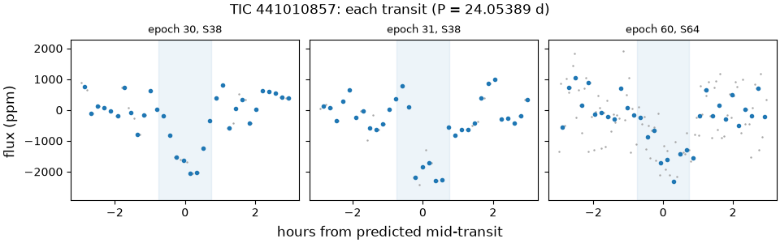
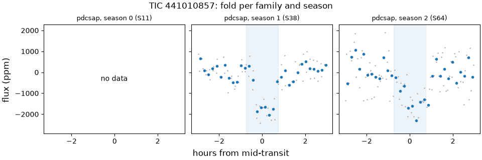
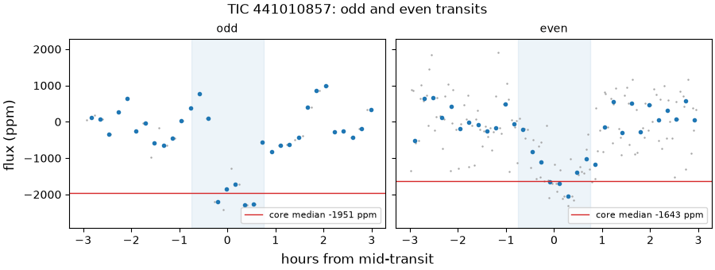
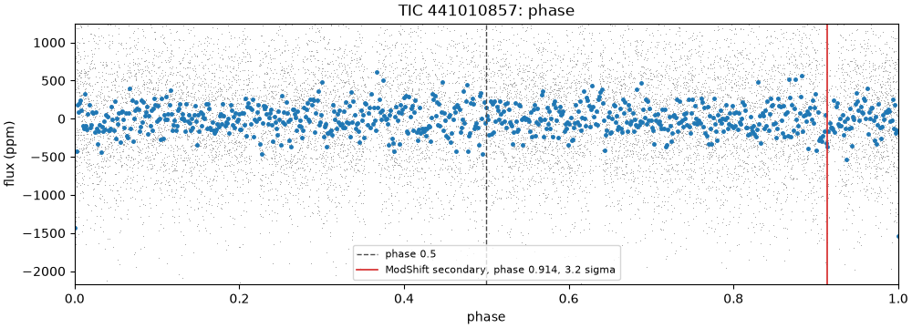
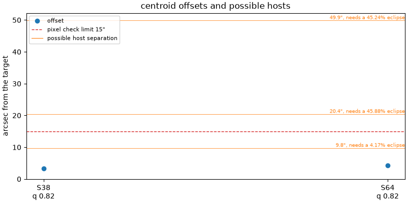

# 441010857-1: TIC 441010857

Call: **killed** on 2026-10-22. Rendered from the files in this directory ([decision 0028](../../../docs/decisions/0028-outcomes-and-calls.md)); the review and the call are quoted, not rendered ([decision 0037](../../../docs/decisions/0037-quoted-text-in-the-dossier.md)).

## Signal and star

|  |  |
|---|---|
| Signal | 441010857-1, a shortlisted candidate |
| Names | TIC 441010857, Gaia DR3 6122183689530591488, TYC 7288-1274-1, 2MASS J14020494-3444208 |
| Ephemeris (the search's box) | period 24.053890 d, epoch BTJD 1613.8350, duration 0.0625 d (1.50 h), depth 1376 ppm |
| Star (TIC) | Teff 6128 K, radius 1.51 solar radii, Tmag 9.82 |
| RUWE (Gaia DR3) | 1.13 |
| CROWDSAP | S11 0.959; S38 0.961; S64 0.959; none published for S102 (QLP) |
| Sectors vetted | PDCSAP family: 11, 38 and 64; left out as timing-suspect: 102 |
| Criteria | search-v2, vet-v3 |
| Runs | vetting 20261020T174317Z-vetting-run-61b5944-2d70 (commit 61b5944, production); TRICERATOPS 20261020T181658Z-vetting-triceratops-61b5944-1bbf (commit 61b5944, production); literature 20261021T001540Z-vetting-literature-61b5944-07de (commit 61b5944, production); evidence-only vetting 20261020T175536Z-vetting-run-61b5944-7f4e (commit 61b5944, production); titles 20261026T155726Z-vetting-titles-0b1deac-1d19 (commit 0b1deac, production) |

## Checks

vet-v3's checks first, then the neighbour table (evidence, never a fail), triage's pixel check, TRICERATOPS and the literature search.

| Check | Outcome | Reason |
|---|---|---|
| novelty | pass | no known object matches |
| odd_even | inconclusive | pdcsap: fewer than 5 in-transit cadences on odd or even transits |
| secondary | pass | no dip at phase 0.5 (-0.4 sigma) |
| sector_depth | pass | pdcsap: depths agree across 2 sectors (p = 0.25) |
| holdout | inconclusive | 0 season(s) could be tested; need 2 |
| signal_present | pass | combined depth is 13.4 sigma |
| shape | pass | U-shaped: grazing in 2% of samples |
| density | fail | transit implies 46.7 g/cm3, the TIC gives 0.475 (3.6 sigma) |
| radius | pass | 7.0 Earth radii |
| neighbours | pass | 3 of 16 neighbours could host the signal |
| pixels | pass | centroid offset 3.3" within 15" |
| triceratops | not run | TRICERATOPS run 20261020T181658Z-vetting-triceratops-61b5944-1bbf did not judge this signal. |
| literature | pass | complete: 0 hits to screen |

## On the star?

Centroids, from triage's pixel check (pass, centroid offset 3.3" within 15"): the difference-image centroid's offset from the target in each sector. Triage's pass rests on the best-quality sector's offset, S38's.

| Sector | Offset (arcsec) | Quality | Note |
|---|---|---|---|
| 38 | 3.3 | 0.82 | the offset triage judged |
| 64 | 4.3 | 0.82 |  |

Neighbours (pass): 3 of 16 neighbours could host the signal. Each Gaia DR3 star that could make the dip, with its separation from the target (Gaia DR3 6122183689530591488, J2016.0) and the eclipse depth it would need, scaled from the depth in the signals file (1376 ppm) as if all its light fell in the aperture:

| Star | Separation (arcsec) | Eclipse needed |
|---|---|---|
| Gaia DR3 6122183689530020736 | 9.8 | 4.17% |
| Gaia DR3 6122183689530020480 | 20.4 | 45.9% |
| Gaia DR3 6122183758249498240 | 49.9 | 45.2% |

TRICERATOPS: TRICERATOPS run 20261020T181658Z-vetting-triceratops-61b5944-1bbf did not judge this signal.

RUWE 1.13 (Gaia DR3). A high RUWE points to an unresolved companion, which TRICERATOPS's priors don't condition on; above vet-v3's limit, or without a RUWE, TRICERATOPS is inconclusive.

## A planet rather than a binary?

- Odd and even transits: inconclusive, pdcsap: fewer than 5 in-transit cadences on odd or even transits.
- Secondary at phase 0.5: pass, no dip at phase 0.5 (-0.4 sigma).
- Secondary at any phase (LEO-Vetter's ModShift, from triage): the strongest secondary is 3.16 sigma at phase 0.914, depth 304 ppm; primary 13.1 sigma, tertiary 2.83 sigma at phase 0.571, positive 4.49 sigma at phase 0.19; Fred 0.999.
- The search's other signals on the star: rank 2 at 2.0846 d (period ratio 0.0867, SDE 6.9).
- Shape (flat-prior fit): pass, U-shaped: grazing in 2% of samples; median b 0.68.
- Density (flat-prior fit): fail, transit implies 46.7 g/cm3, the TIC gives 0.475 (3.6 sigma).
- Radius: pass, 7.0 Earth radii. Rp is 6.96 Earth radii from the flat-prior fit and 61.61 (16th to 84th percentile 31.57 to 100.45) from the density-prior fit; the radius check reads the flat-prior fit.
- Density-prior fit (the TIC density as a prior), whose parameters M4 uses: Rp 61.61 Earth radii (16th to 84th percentile 31.57 to 100.45), b 1.34 (-0.19, +0.24), a/R* 31.38 (-2.13, +2.68), period 24.053967 d (sd 0.00017), t0 BTJD 1613.8391 (sd 0.0043 d).
- TRICERATOPS: TRICERATOPS run 20261020T181658Z-vetting-triceratops-61b5944-1bbf did not judge this signal.

## Real and new?

- Signal present: pass, combined depth is 13.4 sigma.
- Held-out seasons: inconclusive, 0 season(s) could be tested; need 2.
- Sector depths: pass, pdcsap: depths agree across 2 sectors (p = 0.25).
- Novelty, against the catalog snapshot: pass, no known object matches.
- Literature by name (TIC 441010857, Gaia DR3 6122183689530591488, TYC 7288-1274-1, 2MASS J14020494-3444208) and NASA ADS: pass, complete: 0 hits to screen. The hits are listed below.

ExoFOP, read live: TOIs none; CTOIs none; confirmed planets none.

## Next TESS looks

tess-point places the star in no upcoming sector.

2-min data and the DDT ask ([decision 0026](../../../docs/decisions/0026-triceratops.md)): which stars get 2-min data in a sector is decided per cycle, so tess-point can't say whether these sectors will have it. In the sectors fetched, the star never had SPOC 2-min data (QLP at 200 s; TESS-SPOC at 1800, 600 and 200 s). With no upcoming TESS look there is no DDT ask; M4 decides this signal's route.

## Plots

Each transit, against hours from its predicted mid-time:

The fold in each season and each product family:

Odd and even transits side by side:

The whole orbit, with phase 0.5 and LEO-Vetter's ModShift secondary marked:

Triage's centroid offset per sector, with the neighbours that could host the signal:

## Catalogued rows on the star

No catalogued row on this star.

## Literature hits

0 paper(s) from the searches that answered, one row per paper. Titles come only from open sources: the search's own arXiv, OpenAlex and Zenodo hits, else OpenAlex's record for the paper's DOI; a paper none of them titles has a blank title ([decision 0038](../../../docs/decisions/0038-literature-trim-and-username-scrub.md)).

## With the timing-suspect sectors (evidence only)

The same vet with the timing-suspect sectors kept in ([decision 0022](../../../docs/decisions/0022-vet-without-timing-suspect-sectors.md)). It is shown for comparison and never used for the call. Sectors it adds: 102.

| Check | Without them | With them | Reason with them |
|---|---|---|---|
| novelty | pass | pass | no known object matches |
| odd_even | inconclusive | inconclusive | pdcsap: fewer than 5 in-transit cadences on odd or even transits; qlp: fewer than 5 in-transit cadences on odd or even transits |
| secondary | pass | pass | no dip at phase 0.5 (-0.4 sigma) |
| sector_depth | pass | pass | pdcsap: depths agree across 2 sectors (p = 0.25) |
| holdout | inconclusive | inconclusive | 0 season(s) could be tested; need 2 |
| signal_present | pass | pass | combined depth is 13.4 sigma |
| shape | pass | pass | U-shaped: grazing in 2% of samples |
| density | fail | fail | transit implies 46.7 g/cm3, the TIC gives 0.475 (3.6 sigma) |
| radius | pass | pass | 7.0 Earth radii |

## Review

Quoted from `review.json`, as the reviewer and the refuters wrote it: its numbers, paths and run names are theirs, not rendered from the runs ([decision 0037](../../../docs/decisions/0037-quoted-text-in-the-dossier.md)). [The vetting README](../README.md) says what its paths and run names stand for.

Reviewer claude-opus-5-5, 2026-10-20, updated 2026-10-21. vet-v3 kills this signal on density; the first runs also failed it on holdout. That holdout fail was an artefact: S11's only transit sits in its mid-sector gap, so season 1 was predicted from one transit in S64, the case decision 0004's training-season guard exists to stop, and at the fitted ephemeris season 1 holds an 11.8 sigma transit. Decision 0035 fixed the check, and on the rerun holdout is inconclusive. The density fail stands: no bug, no artefact and no plausible error in the star's parameters, and the only way out for a planet on this star is an orbit with e of 0.53 or more transiting near periastron, which only radial velocities could show. Updated 2026-10-21 for the 0034/0035 rerun.

A finding rated kill or hold is confirmed when no refuter refuted it; a note gets no refuters.

### F1 (real and new, note)

Claim: On the first runs (vetting 20261020T010149Z-vetting-run-62882b5-c3ee and its evidence-only twin 20261020T011247Z-vetting-run-62882b5-d92b) this finding reported that the holdout kill was wrong, because S11 counted as a training season though its only transit falls in its data gap, so season 1 was predicted from S64's single transit and missed; decision 0035 fixed the check, and on the rerun holdout is inconclusive and kills nothing.

Evidence: Original claim: "The holdout kill is wrong: season 1's predicted transits came from a refit with one transit in it (S64's epoch 60), because S11 counts as a training season though its only transit (epoch 0, BTJD 1613.83) falls in its data gap, so the refit period was set by the BLS grid rather than by transits and put both S38 transits outside the measuring window." Both refuters reproduced it and neither refuted it. Decision 0035 (docs/decisions/0035-holdout-training-seasons.md) counts a training season only when its own cadences hold at least min_points cadences inside the transits predicted at the check's input ephemeris. Rerun vetting 20261020T174317Z-vetting-run-61b5944-2d70 (signals/441010857-1/checks.json, holdout): inconclusive, "0 season(s) could be tested; need 2". Season 0 (S11, BTJD 1601.391 to 1623.349) is no_predicted_transit_in_data with n 0 and training_seasons_with_transits 2. Seasons 1 and 2 are untestable, training_seasons 2 and training_seasons_with_transits 1, reason "1 of 2 training seasons hold a transit in their data, need 2: one season can't predict a season a year away"; season 1's missed refit (P 24.04896, t0 1614.1389, depth 342 ppm, n 8) is gone. Evidence-only rerun 20261020T175536Z-vetting-run-61b5944-7f4e: inconclusive with the same reason, seasons 1 and 2 untestable (1 of 3 training seasons hold a transit), seasons 0 and 3 (S102) no_predicted_transit_in_data. The dossier (drafts/m3-r2/441010857-1/dossier.md) shows holdout inconclusive in both vets. An inconclusive kills nothing (decision 0028); the density fail still kills the signal (F2).

### F2 (a planet, kill): confirmed

Claim: The density kill stands: the flat fit's 1.3 h transit is far too short for a circular-orbit transit of this 1.5 solar-radius F star, the check is if anything lenient, and eccentricity would need e of 0.53 or more with periastron near transit.

Evidence: Reproduced with `/tmp/t13/heavy.sh uv run python /tmp/t13/441010857-1/repro_density.py` (tension 3.577). Posterior (VET_RUN/signals/441010857-1/fit_samples.npz, 96000 samples): log10 rho percentiles 0.15/2.5/16/50 = 0.439/0.678/1.127/1.670; no sample below 0.0, none near the TIC's -0.323; 19.7% lie above 1.9 against the flat prior's bound of 2.0. The lower tail is lighter than the check's Gaussian (sd 0.54 dex), so 3.6 sigma understates the tension. Direct likelihood on the fit's 270 cadences (S38, S64; same script): best chi2 307.9 with density free (log rho 1.54, b 0.78, Rp/R* 0.043); 333.8 with log rho held at the TIC value and grazing allowed (b 1.2, Rp/R* 0.24; delta chi2 25.9, about 22 to 24 after the red-noise betas 1.077 and 1.037 in checks.json); 390.1 at the TIC density without grazing (delta 82). The density-prior fit (checks.json fit_prior) drifts 2.6 prior sigma off its prior (log rho 0.004 against -0.323 +- 0.127) and goes grazing (b 1.34, Rp 62 Earth radii). The star is not the problem: checks.json star gives TIC R 1.509, M 1.16, rho 0.338 solar (0.475 g/cm3), Gaia FLAME R 1.561, M 1.081 (0.400 g/cm3 from 1.081/1.561^3 x 1.408), GSP-Phot logg 3.96, RUWE 1.13; reaching even the posterior's 0.15th percentile needs 2.75 g/cm3, a K-dwarf density, against Teff 6128 K. Durations (a_rs_from_density, P 24.054109, Rp/R* 0.0423): the TIC density gives a/R* 24.4 and T14 7.85 h at b 0 or 5.95 h at b 0.68; the flat median gives a/R* 112.7 and T14 1.29 h at b 0.68. No artefact: the detrend window is 1.2 d (criteria/search-v2.toml), which cannot cut a 6 to 8 h transit down to the dip with flat wings seen in each of epochs 30, 31 and 60 (draft plots/transits.png), and the signal is 13.4 sigma. Eccentricity (0031's cause): rho_circ/rho_TIC is 5.8, 10.0 and 98 at the 0.15th, 2.5th and 50th percentiles, so e_min = (g^2 - 1)/(g^2 + 1) with g = (ratio)^(1/3) and omega 90 deg is 0.53, 0.65 and 0.91, well above WASP-8 b's 0.30 that 0031 accepted. Such warm, highly eccentric sub-Saturns are known but rare, and only radial velocities could show one here; under 0031 (no criteria change) the kill stands. If the host is a denser neighbour instead (the 9.8 arcsec Gaia DR3 6122183689530020736, BP-RP 1.64, needs a 4.17% eclipse), it is still not a planet on this star. Updated 2026-10-21 for the 0034/0035 rerun: the neighbour's separation, now measured from the target's Gaia DR3 position at J2016.0 (decision 0034; rerun checks.json neighbours centre "Gaia DR3 6122183689530591488, J2016.0"), 10.4 arcsec to 9.8 arcsec (sep_arcsec 10.391 to 9.773).

No refuter has answered yet.

Literature hits flagged for the maintainer to read: none.

## Call

Quoted from `call.toml`, the maintainer's words, not rendered from the runs ([decision 0037](../../../docs/decisions/0037-quoted-text-in-the-dossier.md)).

Outcome: **killed**, 2026-10-22.

Reasons: The transit is far too short for a planet on this star: on a circular orbit at this period a transit across a star this size lasts several times longer, so the fit implies a star far denser than this F star. A planet escapes only on a highly eccentric orbit seen near its closest approach, which only radial velocities could show; the dip may instead be on a denser neighbour. The held-out check's first-run fail was a defect that decision 0035 fixed; it is now inconclusive and plays no part in the kill.

Rests on: density, F2 (finding).

Criteria: vet-v3.
