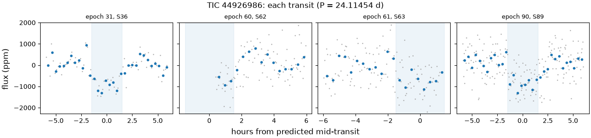
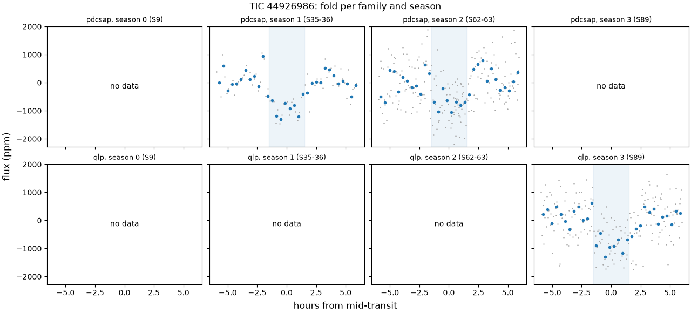
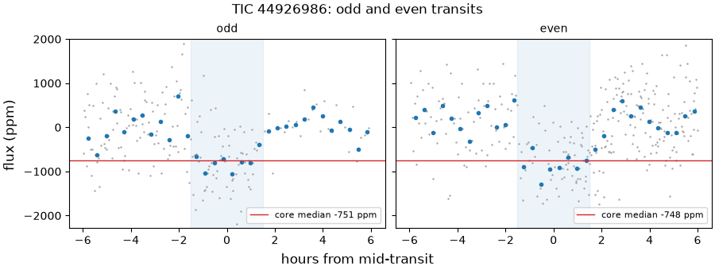
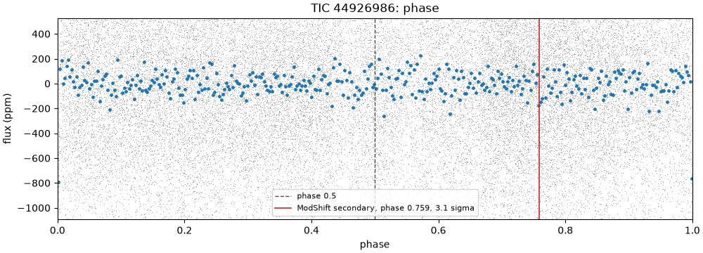
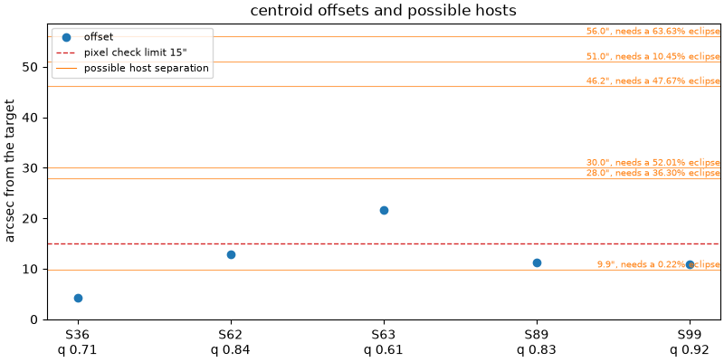

# 44926986-1: TIC 44926986

Call: **killed** on 2026-10-22. Rendered from the files in this directory (decision 0028).

## Signal and star

|  |  |
|---|---|
| Signal | 44926986-1, a shortlisted candidate |
| Names | TIC 44926986, Gaia DR3 5431607545961330560, TYC 7697-2351-1, 2MASS J09472454-3952469, WDS J09474-3953A |
| Ephemeris (the search's box) | period 24.114544 d, epoch BTJD 1556.3563, duration 0.1250 d (3.00 h), depth 776 ppm |
| Star (TIC) | Teff 5494 K, radius 1.14 solar radii, Tmag 9.49 |
| RUWE (Gaia DR3) | 0.85 |
| CROWDSAP | S9 0.730; S35 0.729; S36 0.731; S62 0.729; S63 0.735; none published for S89 (QLP), S99 (QLP) |
| Sectors vetted | PDCSAP family: 9, 35, 36, 62 and 63; QLP family: 89; left out as timing-suspect: 99 |
| Criteria | search-v2, vet-v3 |
| Runs | vetting 20261020T174317Z-vetting-run-61b5944-2d70 (commit 61b5944, production); TRICERATOPS 20261021T194348Z-vetting-triceratops-cd4e7a2-7821 (commit cd4e7a2, production); literature 20261021T001540Z-vetting-literature-61b5944-07de (commit 61b5944, production); evidence-only vetting 20261020T175536Z-vetting-run-61b5944-7f4e (commit 61b5944, production) |

## Checks

vet-v3's checks first, then the neighbour table (evidence, never a fail), triage's pixel check, TRICERATOPS and the literature search.

| Check | Outcome | Reason |
|---|---|---|
| novelty | fail | matches eumemic-allsky f1d17f0 44926986 |
| odd_even | pass | pdcsap: odd and even depths agree within 0.8 sigma |
| secondary | pass | no dip at phase 0.5 (-0.1 sigma) |
| sector_depth | pass | pdcsap: depths agree across 3 sectors (p = 0.47) |
| holdout | pass | 2 held-out seasons predicted |
| signal_present | pass | combined depth is 9.8 sigma |
| shape | pass | U-shaped: grazing in 0% of samples |
| density | pass | transit and TIC densities agree (1.1 sigma) |
| radius | pass | 3.4 Earth radii |
| neighbours | pass | 6 of 28 neighbours could host the signal |
| pixels | pass | centroid offset 10.9" within 15" |
| triceratops | fail | mean NFPP 0.167 > 0.1 over 10 run(s): likely a nearby false positive |
| literature | pass | complete: 6 hits to screen |

## On the star?

Centroids, from triage's pixel check (pass, centroid offset 10.9" within 15"): the difference-image centroid's offset from the target in each sector. Triage's pass rests on the best-quality sector's offset, S99's, from a timing-suspect sector that vet-v3 leaves out.

| Sector | Offset (arcsec) | Quality | Note |
|---|---|---|---|
| 36 | 4.2 | 0.71 |  |
| 62 | 12.8 | 0.84 |  |
| 63 | 21.6 | 0.61 |  |
| 89 | 11.2 | 0.83 |  |
| 99 | 10.9 | 0.92 | timing-suspect: vet-v3 leaves it out; the offset triage judged |

Neighbours (pass): 6 of 28 neighbours could host the signal. Each Gaia DR3 star that could make the dip, with its separation from the target (Gaia DR3 5431607545961330560, J2016.0) and the eclipse depth it would need, scaled from the depth in the signals file (776 ppm) as if all its light fell in the aperture, and the TRICERATOPS star matched to it with the distance between them at the TIC's epoch:

| Star | Separation (arcsec) | Eclipse needed | TRICERATOPS's star (distance) | Its depth |
|---|---|---|---|---|
| Gaia DR3 5431607545963652864 | 9.9 | 0.219% | TIC 44926982 (0.0") | 0.219% |
| Gaia DR3 5431607614680563456 | 28.0 | 36.3% | TIC 44926984 (0.0") | 39.8% |
| Gaia DR3 5431607614680566144 | 30.0 | 52% | TIC 44926993 (0.0") | 55.8% |
| Gaia DR3 5431607545961330176 | 46.2 | 47.7% | TIC 44926967 (0.0") | 96.5% |
| Gaia DR3 5431607507305797760 | 51.0 | 10.4% | TIC 44926962 (0.0") | 36.2% |
| Gaia DR3 5431607335504795136 | 56.0 | 63.6% | TIC 44926968 (0.0") | 0% |

TRICERATOPS (fail) took sectors 36, 62 and 63 at 600 s and folded them on the density-prior fit's ephemeris. It gave a mean NFPP 0.167 (sd 0.018) over 10 run(s) of 1000000 draws. Possible hosts it did not weigh: none. It gave zero depth to Gaia DR3 5431607335504795136 (TIC 44926968): its apertures take too little of that star's light to make the dip. Evidence for the review, not a blocker (decision 0026).

RUWE 0.85 (Gaia DR3). A high RUWE points to an unresolved companion, which TRICERATOPS's priors don't condition on; above vet-v3's limit, or without a RUWE, TRICERATOPS is inconclusive.

## A planet rather than a binary?

- Odd and even transits: pass, pdcsap: odd and even depths agree within 0.8 sigma.
- Secondary at phase 0.5: pass, no dip at phase 0.5 (-0.1 sigma).
- Secondary at any phase (LEO-Vetter's ModShift, from triage): the strongest secondary is 3.12 sigma at phase 0.759, depth 158 ppm; primary 15.2 sigma, tertiary 3.07 sigma at phase 0.513, positive 5.18 sigma at phase 0.533; Fred 1.12.
- The search's other signals on the star: rank 2 at 15.7952 d (period ratio 0.655, SDE 10.0).
- Shape (flat-prior fit): pass, U-shaped: grazing in 0% of samples; median b 0.53.
- Density (flat-prior fit): pass, transit and TIC densities agree (1.1 sigma).
- Radius: pass, 3.4 Earth radii. Rp is 3.44 Earth radii from the flat-prior fit and 3.82 (16th to 84th percentile 3.58 to 4.14) from the density-prior fit; the radius check reads the flat-prior fit.
- Density-prior fit (the TIC density as a prior), whose parameters M4 uses: Rp 3.82 Earth radii (16th to 84th percentile 3.58 to 4.14), b 0.84 (-0.05, +0.03), a/R* 30.63 (-2.08, +2.24), period 24.114783 d (sd 0.00027), t0 BTJD 1556.3465 (sd 0.014 d).
- TRICERATOPS (fail): mean FPP 0.204 (sd 0.02) over 10 run(s) of 1000000 draws.

## Real and new?

- Signal present: pass, combined depth is 9.8 sigma.
- Held-out seasons: pass, 2 held-out seasons predicted.
- Sector depths: pass, pdcsap: depths agree across 3 sectors (p = 0.47).
- Novelty, against the catalog snapshot: fail, matches eumemic-allsky f1d17f0 44926986.
- Literature by name (TIC 44926986, Gaia DR3 5431607545961330560, TYC 7697-2351-1, 2MASS J09472454-3952469, WDS J09474-3953A) and NASA ADS: pass, complete: 6 hits to screen. The hits are listed below.

ExoFOP, read live: TOIs none; CTOIs none; confirmed planets none.

## Next TESS looks

tess-point places the star in sectors 110, 111, 112 and 113.

Each transit predicted in those sectors, from the density-prior fit's posterior (epochs count periods from its t0); duration 0.1511 d from the density-prior fit:

| Sector | Epoch | Mid (BTJD) | Mid (UTC) | sd (min) | 1 sigma half-width (min) | 3 sigma half-width (min) |
|---|---|---|---|---|---|---|
| 110 | 116 | 4353.661 | 2026-11-09 03:50 | 26.4 | 26.4 | 79.3 |
| 111 | 117 | 4377.776 | 2026-12-03 06:36 | 26.8 | 26.8 | 80.5 |
| 112 | 118 | 4401.891 | 2026-12-27 09:21 | 27.2 | 27.2 | 81.6 |
| 113 | 119 | 4426.005 | 2027-01-20 12:06 | 27.6 | 27.6 | 82.7 |

2-min data and the DDT ask (M3 design, section 4.5): which stars get 2-min data in a sector is decided per cycle, so tess-point can't say whether these sectors will have it. In the sectors fetched, the star never had SPOC 2-min data (QLP at 600 and 200 s; TESS-SPOC at 1800, 600 and 200 s). Killed: no DDT ask.

## Plots

Each transit, against hours from its predicted mid-time:

The fold in each season and each product family:

Odd and even transits side by side:

The whole orbit, with phase 0.5 and LEO-Vetter's ModShift secondary marked:

Triage's centroid offset per sector, with the neighbours that could host the signal:

## Catalogued rows on the star

Every catalogued row on the star in the snapshot. vet-v3 masks only the kinds the search masks (decision 0021); the rest stay unmasked. A row overlaps a transit of ours, numbered by epoch from the signal's t0, when its mask window (2 of its durations, or of 0.25 d where the catalog gives none) meets it. 5 transits of ours have data.

| Source | Kind | Name | Period (d) | Masked | Transits of ours it overlaps |
|---|---|---|---|---|---|
| eumemic | community | eumemic-allsky f1d17f0 44926986 | 24.11463 | no, it is the signal | 5 of 5: 30, 31, 60, 61, 90 |

## Literature hits

6 paper(s) from the searches that answered, one row per paper.

| Title | Id | Found by |
|---|---|---|
| The GALAH+ survey: Third data release | doi 10.1093/mnras/stab1242, arXiv 2011.02505 | ads TIC 44926986 |
| The GALAH Survey: second data release | doi 10.1093/mnras/sty1281, arXiv 1804.06041 | ads TIC 44926986 |
| Improved Astrometry and Photometry for the Luyten Catalog. II. Faint Stars and the Revised Catalog | doi 10.1086/344822, arXiv astro-ph/0206318 | ads TIC 44926986 |
| Empirical photometric calibration of the Gaia red clump: Colours, effective temperature, and absolute magnitude | doi 10.1051/0004-6361/201731572, arXiv 1710.05803 | ads TIC 44926986 |
| A Possible Alignment Between the Orbits of Planetary Systems and their Visual Binary Companions | doi 10.3847/1538-3881/ac517f, arXiv 2202.00042 | ads TIC 44926986 |
|  | 1995yCat.1098....0L | ads TIC 44926986 |

## With the timing-suspect sectors (evidence only)

The same vet with the timing-suspect sectors kept in (decision 0022). It is shown for comparison and never used for the call. Sectors it adds: 99.

| Check | Without them | With them | Reason with them |
|---|---|---|---|
| novelty | fail | fail | matches eumemic-allsky f1d17f0 44926986 |
| odd_even | pass | pass | pdcsap: odd and even depths agree within 0.8 sigma |
| secondary | pass | pass | no dip at phase 0.5 (-0.4 sigma) |
| sector_depth | pass | pass | pdcsap: depths agree across 3 sectors (p = 0.47); qlp: depths agree across 2 sectors (p = 0.62) |
| holdout | pass | pass | 3 held-out seasons predicted |
| signal_present | pass | pass | combined depth is 10.6 sigma |
| shape | pass | pass | U-shaped: grazing in 0% of samples |
| density | pass | pass | transit and TIC densities agree (1.1 sigma) |
| radius | pass | pass | 3.4 Earth radii |

## Review

Reviewer claude-opus-5-5, 2026-10-20, updated 2026-10-21 and 2026-10-22. Short brief: novelty and TRICERATOPS killed this signal, and I tested whether either kill is wrong. Both stand: eumemic's public all-sky list (commit f1d17f0, 2026-10-16) holds this signal at the same period and epoch, and TRICERATOPS's NFPP stays above 0.1 in all ten runs, at every nearby ephemeris and in eumemic's own run, with no bug found. What TRICERATOPS can't exclude is a planet on the bound companion TIC 44926982 (9.86" away, same parallax, proper motion and RV), not an eclipsing binary, and the first runs' neighbour table put that companion at 12.5" because it measured from the target's J2000 position, which decision 0034 fixed. Updated 2026-10-21 for the 0034/0035 rerun. Updated 2026-10-22 for the 0036 TRICERATOPS rerun.

A finding rated kill or hold is confirmed when no refuter refuted it; a note gets no refuters.

### F1 (real and new, kill): confirmed

Claim: The novelty kill stands: eumemic's public all-sky candidate list holds this signal on this star, and the check matched it as decision 0013 says it should.

Evidence: checks.json (VET_RUN signals/44926986-1/checks.json, identical to ~/.cache/tess-hunt/drafts/m3/44926986-1/checks.json by cmp), novelty: category known, one match, kind community, 'eumemic-allsky f1d17f0 44926986', period 24.114628, ratio 1.0. The row: grep 44926986 $SNAP3/raw/eumemic/results_public_candidates_allsky.csv gives line 2969: P_d 24.114628, T0_BJD 2458556.348 (BTJD 1556.348), T14_h 2.91, depth_ppm 836, n_transits 6, tier 'likely nearby FP', search 'QLP re-search', NFPP 0.3023, cs_neighbour 44926982 at 9.9". Ours (checks.json ephemeris): P 24.114544, t0 BTJD 1556.3563, 3.00 h, 776 ppm; checks.json catalogued shows the row's mask on all 5 of our transits with data (30, 31, 60, 61, 90). Same signal. When it appeared: $SNAP3/manifest.json reads eumemic at commit f1d17f073842 (raw/eumemic_exoplanets/head.json committer date 2026-10-16T16:16:02Z); the 2026-10-13T163454Z snapshot (commit da72261) has 2427 lines in the same file and no 44926986 row (grep -c . and grep 44926986 on ~/.cache/tess-hunt/catalogs/2026-10-13T163454Z/raw/eumemic/results_public_candidates_allsky.csv). No eumemic-tce row on the star in either snapshot (zcat results_public_all_signals_tce.csv.gz | awk -F, '$25==44926986'). Rule: src/tess_hunt/sources.py normalise_eumemic gives allsky rows kind 'community' (only eumemic-tce rows are 'tce'); 0013: a match of any kind but tce fails novelty; criteria/vet-v3.toml [novelty] inconclusive_kinds = ['tce']. Not a bug or misread: eumemic's own tier ('likely nearby FP') doesn't make the signal unknown; it is a public, dated record of this signal on this star. tess-hunt has no earlier public claim: curl -s -o /dev/null -w '%{http_code}' https://api.github.com/repos/kevinlizarazo/tess-hunt gives 404 (not public). ExoFOP live: no TOI, CTOI or planet rows (~/.cache/tess-hunt/drafts/m3/44926986-1/literature.json search.exofop). 0031's causes don't apply to novelty.

No refuter has answered yet.

### F2 (on the star, kill): confirmed

Claim: The TRICERATOPS kill stands: no bug or misread found, and NFPP > 0.1 holds in every run, at every nearby ephemeris and in an independent run, but the scenario it can't exclude is a planet on the bound companion TIC 44926982, not an eclipsing binary.

Evidence: triceratops.json (TRIC3B_RUN signals/44926986-1/, identical to ~/.cache/tess-hunt/drafts/m3-r2/44926986-1/triceratops.json by cmp): outcome fail; nfpp per run 0.165, 0.179, 0.160, 0.183, 0.205, 0.167, 0.167, 0.146, 0.147, 0.155 (mean 0.167, sd 0.018), fpp mean 0.204; blockers [], missing_hosts [], degenerate all false, field_population true, ruwe 0.848 (< 1.4); sectors 36, 62, 63 at 600 s, 88 binned points. Which scenario: python3 /tmp/t13/44926986-1/probs_sum.py ~/.cache/tess-hunt/drafts/m3-r2/44926986-1/probs.csv (last run): TIC 44926982 NTP 0.15485, NEB 2.8e-22, NEBx2P 3.2e-05; NFPP 0.15489, equal to that run's nfpp 0.15489; target TP+PTP+DTP 0.8064. So NFPP is a planet on B (R_p 4.67 Earth radii in probs.csv), and TRICERATOPS puts about 0.81 on A. B is bound: Gaia DR3 query saved as /tmp/t13/44926986-1/gaia_pair.csv: A 5431607545961330560 parallax 8.935 +- 0.011 mas, pm (-163.63, -52.65) mas/yr, RV 91.85 +- 0.19 km/s; B 5431607545963652864 parallax 8.919 +- 0.014, pm (-165.81, -52.51), RV 92.19 +- 0.28. /tmp/t13/44926986-1/sep.py: 9.86" at PA 234 deg, about 1100 au projected. Christian et al. 2022 Table C1 lists the pair (TIC-1 44926986, TIC-2 44926982). Depth bookkeeping is right: TRICERATOPS's tdepth on B 0.2188% against the neighbour table's required 0.2187% (triceratops.json hosts); Tmag 9.4929 vs 10.6073 gives a flux ratio of 0.359, matching CROWDSAP 0.729 to 0.735. Ephemeris (0032's caveat): python3 /tmp/t13/44926986-1/ephem.py: at epochs 30, 31, 60 and 61 the search ephemeris sits +3.9 to -6.8 min from the density-prior fold, the flat fit within 0.8 min, eumemic's -4.5 to -11.4 min, against a 3.6 h duration and 10 min bins. eumemic's own TRICERATOPS on its ephemeris and data gives NFPP 0.3023 and NFPP_g 0.3306 (SNAP3 row in F1). The fail doesn't move. 0032's limit covers binaries 20" to 25" out; B is 9.86" out, inside 15", where 0032 says TRICERATOPS is what catches a blend the pixels miss. The pixels can't decide: triage's saved difference images refitted with /tmp/pixel-diag's sector_detail.py and two_star.py (copied to /tmp/t13/44926986-1, run through /tmp/t13/heavy.sh; /tmp/t13/44926986-1/detail.json, /tmp/t13/44926986-1/two_star.json, summary by /tmp/t13/44926986-1/summ.py). One transit per sector, expected 3x3 box SNR 1.1 to 1.9. Fits (east, north): S36 (-3.8, +1.9), S62 (-10.5, -7.4), S63 (+18.2, +11.7), S89 (-9.2, +6.4), S99 (-0.6, +10.9) arcsec; B sits at (-8.0, -5.8). Only S62 lands near B (3.0"). S99, the timing-suspect sector triage's pass rests on, lands 1.0" from TIC 872495558 (Tmag 19.89), which can't host the dip. Fixed two-PRF fit: target z 2.7, -0.2, 3.9, 0.1, 0.2; B z 0.2, 0.7, -8.9, 0.2, -0.0. No 0031 cause applies to TRICERATOPS. What would place the host: seeing-limited ground photometry that resolves the 9.9" pair on a predicted transit (about 0.22% on B, about 780 ppm on A). 2-min data would not, since they come from the same pixels. Updated 2026-10-21 for the 0034/0035 rerun: triceratops.json and probs.csv are cited from the rerun, TRIC2_RUN 20261020T181658Z-vetting-triceratops-61b5944-1bbf and drafts/m3-r2, in place of TRIC_RUN 20261020T013408Z-vetting-triceratops-62882b5-e092 and drafts/m3; in the last run, the NTP on TIC 44926982 0.15486 to 0.15487 and its NFPP and nfpp 0.15490 to 0.15491; mean NFPP 0.167384 to 0.167390 and mean FPP 0.203988 to 0.203988, the same at the precision quoted. Updated 2026-10-22 for the 0036 TRICERATOPS rerun: triceratops.json and probs.csv are cited from TRIC3B_RUN 20261021T194348Z-vetting-triceratops-cd4e7a2-7821 (identical by cmp to drafts/m3-r2) in place of TRIC2_RUN 20261020T181658Z-vetting-triceratops-61b5944-1bbf; its dropped_stars lists three DUPLICATE rows, TIC 872495677, 872495726 and 872493659 (of 44926991, 44927039 and 44926970, 112" to 190" out), which TRIC2_RUN gave tdepth 0 and no probs.csv rows, and the 6 hosts, their TICs and B's tdepth are unchanged; in the last run, the NTP on TIC 44926982 0.15487 to 0.15485, its NFPP and nfpp 0.15491 to 0.15489, and target TP+PTP+DTP 0.8065 to 0.8064; mean NFPP 0.167390 to 0.167389 and mean FPP 0.203988 to 0.204016 (1.4e-4 relative), within 0036 item 5's run-to-run noise and the same at the precision quoted.

No refuter has answered yet.

### F3 (on the star, note)

Claim: On the first runs (vetting 20261020T010149Z-vetting-run-62882b5-c3ee and its evidence-only twin 20261020T011247Z-vetting-run-62882b5-d92b) this finding reported that the neighbour table measured separations from the target's J2000 TIC position to Gaia DR3 positions at J2016, so the bound companion TIC 44926982 read 12.5" for a true 9.86"; decision 0034 fixed it, and the rerun's table measures from the target's own Gaia DR3 position at J2016.0.

Evidence: Original claim: "The neighbour table's separations mix epochs: it measures from the target's TIC position (J2000) to Gaia DR3 positions (J2016), so on this high-proper-motion star the companion reads 12.5" when the pair is 9.86" apart." It was a note, with no refuters. Decision 0034 (docs/decisions/0034-neighbour-table-epochs.md) cites this finding and centres the cone on the target's own Gaia DR3 row. Rerun vetting 20261020T174317Z-vetting-run-61b5944-2d70 (signals/44926986-1/checks.json, identical by cmp to ~/.cache/tess-hunt/drafts/m3-r2/44926986-1/checks.json): neighbours pass, centre "Gaia DR3 5431607545961330560, J2016.0", reason "6 of 28 neighbours could host the signal" (was "7 of 29"). neighbours.csv: Gaia DR3 5431607545963652864 (TIC 44926982) sep_arcsec 9.8586 (was 12.5039), the same as A to B from both DR3 positions in /tmp/t13/44926986-1/gaia_pair.csv (sep.py: 9.86" at PA 234.1 deg). The cone-edge case F3 warned of happened here: Gaia DR3 5431607644742487424 (possible, required depth 0.86, 59.04" from the TIC position) sits 61.50" from the target's DR3 position and leaves the 60" cone, so the possible hosts go from 7 to 6 and TRICERATOPS's hosts_tdepth_zero from [5431607335504795136, 5431607644742487424] (TRIC_RUN) to [5431607335504795136] (TRIC3B_RUN). The 28 stars in both tables move by up to 2.74" (Gaia DR3 5431607576022977792, 44.48" to 41.74"), and no star's possible flag flips. The dossier's possible-host table names its centre (Gaia DR3 5431607545961330560, J2016.0) and shows TIC 44926982 at 9.9"; 0026's Ruling S reads 9.86" (corrected in 0034); the Task 13 brief no longer gives 12.5". The controls F3 left unchecked: 0034 item 3 keeps the control vet's mixed-epoch tables with 0034 as their note, and item 5 shows 0025, 0026 and 0032's 20.90" and 23.53" came from the network test, not this table, and hold within 0.05". No check outcome changed. Updated 2026-10-22 for the 0036 TRICERATOPS rerun: hosts_tdepth_zero is cited from TRIC3B_RUN 20261021T194348Z-vetting-triceratops-cd4e7a2-7821 in place of TRIC2_RUN 20261020T181658Z-vetting-triceratops-61b5944-1bbf; its value, [5431607335504795136], and the 6 hosts are the same in both.

### F4 (real and new, note)

Claim: Three literature hits name the star as a member of a binary (Christian et al. 2022, Salim and Gould 2003, Luyten's NLTT); none names it as a planet host, eclipsing binary or variable, or reports a period.

Evidence: VizieR, scripts in /tmp/t13/44926986-1: vz2.py finds J/AJ/163/207/tablec1 ('Control sample', binaries without known planets) row 29: EDR3-1 5431607545961330560, EDR3-2 5431607545963652864, TIC-1 44926986, TIC-2 44926982, MajAxis 1039 au, e 0.49. vz3.py finds J/ApJ/582/1011/table2: NLTT 22614, BInd 1, BinN 22613, SepN 9.0, PAN 231. vz5.py finds I/98A/remarks: 'L 462-147: Comp. to 146, 231d, 9"'. Dismissed: GALAH DR3 (vz6.py, J/MNRAS/506/150: Flagsp 0) and GALAH DR2 (flag_cannon 0), survey catalogues; Ruiz-Dern et al. 2018, whose title doesn't explain a dwarf in a red-clump paper: it lists the star (Gaia DR1 5431607541661699840) only in its low-extinction TGAS calibration table 'lowetgas', a calibration sample, not a classification.

Literature hits flagged for the maintainer to read: doi 10.3847/1538-3881/ac517f, arXiv 2202.00042, doi 10.1086/344822, arXiv astro-ph/0206318, 1995yCat.1098....0L.

## Call

Outcome: **killed**, 2026-10-22.

Reasons: Not new: eumemic's public all-sky candidate list holds this signal at the same period and epoch, added before tess-hunt made any public claim. TRICERATOPS also fails it, on a planet on the bound companion TIC 44926982, which TESS's pixels can't separate from the target.

Rests on: novelty, triceratops, F1 (finding), F2 (finding).

Criteria: vet-v3.
