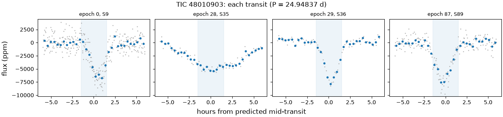
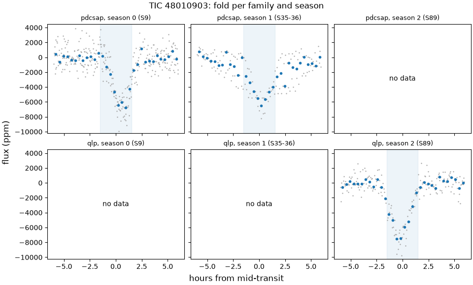
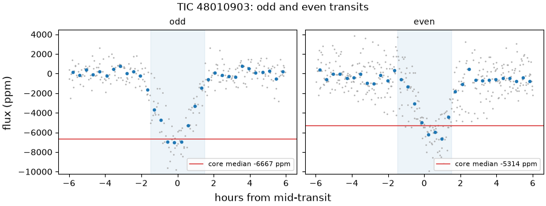
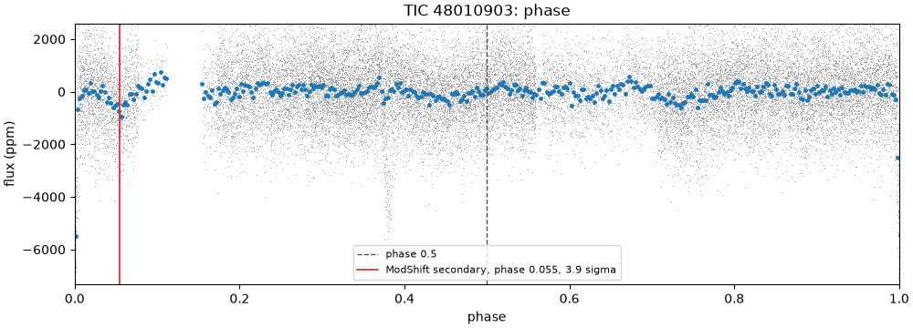
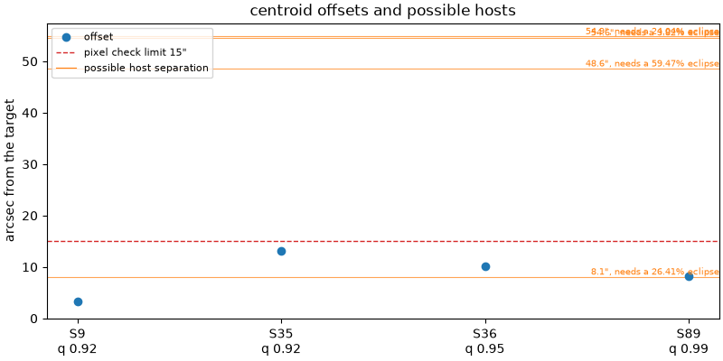

# 48010903-1: TIC 48010903

Call: **killed** on 2026-10-22. Rendered from the files in this directory (decision 0028).

## Signal and star

|  |  |
|---|---|
| Signal | 48010903-1, a shortlisted candidate |
| Names | TIC 48010903, Gaia DR3 5438970459935585280, TYC 7172-1385-1, 2MASS J09481185-3258351 |
| Ephemeris (the search's box) | period 24.948370 d, epoch BTJD 1566.0526, duration 0.1250 d (3.00 h), depth 4575 ppm |
| Star (TIC) | Teff 5751 K, radius 1.33 solar radii, Tmag 10.36 |
| RUWE (Gaia DR3) | 1.02 |
| CROWDSAP | S9 0.959; S35 0.926; S36 0.957; none published for S89 (QLP), S99 (QLP) |
| Sectors vetted | PDCSAP family: 9, 35 and 36; QLP family: 89; left out as timing-suspect: 99 |
| Criteria | search-v2, vet-v3 |
| Runs | vetting 20261020T174317Z-vetting-run-61b5944-2d70 (commit 61b5944, production); TRICERATOPS 20261020T181658Z-vetting-triceratops-61b5944-1bbf (commit 61b5944, production); literature 20261021T001540Z-vetting-literature-61b5944-07de (commit 61b5944, production); evidence-only vetting 20261020T175536Z-vetting-run-61b5944-7f4e (commit 61b5944, production) |

## Checks

vet-v3's checks first, then the neighbour table (evidence, never a fail), triage's pixel check, TRICERATOPS and the literature search.

| Check | Outcome | Reason |
|---|---|---|
| novelty | pass | no known object matches |
| odd_even | pass | pdcsap: odd and even depths agree within 1.9 sigma |
| secondary | pass | no dip at phase 0.5 (-0.1 sigma) |
| sector_depth | pass | pdcsap: depths agree across 3 sectors (p = 0.13) |
| holdout | pass | 2 held-out seasons predicted |
| signal_present | pass | combined depth is 27.6 sigma |
| shape | fail | V-shaped: grazing in 68% of samples |
| density | pass | transit and TIC densities agree (0.1 sigma) |
| radius | fail | 23.2 Earth radii, above 22 |
| neighbours | pass | 4 of 26 neighbours could host the signal |
| pixels | pass | centroid offset 8.3" within 15" |
| triceratops | not run | TRICERATOPS run 20261020T181658Z-vetting-triceratops-61b5944-1bbf did not judge this signal. |
| literature | pass | complete: 2 hits to screen |

## On the star?

Centroids, from triage's pixel check (pass, centroid offset 8.3" within 15"): the difference-image centroid's offset from the target in each sector. Triage's pass rests on the best-quality sector's offset, S89's.

| Sector | Offset (arcsec) | Quality | Note |
|---|---|---|---|
| 9 | 3.3 | 0.92 |  |
| 35 | 13.2 | 0.92 |  |
| 36 | 10.2 | 0.95 |  |
| 89 | 8.3 | 0.99 | the offset triage judged |

Neighbours (pass): 4 of 26 neighbours could host the signal. Each Gaia DR3 star that could make the dip, with its separation from the target (Gaia DR3 5438970459935585280, J2016.0) and the eclipse depth it would need, scaled from the depth in the signals file (4575 ppm) as if all its light fell in the aperture:

| Star | Separation (arcsec) | Eclipse needed |
|---|---|---|
| Gaia DR3 5438970459935584640 | 8.1 | 26.4% |
| Gaia DR3 5438970494295320320 | 48.6 | 59.5% |
| Gaia DR3 5438970391216107264 | 54.6 | 3.82% |
| Gaia DR3 5438971250209564672 | 54.9 | 24% |

TRICERATOPS: TRICERATOPS run 20261020T181658Z-vetting-triceratops-61b5944-1bbf did not judge this signal.

RUWE 1.02 (Gaia DR3). A high RUWE points to an unresolved companion, which TRICERATOPS's priors don't condition on; above vet-v3's limit, or without a RUWE, TRICERATOPS is inconclusive.

## A planet rather than a binary?

- Odd and even transits: pass, pdcsap: odd and even depths agree within 1.9 sigma.
- Secondary at phase 0.5: pass, no dip at phase 0.5 (-0.1 sigma).
- Secondary at any phase (LEO-Vetter's ModShift, from triage): the strongest secondary is 3.92 sigma at phase 0.0545, depth 689 ppm; primary 27.5 sigma, tertiary 3.17 sigma at phase 0.756, positive 3.15 sigma at phase 0.655; Fred 2.
- The search's other signals on the star: rank 2 at 34.4521 d (period ratio 1.38, SDE 25.2); rank 3 at 15.0149 d (period ratio 0.602, SDE 9.0).
- Shape (flat-prior fit): fail, V-shaped: grazing in 68% of samples; median b 0.97.
- Density (flat-prior fit): pass, transit and TIC densities agree (0.1 sigma).
- Radius: fail, 23.2 Earth radii, above 22. Rp is 23.22 Earth radii from the flat-prior fit and 72.13 (16th to 84th percentile 30.35 to 115.73) from the density-prior fit; the radius check reads the flat-prior fit.
- Density-prior fit (the TIC density as a prior), whose parameters M4 uses: Rp 72.13 Earth radii (16th to 84th percentile 30.35 to 115.73), b 1.34 (-0.32, +0.31), a/R* 25.75 (-1.11, +1.43), period 24.947948 d (sd 7.5e-05), t0 BTJD 1566.0775 (sd 0.0016 d).
- TRICERATOPS: TRICERATOPS run 20261020T181658Z-vetting-triceratops-61b5944-1bbf did not judge this signal.

## Real and new?

- Signal present: pass, combined depth is 27.6 sigma.
- Held-out seasons: pass, 2 held-out seasons predicted.
- Sector depths: pass, pdcsap: depths agree across 3 sectors (p = 0.13).
- Novelty, against the catalog snapshot: pass, no known object matches.
- Literature by name (TIC 48010903, Gaia DR3 5438970459935585280, TYC 7172-1385-1, 2MASS J09481185-3258351) and NASA ADS: pass, complete: 2 hits to screen. The hits are listed below.

ExoFOP, read live: TOIs none; CTOIs none; confirmed planets none.

## Next TESS looks

tess-point places the star in sectors 110, 111, 112 and 113.

Each transit predicted in those sectors, from the density-prior fit's posterior (epochs count periods from its t0); duration 0.2072 d from the density-prior fit:

| Sector | Epoch | Mid (BTJD) | Mid (UTC) | sd (min) | 1 sigma half-width (min) | 3 sigma half-width (min) |
|---|---|---|---|---|---|---|
| 110 | 112 | 4360.248 | 2026-11-15 17:55 | 10.7 | 10.7 | 32.0 |
| 111 | 113 | 4385.196 | 2026-12-10 16:40 | 10.8 | 10.8 | 32.3 |
| 112 | 114 | 4410.144 | 2027-01-04 15:25 | 10.9 | 10.9 | 32.6 |
| 113 | 115 | 4435.092 | 2027-01-29 14:10 | 11.0 | 11.0 | 33.0 |

2-min data and the DDT ask (M3 design, section 4.5): which stars get 2-min data in a sector is decided per cycle, so tess-point can't say whether these sectors will have it. In the sectors fetched, the star had SPOC 2-min data in sectors 9. Killed: no DDT ask.

## Plots

Each transit, against hours from its predicted mid-time:

The fold in each season and each product family:

Odd and even transits side by side:

The whole orbit, with phase 0.5 and LEO-Vetter's ModShift secondary marked:

Triage's centroid offset per sector, with the neighbours that could host the signal:

## Catalogued rows on the star

Every catalogued row on the star in the snapshot. vet-v3 masks only the kinds the search masks (decision 0021); the rest stay unmasked. A row overlaps a transit of ours, numbered by epoch from the signal's t0, when its mask window (2 of its durations, or of 0.25 d where the catalog gives none) meets it. 4 transits of ours have data.

| Source | Kind | Name | Period (d) | Masked | Transits of ours it overlaps |
|---|---|---|---|---|---|
| ExoMiner-v2 | tce | ExoMiner vetting_catalog_FFI 48010903-1-S36 | 9.50241 | no | 1 of 4: 29 |

## Literature hits

2 paper(s) from the searches that answered, one row per paper.

| Title | Id | Found by |
|---|---|---|
| GaiaData Release 3 | doi 10.1051/0004-6361/202243782, arXiv 2206.05595 | ads TIC 48010903 |
| GaiaData Release 3 | doi 10.1051/0004-6361/202244178, arXiv 2206.05500 | ads TIC 48010903 |

## With the timing-suspect sectors (evidence only)

The same vet with the timing-suspect sectors kept in (decision 0022). It is shown for comparison and never used for the call. Sectors it adds: 99.

| Check | Without them | With them | Reason with them |
|---|---|---|---|
| novelty | pass | pass | no known object matches |
| odd_even | pass | pass | pdcsap: odd and even depths agree within 1.9 sigma |
| secondary | pass | pass | no dip at phase 0.5 (-0.7 sigma) |
| sector_depth | pass | pass | pdcsap: depths agree across 3 sectors (p = 0.13) |
| holdout | pass | pass | 2 held-out seasons predicted |
| signal_present | pass | pass | combined depth is 27.6 sigma |
| shape | fail | fail | V-shaped: grazing in 68% of samples |
| density | pass | pass | transit and TIC densities agree (0.1 sigma) |
| radius | fail | fail | 23.2 Earth radii, above 22 |

## Review

Reviewer claude-opus-5-5, 2026-10-20. I tested both kills by rerunning vet-v3's own fit (same code, criteria and seed) on subsets of the eclipses. The search's 24.948 d period is an alias. The real period is 34.452 d, and the vet's epoch 28 (S35) is a different, broad eclipse. Without it the shape fail is marginal (18 to 62% grazing) and the radius fail is gone (10 to 19 Earth radii). The signal is still dead: the broad eclipses are its secondary at phase 0.276, about 5900 ppm deep, so this is an eccentric eclipsing binary of stars. Gaia DR3 also lists the target as an 11.64 d SB2.

A finding rated kill or hold is confirmed when no refuter refuted it; a note gets no refuters.

### F1 (a planet, kill): confirmed

Claim: The shape kill stands, but only weakly: its 68% grazing includes epoch 28, which is not this signal's eclipse, and on the sharp eclipses alone vet-v3's fit is above 50% grazing in 3 of 4 runs (18 to 62%), so the signal's kill rests on F3, not on this check.

Evidence: Scripts and logs in /tmp/t13/48010903-1/, run as: MSYS_NO_PATHCONV=1 wsl.exe -d Ubuntu-26.04 --cd ~/code/tess-hunt -- bash -l -c '/tmp/t13/heavy.sh uv run --project ~/code/tess-hunt python /tmp/t13/48010903-1/<script>.py'. Each refit uses tess_hunt.fit.fit_transit with criteria/vet-v3.toml [fit] on the vet's detrend (search-v2 [detrend], S99 dropped as vet-v3 does), PDCSAP family only. (1) Reproduction, refit.py case a (S9, S35, S36, search ephemeris, seed 1): grazing 0.675, b 0.972, rp_rs 0.1606, the same as checks.json; seeds 2 and 3 give 0.769 and 0.767 (refit2.log). (2) Epoch 28 (BTJD 2264.620, S35) is a broad eclipse: the vet's detrended flux in 1-hour bins runs from -1621 to -4859 ppm between -5 h and +5 h with no sharp core (explore.py output, events.png), where epochs 0, 29 and 87 are about 3 h wide. F3 shows it is the binary's secondary. (3) Without epoch 28 (cadences within 1 d of 2264.620 removed): at 34.452 d, seed 1 grazing 0.180, b 0.536 (refit.log case c); seeds 2 and 3 give 0.517 and 0.567; at the vet's 24.948 d, seed 1 gives 0.615 (refit2.log). Single eclipses: S9 0.549, S36 0.412, S89 QLP alone 0.0007 (refit.log cases d, e, f). In every run b piles up between 0.8 and 1.0 (b_hist in refit2.log), so this signal sits near the 0.5 line and the outcome moves with the seed at 32 walkers by 5000 steps. None of 0031's causes rescues a planet here, because F3's 5900 ppm secondary rules one out.

No refuter has answered yet.

### F2 (a planet, hold): refuted

Claim: The radius kill comes from the alias fold: without epoch 28 every rerun gives under 22 Earth radii, so this check's fail does not stand on its own (the signal stays killed by F3; the hold is about the check, for the decision record the brief asks for).

Evidence: (1) The vet's own posterior (radius_sens.py on $VET_RUN/signals/48010903-1/fit_samples.npz, radius_sens.log): median Rp 23.22 Earth radii, P(Rp > 22) 0.533. The 32.5% of samples that are not grazing give 8.1, 8.8 and 10.8 (16th, 50th, 84th percentiles) and none above 22, so the fail is the median of the grazing mode, where Rp/R* is unconstrained, not a measured size. (2) With epoch 28 (search ephemeris, seeds 1 to 3): 23.2, 30.9, 34.1. Without it: 10.3 (16th to 84th 9.0 to 16.2), 16.0 and 17.3 at 34.452 d, and 18.8 at the vet's 24.948 d; P(Rp > 22) 0.02 to 0.41 (refit.log case c, refit2.log). The best-constrained single eclipse, S89 in QLP, gives 9.7 (9.1 to 11.4). (3) Star radius and dilution, the controller's leads (radius_sens.log): the TIC radius is 1.325 +/- 0.064 Rsun (checks.json star.rad, e_rad); at -1 sd the vet's median gives 22.10; FLAME's 1.364 gives 23.89. Undoing CROWDSAP (S35 0.926, S9 0.959) gives 22.35 to 22.74, and 21.27 to 21.65 with the TIC radius at -1 sd. The fit is PDCSAP only, so QLP dilution never reaches it. Decision 0018 already names the median-without-errors limitation. (4) F4's near-equal SB2 makes the TIC radius a single-star value, but for two stars of equal Teff the dilution and the smaller host cancel in Rp = (Rp/R*) x R_TIC, so it does not move this check to first order. What decides it: nothing new is needed from the sky; a rerun of the check on the sharp eclipses at 34.452 d settles the check, and F3 settles the signal.

- Refuter 1: refuted. Every number F2 cites reproduces, but the claim it carries does not. The claim is that without epoch 28 every rerun gives under 22 Earth radii, so the fail comes from the alias fold. More seeds of the same fit break that.

What reproduces (scratch in /tmp/t13/48010903-1/refute-F2-reproduce/; scripts are the reviewer's, copied with only the samples output path changed; each run as /tmp/t13/heavy.sh uv run --project ~/code/tess-hunt python $O/<script>.py, exit 0):
- radius_sens.py on $VET_RUN/signals/48010903-1/fit_samples.npz (radius_sens.log): median 23.22, P(Rp>22) 0.533, non-grazing 0.325 with 8.1/8.8/10.8, TIC -1 sd 22.10, FLAME 23.89, CROWDSAP 22.35/21.27 and 22.74/21.65.
- refit.log cases a to g and refit2.log: identical to the reviewer's, line for line. Case a matches checks.json: radius 23.2, rp_rs median 0.1606.
- Also confirmed: vet.py fits PDCSAP only ([families] fit = "pdcsap"); decision 0018 line 27 names the median-without-errors limitation; the radius check is median(rp_rs) x 1.32527 x 109.076 (physical.py 86-97).

What breaks the claim (seeds.py, seeds.log). This uses vet-v3's own configuration: fit_transit, criteria/vet-v3.toml [fit], the PDCSAP family, cadences within 1 d of E28 = 2264.620 removed. Seeds 4 to 8 give:
- Without epoch 28 at 34.452 d: seed 5 fails at 46.5 (P>22 0.818) and seed 6 fails at 24.0 (0.559). Seeds 4, 7 and 8 pass (14.2, 14.5, 12.2).
- Without epoch 28 at 24.948 d: seed 7 fails at 35.5 (0.785). Seeds 4, 5, 6 and 8 pass.
- With epoch 28 at 24.948 d: seeds 4 and 8 pass (18.7, 20.5). Seeds 5, 6 and 7 fail.
- The reviewer's own refit.log case g already failed at 31.1 (P>22 0.746). That run is "g_S9_S36_S89_sharp_events_P34.452", sharp eclipses only with no epoch 28, though it fits both families. The evidence leaves it out.

Across seeds 1 to 8, the PDCSAP-only reruns without epoch 28 fail the radius check in 3 of 14. With epoch 28 they fail in 6 of 8. Epoch 28 raises the fail rate but does not decide the outcome. The seed decides it: each run lands in either the grazing mode (Rp/R* unconstrained, median over 22) or the non-grazing mode. That matches F2's own point (1), but not its headline or its decider. Its proposed decider, "a rerun of the check on the sharp eclipses at 34.452 d settles the check", gives a pass or a fail depending on the seed (seeds 5 and 6 fail).

The check's fail at the vet's seed 1 stands as the check defines it. The finding's reason for doubting it, the alias fold, does not hold.
- Refuter 2: refuted. The finding overstates its evidence, and a hold does not fit the brief here: the radius kill stands under the rules.

1) Its central claim is contradicted by the reviewer's own log. F2 says "without epoch 28 every rerun gives under 22 Earth radii" and cites only "refit.log case c, refit2.log". I ran `cat /tmp/t13/48010903-1/refit.log`. Case g_S9_S36_S89_sharp_events_P34.452 is built in refit.py as cat(no28, qlp) at 29x24.94796/21 d. That is without epoch 28, on exactly "the sharp eclipses at 34.452 d" that F2 says settle the check, and at vet-v3's [fit] seed 1. The check's own `radius()` returns "31.1 Earth radii, above 22", with P(Rp>22) 0.746 and grazing 0.856. Refuter 1's independent rerun (/tmp/t13/48010903-1/refute-F2-reproduce/refit.log) gives the same 31.1. refit2.log gives the same data 16.9 and 20.9 on seeds 2 and 3.

Case g adds S89 QLP, which the vet's fit leaves out (vet-v3.toml [families] fit = "pdcsap", decision 0023). But F2 itself uses QLP-only S89 (9.7) as its best evidence and leaves out the QLP-including run that fails. On the PDCSAP-only reruns (10.3, 16.0, 17.3, 18.8), P(Rp>22) reaches 0.36 to 0.41. At the true period the outcome moves with family and seed. It is not "under 22 in every rerun", and the deciding rerun F2 names has already been run once with a fail.

2) The other reasons are limitations the rules already accept, not a bug or a misread:
- "Median of the grazing mode, not a measured size": M3 design 4.2, /c/code/docs/tess-hunt-m3-design.md line 200, keeps shape and radius on the flat-prior fit knowing it "can make a low-SNR planet read grazing ... or larger", and leaves the known-set controls to measure the cost. results/benchmarks/20261020T082333Z-benchmark-controls-16418d2-f45a/pass_rates.csv shows radius passing 20 of 20 known planets (19 of 19 without the left-out control).
- The TIC radius sd and CROWDSAP arguments: decision 0018, Limitations, which F2 itself cites.
- No bug: 0.16064 x 1.32527 x 109.076 = 23.22, matching checks.json and src/tess_hunt/checks/physical.py radius() lines 86 to 97.
- F2 invokes none of 0031's causes.

3) The kill stands on the rules' own terms. 0018's Context says the radius check exists because "nothing else caught a stellar companion". F3, from the same reviewer, shows the eclipsing body is a star, and F2 says "the signal stays killed by F3". The broad eclipse at epoch 28 is the binary's own eclipse at the vetted period. It is not an instrumental artefact (the brief's artefacts are momentum dumps, scattered light and sector edges).

4) The rating fits neither definition.
- The short brief (line 116) and M3 design 4.8 (line 317) use a hold for a kill that "looks wrong". This kill does not.
- The brief's general hold (line 102), and "held" in design 4.9 and decision 0028, need public data that "can't decide" and a named decider: 2-min data, imaging, ground photometry or a QLP redelivery. F2 says "nothing new is needed from the sky" and names a rerun as the decider. The brief (line 6) and design 4.8 (line 316) rule that out: "never a quiet rerun".

At most this is a note on the check's fragility for a decision record.

### F3 (a planet, kill): confirmed

Claim: This is an eccentric eclipsing binary: the sharp eclipse repeats every 34.452 d, not 24.948 d, and the search's rank-2 signal is its secondary eclipse at phase 0.276, about 5900 ppm deep and four times as long, which no planet can make.

Evidence: events_fit.py (a trapezoid with a local linear baseline, fitted to raw normalized flux within 1 d of each eclipse; events_fit.log). The sharp eclipse is at BTJD 1566.0770 (S9), 2289.5684 (S36), 3736.5502 (S89) and 4046.6169 (S99: timing-suspect, so evidence only, and at the sector's start, so the detrend's edge cut hides it). Each sits at phase 0.0000 of P = 34.45196 +/- 0.00003 d, a line through the single-eclipse fits with residuals under 1 min (refit.log cases d, e, f). Depths are 7034 to 7879 ppm and T14 3.07 to 3.84 h. The 24.948 d period predicts no eclipse in S99 (its nearest falls at 4060.87, in S99's gap). It does predict a sharp one at 2264.620 in S35, and none is there (F1, point 2). aliases.py: the three non-suspect sharp eclipses fix P = 723.491 d / n for a whole number n; the covered times with no dip and the S99 eclipse (2480.540 d = 24/7 of 723.491 d after the first) leave n = 7, 14 or 21, and n = 21 gives 34.4519 d. The broad eclipse is at 2264.6338 (S35), 2299.0677 (S36) and 3746.0588 (S89), phases 0.2763, 0.2757 and 0.2760, depth 5643 to 6063 ppm, T14 13.5 to 14.9 h. Its own period is 34.45194 +/- 0.00011 d, against 34.45196 for the sharp one. It is the search's rank-2 signal (checks.json other_signals: 34.45207 d, SDE 25.2; period ratio 1.381 = 29/21, which novelty's harmonics [1, 0.5, 2, 1/3, 3] don't list). The vet's epoch 28 lands 20 min from its S35 eclipse, because 28 x 21/29 = 20.276. That is why the alias outscored the true period in the search: three sharp eclipses plus one broad one, against three. Two eclipses on one period, away from phase 0.5 and with mean durations of 3.4 h and 14.3 h, mean an eccentric orbit (first-order e cos w about -0.35, e sin w about 0.6). A 5900 ppm secondary is about 390 times decision 0031's occultation bound for every shortlisted signal (15.2 ppm at albedo 1.0), so the companion is self-luminous: a star. Neither of 0031's causes (the planet's own occultation, an eccentric planet) can produce it. The checks missed it for these reasons: vet-v3's secondary looks only at phase 0.5; triage's ModShift ran at the alias period; and odd_even and sector_depth compare core depths, where the broad eclipse's S35 core (5141 +/- 347 ppm in checks.json sector_depth) matches the sharp ones. Wherever the binary sits (the target or a neighbour), the dip is not a planet transiting TIC 48010903. The dossier's next-look windows for S110 to S113 use the alias period.

No refuter has answered yet.

### F4 (on the star, note)

Claim: Gaia DR3 lists the target as a double-lined spectroscopic binary of near-equal stars with an 11.641 d period, and SIMBAD types it SB*; both ADS hits are the Gaia DR3 papers whose catalogues carry it, as a binary and as a rotational variable.

Evidence: Gaia archive TAP, read only (curl -s https://gea.esac.esa.int/tap-server/tap/sync --data-urlencode REQUEST=doQuery --data-urlencode LANG=ADQL --data-urlencode FORMAT=csv --data-urlencode QUERY=...). SELECT period,period_error,eccentricity,arg_periastron,semi_amplitude_primary,semi_amplitude_secondary,significance FROM gaiadr3.nss_two_body_orbit WHERE source_id=5438970459935585280 gives SB2, P 11.641079 +/- 0.000507 d, e 0.429, w 281.3 deg, K1 63.04 km/s, K2 64.98 km/s, significance 85.3. gaiadr3.gaia_source gives non_single_star 2, phot_variable_flag VARIABLE, RUWE 1.019. gaiadr3.vari_rotation_modulation gives best_rotation_period 6.82 +/- 0.18 d. gaiadr3.vari_eclipsing_binary has no row. SIMBAD TAP (https://simbad.cds.unistra.fr/simbad/sim-tap/sync, SELECT b.main_id,b.otype,b.nbref FROM basic b JOIN ident i ON i.oidref=b.oid WHERE i.id='TIC 48010903') gives TYC 7172-1385-1, otype SB*, 2 references. ADS found both hits through that SIMBAD object (literature.json query: simbid 1665159). K2/K1 near 1 means two stars of similar mass and light, so the TIC's single-star radius (1.33 Rsun) and density don't describe either one. 34.452 / 11.641 = 2.96, so the SB2 pair is not F3's eclipsing pair. That pair is a further pair in the system or a blend, which leaves F3's call unchanged.

Literature hits flagged for the maintainer to read: doi 10.1051/0004-6361/202243782, arXiv 2206.05595, doi 10.1051/0004-6361/202244178, arXiv 2206.05500.

## Call

Outcome: **killed**, 2026-10-22.

Reasons: An eccentric eclipsing binary of stars, not a planet: the real period is longer than the search's, and the search's second signal on the star is the binary's secondary eclipse, too deep and too long for any planet. The shape and radius checks fail too, on a fit that sits near the grazing line, so they are the weaker grounds. The next-look windows in this dossier use the search's period, not the binary's.

Rests on: F3 (finding), shape, radius, F1 (finding).

Criteria: vet-v3.
